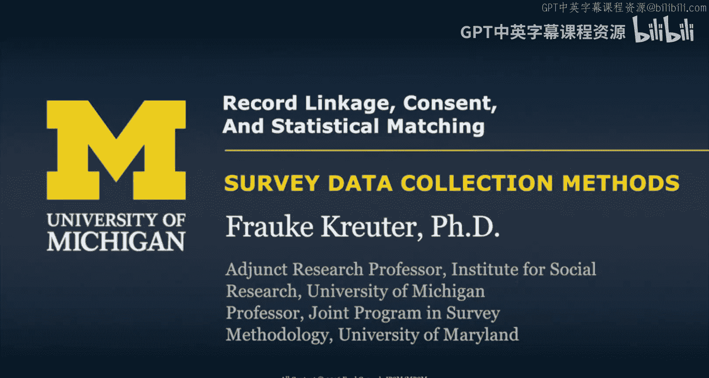
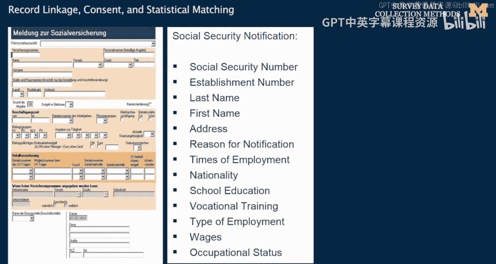
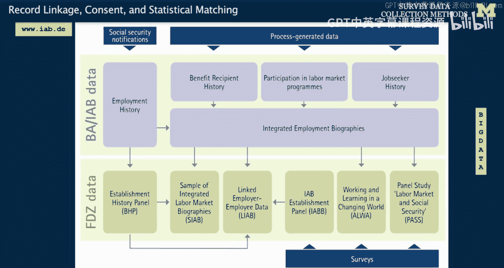
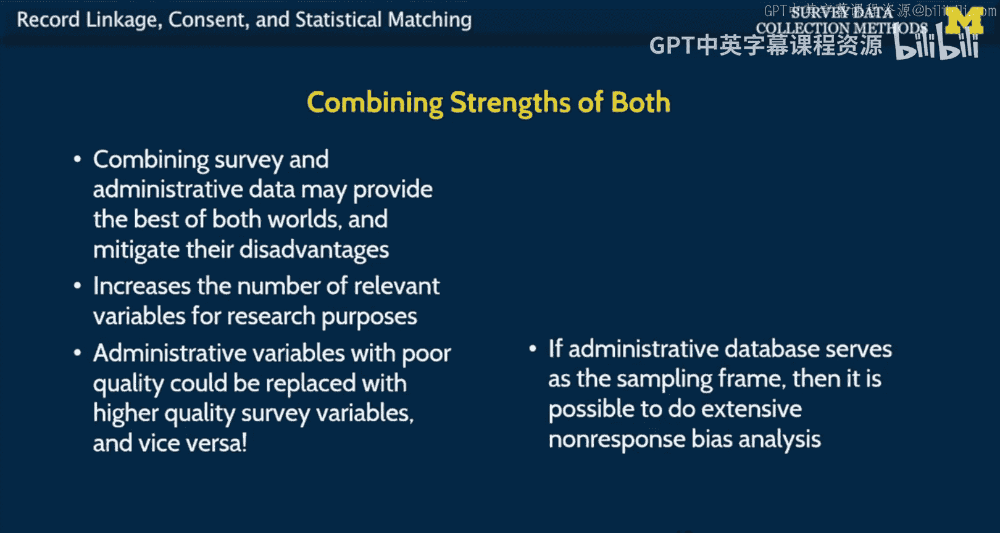

# 密歇根大学《调查数据收集和分析（2-6：方法、社调问卷设计、抽样、缺失数据、分析）｜Survey Data Collection and Analytics》 p35 34_4.2.1 记录链接统计问题.zh_en -BV1fw4m1e7Zh_p35-

Hi， welcome。My name is Froca Crota。I'm also professor in the jointin program and Sur methodologyology here at the University of Maryland。

And affiliated with the University of Michigan。I will provide to you this segment on record linkage consent and statistical matching some of you might have seen me over in our questionnaireary design course or in the introductory course for this specialization that we have the material I present here is draws somewhat on material presented by Stephen Binda。

 who is at the Bdesbank in Germany， Manfred Anthony and Alexandra Schmer at the Institute for Employ Research in Joe Saaka who was there as well but is now at the University of Manchester。

The Germans are pretty heavily engaged in record linkage and so many of the European countries in particular。

 those in northern Europe and that's why a lot of research has taken place there that we want to share with you here。

So briefly， the segment will introduce to you what we try to link and why this first segment in particular will touch on differences between administrative and survey data and discuss the advantages and disadvantages。

The next segment piece will touch on linkage techniques， and we will also discuss informed consent。

 which is for many linkage endeavors pretty key。So。Why not just use survey data。

 why even think of using other data sources when you collect data？The advantages of survey data。

 they are specifically designed for your research purpose and they have been scrutinized by the total survey framework that you have been made familiar with through the specialization so far。

And survey data are particularly advantageous and you know there aren't that many alternatives right now to give you subjective information on behaviors。

 attitudes and so on now that's different for objective information on behavior。

 think of tracking someone exercises or other elements。

 and so that already shows you one of the disadvantages。

 it's often hard to report correctly what has happened in the past just to remember certain behaviors and。

All of these memory and recall errors will be discussed in questionary design if you haven't taken that already。

😊，Now another disadvantage of survey data can be nonres you've heard about this at length in this class。

 this can be true either on the unit level case or on the item level case and in panel surveys。

 which we call panel attrition。When non responses happens to them。

There's also a disadvantage that surveys can only be so long。

 you know you don't want to have a six hour interview and go through everything that happens in the past of a respondent。

 for example， they are labor market history for someone who is in an advanced age and usually collecting additional information can encounter high costs so instead the idea is to you know if you think of the different data sources for simplification I've shown you here only three survey data experimental data and administrative data that as a strong incentive to think about how can these data sources be linked so that we get the opt amount of information。

So let's talk about that what are administrative data。

 I mean experiments I take it many of you are familiar with。

 but we focus on administrative data since linkage here has become quite prominent。

We call administrative data and data that are collected during the process of some administrative purposes。

You can think of these data being generated by government agencies in the public and private sector。

😊，They have records of their services that they deliver in anything that they process。 So。

 for example， Social Security records， unemployment records through active labor market。

Programs or benefit programs， records on students in classrooms。

 tax and income records or you know information collected from birth and death certificates。

 all of these would be digitally available just because a service or some other administrative process has taken place and there's a big push in particular in the United States。

 but other countries too to make more use of these data to acquire access and if needed linkednk them to survey data。

Here's a screenshot of the Social Security form that employers have to fill out when someone takes part and this is of course a test of your German or not。

 these are the fields that you see here capturing name， address information。

 resources for the notification a little bit on the educational background and obviously type of employment and wages now it's good to look at these variables here for a moment and think of well。

 if I administer the social security program， which of these variables are really important and you probably quickly will come to the realization that wage information and the beginning and end date of an employment spell would be quite important if this derives later on how much pension you get or how much unemployment insurance payment。

I'll come back to this piece in a moment。These particular administrative data that I've just shown you are part of a larger data system that the Institute for Employ Research in short IAB you see the website information in the upper left corner is collecting theyre creating out of all these you information the social security notification but also other process generated data。

 something that they call integrated employment biographies so there's a lot of linkage of administrative data sources going on there and then there are a whole bunch of surveys that the IOB does and both pieces can be all linked together so if you want to learn more about the big data sources available over there or you do labor market research that might be an interesting source。

Moving away from this example to something more general。

 the primary use of administrative data is not research。

 so this is a very important difference between administrative data and survey data that you should have in mind。

The administrative data is also usually collected for a population。

 but that population can be different from traditional survey populations right so let's say you get administrative data on Social Security notifications in Germany。

 you wouldn't have anyone who is self employedloyed。

Let's assume you get health records from a certain medical provider or a health insurance organization。

 they will have people who enroll with that particular organization。

So person diagnosed with particular illnesses that are available through a cancer register， great。

 you know， you have all of them， but you only have those that have cancer and not the ones that don't。

So while these are populations and it's advertised， they use。

 it could be different than what you need for your research question。

Another piece that you should keep in mind is that you cannot add specific measures to your administrative data on the survey。

 you can decide this should go on， the shouldn't that is not the case with administrative data。

 but for what they have， they are often available longitudinally。Now。

 the advantage of using these data is they are relatively easy and inexpensive to attain and then use there is an upfront cost I'll talk about in a moment。

 but。Those you have with survey data too so you save resources from data collection。

 that's why we put this here as part of the course。And sometimes in particular。

 when it's sort of behavioral records， they can be more accurate than survey data and have less memory issues for getting social desirability stuff we talk about over in the questionnaire design course。

And as I mentioned before， livelong information could be available。

Now what's also cool is they often contain very large sample sizes that would be way too costly to achieve in surveys and because of that you can draw down to you know interesting subsets of the population and that can really enhance the kind of research you do。

If you're lucky， these databases are regularly updated and sometimes even continuously and there are quality control checks in place because that needs to be done for administering a certain program。

Again， you know nearly 100% coverage of the population of interest for the programs， but of course。

 not necessarily for your research question， as we discussed before。

 but it does include individuals that might not respond to surveys so some combination of these data sources can help mitigate the nonresponse problem。

The disadvantage of using administrative data。Is that they are often not sufficient。

 as I said to answer all of the research questions， concepts might differ。

 reference dates might differ， and you don't have control over all the content in there。

 so you might need additional information and hence our pledge for linking data sources。Also。

 these data are not per say， perfect。They can have very poor quality on non program relevant variables remember how a few minutes ago I just said that the income and start intake of unemployment information is probably pretty good。

 but。In the German Social Security records， for example， the education variables are not very good。

 they're not updated， they're not program relevant。Also， variant can change over time。

 you know definitions of certain diseases or codes with which your correlation shouldn say definition。

 but job classifications might change。And you may or may not know about this because metadata and description on the background of the data collection process is often limited。

That paired with the large size and the significant processing costs。

 which you'll talk about in a moment， as well as the strong data protection laws that require often informed consent by the respondents。

 it's not without challenges and in particular on the last two points will inform you in the next two segments so that you learn a little bit more what's coming your way if you plan on using such data。

But let me close out here with a pledge for combining the strengths of both of the data sources。

Combining survey and administrative data may provide you with the best of two worlds。

 you have the advantages of survey data and defining the population and the variables。

 and you have the often better and fine grain measurement information on nonreents and the larger population on the other side。

You could impede respectively depending on which data sources you think the variables are of higher quality。

 and then of course you can use the whole thing for methodological research to examine。

Weakness is in one or the other data source。

