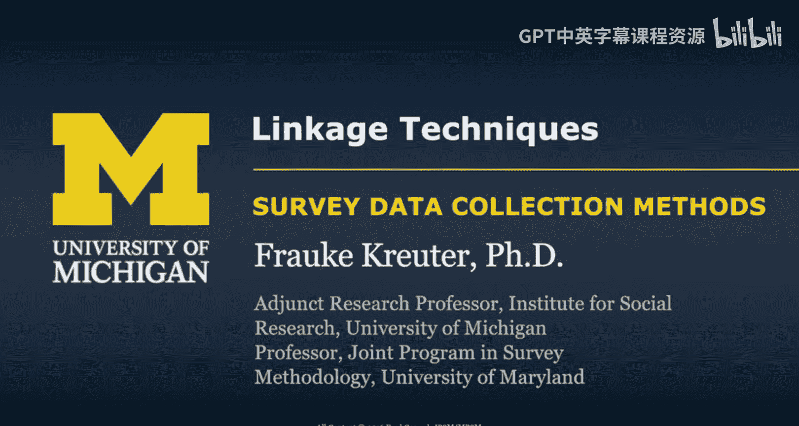
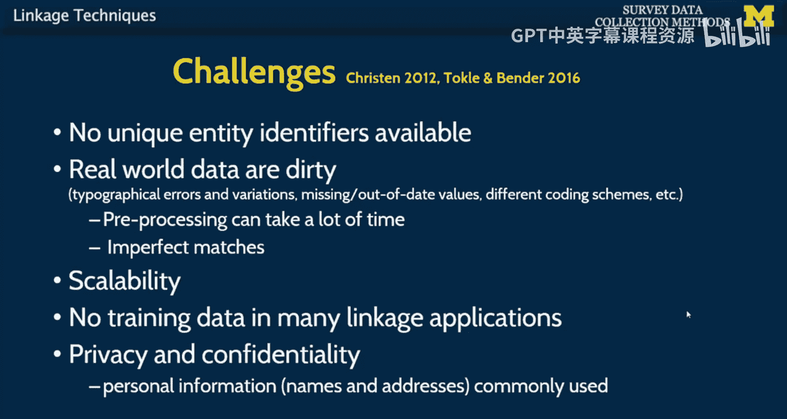
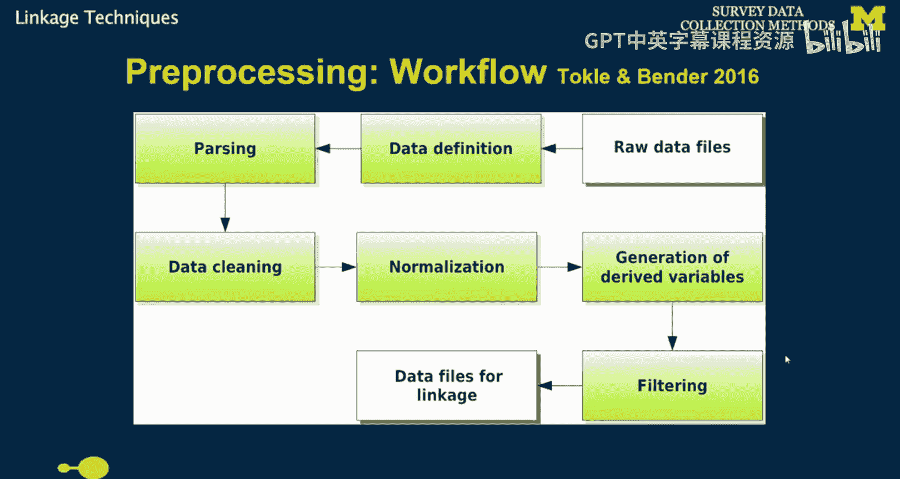
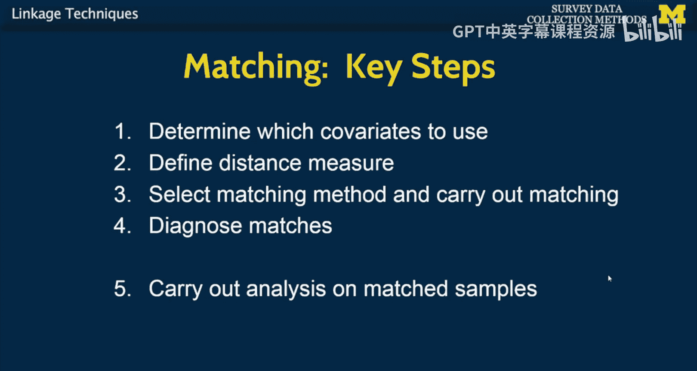
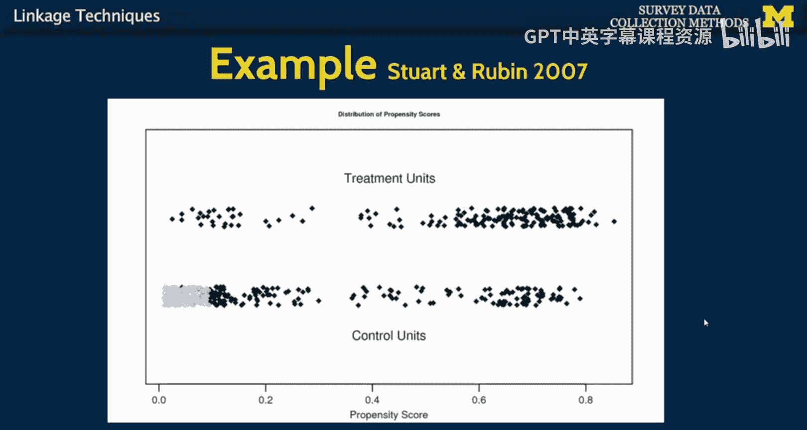

# 密歇根大学《调查数据收集和分析（2-6：方法、社调问卷设计、抽样、缺失数据、分析）｜Survey Data Collection and Analytics》 p36 35_4.2.2 记录链接技术.zh_en -BV1fw4m1e7Zh_p36-

So let's talk about different linkage techniques that we have at our disposal when you look into the literature for record linkage。

 you will see that， you know， it happens。Increasingly common in the social。

 but in particular in the health sciences。The basic idea of linkage is really to identify common variables in both data sets so yeah that's a starting point often。

And the hope that you can combine records to each other on these matching variables。

What is interesting， the way I describe it right now actually relates to what we call exact matching and probabilistic matching and less so to statistical matching or data fusion。

Why is that well the first two techniques， exact matching and probabilistic matching。

 they assume that the linked records belong to the same unit so you know ideally you would see a record in data set one from Froca Kta one I'm not going to tell you and some other identifying variable or maybe my first name and last name combined is already unique enough that you would in the second data set find that case as well。

 right。嗯。If it's the Social Security number that you know presumably is unique for a particular person and you couldn't find that in both data sets so that would be an exact matching sometimes if you don't have as good of an identifier you can't do that and so you need to move to probabilistic matching。

Statistical matching is a totally different game。 The key difference here is that you try to find similar cases。

 even so these are completely different data sets。 So I'm going to talk in more detail about these。

 but I wanted to make that distinction clear so that， you know， the the broader。

Difference between these techniques as we visitit this year。So on an exact linkage， as we said。

 the link is established based on a single unique identifier。

Although you could imagine creating a single unique identifier out of several variables right so first let not them birthday birthplace。

😊，That together could be a single unique identifier for a case easier would be a social Security number or an establishment number。

 so this depends very much on what kind of record system you have and what you were able to ask in your survey if you were to link administrative data with survey data。

The purely deterministic approach requires an exact one to one match where you have one case here and one case there you combine the two。

The key here is if you know， eventually you want to link to a certain administrative database。🤢。

That you request that particular identifier from the respondent prior to linkage。

 so it's good to plan your whole data collection at once。

And make sure you have the proper identifying variables for each data set in place as you go into this。

Now this also assumes that youve record the identifier without error if I misremember my birthday or if you have a telephone interview and you know you。

Mi here my name and write it down a different way than it will be very hard to find me in the database and you will need to move to something that's more probabilistic or predictive linkage Now the term I shall say that the term predictive linkage is not necessarily a fixed term like probabilistic record linkages but in the latter sort of coming more out of computer science using techniques like machine learning or techniques from database and informational retrieval systems they are basically techniques that are used for prediction that's why I used as kind of labeling here。

But let me talk first about probabilistic record linkage。

 this is something that Felonji and Santa in 1969 discussed in a paper widely cited and for anyone who works on record linkage they you know did a lot of work within the statistical agencies in Canada and here linking administrative records of all sorts。

What happens when you do this kind of probabilistic linkage。

 you use a set of available attributes for linking that could be personal information。nameames。

 addresses， date of birth and so on and then you calculate match weight for attributes so this might be a little bit confusing because I just said earlier on the exact link as you create a unique key out of that string that's right right that will if we if I actually make a string out of the entire set of variables。

Which eventually then is unique here， the notion is more that， you know。

 you could link on names on addresses， on birth dates and each of them。

Should have a different weight because let's say if you have the correct name right and so so you assume every every one of these variables could have an error right so my name could be typed wrong。

 my birthday could be wrong the birthplace could be wrong， the errors could be wrong。

And so you wouldn't want all of them to go equally strongly into the probabilistic record linkage algorithm because you would assume well name change less likely to happen right whereas address changes maybe more so right so if I have the same name and birthday but two different addresses。

 then maybe the address shouldn't have as much weight or depending on what it is。

 maybe you have different decision going on here right but or you think okay well typo and name quite frequently but in the database I have address is always validated and so therefore the address is good then you might have a different rationale here so so you got to think ahead time what that might be you know what these。

wes for the particular variables and then eventually you sum over all of them and create a score in which you merge not going to go into the statistical details yet。

 that's not the right cause for this， but it gives you a sense of what's behind this technique。

And then likewise， on the predictive linkage you purchase。

 you know most of them sort of driven by machine learning techniques there are a lot of papers by Bill Winkler from the US Census Bureau that you can retrieve from the US Census Bureau website on using these techniques for various data linkage endeavors and as always in machine learning you can use both techniques。

 supervised learning and unsupervised learning， supervised learning basically being like regression techniques。

 you predict something using training data so you have a subset of your data where you already had a link and you know okay these really are true matches and then you try to you know。

L from these training data， what a good predictive variable for these matches and use those。

And then likewise， in supervised learnings a little different。

 those are usually clustering techniques or some graph based techniques。

See that a little less often used， but any of that sort of gets at the notion that you want to link cases that have a very high probability to be the same unit in both data sources。

 or if you have multiple sources across the multiple data sources。

Now the challenges with these techniques is。That if there are no unique identifier available。

 then this can be quite difficult， but more likely the real world are dirty， as I said before。

In the the fellowology center approach， even， I mean， you want to assign different weights even。

If we are not dealing with dirty0 data because you know it might be more important to match on name and birthday and not on address because address changes right so this is not counting for typos。

 but if you have you know all of this is sort of filled with typographical errors and missing values or out of date values and stuff like that。

It might be necessary to have a lot of preproces so let's take my name again right so sometimes you will see Froku Kta comma PhD。

 sometimes you will see Dr。 Froku Kta sometimes you will see Profess Dr。

 Froku Kta because the Germans like to spell out the full titling。

And so if you were to take that string that's in your dataset and match it with the same string that only has Foccardta。

 you wouldn't even see that this is the same case right so they would need to be passing going on where you drop the professor。

 you drop the doctor and then you merge these two pieces right so theres a lot of work going on ahead of time don't underestimate that when you try to have create a record linkage project。

Also， they could be imperfect matches， obviously as a function of these sturdy data。

Now the other piece that's problematic is if you've really tried to find a one to one match right that this doesn't scale right because you like just think about it。

 you take a case and then you search in the the other database for across everybody is there an available case this is computationally very。

 very effort for and can very quickly result into you know exceeding any computational power you have so there are technique out there that sort of reduce any duplicates before in the data that use techniques like blocking that you only search within a certain area so if you decide okay city is the knows important variable and you would just search within。

Washing DC rather than everybody and stuff like that so there are techniques to make that computational task a little easier something to take a look at there are textbooks out there like the one from Kristen from 2012 published with Springer and then an Inter chapter in the Taylor and Francis Eded volume from Ian Foster and others that's coming out in 2016 that Josh Toco and Jeff Bennderva。

 they give you a good sense of this。We'll put the links up on the cururra website when。

The book is out and obviously something interesting for you to look at。Also。

 there couldn't be a problem because sometimes you don't have training data in many linkage applications。

 so then some of these techniques don't even work。And another challenge that you have to deal with is this issue of privacy and confidentiality because personal information names and addresses are commonly used。

Now on the ladder， there's a lot of exciting research going on。

R National over at the University of Dusburg and currently in London with the European Social Survey and that ins USS is housed in。

 they are working on research that's using private see preserving record linkage so that you don't even need to use that information or crypted prior so that it can be more easily used for these record linkage endeavores。

 and then of course the issue of consent which is the next piece we're going to talk about。Now。

 circling back to the preproing， just talking to Step and Benda。

 they had a workflow schematic here that the German record link kitchen center sort of used to portray all the work that needs to be done。

You can basically think of having a raw data file you know where you have to first you know think about and capture any data definition and be clear what these are you know you might have birth dates being you know month month day day year year in one data and in the other data because it comes from Europe you have dayday month month and then a year or even a year with four digits and of course all of that needs to be common and so you need to learn about these data definitions ahead of time then there's the passing I already gave that example with the names so extensive data cleaning that happens and in some instances you also need to normalize which means that you break up a data table that has a lot of redundancy into separate data table so for example if you have a survey data that has you know one record for your household member and then additional record for the household information often it would be helpful。

to have these tables spread out in a household level file and the person level file and then you might match address information or geocode positions to the household level file because then you have just one row and not duplicated rows for each of these geocodes much faster or addresses for that matter much faster record linkage possible that way and then for the person information you just keep that separate person level file so that would be the step of normalization。

You might have new variables that you derive， you know， because you take certain variables。

 combine them or what have you。You might decide that you only link on a subset that could be filtering going on and then of course the data linkage itself。

 so this， you know we talked about resources saving through record linkage。

 but this certainly or these are all elements that add to additional resources and time program and time that you might need in order to do this。

There software that can help you with this on the left here you see a bunch of packages the RP record linkage is probably popular but the others too so you can you know look at them see what speaks to you and fits your purpose is the best I'm most familiar with the mergech toolbox MTV which is a Java application developed in the German Record linkage Center the last version updates from November 2012 this is free for anyone who does research unfortunately not for。

There are non academic purposes， but you can find information on their website and you can get counseling on how to use that software by the German Record Liage Center。

Now， a very different technique， as I promised， would be statistical matching。

Here you combine distinct data sources。 Okay， so remember earlier。

 we said we have the same cases and they are linked together。

 right here we have a situation where we have。Disjoint dataset sets。And。

You're try to find good fitting cases across the two dataset sets。here records are linked。

If they are similar based on similarity measures but。How will you create these similarity measures？

Up to you， right very a lot of different techniques available nearest neighbor would be one regression based techniques。

Another one， many use propensity score matching。There is a whole set of literature that you wouldn't even see when you look at the record linkage literature。

 but that you can read up on if you look closely at the causal inference literature and anything that has to do with generalization of experimental results。

 So think about it， you have you know， an experiment that。

NIH National Institute of Health so someone else does and it's a small set of cases and and or even more so actually more common you have some you know。

Some cases that have undergone， you know a treatment but weren't randomized and you would like to see well what what would have happened had these people not undergone this treatment and so you're looking for a control group to compare them to so you're looking for cases who are just like the ones that。

ha been exposed to a certain training have been exposed to a labor market participation program or something like that and you then later on want to analyze what is the effect between those two so that would be a typical application for these statistical matching techniques and as I said there is a ton of literature out there。

The steps when you do that are also pretty straightforward。

 you know you have to determine a set of covariate you use。You define a distance measure。

 you select a matching method and carry it out， and then most importantly you diagnose the quality of your matches often graphically but other statistical techniques out there too。

 and then you carry out the analysis on the match samples。

He has just one visual graph that sort of shows this treatment and control unit and in gray on the left side you see all the cases for which no matches were found so later on in this analysis that Elizabeth Stewart and Don Rubin did in this paper they would do this analysis only for the cases that had。

 treatment and control units that could be matched to each other。

Any of the papers by Elizabeth Stewart at Johns Hopkins University are very accessible on this topic。

 there's a couple of overview papers that you can see on her website and are highly recommend if you want to dive into that particular topic。

