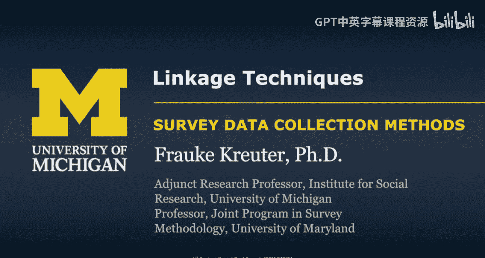
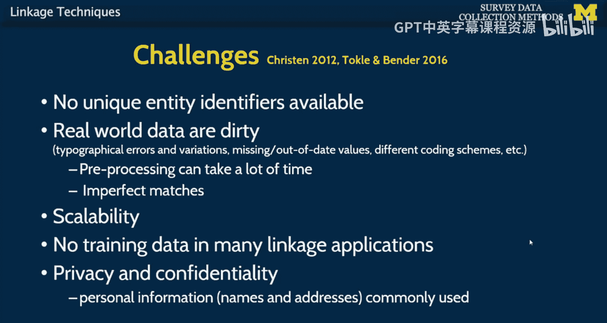
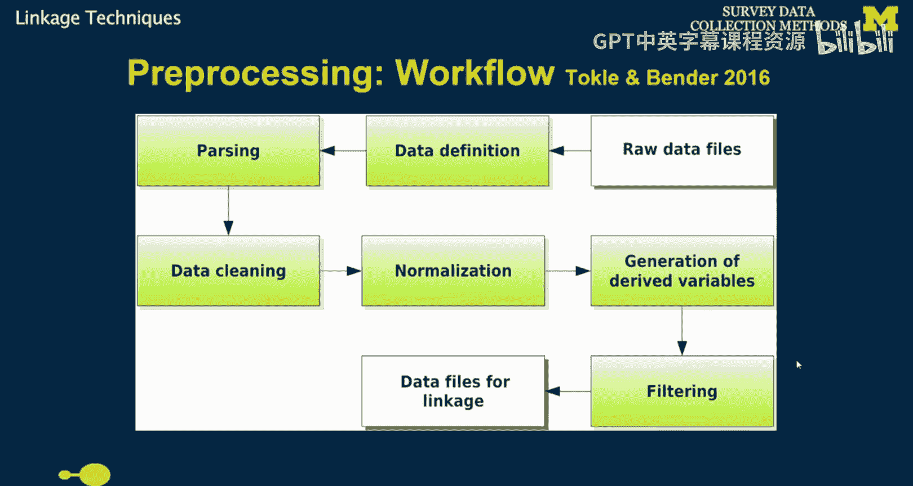
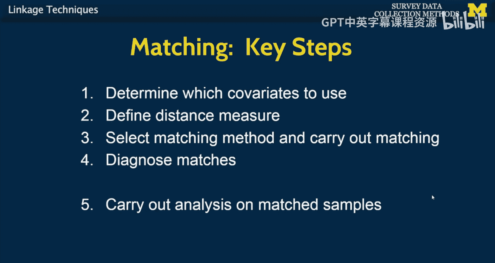
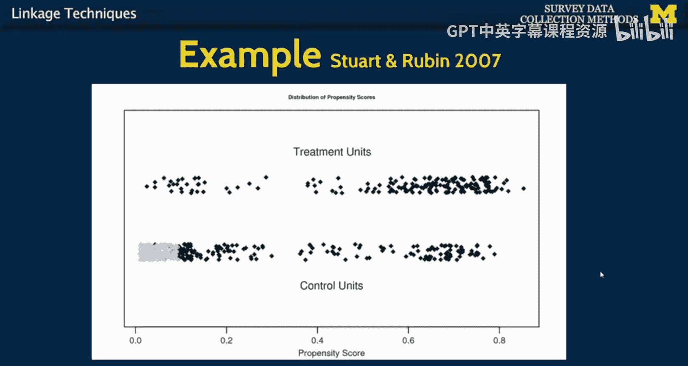

# 调查数据收集与分析：4.2.2：记录链接技术 📊

在本节中，我们将学习如何将不同来源的数据集连接起来，这一过程称为记录链接。我们将探讨几种主要的链接技术，了解它们的工作原理、适用场景以及面临的挑战。

记录链接的核心目标是识别并合并来自不同数据源、但属于同一实体的记录。这在社会科学，尤其是健康科学领域正变得越来越普遍。

## 精确匹配 🔍

上一节我们介绍了记录链接的基本概念，本节中我们首先来看看**精确匹配**。

精确匹配基于一个或多个能**唯一标识**某个实体的变量来建立链接。这个标识符可以是一个单独的变量（如社会保障号），也可以由多个变量组合而成（如姓名、出生日期和出生地）。

其核心思想是**确定性**的：在数据集A中找到一个记录，通过其唯一标识符，在数据集B中找到**完全对应**的同一个记录。公式可以表示为：
`匹配成功 IF 数据集A.标识符 == 数据集B.标识符`

以下是实施精确匹配的关键点：
*   **规划先行**：若计划将调查数据与行政数据链接，必须在调查阶段就向受访者收集该行政数据库所需的唯一标识符。
*   **数据质量**：此方法假设标识符的记录**完全准确无误**。任何拼写错误、记忆偏差或格式不一致都可能导致匹配失败。

如果无法获得高质量的唯一标识符，我们就需要转向其他技术。

## 概率匹配与预测性匹配 🎲

当缺乏完美的唯一标识符时，我们可以使用**概率匹配**或**预测性匹配**。这两种技术仍然旨在链接**同一实体**在不同数据集中的记录，但允许匹配变量存在误差。

**概率匹配**由Fellegi和Sunter于1969年提出，被统计机构广泛使用。其思路是使用一组可能包含错误的个人属性（如姓名、地址、出生日期）进行链接。

以下是概率匹配的基本步骤：
1.  **为属性分配权重**：根据每个变量在匹配中的可靠性和重要性赋予不同权重。例如，姓名变更的可能性低于地址变更，因此姓名的匹配权重可能更高。
2.  **计算匹配分数**：对每个候选匹配对，根据其各个属性的匹配情况（是否一致）和相应权重，计算一个总分。
3.  **基于分数决策**：设定一个阈值，总分超过该阈值的记录对被判定为匹配。

**预测性匹配**则更多地借鉴计算机科学领域的技术，如机器学习和信息检索。它同样旨在预测两条记录是否指向同一实体。

预测性匹配主要使用两类机器学习方法：
*   **监督学习**：使用已有明确匹配结果的训练数据（即已知哪些是“真匹配”），训练一个模型来预测新记录的匹配情况。这类似于回归技术。
*   **无监督学习**：使用聚类或基于图的技术，在没有预先标记的数据中发现可能匹配的记录组。

## 链接技术面临的挑战 ⚠️

无论采用哪种链接技术，在实际操作中都会面临一系列挑战。

以下是实施记录链接时常见的困难：
*   **数据“脏乱”**：现实数据常包含拼写错误、缺失值、过时信息或格式不一致（如姓名的不同书写格式：“Dr. Smith” vs “Smith, John”）。这需要进行大量的**数据预处理**，如清洗、标准化和解析。
*   **计算复杂度**：进行穷举式的一对一搜索（将数据集A的每条记录与数据集B的所有记录比对）计算量极大。通常需要使用**分块**等技术来缩小搜索范围，例如只在同一城市内进行匹配。
*   **缺乏训练数据**：对于许多链接应用，可能没有已知的匹配结果作为训练数据，这使得某些监督学习方法无法使用。
*   **隐私与保密**：链接常涉及姓名、地址等敏感个人信息，引发隐私担忧。当前有研究致力于开发**隐私保护记录链接**技术，例如对标识符进行加密后再链接。
*   **知情同意**：在收集用于链接的数据时，必须获得受访者的知情同意，这是下一节将讨论的内容。

## 数据预处理工作流 🔄

鉴于数据质量对链接成功至关重要，一个结构化的预处理工作流非常必要。德国记录链接中心提出了一个典型的流程。

以下是记录链接前典型的数据预处理步骤：
1.  **理解数据定义**：明确两个数据集中变量的含义、格式和编码方式（如日期格式是MM/DD/YYYY还是DD/MM/YYYY）。
2.  **数据清洗与解析**：修正错误、处理缺失值，并将复杂字段（如包含头衔的姓名）解析为标准格式。
3.  **数据规范化**：将数据表重组以减少冗余。例如，将包含家庭成员信息和家庭地址的调查数据，拆分为“家庭级”文件和“个人级”文件，分别进行链接，以提高效率。
4.  **衍生新变量**：根据需要，通过组合或转换现有变量创建新的链接变量。
5.  **数据过滤**：可能只选择数据集的一个子集进行链接。
6.  **执行链接**：应用选定的链接算法。

## 统计匹配：一种不同的思路 🤝

前面讨论的技术都假设链接的是同一实体的记录。现在，我们来看一种完全不同的技术：**统计匹配**（或称数据融合）。

统计匹配用于合并**完全不同**的数据集，其中的记录**不属于同一实体**。其目标是找到两个数据集中**相似**的个案，然后将它们的信息“融合”起来。

这种方法在因果推断和实验结果的泛化中很常见。例如，有一个接受过某种培训的小群体（处理组），需要找到一个与之特征相似但未接受培训的群体（控制组）进行比较，以评估培训效果。

实施统计匹配通常遵循以下步骤：
1.  **确定协变量**：选择一组用于衡量相似性的变量。
2.  **定义距离度量**：确定如何计算两个记录之间的“距离”或相似度。
3.  **选择匹配方法**：常见方法包括最近邻匹配、回归匹配或倾向得分匹配。
4.  **执行匹配**：为处理组的每个个案，在控制组中找到一个或多个最相似的个案。
5.  **诊断匹配质量**：评估匹配后的两组在协变量上是否达到了良好的平衡（通常通过图形或统计检验）。
6.  **分析匹配样本**：在匹配好的样本上进行后续分析。

> 可视化图表常被用来展示匹配效果，例如显示每个处理组个案找到了哪个控制组个案作为匹配，以及哪些个案没有找到合适的匹配而被排除在后续分析之外。

## 软件工具与资源 🛠️

有多种软件工具可以帮助实现记录链接：
*   **R语言**：`RecordLinkage` 等软件包。
*   **Merge ToolBox (MTB)**：德国记录链接中心开发的Java应用程序，适用于学术研究。
*   其他专有或开源软件。

对于统计匹配，可以查阅因果推断和倾向得分匹配相关的大量文献，Elizabeth Stewart等人的综述论文是很好的入门资料。

## 总结 📝

本节课中我们一起学习了记录链接的几种关键技术。我们首先介绍了基于唯一标识符的**精确匹配**。随后，我们探讨了当数据存在误差时使用的**概率匹配**和**预测性匹配**，并了解了它们面临的共同挑战，如数据质量、计算复杂度和隐私问题。接着，我们详细说明了链接前必不可少的**数据预处理工作流**。最后，我们学习了目的完全不同的**统计匹配**技术，它用于融合不同数据集中的相似个案，常见于因果效应评估。理解这些技术的区别和适用场景，对于成功整合多源数据至关重要。