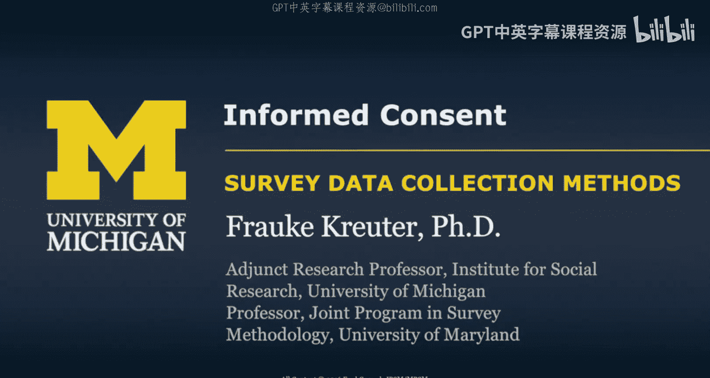
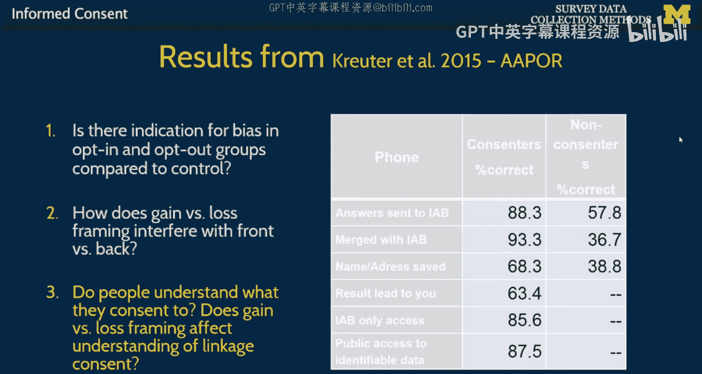
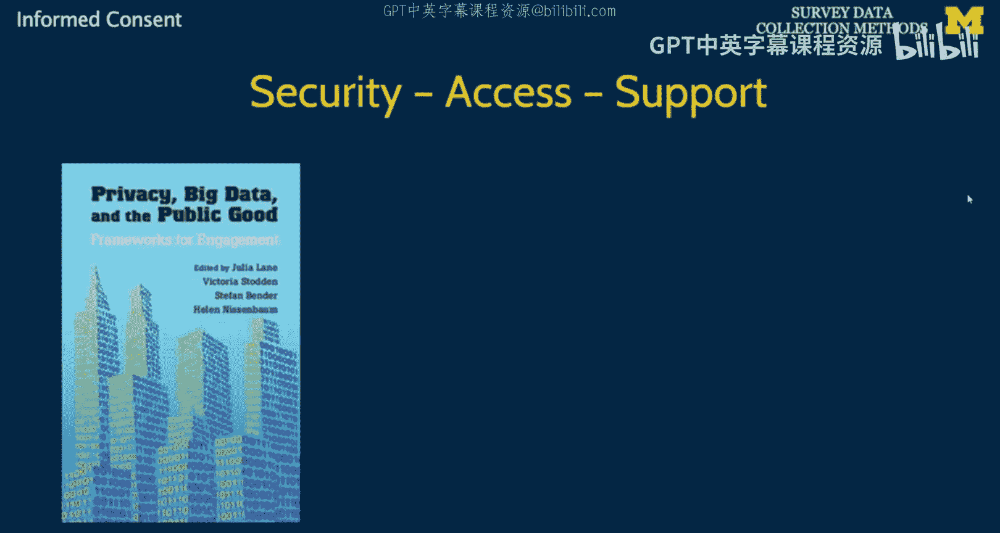
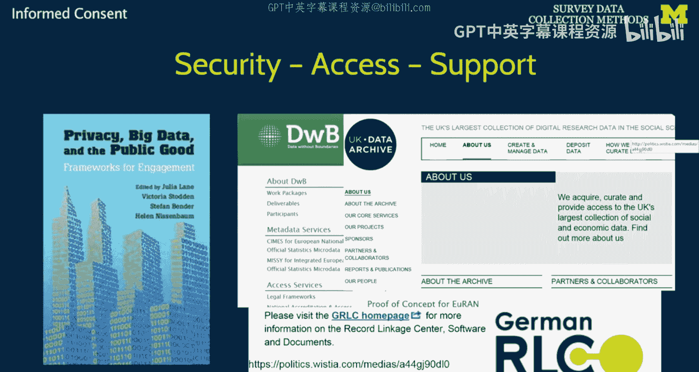
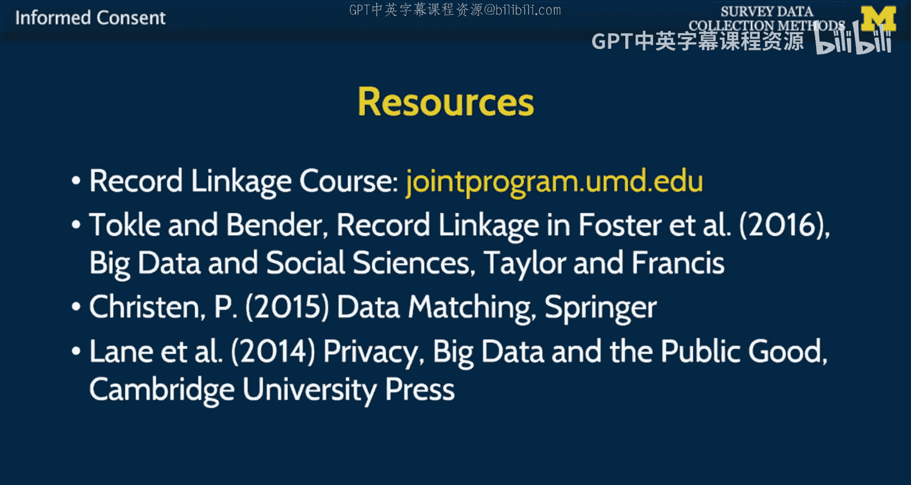

# 密歇根大学《调查数据收集和分析（2-6：方法、社调问卷设计、抽样、缺失数据、分析）｜Survey Data Collection and Analytics》 p37 36_4.2.3 记录链接知情同意与伦理问题.zh_en -BV1fw4m1e7Zh_p37-

So the last piece that's very relevant to data collection is how to get informed consent so that you can do。

The record linkage that you've planned to do。Inform consent is。

Still largely believed to be an effective means of representing individuals as autonomous decision makers。

 so you go out and you ask the respondent or you if they would be okay with you using their administrative data or linking information about them from various data sources。

Now， this is still standard， at least in many countries， but countries do I mean。

 Germany for example， requires by law that respondents are asked to link this data。

But countries vary in their policies and they vary across domains。

 so it's by far not the case that everywhere you need to ask for consent。

 so it's important that you check and see what needs to be done。

 but remember check that before you collect your survey data because you would need to get that information from the respondent。

From a data collector point of view， it's also important that you keep in mind that there could be selectivities on the consent request。

 So just like you deal with selectivities when it comes to nonres， right。

 you could have consent rates that vary。Across， you know。

 topics or by respondent characteristics and can introduce bias。 So， you know， for one。

 you want to get the rates high， but also， you want to make sure that you don't have。

In the combined data set， a very selective crowd。There have been quite a few studies here I'm not going to set them all。

 but you know the papers we have on this topic have the full references and the like related to age race。

 ethnicity， gender education， all these characteristics have shown to introduce some selectivity and consent。

Likewise， you could have differential item missing data rates interviewer characteristic。

 deter or contributing to whether consent is given or not and outcomes from a prior wave。

 so all of these things can lead to cell activities。And。

You know for a particular survey that you want to do it's good to you know scan that literature and see which of these things might apply to you what you should have in mind is this conceptual pathway to linkage right so remember you learned about sampling frames of which we take a sample。

Now there's nonrespon bias because from that sample。

 some will respond to your service and some don't if you now ask for linkage consent。

 some will consent and some won't and to the extent that that is selective。

 it's just like nonres bias， right？On the other hand。

 if you have data that can be linked to variables that you have on the frame。

 this is a very nice way to look at measurement bias in conjunction。

 so you want to evaluate or ideally set yourself up that you can evaluate these different error sources。

 maybe as part of that linkage process。I just want to give you a quick glimpse in what other data collection features。

 something you have direct control over， so unlike interviews you might have control over。

 but unlike all the respondent characteristics that I mentioned on the previous slide。

 there are data collection features that affect or can affect consent and that you have control over。

One is opt in versus opt out wording， gain loss framing is another。

 so two different ways of wording a question and then where you place that linkage consent question。

So with respect to opt in and opt out wording， there's evidence from behavioral economics and psychology that the default option always has a strong effect。

 Okay， so Taylor and Sunstein have a very popular book out on this topic and。Schwartz wrote to this。

 many others said that basically that if the default is that you opt in and the default is opt out that that is basically where most people fall into right？

Issuing a conscious act like having to consent， according to this theory here lead to lower consent rates then。

Informing the respondent that it will be linked and allowing them the option to opt out， right？

We have seen some strong effects in the languageage request with research done by the US Census Bureau from Nancy Page and John Pascal。

However， you know， it is not always clear if the behavior really matches the intentions and so there's some interest literature to that respect as well。

 and of course their concerns about bias in addition to the meA rates。

Now the gain loss framing is another way of formulating a request that can have an effect on the resulting rate。

 so most common is an emphasis on the benefit of the linkage so。

Research will benefit from you allowing us to link， for example。

 but turns out that in practice it actually doesn't work I mean one would think that helps but in practice it helps more to frame it in terms of a loss frame and why is that well if you look at the psychological and behavioral economics literature which are Kaneman and Tsky way way back when they did all these experiments showing that。

When faced with risky choices in making decisions that people can be affected by in terms of gains and losses。

 so they try to avoid losses more so than they try to see gains and the said in the survey context we have seen if you ask for a request for example。

 to participate to consent to be interviewed again in a panel study a research that Roger Trener and Z did。

In 2009 or then ask whether people would have allow their records to be linked to voting records or there so they answer we see that framing it as loss so the information you've given us so far is much less valuable if you don't allow us to think does increase the rates so that's another element that effects in the data collection how you are set up for linkage。

Most common is placing these linkage request questions in the back of a survey questionnaire and not in the front anecdotally this has always argued that there's a report build and people you know what the survey was about and things like that。

 but experiments show that theres a higher rate of consent when you ask these questions in the front we've done a series of these by now and that seems to hold up we have looked at the gain loss frame in action so'm showing you here some results that I presented in 2015 at the April conference and the paper will hopefully appear and is then accessible with the link through the website so questions of this particular research study was whether there's an indication for bias in the opt in and opt out groups compared to control groups this is again a study done with cases in Germany how。

A simple regression of income on age and gender， we do see some differences here between control group up in and out groups。

 so these are the regression lines that you see in this graph and if you have never done a regression in your life then don't be intimidated by this This is just the point being here that you can't assume that the wording doesn't have an effect on bias in our study the。

Case numbers were too small in the opt in group so we had have overlapping confidence in aC and can really talk about that difference。

 but know just illustrating that there could be a bias likewise if we think of gain loss framing we field it here in a phone survey。

 the sorry G F versus front back we field it in a phone survey。

 the consent question for a record linkage in the front and in the back of the survey and in a gain frame in a loss frame on the phone。

 the different frames did not make a big difference but you see almost a 10 percentage points difference between the placement this is on 1。

200 cases again from a survey done in Germany with selected from those social security administration records。

AndBut on the web survey with a similar population。

 we do see at least in the back of the survey a difference in the gain loss framing。

 so this is just illustrative， you know there's you know obviously growing research to this topic。

 but we just want to sensitize you that it does matter where and how you ask these questions。

What people understand and what they will answer and so to the last point on the understanding。

 we also in this particular study had a lot of debriefing questions and were wondering if people actually you know that that consent you know if they then if probed you know can correctly say what will happen with the data so the consenter column shows you the percent of people who who got the answer correct whether the data will be sent to IOB in which case the correct answer was yes and whether their data will be merge with the IOB answer here data the answer is yes。

 and most of them got that right but as you can see on the others they don't necessarily got it right in all instances and then clearly the non-con is you know of course there's a reverse coding going on here they will not be merged。

With you know with the data at the IAB but they still thought that is the case and got that wrong。

 so this is important again， just illustrative that it does matter if you ask qua linkage consent that you make sure people do understand if you do this for ethical reasons。

 but also that the way you ask can affect the consent rates and likely also consent bias。

Now there's a long very good discussion on whether consent should be asked at all in this edited volume has a lot of legal pieces on this so using big data and various data sources how they can be collected and combined and in particular the chapter by H Nissbaum was one of the editors on this book and is a very good read on this topic。

A couple of other resources here that we want to mention this is the website from the German Record Liage Center that we had before。

 there is the data Without Bound project going on in Europe that has a lot of interesting information to this topic and the UK data archive has also very interesting data sets by now but also research projects on this topic that it's worthwhile checking out and my favorite is they see the link down there。

 a little video clip for public outreach to take away some of the field that people might have when the administrative data get accessed。

Finally， if you want to dive deeper， you know， in the joint program here in Maryland。

 we have a record linkage course that you can take online the chapters I mentioned in the。

In the edited volume by Helen Nisenbaum is in this book from Julialaine Privacy Big Data and the Public Good and the other authors you saw the title just there。

 I cited the book from Kris data matching which was published by Springer and then the big data and social science book has this overview chapter on Record linkage there are many more references in the slides that you。

We'll see a reference too on the Coseir website， but these are good starting points as you dive into this topic。

Thank you。