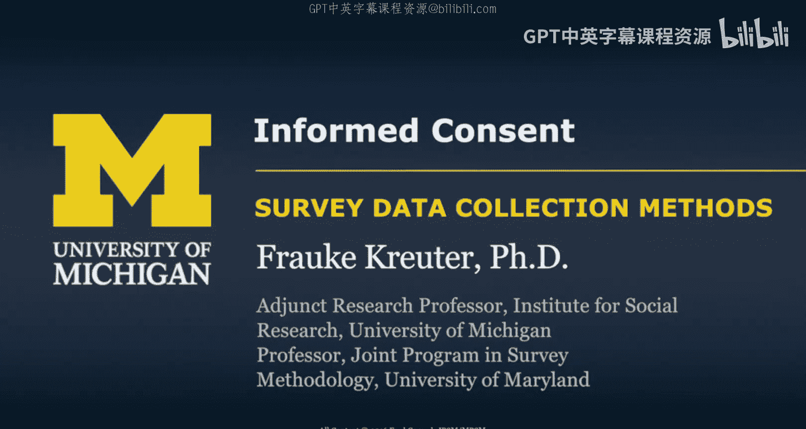
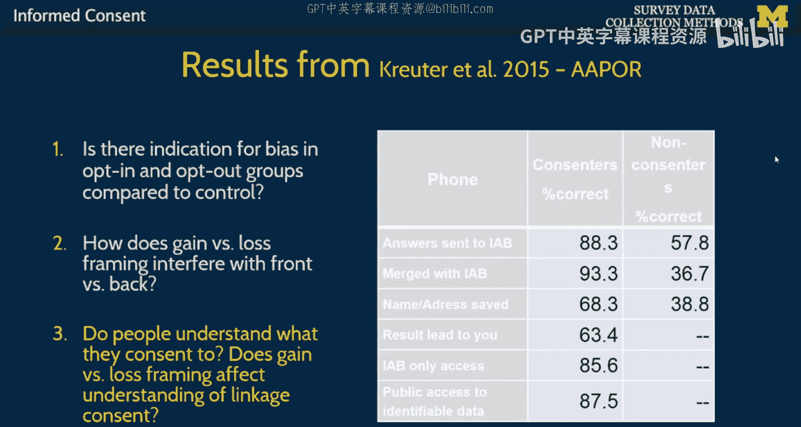
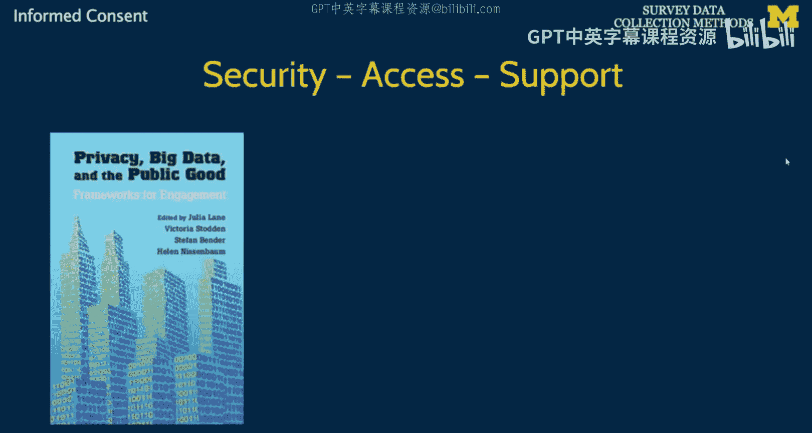
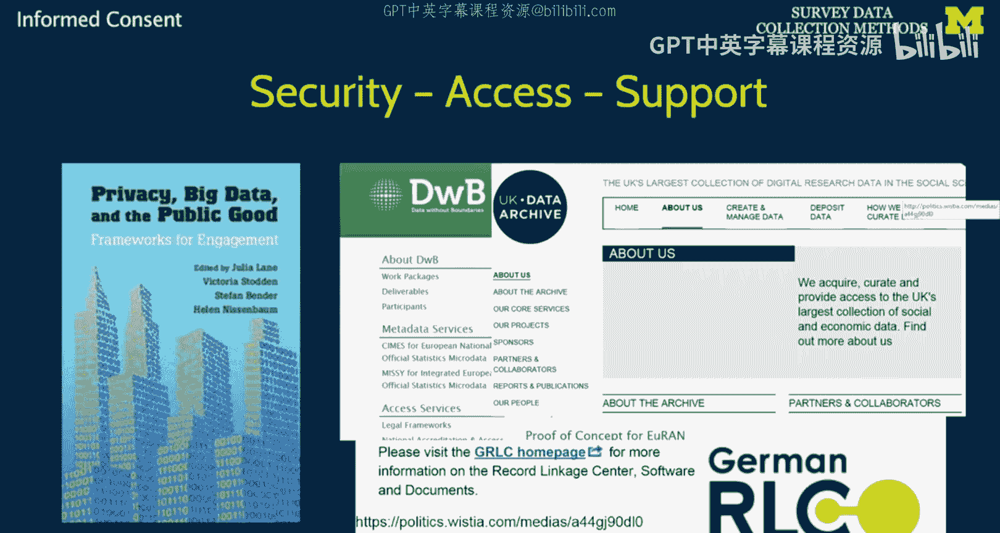
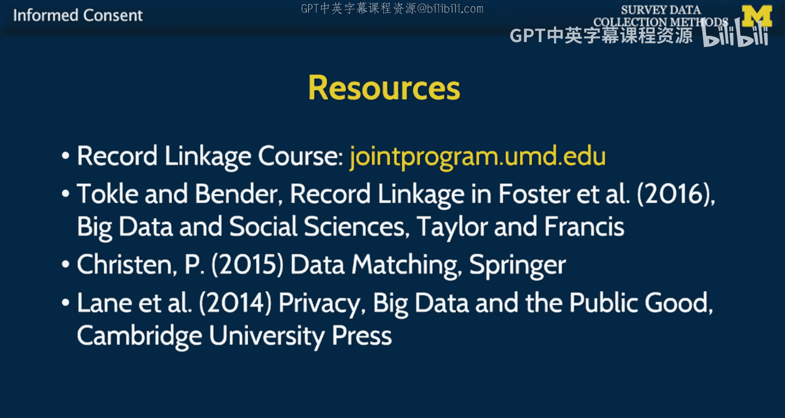

# 调查数据收集与分析：4.2.3：记录链接的知情同意与伦理问题 🔗

在本节课中，我们将要学习在调查数据收集中，如何获取知情同意以进行计划中的记录链接。我们将探讨知情同意的标准、选择性偏差的风险，以及数据收集方式（如提问措辞和问题位置）如何影响同意率与数据质量。

---

## 知情同意的标准与差异

上一节我们介绍了记录链接的技术方法，本节中我们来看看如何合法合规地获取链接数据的许可。知情同意目前仍被广泛认为是尊重个体自主决策权的有效手段。这意味着你需要询问受访者，是否同意你使用其行政数据或将来自不同数据源的信息进行链接。

目前这在许多国家仍是标准做法。例如，德国法律要求必须征得受访者同意才能链接数据。然而，各国的政策和不同领域的规定存在差异。并非所有地方都需要获取同意。因此，在收集调查数据前，核查当地的具体要求至关重要，因为你需要在调查中向受访者获取此信息。

---

## 同意请求中的选择性偏差

从数据收集者的角度来看，必须意识到同意请求可能存在选择性偏差。这与处理无回答偏差类似。同意率可能因调查主题或受访者特征（如年龄、种族、民族、性别、教育程度）的不同而波动，从而引入偏差。

因此，目标不仅是提高同意率，还要确保合并后的数据集不会因同意与否而变得过于选择性，即样本不具有代表性。研究表明，访员特征、前期调查的结果等因素也可能影响是否给予同意，所有这些都可能导致选择性偏差。

理解链接的概念路径有助于分析此问题。我们从一个抽样框中抽取样本，样本中会存在因无回答导致的偏差。如果在此基础上请求链接同意，部分人会同意，部分人会拒绝。若同意与否具有选择性，这就会产生类似无回答偏差的影响。

反之，如果你拥有可与抽样框变量链接的数据，这将是结合评估测量偏差的绝佳方式。理想情况下，你应能评估这些不同的误差来源，或许将其作为链接过程的一部分。

---

## 可控的数据收集特征

与受访者特征不同，某些数据收集特征会影响同意率，并且是你可以直接控制的。

以下是三个关键特征：

*   **选择加入 vs. 选择退出**：行为经济学和心理学证据表明，默认选项具有强大影响力。如果默认状态是“选择加入”（即需要主动同意），同意率通常低于默认状态为“选择退出”（即告知将进行链接，但允许其选择退出）的情况。美国人口普查局的研究显示了这种措辞的显著影响，但也需注意行为与意图可能不符，以及潜在的偏差问题。
*   **收益与损失框架**：另一种影响同意率的提问方式是“收益-损失框架”。最常见的是强调链接带来的收益（例如，“您允许链接将使研究受益”）。但实践表明，采用“损失框架”可能更有效。行为经济学指出，人们通常更倾向于避免损失而非获取收益。在调查情境中，研究表明，强调“如果您不允许链接，您已提供的信息价值将大打折扣”这类损失框架，能提高同意率。
*   **问题放置位置**：通常将链接同意问题放在问卷末尾而非开头，理由是此时已建立信任关系。但实验表明，将问题放在开头能获得更高的同意率。多项研究支持了这一结论。

---

## 实证研究示例

为了具体说明上述因素的影响，我们来看一些研究结果。一项在德国进行的研究，通过简单回归分析收入与年龄、性别的关系，比较了控制组、选择加入组和选择退出组之间的差异。

**公式示例：简单线性回归**
`收入 = β₀ + β₁ * 年龄 + β₂ * 性别 + ε`

研究发现，不同组别间的回归线存在差异，这表明提问措辞可能对数据偏差产生影响。尽管该研究中“选择加入”组的样本量较小，不足以得出确定性结论，但它警示了偏差存在的可能性。

另一项电话调查研究了“收益-损失框架”和“问题位置（前/后）”的影响。结果显示，不同框架在电话调查中差异不大，但问题放在开头比放在末尾的同意率高出近10个百分点。而在针对类似人群的网络调查中，至少在问卷末尾部分，“收益-损失框架”产生了明显差异。

这些例子说明，**如何提问**以及**在何处提问**至关重要，它们会影响人们的理解和回答。

---

## 对“理解”的评估

确保受访者真正理解同意内容同样重要。在一项特定研究中，通过事后追问发现，即使表示同意的人，也并非全部能正确说出其数据将被如何处理（例如，是否发送给特定机构并合并）。而未同意者中，也有部分人错误地认为其数据会被合并。

这强调了，出于伦理原因，你必须确保受访者真正理解同意内容。同时，提问方式不仅影响同意率，也可能影响同意偏差。

---

## 深入讨论与资源

关于是否应该征求同意，学界存在深入讨论。相关编辑著作中包含了许多法律层面的探讨，涉及如何使用大数据、整合多种数据源等。

以下是一些有价值的资源：

*   **德国记录链接中心**网站。
*   欧洲的“**Data Without Boundaries**”项目，包含大量相关信息。
*   **英国数据档案馆**，不仅提供有趣的数据集，也有相关研究项目。
*   一个用于**公众科普**的视频短片，有助于减轻人们对行政数据被访问的恐惧。

若想深入学习，可以参考以下资源：

*   马里兰联合项目提供的在线**记录链接课程**。
*   由**Julia Lane**等人编辑的书籍《*Privacy, Big Data, and the Public Good*》，其中包含**Helen Nissenbaum**的相关章节。
*   **Springer**出版的**Kris**所著《*Data Matching*》。
*   《*Big Data and Social Science*》一书中关于记录链接的概述章节。

课程网站上提供了更多参考文献，以上是入门此主题的良好起点。

---

## 总结

本节课中我们一起学习了记录链接中知情同意的关键要点。我们了解到知情同意的标准因国家、领域而异，必须在数据收集前进行核查。同意请求可能引入选择性偏差，影响数据质量。数据收集者可以通过控制**提问措辞（选择加入/退出、收益/损失框架）**和**问题放置位置**来影响同意率与潜在偏差。最后，确保受访者真正理解同意内容至关重要，并且有丰富的学术资源和实践项目可供深入探索。