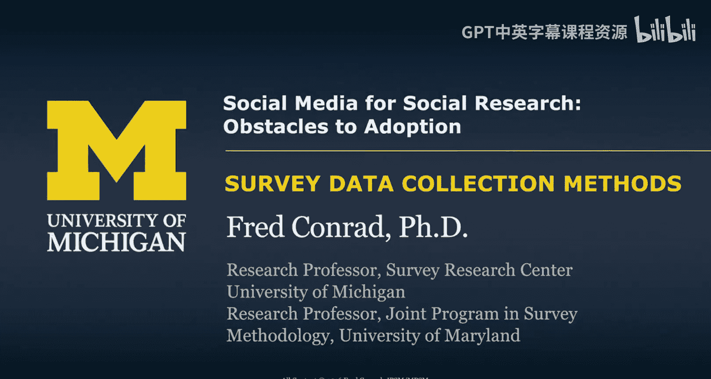
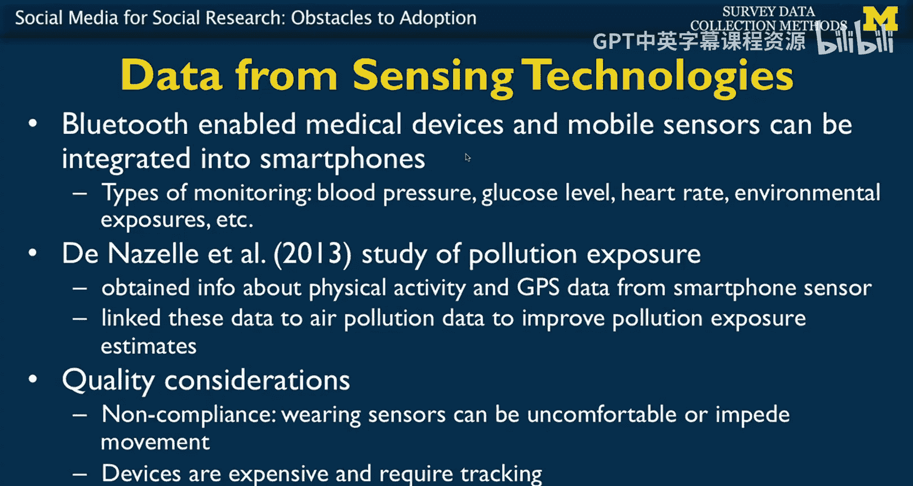
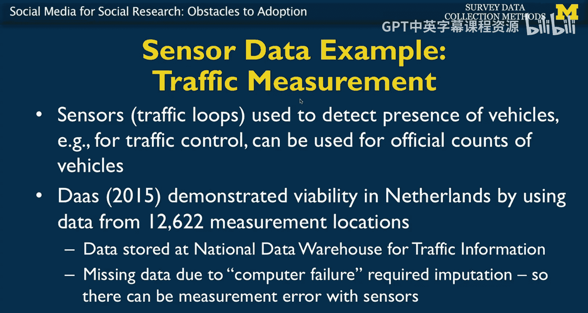
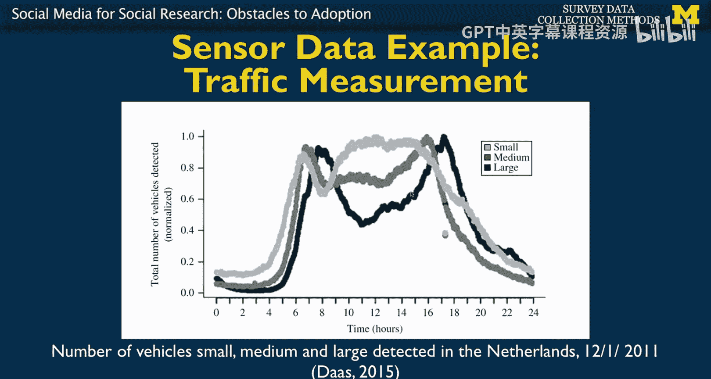
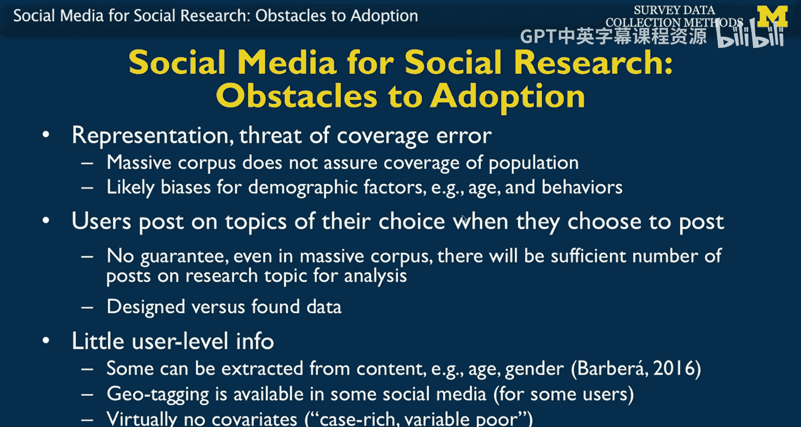
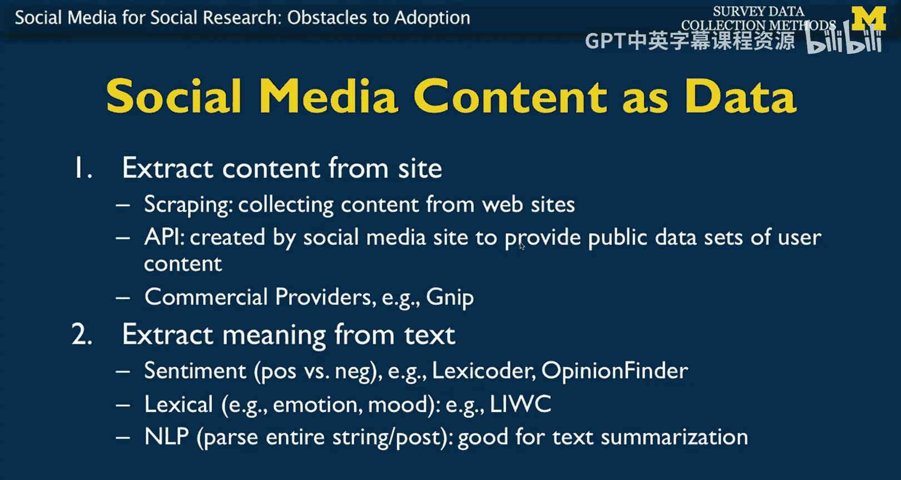

# 密歇根大学《调查数据收集和分析（2-6：方法、社调问卷设计、抽样、缺失数据、分析）｜Survey Data Collection and Analytics》 p38 37_4.3.1 大数据传感技术的应用：社交媒体数据.zh_en -BV1fw4m1e7Zh_p38-

Hi， welcome back。We've now talked a little bit about administrative data as an alternative to traditional survey data and some of the issues involved in using administrative data。

 the rest of this topic concerns other alternatives to survey data most of which are generally given the label big data。

What is big data and what can it be used for well according to the report of the APR T force on big data。

 it has some potential uses and then other applications for which it's not recommended so APR endorses the use of big data for gaining qualitative insights and for monitoring trends over time。

 but not for accurate quantitative estimates as we'll see there have been some attempts to use big data in particular sensor data and social media data for just those purposes so we'll take a look at how successful those attempts have been。

Let me move on to a discussion of sensor data mobile devices collect lots of data passively so that the user of the mobile device doesn't need to take any particular step to initiate this data collection so for example Bluetooth enabled medical devices that measured heart rate and activity can be integrated into smartphones there have been studies of pollution exposure by Dazelle and colleagues that obtain information about physical activity and location。

 GPS data from smartphone sensors and in principles these can be used to improve the measurement of pollution exposure there are as with any measurement。

 quality considerations， for example non-compliance if the people from whom the data are being collected or required to where some kind of sensor。

 this can be uncomfortable may affect what they're doing therefore effect measurement and and they may simply not comply and the devices are potentially expensive and do require tracking。

Another type of sensor data that has been explored recently and as a candidate for surveys on vehicle use。

 is data that are automatically sense or collected by so-called traffic loops。

 so these are used for traffic control often like when should the light turn green know to turn green when there's a vehicle present。

 but they may be able to be used as an alternative to asking people about whether they have a vehicle and you its size。

 a few questions like that， this really comes from a demonstration by Pete Doss who's at Staistic Netherlands。

 and Staistic Netherlands is of course the official statistics agency in the Netherlands and has an interest in an alternative to the relatively expensive。

A survey approach。So what DoOS did was used this kind of sensor data collected by over 12。

000 sensors around the Netherlands， the sensor data are stored in a national data warehouse。

 and he tested whether you can produce kind of continuous measurements of vehicle use。

There were missing data and he spent a fair amount of time in this paper talking about how he dealt with the missing data they used imputation to substitute for the missing data。

 but really the point is that there can be measurement error even with something that's automatic like a sensor so what dos was able to produce where plots like this which show when there's more and when there's less vehicle use I mean it's not too surprising that there's virtually no vehicle use right after midnight and that it peaks during morning rush hour and drops down then peaks again the evening rush hour and then tails off over the course of the day but this gives actual not only the pattern but precise counts what he was further able to do was to differentiate the size of the vehicle from these data so you get to see the patterns and looks a little different for small versus medium versus large vehicles in the middle of the day I assume that there's more small vehicles driving around in fewer trucks。

 big vehicles when people are at work。

Censed data holds promise to use this in place of survey data。

 there needs to be a close connection between a question that is asked on a survey and the one or two variables that are produced by the sensor data。

 in the absence of that there are limits I would say to what this kind of data can be used for。

 limits to how this data might substitute for existing survey data。

The other type of。Alternative data source I'd like to discuss is social media。

 which is quite different in a way it is self-report data。

 the social media users are voluntarily reporting something about themselves or their opinions or perhaps opinions they think others might want to hear。

But it is generated by people and it's verbal， so it's quite different from sensor data。

So it makes sense to consider social media data for measurement purposes if you consider the fact that about three quarters of the US。

S population and similar percentages even higher in other countries are currently using social media。

 and these estimates are a few years old， so the proportions likely to grow。

There are large differences by age in who currently uses social media and who does not。

 as you might imagine， social media underrepresents older people and does a better job representing younger people that too is likely to change as the population ages。

The promise of social media for social measurement。

iss that the information extracted from the social media can be used for at least two purposes which I've outlined here。

 one is to do something you can't do very easily with surveys that's quantitative。

 so to produce some a quantitative picture of some social phenomenon that would otherwise be hard to do using more conventional methods like surveys。

 the other application of social media for these purposes is to try to replicate survey results and if that's possible to replace at least some questions on a survey with social media data。

 so to provide accurate estimates more cheaply and quickly than conventional methods even potentially for official statistics。

And possibly in place of some waves of a longitudinal survey， so one approach might be。

 well you can't replace the survey entirely， but you can conduct a longitudinal survey that is a survey with repeated measurement。

 you can replace some waves of that repeated measurement。

 so instead of a monthly survey maybe the survey is conducted every other month with social media estimates produced in between。

There are some great opportunities， potentially in using social media for these purposes， low cost。

 not free， generally because one might need to purchase the data。

 one might need to pay people with expensive skills to do some of these analyses。

 but low cost compared to collecting survey data， particularly with interviewers timely in that they're generally sensitive to events and as soon as an event occurs。

 there's a spike in social media data around that event。

 people generally post about what's happening right now。

 the phrase now casting has been used about social media。

They produce a continuous measure as opposed to know like a monthly estimate。

 now it's continuous across users， it's not that individual users are posting every minute of the day every second of the day。

 but across the whole user base across millions or billions of users。

 the results are virtually continuous。And there's a very low or even no burden on the data providers that is the social media users。

 they would be using social media anyway， in fact， their social media users are generally not aware of the fact that there are researchers who might be analyzing their data。

 although this may be mentioned in the terms and conditions of use。

Most people probably don't notice this。There are a number of obstacles， however。

 for adopting social media for these purposes， the biggest one I would say is the lack of representativeness and in particular coverage error。

 so even though you have a massive corpus and often collections of social media messages or posts are called a corpus。

That does not assure that the entire population is covered。

 right so not everybody we just discussed is a social media user。

 and so if those who are not users differ on the issues one is analyzing the social media about。

 then the picture that emerges，will likely not represent the entire population there's likely of bias for demographic factors in particular age as we've discussed。

 and also certain behaviors， the non-users may engage in certain behaviors less often than the user。

 so if this is what the researcher is interested in。

 there's likely to be error associated with social media use for these purposes。

Another concern is that users of social media post on topics of their choice when they choose to post so there's no guarantee even in a massive corpus that there will be enough sufficiently large number of posts on the research topic to analyze them so if one is interested in a particular topic and it turns out that social media users are not posting on this it's very hard to reach any conclusions with surveys on the other hand the researchers design questions about the topics they're interested in and they collect data about those topics so this is definitely a shortcoming of using social media because it really requires that the users spontaneously post content that's relevant and that doesn't always happen the researcher has no control over that the way the researcher does with a survey often a distinction is made between so-called designed data of which surveys is the sort of best example where the researcher knows what。

Data set will look like before getting started because the questions that are asked become variables in the data versus data that are found and repurposed。

 found in the sense of they were not collected for this purpose。

 but they might be used for this purpose in the social media。

Data are not produced by the users because they want an analyst。

 a researcher to you know develop a story about some phenomenon they're used for many other purposes so so the design versus found distinction is important Another concern is that there is really very little information about the users in the posts aside from the content so some demographic information has been extracted or linked in some clever ways concerning age and gender but it takes some work it's not inherent in the in the posts themselves geotaging is available in some social media for some users like those users who turn it on or who don't turn it off but there really are no covariates if that will help explain a particular variable that might be extracted from social media the expression that's often that's been used is that it's case rich variable。

Poor case rich in meaning that there are many users。

But you really might only get one variable from an analysis of social media and not the helpful covaris that surveys are so good at producing。

There are more obstacles to adoption that it's worth mentioning as we'll discuss in a moment。

 in order to use social media data for analytic purposes。

 it's important to extract meaning from the posts and various text analysis tools are used for this well as even the designers of these tools will acknowledge they're not very nuanced and they are kind of confounded by or confused by text content with pronouns。

 negation， metaphors， irony slang all these things they're very literal sorts of tools and another class of tools data mining techniques and machine learning are largely atheoretical and data drivenriven so they may result in a model that fits one corpus or the corpus at a particular point in time but there's no guarantee that a model that fits well at one point in time will continue to fit well over time because there's really nothing driving these models besides the data there's no。

Theoretical framework that leads to the construction of these models。

 the way there generally is with models that are based on survey data。

The last concern that I'll mention that has been pointed out is spurious correlations with a very large corpus。

 a very large data set， the chances that many things in the data that will correlate with each other or that things in the data will correlate with events in the outside world are high。

 and so it's hard to know if what you're observing if a relationship that seems to be evident in the corpus of social media data should be taken seriously or not。

 so for example， a high correlation has been reported between stock market performance and butter production in Bangladesh just seems unlikely that there's a relationship there that makes sense for theoretical reasons。

So we've listed many concerns about using social media data。

 actually quite a few more than reasons to use social media data。

 but there really is great promise and at this point the research community I would say。

 hasn't quite figured out whether social media data is usable and for what purposes it's usable。

 but there's great interest in figuring this out， so how would you use social media data。

Really in general， at the highest level， one needs to do both extract content from the site。

 so access the social media data of the posts， the textual material and then somehow extract meaning from that textual material and it'll be that extracted meaning that's really analyzed so extracting content from the site can involve scraping public web pages or web pages that will permit this through various tools using the application programming interface or API that social media site。

 social media companies sometimes create to provide public with access to user content。

And then there are commercial providers that will sell the content of the sites。

 sometimes with some analysis done as well。So that generally those are generally the ways that researchers access the content。

Once once that's done and the researcher has a really large data set。

 then it needs to be turned into something that can be essentially quantified so one approach is sentiment analysis which is really a matter of determining whether the words in a post are positive or negative and sometimes this is done within within a post with this let's say a tweet and the tweet is tagged as either positive or negative depending on that ratio and then the number of positive and number of negative messages re counted up over some time period。

 or the alternative is to just count the number of positive and negative words in the entire corpus in some time period。

 their variance on the same theme， but the idea is that the words are compared to a lexicon of some type。

 dictionary of some type where they're classified as positive or negative， a slightly more。

Semantically nuanced or rich approach is an example is Luke lexical inquiry and word count tool。

 which contains many different categories， not just positive and negative。

 but many different categories of word meaning， and so it's possible to， for example。

 classify words on the basis of particular emotions or moods。

 but many other attributes from many other categories and in studies in a number of studies some of which we'll talk about。

 Luke has been used instead of sentiment analysis。And then there are more fullbodied natural language processing tools in which the entire string。

 let's say， the entire post is parsed and an interpretation is assigned to it。

 this is really good for text summarization purposes and NLP approaches are much more likely to succeed when the posts contain the kinds of negation and irony and non- literal meaning that we said really can confound these more word level approaches。

So what I'd like to turn to next in the next segment is some examples of。

Using social media that have been successful for what they were intended to do。

 and then after that look at some examples that have been less successful and talk about why it might be that social media works sometimes and not at other times in replicating survey results。

