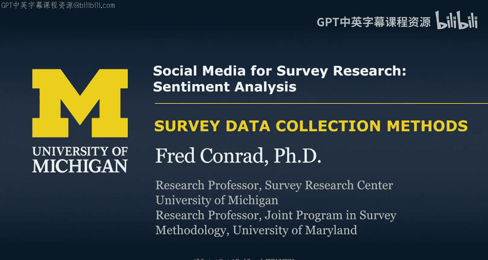
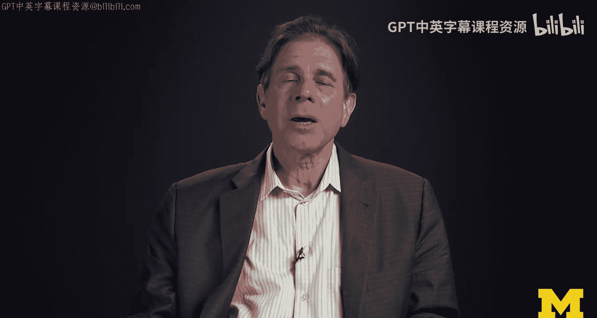
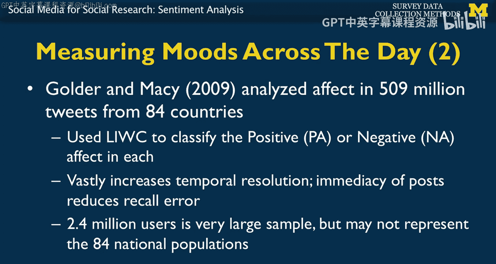
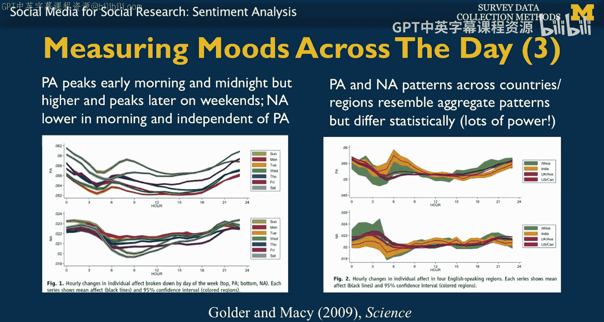
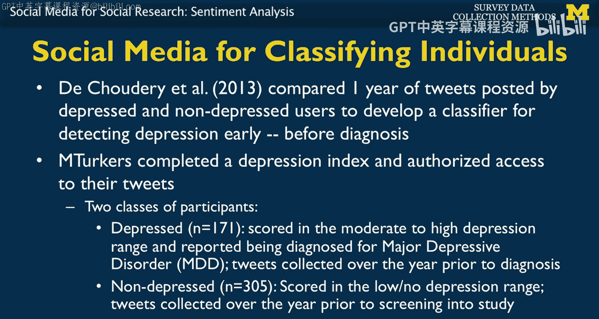
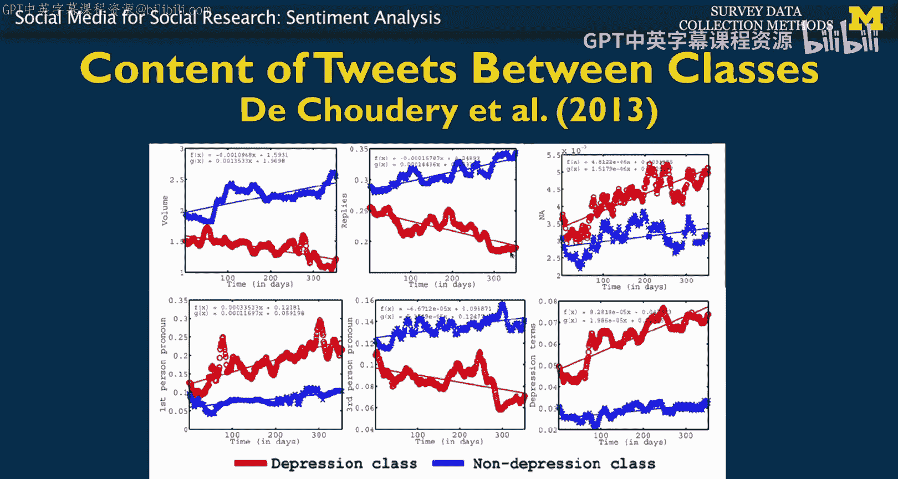
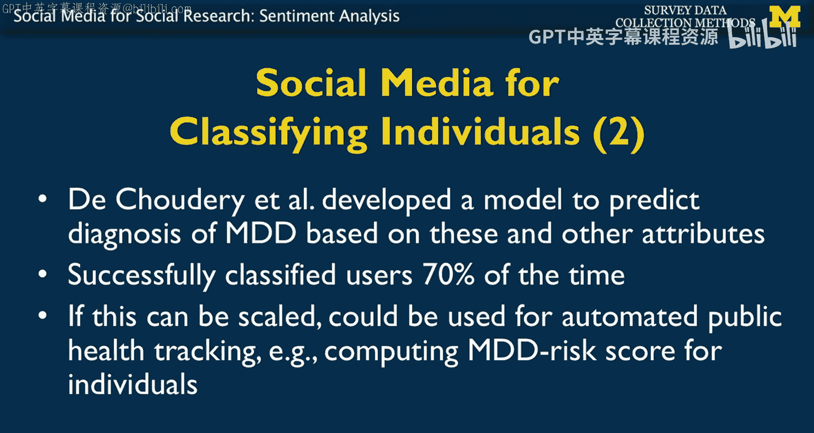

# 密歇根大学《调查数据收集和分析（2-6：方法、社调问卷设计、抽样、缺失数据、分析）｜Survey Data Collection and Analytics》 p39 38_4.3.2 社交媒体应用：情绪与抑郁测量.zh_en -BV1fw4m1e7Zh_p39-

。Hi again， what I'd like to turn to now is a couple of examples of this application of social media data to tasks that are really not well suited to survey measurement。

 survey measurement surveys have been used for these kinds of tasks over time。

 but it looks like social media works quite well。So the first of these is measuring mood or affect over the course of the day。

 much of the research that has been done on this is based on retrospective self reports。Respondents。

 and often they' undergraduate university students who come into the lab。

 they'll talk about their mood over the previous 24 hours or over the last week， not at the moment。

 not the mood they're experiencing at that moment， because that wouldn't really allow a continuous picture of mood or affect to emerge。

So they're often done with small convenient samples like students。

 and even when they're done with larger more representative samples， they're not really very current。

 they're retrospective， and there's potentially memory error involved there。So with this in mind。

 Goldder and Macy published a paper in science in 2009 in which they analyzed the affect in 509 million tweets from 84 countries over the course of the day。

 and this is a huge corpus， although if this study were done today。

 many more tweets would be available for these analyses， they used Luke。

 which we mentioned in an earlier segment to classify the affect in each tweet as either positive affect or a negative affect。

 as we said， there are many other categories that Luke can provide。

 but they used Luke for positive and negative affect。

So their argument at this time was that doing this using this approach vastly increases temporal resolution that is instead of monthly estimates or estimates in a discrete way。

 they're able to paint a kind of continuous picture of mood across the day。

 they pointed out two real benefits to this approach which have inspired other researchers。

 namely that this vastly increases the temporal resolution because tweets arrive every second or many tweets arrive at the same time。

 in fact， but across all the users as was mentioned in a previous segment。

 we have essentially a continuous picture of whatever the phenomenon in this case。

 affect over the course of the day， and they also point out that there is no really chance for recall error to affect the way affect might be included in these posts because people are posting at the moment to the extent that the posts contain affect its current affect。

Having said this 2。4 million users is a very large sample。

 but it may not represent the population in all 84 countries or within any one country。

 it may not represent everyone， as we discussed in the previous segment。

 the question really is whether mood over the course of the day is any different。

 the patterns of mood over the course of the day， is any different for Twitter users and non-twitter users。

So their analyses produced these pictures of the patterns of mood over the course of the day so on the left they've plotted positive affect on the top negative affect on the bottom the different curves represent different days of the week what they show is that positive affect starts is highest about midnight it drops as people are sleeping and then it picks up when people wake up so people tend to wake up happy it then tails off over the course of the day and then picks up again in the evening and it's at its highest by midnight the increased positive affect when people wake up is shifted to the right a little bit for Saturday and Sunday suggesting that they sleep in but that when they wake up they wake up happy negative affect has a compliment but independent pattern in some cases involving a drop so less negative on someday。

And others and in particular it's on weekends， people are less negative on weekends and they are on the workday after waking up on the right side。

 they've collapsed day of week， but they've broken it out by different regions in the world out of their 80 plus countries so the different regions are Africa。

 India， UK， Australia and U。 Canada and there's pretty much the same pattern when broken out by country as as we see on the left when broken out by day of the week and there's pretty much the same pattern across the different countries。

 the point for our purposes is that it makes sense there's face validity to it。

 but it's something that would be hard to do with surveys。

 at least on such a large scale that we can break it out by day of week and different regions of the world and still have plenty of data。

Another example of using social media for something that seemed not to be as effective at comes from a study by De Choowy and her colleagues。

In which they used social media also Twitter to classify individuals as either depressed or not depressed so what they did was compared one year of tweets posted by users who they were able to determine were either depressed or not depressed and they developed a classifier statistical model for detecting depression early that is before its clinically diagnosed。

 they actually used clinical diagnosis as part of their classification in this study but the idea is that you could then use a tool like this to class people prior to a diagnosis they recruited mTrks。

 these are workers in Amazon mechanical Turk which is a well-known crowdsourcing service that Amazon runs in which people will perform various online tasks including studies like this they paid the mTrkers to complete a questionnaire that produces a depression index。

Number of questions， although in a way it's like a survey questionnaire and they required them or at least the ones whose data were used here authorized access to their tweets。

 they knew where they scored in this depression index and they had their access to their tweets。

So based on the depression index scores， the chatttery and her colleagues classified respondents as depressed if they were in the moderate to hide depression range。

And if they reported having been diagnosed for major depressive disorder or MDD。If so。

 then they collected their tweets over the year prior to the diagnosis。

The other group were non-depressed， they scored in the low or node range of the depression index and so the authors collected their tweets over a year prior to their screening into the study so was roughly the same time period but the year was for the depressed participants was the year prior to the diagnosis which might have been a little before a nondeed group screening into the study they were able to distinguish some very different patterns of Twitter content between the depresseded and non-depressed participants。

 this is just several of the many dimensions on which they compared the two classes of participants so the red curves represent the depressed group and the blue curves。

 the non-depressed group and so just for example the volume of tweets。

In the upper left is higher for the non-depressed groups， and it increases over the year。

 really maybe more to the point， the volume of tweets is lower and decreases over the year prior to diagnosis for the depressed class when it comes to replying to tweets。

 tweets that contain at reply， which the authors treated as just one of several measures of how interconnected。

 the extent to which the users were interconnected and the depth of their networks。

 the nondepressed group produced a larger volume of tweets， and that volume increased over the year。

 or again more to the point， the lower number of tweets for the depressed group decreased over the year so they seemed to be getting less engaged with others。

They looked at negative affect， which they also used Luke to classify the depressed group was higher in negative affect at the beginning of the year and just increased in the amount of negative affect their tweets contained over the course of the year in the lower left we see the frequency with which the tweets contained the first person singular which the authors suggest can be indicative of depression。

 that is that depression entails a kind of self-focus and the use of I was higher for the than the non-depressed group and that difference increased over the course of the year。

Similarly or really conversely， the use of the third personson pronoun in their tweets was lower than that of the non-depressed group at the start of the year and it only got lower over the course of the year so between the in of first person and the reduction in use of third person suggest that the depressed participants were becoming more self-focused and less engaged with others and then in the lower right。

 the extent to which the tweets contained terms about depression was higher not surprisingly but higher for those who were depressed than not depressed and that increased over the course of the year。

 so these are a number of kind of very regular clear patterns that distinguish depressed and non-depressed participants don't forget that the depressed group not only scored higher on the inventory that was administered but they reported a clinical diagnosis of major depressedive disorder and the tweets reflect this so the idea is could you use the tweets。

to predict depression or the likely occurrence of a major depressive disorder diagnosis ahead of time。

 and so as part of this study， they developed a model to predict diagnosis of MDD basically to classify could you accurately classify these participants on the basis of the kinds of attributes that we just looked at and they did just this and the classifier that they developed was successful 70% of the time。

 which is a pretty good hit rate and so they conclude that if this approach can be scaled appropriately。

 then it could be used for automated public health tracking of depression， for example。

 computing an MDD risk score for individuals who are both Twitter users and therefore in the population which could be potentially quite useful？

They actually extracted a number of variables from Twitter and this turns out to allow them to do a kind of nuanced and pretty accurate job of classifying participants into either depressed or non-depressed groups so this would have to be considered a successful use of social media for something that surveys haven't been used widely for for reasons we've discussed so what we'll turn to in the next segment is a couple of examples of using social media to do things to perform tasks that surveys are actually quite good at but the question is whether。

We can substitute or supplement survey data with these alternative sources of data in an effective way。

