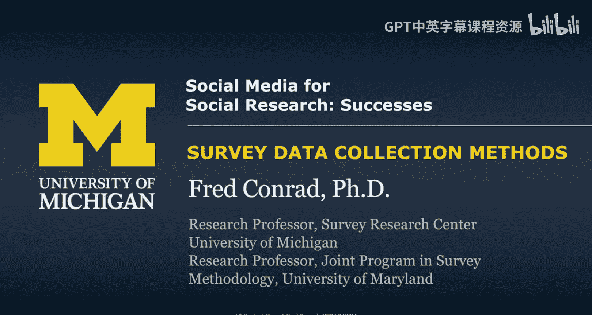
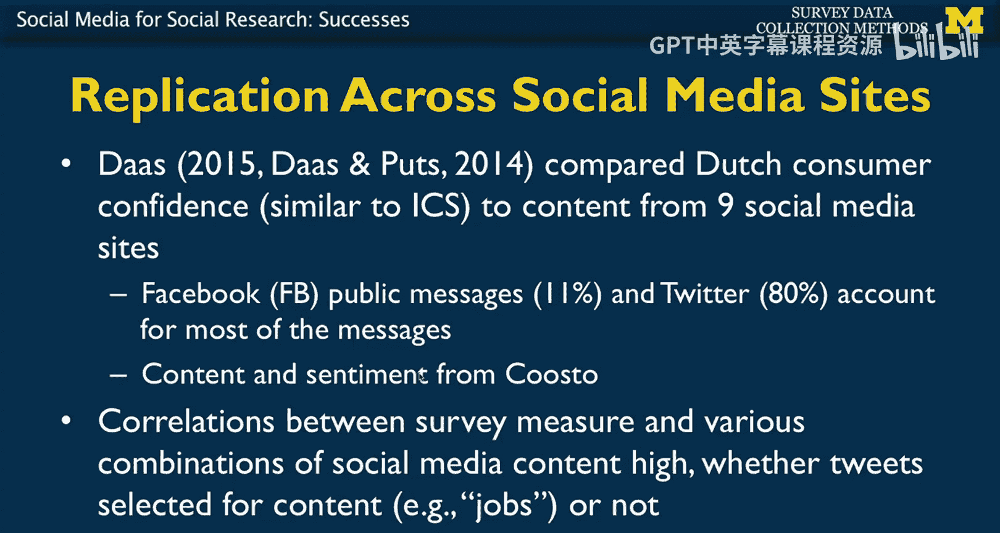
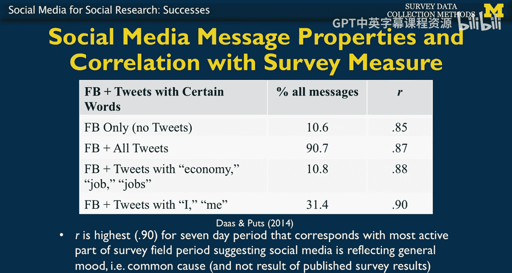

# 密歇根大学《调查数据收集和分析（2-6：方法、社调问卷设计、抽样、缺失数据、分析）｜Survey Data Collection and Analytics》 p40 39_4.3.3 社交媒体与人口估计的成功案例.zh_en -BV1fw4m1e7Zh_p40-

Welcome back， so we're turning now to sort of feasibility studies of using social media to approximate survey data。

 with an eye to whether they might ever be able to be substituted for survey data。

 or at least used alongside survey data， and I'd like to turn first to some of the more successful efforts to do this。

So one of these successful efforts was done by O'Connor and colleagues and in which they found that the sentiment ratio that is the ratio of positive to negative words of tweets correlated highly with Gallup's economic confidence index。

 which is based on answers to several survey questions。

 another study that's often pointed to was conducted by Tmajn and his colleagues in which they found that the number of tweets mentioning a political party predicted the German election outcome as well as the traditional preelection polls。

 and there are a number of other。So calledled success stories in the literature。

 I'd like to focus on O'Connor's study to give you a flavor of this approach。

 they classified each tweet between 2008 and 2009 containing economy， job or jobs。

As either positive or negative。And then they computed sentiment for each day。

 so a tweet was positive if a sentiment analysis tool called opinionion Finder detected a positive word。

 and it was negative if it detected a negative word。

 so it could be both a tweet could be classified as both positive and negative。

And then this was within a day， and then the daily sentiment was the just the ratio of the number of positive tweets and the number of negative tweets posted on that day。

And then to kind of stabilize the data a bit。Social media data can be quite volatile or noisy。

 they smoothed the data over either a 15 or 30 day interval so they took a kind of rolling average over that time period。

 and they also tried fitting the data or comparing the data to the survey data at different lags going from negative 90 days that is to positive 90 days so they wanted to see basically if the tweets were preceding the sentiment expressed in the survey data or were following the sentiment expressed in the survey data were happening at the same time they compared the sentiment expressed actually in two surveys。

 the index of consumer sentiment which is based on five questions from the University of Michigan's surveys of consumers。

 which is the monthly telephone survey of 500 households or individuals。

 the questions concerning the economy both now and in a year and the participants personal finances now and in a year。

They also compared the sentiment in the tweets to the sentiment expressed in Gallup's Economic confidenced In。

 which is based on two questions asked by phone in the daily tracking poll to about 3。

500 respondents per week。The questions concern the state of the economy and whether it's getting better。

 worse or staying the same。O'Connor et all found that the relationship between sentiment in tweets and these surveys was clearest if they just looked at tweets containing the word jobs。

 because the correlations are better when the Twitter data is rightshift as if it came later meaning that it's actually preceding the survey data so it is kind of leading indicator of what the surveys will illustrate。

 as you can see with a larger lead， the red curve， the peaks and valleys line up better with the two sets of survey data than without any lead。

 any offset， so the point is that the authors kind of needed to adjust the data to increase the fit。

So the authors interpret this as indicating that there can be at least a moderately strong correlation between Twitter and some survey data and that the information in Twitter is produced before the survey estimates are produced so that tweets lead surveys。

These results have been really nicely replicated in Europe by DoS in which he compared Dutch consumer confidence。

 which is very similar to the Michigan In of consumer sentiment to the content from nine different social media sites。

 so it's not just Twitter， but he actually looked at Facebook public messages as well as Twitter and then a number of other social media sites that provided much smaller percents than Facebook which provided 11% and Twitter which provided 80% of the social media content he looked at。

 the content was purchased from a commercial provider called Ksto。

 and they also provided the sentiment analyses along with the data。

The correlations between the survey measures and various combinations of social media content were higher than what we saw just a moment ago in the O'Connor at all study and this was the case whether the tweets were selected for particular content like jobs or not at all selected so just the entire Twitter corpus correlated quite highly with。

The consumer sentiment measured in in the Dutch survey for an example。

 Facebook alone produced a correlation of 0。85 so quite high if Facebook was combined with all the tweets the correlation went up to 0。

87 if Facebook was combined with tweets that contained the word economy job and jobs which is what O'Connor first looked at the correlation was even higher 0。

88 and if Facebook was combined with tweets that contained the words I and me the correlation was at its highest 0。

90 so it suggests really a robustness about using Twitter in this way along with Facebook and content from a small number of additional social media sites that might not have been the conclusion based on O'Connor study as in the O'Connor study。

 Dos manipulated the offset or the lead between the date of the tweets and the date of the surveys and found that the correlation was high。

For the seven day period that corresponds to the most active part of the survey field period。

 suggesting that social media is reflecting a general mood。

 what he calls a common cause that is the survey data and the social media data share a common cause of sentiment and it's not a reaction to the published survey results so that as in the O'Connor study it leads the survey results and they both have the same origins。

So this is quite a successful demonstration of using social media for these purposes。

It's not always the success and we saw that within the O'Connor study that for one of the surveys。

 the correlation was higher than for the other， it was moderately high for one and less moderately high for the other so in the next segment we'll look at we'll talk about the fact that the agreement is not always as high as it is in this doOS study between social media and survey data and some ideas about why it might vary。

 why different analyses might lead to different conclusions about the potential for using social media in this way。

