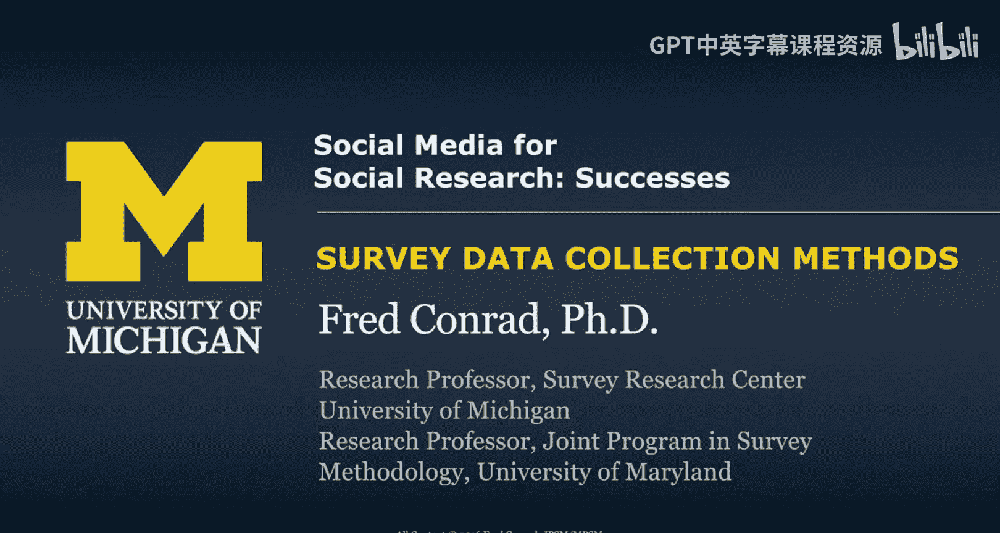
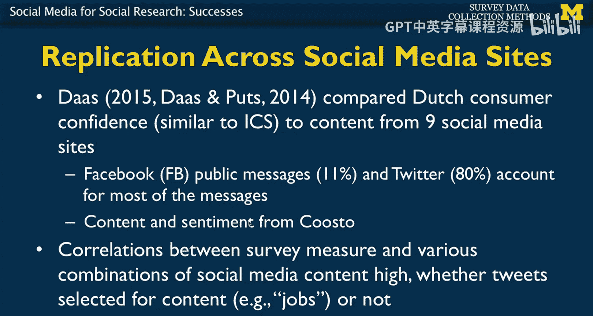
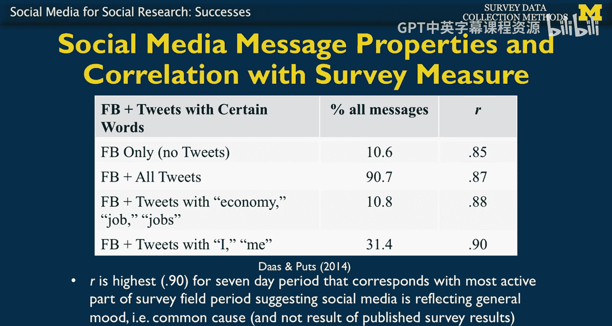

# 调查数据收集与分析：2-6：社交媒体与人口估计的成功案例

在本节课中，我们将探讨利用社交媒体数据来近似或补充传统调查数据的可行性研究。我们将重点关注几个成功的案例，了解其方法，并分析这些成功背后的原因。

上一节我们讨论了社交媒体数据在调查领域的潜力，本节中我们来看看一些具体的研究，它们展示了如何利用社交媒体（如推特）的情绪分析来预测或反映基于传统调查得出的经济或政治指标。

## 成功案例研究

以下是两个被广泛引用的成功利用社交媒体数据进行人口估计的研究。

*   **奥康纳等人的研究**：该研究发现，推特上**正面与负面词汇的情感比率**与盖洛普的**经济信心指数**高度相关。盖洛普指数基于对几个调查问题的回答。
*   **特姆金等人的研究**：该研究发现，提及某个政党的**推文数量**能够预测德国大选结果，其准确度与传统选前民调相当。

为了让大家更具体地了解这种方法，我们将深入分析奥康纳等人的研究。

## 案例详解：奥康纳的研究方法

奥康纳团队在2008年至2009年间，抓取了所有包含“economy”、“job”或“jobs”词汇的推文。他们的分析流程如下：

1.  **情感分类**：使用一个名为“OpinionFinder”的情感分析工具，将每条推文分类为**正面**、**负面**或两者皆有。
2.  **计算日度情感比率**：对于每一天，计算当天发布的**正面推文数量**与**负面推文数量**的比值。公式可表示为：
    `日度情感比率 = 当日正面推文数 / 当日负面推文数`
3.  **数据平滑处理**：由于社交媒体数据波动较大（噪声多），他们对数据进行了平滑处理，计算了**15天或30天的滚动平均值**。
4.  **与时滞调查数据对比**：他们将推特情感数据与两项传统的电话调查数据进行了对比，并尝试了不同的**时滞**（从推文领先调查90天到落后90天），以寻找最佳匹配关系。对比的两项调查是：
    *   **消费者信心指数**：基于密歇根大学“消费者调查”中的5个问题。
    *   **盖洛普经济信心指数**：基于每日追踪调查中的2个问题。

## 研究结果与解读

研究发现，当仅分析包含“jobs”一词的推文，并将推特数据在时间轴上**适当提前（右移）**时，其与调查数据的相关性最为清晰。这意味着推特情绪的变化**领先于**后续调查所反映出的公众情绪，可以被视为一个**先行指标**。

作者将此解释为：推特数据与某些调查数据之间可以存在**中等偏强的相关性**，且推特上的信息产生于调查估计值之前，即“**推文引领调查**”。

## 成功案例的复现与扩展

多斯在欧洲进行的研究成功地复现并扩展了这一结论。他比较了**荷兰消费者信心指数**与来自**九个不同社交媒体平台**（包括Facebook和Twitter）的内容。

*   他使用了商业数据提供商Ksto购买的数据及配套的情感分析结果。
*   研究发现，社交媒体内容与调查数据之间的**相关性**普遍高于奥康纳的研究。
*   例如，仅Facebook数据与调查的相关系数就达到了**0.85**。
*   当结合Facebook和所有推文时，相关系数升至**0.87**。
*   最高相关性（**0.90**）出现在结合Facebook与那些包含“我”和“我自己”词汇的推文时。

多斯也调整了时滞，发现相关性在**调查实地访问最活跃的7天期间**最高。他提出，社交媒体反映的是一种**普遍情绪**或“**共同原因**”——即调查数据和社交媒体数据都源于同一种公众情绪，并非是对已发布调查结果的反应，因此社交媒体数据会领先于调查结果。

## 本节总结

本节课中我们一起学习了利用社交媒体数据进行人口估计的成功案例。我们通过奥康纳和多斯的研究看到，通过分析社交媒体上的**情感倾向**，并将其与时间序列上的传统**调查数据**进行对比和校准，确实可以在某些领域（如经济信心）获得高度相关的结果。这表明社交媒体数据有潜力作为传统调查的**补充**或**先行指标**。

然而，这种一致性并非总是如此之高。在奥康纳的研究中，推特数据与两项不同调查的相关性也存在差异。下一节，我们将探讨社交媒体与调查数据之间**不一致**的情况，并分析可能导致这种差异的原因，以及为何不同研究会对社交媒体的应用潜力得出不同结论。