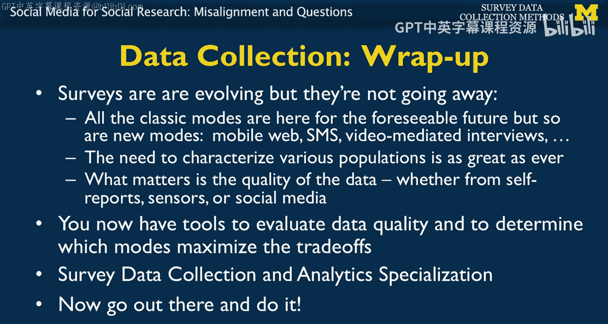

# 密歇根大学《调查数据收集和分析（2-6：方法、社调问卷设计、抽样、缺失数据、分析）｜Survey Data Collection and Analytics》 p41 40_4.3.4 社交媒体数据与调查数据的协同与分歧.zh_en -BV1fw4m1e7Zh_p41-

Hi， in our last segment， we talked about some pretty successful attempts to replicate survey data using social media content。

What I'd like to turn into in this segment is some less successful attempts。

 but really the question about why it's sometimes possible to replicate survey data with social media data and sometimes not so we spoke about the O'Connor study at some length in the last segment well O'Connor did find a fairly high correlation between。

Tweets containing the word jobs and the Gallup survey data。

 he reported a lower correlation between the Twitter data and the Michigan indexex of consumer sentiment。

 which so O'Connor himself calls the results of the entire paper mixed。

Jonghaer and colleagues reanalyzed the corpus of tweets that were analyzed by Tman etal。

 who successfully predicted the outcome of German elections。

But he restored to the or they restored to the corpus tweets that Tamajan and colleagues had removed containing references to the pirate party。

 a small political party， when they restored those tweets to the corpus。

 the ability to predict the election outcome on the basis of the Twitter content。

 was substantially reduced， so it was really quite a fragile finding。

And then a much bigger problem most likely is the so-called file drawer problem or publication bias。

 the idea that we only know about the successful studies。

 whether we're talking about this particular problem or really science in general if studies that are quotenot successful that don't produce significant results aren't published。

 we may never know， and these may far outnumber those that are successful and are published。

 and so that could well be the case with this problem replicating survey data with social media content and a variant on this on this kind of publication bias is that there may be high levels of agreement between social media content and survey measures over one time period and this story may get told but then the relationship may disintegrate or at least be reduced in the next time period and we may never know that。

 so it's a little，tricky evaluating the degree to which social media data can be used for the kinds of purposes that surveys are used for。

Well why might social media content sometimes align with survey results and sometimes not One possibility is that even though social media users almost certainly differ from the population we might want to generalize to and so therefore there's undercover。

 those who use social media are different than many in the population。

 it may be that the sentiment and experiences in their posts。

 are proportional to the sentiment and experiences in the population so that even though different kinds of people are tweeting for example。

 their tweeting about experiences that are similar to those of the general population this just kind of has to be the case when there is alignment。

 but it could be that there's something about social media which is different than survey responses and that's that social media。

Is social， and so when users post， they're not just posting about themselves necessarily or for themselves。

 they're posting for others， they're posting information they think others will find interesting。

 may retweet， may like and they may be distilling a kind of conversation。

 larger conversation that they're detecting in their environment。

 and so in that sense we may see similar kinds of characteristics reporteded in social media to that that we see in surveys。

Another possibility is that the particular tools that are used to extract the content from social media may matter and so if two different tools for extracting sentiment are used。

 they may lead to different results or if one study uses a sentiment analysis tool another uses a semantic analysis tools such as Luke which we've talked about that also may lead to different outcomes or similarly the particular machine learning algorithms that are used may lead to different outcomes if they're slightly different so many things can vary between studies and their replications which might also affect the degree to which these two data sources tell the same story a final possibility at least for now is that the particular survey questions whose data we are trying to match with social media data in these studies may really make a difference so for example some survey questions。

 maybe most surveys。Questions ask about you as the respondent。

 others ask about the larger group what do you think about the country as a whole and it may be that that distinction makes a difference because one type of question may be more similar to the processes producing social media posts than another and there may be many other distinctions among survey questions that we we can point to but let's talk just about this this distinction between questions that ask about the self or use the respondent and questions that ask the respondent about a larger group or a collective so here are two examples that are actually used to generate the index of consumer sentiment question about the self about the respondent is now looking ahead do you think that a year from now you and your family living there will be better off financially or worse off or just about the same as now so it's about you and your family versus a question about a larger group now turning to business conditions in the country as a whole。

Do you think that during the next 12 months we'll have good times financially or bad times or what？

So what might be the consequence of looking for alignment between social media data in particular Twitter and each of these questions。

 so this figure gives us a sense of this between 2008 and the end of 2011 the black line is the Twitter sentiment ratio。

 so processing tweets containing the word jobs with a sentiment analysis tool called Lexxipro。

The red line represents the question data from or sentiment derived from the question about the self。

 the first of those two questions we looked at and the blue line represents sentiment from the survey question about the country as a whole。

 the collective now you may be able to see this in here if you trace from left to right the black line you may be able to see that the blue line moves more closely with the black line than the red line。

 but it's not always evident， but overall the correlation is greater in fact more than twice as large for between the Twitter content and the question about the collective than it is for the correlation between Twitter content and the question about the self so that begins to suggest that the type of question may matter when looking at this kind of alignment that is if we think we want to use social media to estimate population characteristics。

 population parameters one problem though，iss that in these data。

 this particular advantage is evident overall across these four years。

 but if we look at individual months， for example， or other smaller time periods。

 we don't see the relationship in all of them， so in fact， if we look at individual months。

 the advantage the collective versus the self questions is evident only for 24 or 46 months。

 so actually just around half of half of the months。

 so this would mean that if we were thinking about substituting social media data for say a monthly wave of a survey。

 monthly administration of a survey， that might not be such a good idea at least given these data for these questions。

So there really are still many unanswered questions about the way social media content might be used in place of surveys。

 we talked about some other applications of social media that might supplement survey data or be used in situations where surveys are hard to do。

But for this purpose， trying to。reproduce or produce the same story from social media that we might get from surveys。

 we really need to know when we might find alignment and when not。

 and we've proposed some possible explanations here。

 but this is really very preliminary and suggestive。

We also need to know at what temporal resolution annually monthly weekly， there is alignment。

 because in the example we just looked at there was alignment over a four year period but not in monthly increments。

 so what time period can we sort of rely on for this kind of alignment？And speaking of reliability。

 when when we need to benchmark social media trends against survey data and when can the social media data stand on their own。

 right now， we always use surveys as the gold standard or some kind of gold standards still required to evaluate social media content。

 when social media content is theoretically based or when our interpretation of it is theoretically based enough that we can believe the data without referring to a gold standard。

 then we'll be in a much better position to begin to incorporate it into these kinds of estimation processes that we currently use surveys for。

So that concludes really our final segment。Our final lesson on mobile data collection and alternative modes and our entire course。

I think one thing that should be evident， but that I want to underscore is that as these alternatives arise。

 surveys are not going anywhere， they're evolving， but the demand for surveys is as strong as ever all of the classic modes that we discussed in the first lesson are still in widespread use。

 and will be with us for the foreseeable future， but so our new modes， mobile web。

 SMS modes like video mediated interviews and so on。

This is because the need to characterize various populations is as great as ever。

 it's growing 10 years ago we weren't collecting survey data from apps on mobile devices。

 but as society changes， we continue to want to monitor people's experiences and their attitudes。

We really can't make good decisions as a society without this kind of information and as we change we need to adapt our measurement processes to those changes what really matters is the quality of the data。

 whether it's from self-reports as is the case in surveys or sensorenss or social media。

You now have the tools to evaluate data quality and to determine which modes of data collections maximize the trade offs。

But I encourage you to complement these skills and tools by taking the rest of the specialization in survey data collection and analytics together these skills will form a valuable package that will allow you to really address a number of issues in social research。

So I urge you to go out there and use this knowledge and talk about it。

 let us know through the forum how you're doing， talk to each other。

 hopefully you've been talking to each other throughout the course。

 but put these skills and this new knowledge to youth， I've really enjoyed。

Producing these videos have been working on them over the last many months and has been good for me。

 I really hope it has been valuable to you and it will be valuable going forward so I look forward to hearing about your success in our forum and wish you all the best as you go forward。

Thanks。

