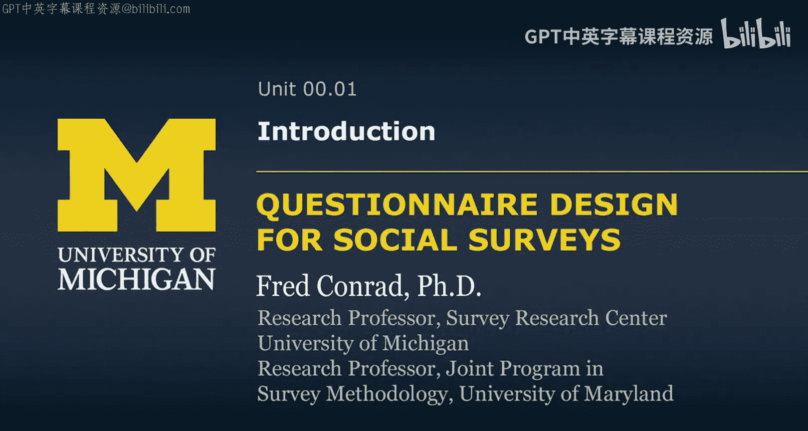
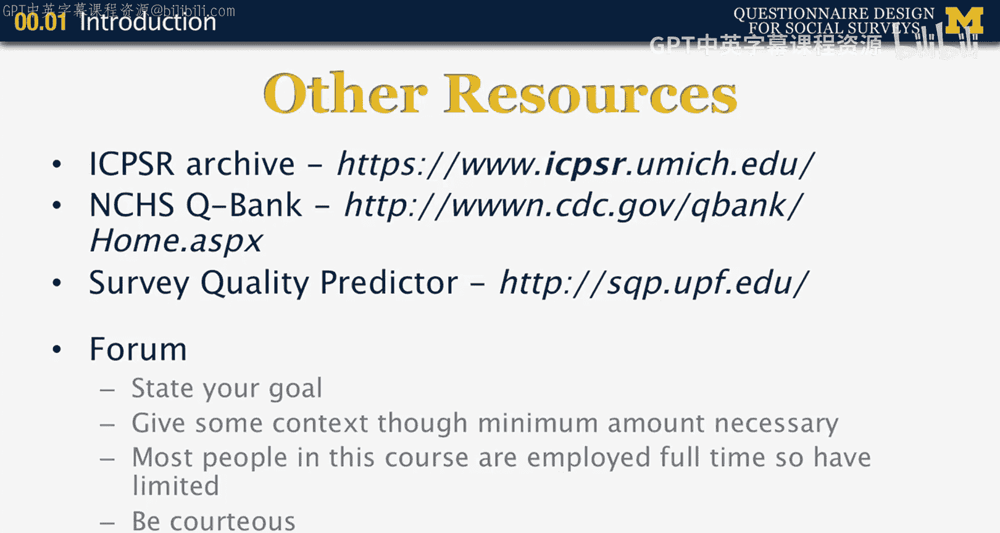

# 密歇根大学《调查数据收集和分析（2-6：方法、社调问卷设计、抽样、缺失数据、分析）｜Survey Data Collection and Analytics》 p43 0_导论.zh_en -BV1fw4m1e7Zh_p43-

Yeah。Welcome to Quesnare Design for Social Surys。 I'm Fred Conrad and will be teaching the course along with Fracca Croer。

The course is a collaboration between the Michigan program and Survey methodology and the Jo program in Sury methodology housed at the University of Maryland。

Faculty in both programs are from the University of Michigan， the University of Maryland。

 and Westatt。We thank all our current and former colleagues who contributed their research and teaching to the material presented here。

The focus of both of these programs is to teach all aspects of survey methodology。

This course covers just one relatively small aspect of survey methodology。

This slide borrowed from the book by Grorovvees at all。

 Survey methodology presents what's known as the total surveyve error perspective。

 and it shows all of the different error sources that are present in any survey。

Our focus is just on measurement error on the left side。

 which has to do with the error in the answers respondents give to individual questions。

 a discrepancy between the answers they provide and the true value if we could know the true value of their answers。

Our focus on the questionnaire design process can be divided into the following steps or stages。

 first determining the purpose or objective of the questionnaire and individual questions。

Then selecting a mode to deliver those questions in so face to face interviews。

 telephone interviews or self administered modes such as mail out paper questionnaire or a web questionnaire。

The mode can affect the design of the particular question， for example， in a spoken mode。

 respondents need to remember the entire question， and by the time the interviewer gets to the end of the question if it's long。

 respondents may have trouble remembering earlier words in the question and so in a spoken mode。

 a designer wants to use fewer words in a visual mode where respondents are reading the question。

 this is much less of a concern。Then designers need to consider the analytic goals of a particular question。

 because if the role that the question will serve in addressing those analytic goals isn't clear at the outset。

 then the question may end up being not very helpful and wasting time by interviewers and respondents。

Then the designer gathers existing questions or writes original questions and pretests them。

 and then ultimately assembles them into a questionnaire or instrument。

There are six units in the course， the first unit covers terminology。

 of the concepts of accuracy and reliability， a discussion of standardized interviews and related interviewing techniques。

The second unit provides background on the response process， how respondents answer questions。

 the unit will be referenced throughout the course and provides the theoretical underpinning for the rest of the course。

The third unit covers specific types of questions that are particularly difficult to answer。

 questions on sensitive topics and questions that require difficult retrieval tasks or place of burden on the respondent's memory。

The fourth unit covers attitude questions and response scales。

 the fifth unit covers preting questionnaires， and the sixth unit covers the process of assembling individual questions into a questionnaire instrument。

There are required readings which were picked from open access journals and journals that allowed us to provide access to particular papers。

In addition， there are some reports from federal or government statistical agencies in the US。

Open access has limits， thus， in some slides， there are references to studies and important papers that unfortunately can't be accessed here。

Those are not required as reading。The multiple choice homework assignments will have questions about one of the readings in each unit。

There are a number of recommended textbooks， the text by Taranjo at all describes the mental and social processes that respondents go through when answering questions and it's theoretical and provides lots of empirical basis for the recommendations。

The book by Fowler is a practical guide to designing survey questions。

The book by Converse andpressor is a thin， it's an excellent handbook。

 it's a very thin book that provides， again， practical advice for designing questionnaires。

The text by Subit and Bradburn is also a practical guide。

 but is longer and goes into more detail than Converse and presser。

 It's really a classic questionnaire design book。Sudman Bradburn and Schwartz is very much like Tranzo at all and covers the psychological processes that respondents go through when answering questions。

The book by Willis is both practical and theoretical and concerns the pretesting technique that we'll look at in most detail in this course。

 cognitive interviewing。The book by Cooper is a practical guide to designing web surveys with excellent examples and illustrations of web pages。

The book by Ds is a practical guide to developing items that involve response scales。

And the text edited by presser et all is a collection of chapters coming out of a conference on questionnaire。

 design and evaluation。Other resources that you are likely to find useful during the course。

 the ICPSR archive， that's the Inter Universityiversity Consortium for Political and Social Research。

 is a fantastic archive that allows you to find existing questions from past and current surveys。

The NCHS or National Center for Health Statistics， QBa or Quetion Bank。

 is an archive of questions that have been used and reports about the pretesting of those questions。

The Survey Qity predictor allows you to test your questions for reliability and validity and similar measures。

 and it was developed by the Research and Expertise Center for Survey Methology for the European Social Survey。

You should make use of the forum in posting content to the forum or discussion board。

You should state your goal。Give some context， though， not more than necessary。

And keep in mind that most people in the course are employed full time， so have limited time。

And you should be courteous of others。So that's a brief overview of the course we're really excited to be teaching the course and we're looking forward to having you in the class。

