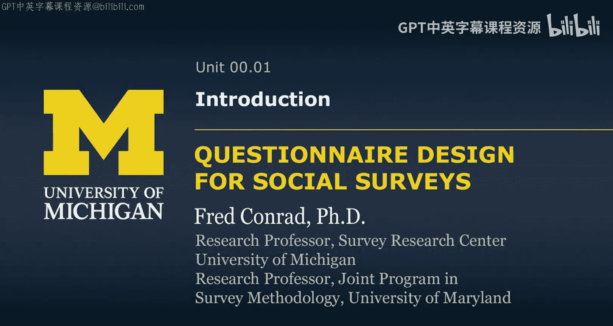
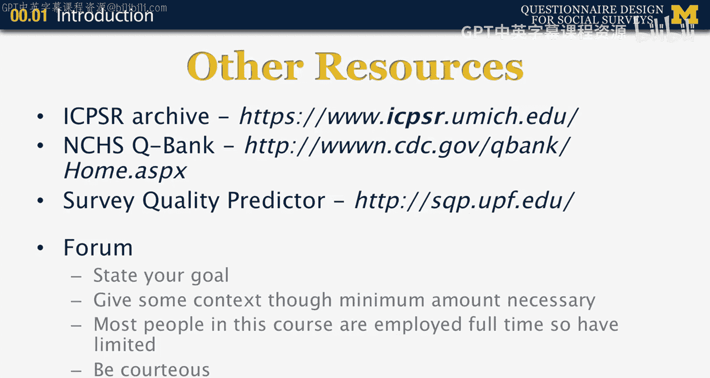

# 调查数据收集与分析：0：导论 🎯

在本节课中，我们将学习《社会调查问卷设计》这门课程的整体框架、核心目标以及你将用到的学习资源。课程由密歇根大学和马里兰大学的调查方法学项目合作开设，专注于调查方法学中的一个关键环节：问卷设计。

---

## 课程背景与目标

本课程由弗雷德·康拉德和弗拉卡·克罗尔共同讲授。课程内容源于密歇根大学、马里兰大学以及Westat机构教职员工的研究与教学贡献。

课程的核心目标是教授调查方法学的各个方面。本课程将聚焦于其中一个相对较小的方面：**测量误差**。

测量误差指的是受访者对单个问题的回答与其真实值之间的差异。这与调查总误差视角中的左侧部分相关。

---

## 问卷设计流程概述

上一节我们介绍了课程的整体目标，本节中我们来看看问卷设计的具体步骤。问卷设计过程可以分为以下几个阶段：

以下是问卷设计的主要步骤：

1.  **确定目的**：明确问卷及每个问题的目标。
2.  **选择模式**：决定问题的传递方式，例如面对面访谈、电话访谈或自填式问卷（如邮寄纸质问卷或网络问卷）。模式会影响具体问题的设计，例如，在语音模式中，问题应更简短；在视觉模式中，则无需过多担心此问题。
3.  **考虑分析目标**：明确每个问题在实现整体分析目标中的作用。
4.  **搜集或编写问题**：收集现有问题或撰写原创问题，并进行预测试。
5.  **组装成问卷**：将测试后的问题最终组合成完整的问卷或调查工具。

---

## 课程单元结构

在了解了设计流程后，接下来我们预览一下课程的具体内容安排。本课程共包含六个单元：

以下是各单元的简要介绍：

*   **第一单元**：涵盖准确性、可靠性等术语概念，并讨论标准化访谈及相关访谈技巧。
*   **第二单元**：提供关于回答过程的理论背景，即受访者如何回答问题。该单元的理论将贯穿整个课程。
*   **第三单元**：涵盖特别难以回答的具体问题类型，例如涉及敏感话题或需要困难记忆检索任务的问题。
*   **第四单元**：讲解态度问题与回答量表。
*   **第五单元**：介绍问卷预测试方法。
*   **第六单元**：讲解将单个问题组装成完整问卷工具的过程。

---

## 学习资源与要求

为了帮助你更好地学习，课程提供了丰富的阅读材料和参考资源。

**必读材料**选自开放获取期刊或允许提供特定论文访问权限的期刊，以及美国联邦或政府统计机构的一些报告。由于开放获取的限制，部分幻灯片中引用的重要研究可能无法在此获取，这些不属于必读内容。

**单元作业**为选择题，内容将涉及每个单元的一篇必读材料。

**推荐教材**包括：
*   **Tourangeau等人**的著作：理论性强，详细描述了受访者回答问题时的心理与社会过程。
*   **Fowler**的著作：实用的调查问题设计指南。
*   **Converse和Presser**的著作：一本简短的优秀手册，提供实用的问卷设计建议。
*   **Sudman和Bradburn**的著作：同样是实用指南，但比Converse和Presser的著作更详细，是经典的问卷设计书籍。
*   **Sudman, Bradburn和Schwarz**的著作：与Tourangeau等人的书类似，关注回答问题的心理过程。
*   **Willis**的著作：兼顾理论与实践，详细讲解本课程重点关注的预测试技术——认知访谈。
*   **Couper**的著作：实用的网络调查设计指南，配有优秀的网页示例和插图。
*   **DeVellis**的著作：关于设计涉及回答量表的项目的实用指南。
*   **Presser等人**编辑的文集：来自问卷设计与评估会议的章节合集。

**其他有用资源**：
*   **ICPSR档案库**（校际政治与社会研究联盟）：可查找过往及当前调查中使用的现有问题。
*   **NCHS问题库**（国家卫生统计中心）：存档了已被使用的问题及其预测试报告。
*   **调查质量预测工具**：由欧洲社会调查的研究与方法学专业中心开发，可用于测试问题的信度和效度。

---

## 论坛使用建议

课程设有论坛或讨论板，请善加利用。在发帖时，请注意：

以下是发帖时的几点建议：

*   明确陈述你的目标。
*   提供必要的背景信息，但不要过多。
*   考虑到课程中大多数学员是全职工作，时间有限。
*   请礼貌待人。

---

本节课中，我们一起学习了《社会调查问卷设计》课程的导论部分，包括课程目标、问卷设计流程、六个单元的核心内容、必读与推荐的学习资源，以及论坛的使用规范。我们非常高兴能讲授这门课程，并期待你的加入。