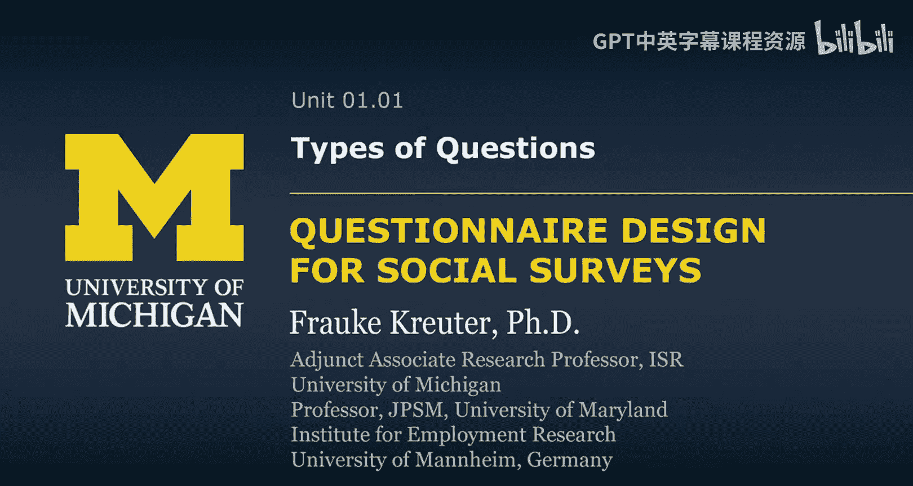
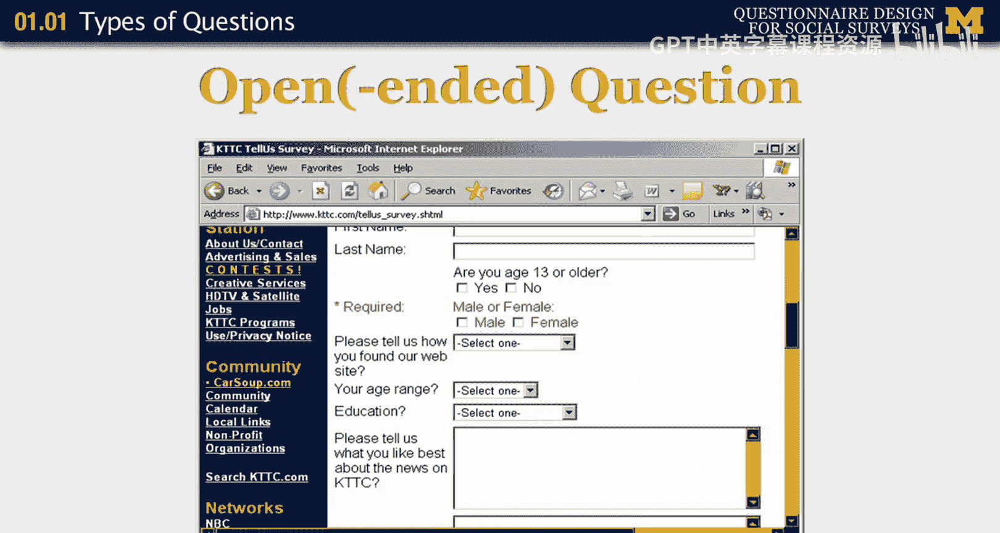

# 密歇根大学《调查数据收集和分析（2-6：方法、社调问卷设计、抽样、缺失数据、分析）｜Survey Data Collection and Analytics》 p44 1_问题类型.zh_en -BV1fw4m1e7Zh_p44-

Welcome。So in this segments， we will talk about different types of questions that you might want to design or will encounter when you deal with surveys I will give you some examples and some terminology so that you don't get lost when throughout the course we will talk about different types of questions。

This first one here is a simple question， it has a yes， no answer category， one phrase。

 no explanations， no special features here。It is in a sense。

 the most simple form of question that questionnaires usually have The examples I'm going to use come from monitoring the future and so does this simple question here。

 if you're curious about that survey， you can check out the website that comes with it it is a survey sponsored by the National Institute on Drug Abuse just part of the National Institutes of Health and it is conducted here at the Institute for Social Research at the University of Michigan。

Another example from monitoring the future is this question here。

 which has a running prompt we call it an do you see it's a question there are a couple of different sub items。

 as we call them。This particular one on how many occasions， If any， have you used Mariaa。

And then the first running prompt that we have is in your lifetime and over here on the right you see a couple of answer categories these can be different scales。

 this is what we call a self-administered questionnaire is very nicely formatted the layout is pretty clear so that people can see where the answer categories are。

 where the labels are and throughout the course we will talk more about how many scale points to choose in those kind of scales and what labels one should be used and how you should think about labeling these kind of questions。

The next one here is a closed question Now the other ones were also closed。

 but they were much simpler here。 we actually have scale points like in the one before。

 but it's a one choice question。 We have one question。

 how do you think your own life will go in the next three years do you think it will get better or worse and then a scale to pick an answer？

This is in contrast to questions like this one here that are sometimes called mark all that apply or questions that allow for more than one choice。

And this particular question here is a question for race and ethnicity。

 sort of a mix that too will be a separate topic in this course。

 and you can see here that people are loud in their are instructions here that mark that to the respondent to select one or more answer category。

 so someone could be black or African American and white。

 easily imagine mobile if you have parents of mixed race。

Here's another example for Mark all that applies。This is again a question from monitoring the future about drug use and the question here is what methods have you used for taking cocaine and obviously respondents can pick several or all of these answer categories。

One note ahead， this is not the course about data analysis。

 but if you start converting this kind of questionnaire or this kind of questions into a data。

 it is important that you already think ahead how to code this kind of question。

Because later on in your data， it probably would show up as six different variables， one variable。

841。Sniffing and snorting and then yes， no01 coded in there for this question having been checked or not if you don't pay attention to this。

 then data analysis can be quite complicated afterwards I'll talk about analysis issue in a separate segment on preparing your analysis plan。

Okay so this question here is what is called a filter question。

 you see here that the layout is very different and so let me show you first is a different source。

 This is the British crime survey from 2002 their new versions up there。

 but this one is already in the archive and easily accessible for everybody This is an interviewer admitted the questionnaire so you see a lot of code that the respondent doesn't see but the interviewer does or if it's automatically programmed into a computeraied interviewing device the program can pick up these code words knows which questions these are and the like。

What is key in this yes， no filtering setting is that the interview will read here apart from anything you have already mentioned。

 this is in brackets in case nothing was mentioned yet the question continues in that time did anyone get into。

Your house flight without permission and cause damage so。

Capitalized words that the interviewer should pronounce。 And then there is a yes， no。

 And here is the hint for the computer program to continue asking follow up questions to this filter question。

 If this previous question has been answered with yes。 So this is what we call a filter question。

This has the advantage that respondents don't have to say， oh， this question doesn't apply to me。

When they are asked， it shortens questionnaires for people who， for example， in this case。

 never had any burglary at their house， and it allows therefore tailoring of questions to respondents。

Now。An interesting side note here。 sometimes， and there has been research out there。

 respondents too clue into this problem and into this questionnaire structure。

 and they might actually。Niggate filter questions say no here to avoid the follow up this is a little bit of research that I'm happy to report in a separate segment here。

 not particular part of the course， but look out on the website and we'll show your results from that particular research。

And finally they are what is called open ended questions。

 those questions are questions like this one here， this is from a customer survey that KTTC in the US has issued down here there's a question please tell us what you like best about the news on KTTC and then there's an open field in this particular self-administered web survey where respondents can type in their answers。

Again， we have a separate segment which will talk about the design of web service in more detail。

 but as a small hint on that。The amount of answer open in the text you will get does depend on how big that box is。

 respondponents to react to that。

Okay， so in the next segment， we will talk about bias invari。

 those are the issues I've just hinted at， you know how do respondents vary their answers。

As a result of how the question is asked， how the layout is created。

 and what respondents might anticipate the question meaning is and thinks of that nature。

