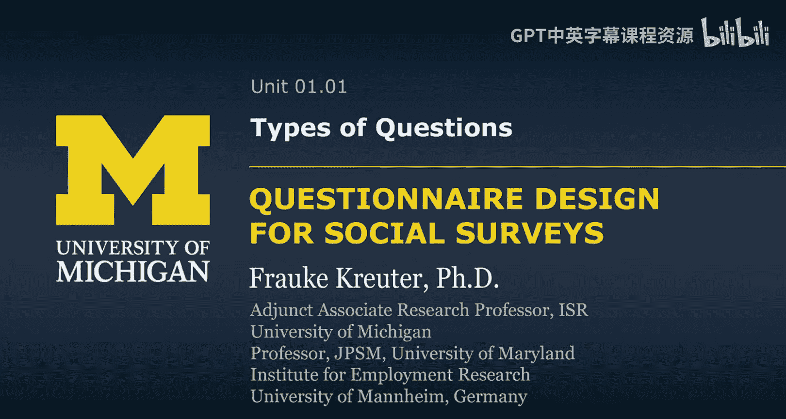
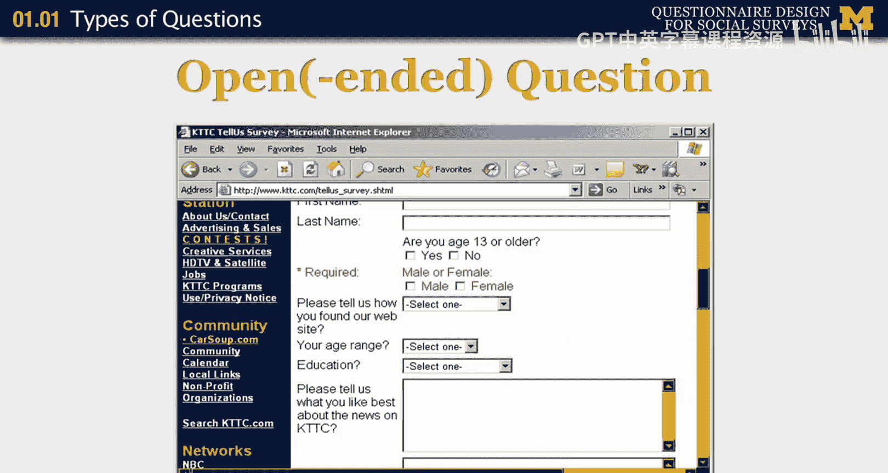

# 调查数据收集与分析：1：问题类型 📝

在本节中，我们将学习调查问卷中可能遇到或需要设计的不同类型问题。我们将通过实例介绍相关术语，以便在后续课程中讨论各类问题时，您能清晰理解。

## 概述

调查问卷包含多种形式的问题，每种类型都有其特定用途和设计考量。了解这些类型有助于设计出更有效、更清晰的问卷，从而收集到更高质量的数据。

## 简单问题

首先，我们来看最简单的问题形式。这类问题通常只提供一个简单的选择，无需额外解释。

以下是一个来自“监测未来”调查项目的例子。该调查由美国国家药物滥用研究所赞助，密歇根大学社会研究所执行。

*   **问题示例**：你是否同意某个观点？
*   **答案选项**：是 / 否

这是一种封闭式问题，结构最为简单直接。

## 系列提示问题

上一节我们介绍了简单问题，本节中我们来看看结构稍复杂的问题。这类问题包含一个主问题和多个相关联的子项。

以下是另一个“监测未来”调查中的例子。这是一种自填式问卷，布局清晰，便于受访者识别答案选项和标签。

*   **主问题**：你有多少次使用过大麻？
*   **子项/提示**：
    1.  在你的一生中？
    2.  在过去一年中？
    3.  在过去一个月中？
*   **答案格式**：每个子项后都附有一套量表选项（例如：0次、1-2次、3-5次等）。

在后续课程中，我们将深入探讨如何选择量表的点数、使用何种标签以及如何设计这类问题的布局。

## 单选与多选问题

接下来，我们区分两种常见的封闭式问题：单选问题和“选择所有适用项”的多选问题。

**1. 单选题**
这类问题要求受访者从多个选项中只选择一个答案。

*   **问题示例**：你认为未来三年自己的生活将变得更好还是更糟？
*   **答案格式**：提供一个从“好得多”到“糟得多”的量表供选择。

**2. 多选题（“选择所有适用项”）**
与单选题不同，这类问题允许受访者选择多个或所有适用的答案选项。

以下是关于种族和民族的问题示例，请注意其中的答题说明。

*   **问题**：你的种族或民族是什么？（可选择一项或多项）
*   **答案选项**：白人、黑人或非裔美国人、亚裔等。

以下是另一个关于吸毒方法的“选择所有适用项”问题示例。

*   **问题**：你通过哪些方式使用可卡因？
*   **答案选项**：吸食、注射、口服等。

> **数据分析提示**：在设计阶段就需考虑如何编码此类多选题。通常，每个选项会被转换为一个独立的变量（例如，变量“吸食”的值为0或1），以便于后续分析。我们将在关于制定分析计划的章节中详细讨论。

## 筛选问题

筛选问题用于根据受访者对前一问题的回答，决定是否询问后续问题。这可以避免向不相关的受访者提问，从而缩短问卷长度并提升体验。

以下是一个来自2002年英国犯罪调查的示例。这是一个访谈员主导的问卷，包含许多受访者看不到但程序或访谈员能识别的代码。

*   **筛选问题**：（除了已经提到的）在那段时间里，是否曾有人未经许可闯入你的房屋并造成损坏？
*   **答案与路径**：
    *   如果回答“是”，则继续询问后续的详细问题。
    *   如果回答“否”，则跳过后续相关问题。

> **研究备注**：有研究表明，部分受访者可能会察觉到这种结构，并为了跳过后续复杂问题而在筛选问题上故意回答“否”。关于这一现象的研究，我们将在课程网站的其他资料中进行展示。

## 开放式问题

最后，我们来看开放式问题。这类问题不提供预设选项，允许受访者自由填写文字答案。

以下是一个来自美国KTTC电视台客户调查的例子。

*   **问题**：请告诉我们您最喜欢KTTC新闻的哪一点。
*   **答案格式**：一个供受访者输入文字的回答框。

> **设计提示**：在网页调查中，回答框的大小会影响受访者回答的长度和详细程度。我们将在关于网页调查设计的章节中详细讨论。

## 总结

本节课中我们一起学习了调查问卷中常见的几种问题类型：
1.  **简单问题**：提供是/否等简单选择。
2.  **系列提示问题**：一个主问题下包含多个量表式子项。
3.  **封闭式问题**：包括**单选题**和**多选题**（“选择所有适用项”）。
4.  **筛选问题**：根据答案决定后续提问路径，以定制问卷。
5.  **开放式问题**：允许受访者自由填写文本答案。

理解这些类型是设计有效问卷的基础。在下一节中，我们将探讨**回答偏差与变异**，即问题的表述方式、布局设计以及受访者的理解如何影响其答案。