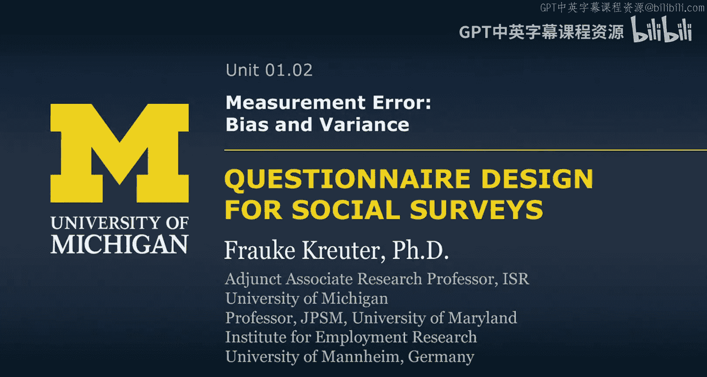
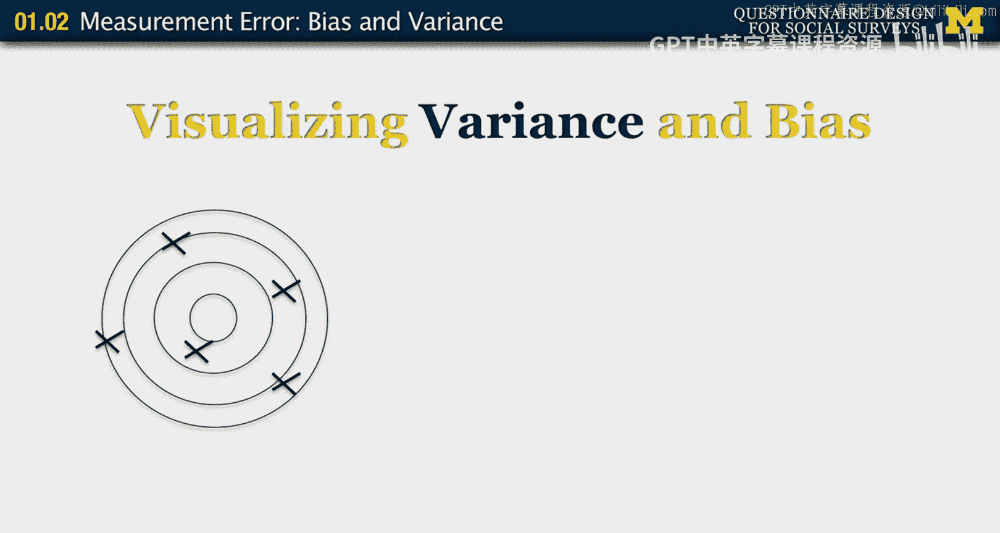
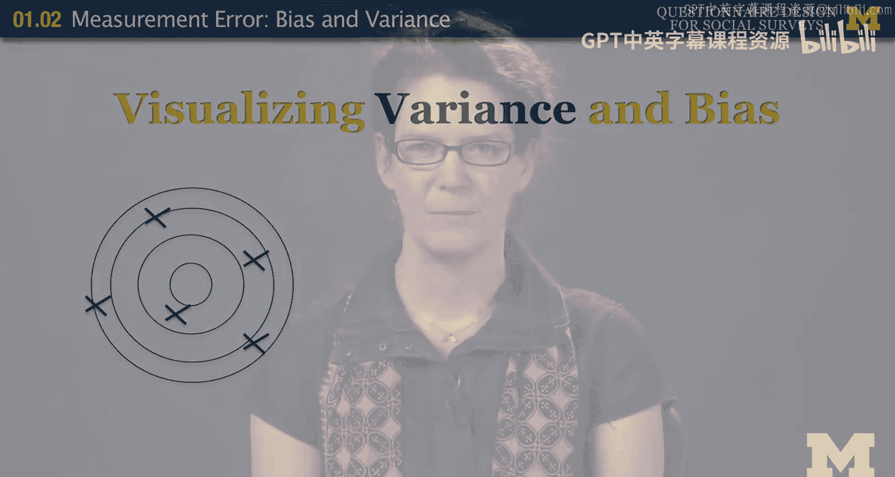
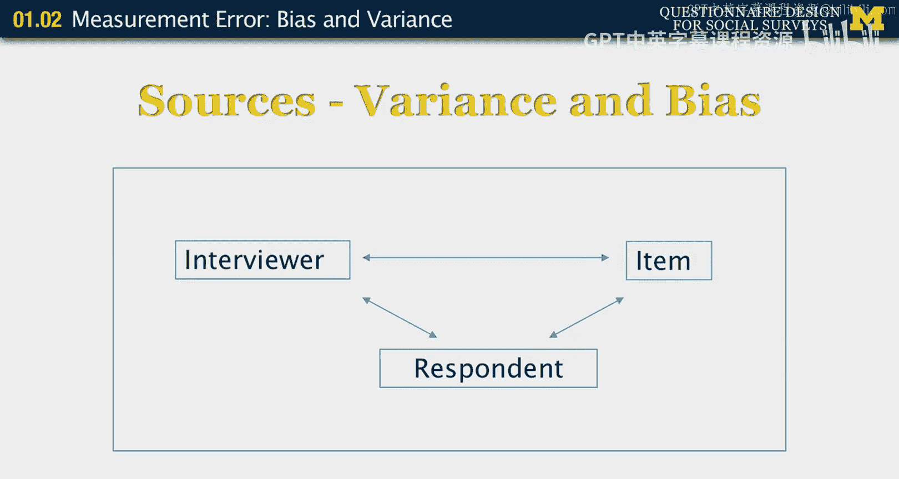

# 密歇根大学《调查数据收集和分析（2-6：方法、社调问卷设计、抽样、缺失数据、分析）｜Survey Data Collection and Analytics》 p45 2_测量误差：偏倚与方差.zh_en -BV1fw4m1e7Zh_p45-

This segment is about bias and variance。I'm going to talk about the general concept， here。

no formulas， no statistics needed to understand what's going on here。

 but it is important that you understand the general concept because what we worry about as questionnaire designers is that we want to minimize any bias that you can have when measuring something of interest to you。

And to minimize variances so that you have the best possible measurement of what it is that you want to measure in your survey。

Some visualize variants and bias to help you understand what we're talking about。

You see this bull'sey and imagine a dot board。You throw a little dots and it ideally。

 you want to get all your measurements exactly to the target right so you have an idea of what is the true value that you want to measure and you really want everybody to be pretty much in the center of this measurement。

Now。The truth is。Really our measurement instruments that good right so you might have variants here there might be ambiguity in a question and so some people are a little off target。

 they overshoot in the answer， others might undershoot in the answer， some might hit it better。

 you know you have variations in all directions。If they are spaced out evenly。

 it will only lead to larger variance and larger standard errors in your statistical estimates。

But it wouldn't bias the results of your study。

In statistical terms， you can solve that problem， but just having a larger sample size in your survey。

But of course， as a question and designer， you would still try to remove ambiguity and get everybody back here in the center。

How you do that will come to， but for hour。Remember that concept， Okay。

 we want to minimize variances， minimize ambiguity。Now， what about bias。

Bs would mean you formulate a question and everybody gets it wrong in the same direction so here you are you know all of our respondents sort of misunderstand the question in you know the same way or they misreport in the same way and that will cause a bias。

The problem with bias is there isn't really a statistical trick that you can easily apply。

 you can't just increase your sample size because everybody sort of in the wrong place there。

So let me give you some examples here for variants and bias。

 The first question is one that is likely to introduce variants last week were you a victim of a crime。

Now， last week might be interpreted differently by respondents。

Last week can mean today and the six days prior。 It could be the last calendar week。

But even the last calendar week can be interpreted quite differently across respondents depending on the cultural context。

 some of you live in countries where the week starts on Monday， in the United States。

 the week usually starts on Sunday in people's mind。

 so that's a variation in the time frame that you ask about。

There are other words in this question that can also be interpreted differently and therefore lead to variance。

People might have different understandings of what it means to be a victim。You can be victimized。

 you can be a subject of a crime， but if you you don't really feel like a victim。

 then you know it's not a big deal， so people might say no to that question。

 even so technically they have been victimized and then of course crime。

 what falls into the definition of crime is something that only the researcher knows。

The individual respondents might think of very different things。

 A good example for this problem is violence within the household。

 That's something that's often not considered a crime， but victimization surveys， of course。

 where many of them， at least are interested in that as a type of victimization。

The question below is one that is likely to introduce bias， so the statement here， the Brady bill。

 and this is for the US context， but I think you'll get it even without that。

 the Brady Bill takes gun out of the hands of convicted killers， are you in favor of the Brady bill？

As you see， the second part of this question only ask if you are in favor of it and those type of questions or this kind of formulation of a question is likely to produce more answers in favor。

Then a more balanced question would so as a question a designer。

 you would advise people to ask the question the following way are you favor or op opposed and maybe you want to make an even stronger adjustment which is alter the first sentence because。

It only points out in one direction what the consequence is of that particular bill。

 so this is something to keep in mind when you formulate your questions。As I said， right now。

 we're only giving examples to go into much more detail for these things。

 but what's important to take away from the segment is understanding what variance and bias means。

As we go through the course， there are always three elements that you should have in mind because all of them can produce variants and bias in the examples I've given so far initially。

 I said respondents understand a question a certain way or respondents don't want to reveal something and therefore produce bias that would be a respondent feature。

And so respondent really is the source of variances or the source of bias。However。

 you of course don't really have control over your respondents。

 what you have control over are your items。You can。

Make sure that you design them in a way that they reduce variance and bias。

And so we will talk about different types of questions that lend themselves more or less to these different types of measurement errors。

But then there's also the interviewer the interview is a crucial part in a survey。

 at least in a survey that is not self administered。

And so the way the interviewer asked the question and how much you allow an interviewer to give explanations to a respondent and many other feature about the interviewer。

 they have the possibility to influence the respondents。

Perception of a question and the choice of answer that a respondent might pick。So for that reason。

 the next segment will talk first about standardized interviewing and the one there after about conversation interviewing to give you an idea of how the interaction of interviewers with the particular items and questions can influence respondent answers。

