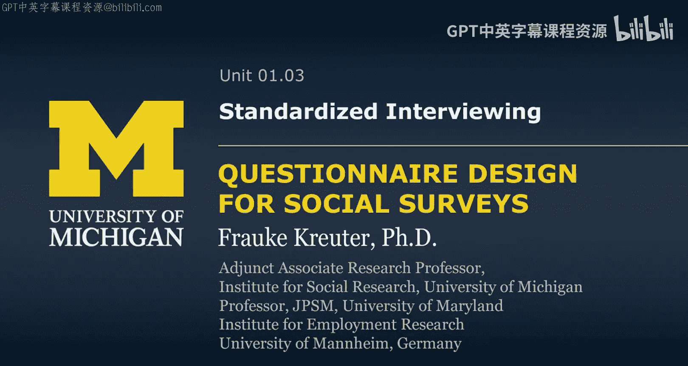
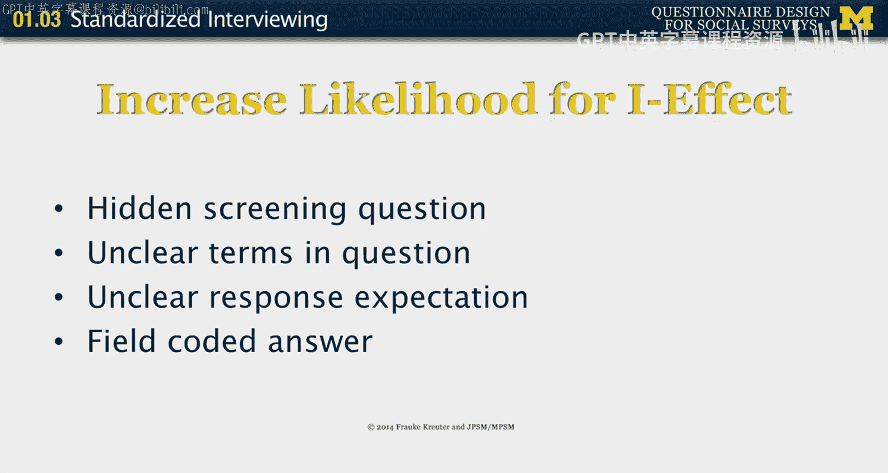

# 密歇根大学《调查数据收集和分析（2-6：方法、社调问卷设计、抽样、缺失数据、分析）｜Survey Data Collection and Analytics》 p46 3_标准化访谈.zh_en -BV1fw4m1e7Zh_p46-

。So in the last segment， we talked about bias and variance。

 and we mentioned that interviewers can contribute to both of these。And so in this segment。

 we'll explain a little bit more why that can be and how this comes about。

And to understand what's going on in the interviewing process。

 it's helpful to review standardized interviewing techniques in the next segment we will talk about more conversational interviewing techniques。

So in terms of research， the goal is usually to standardize so that each respondent is exposed to the same question experience。

And that the recording of the answer is the same to so two people giving the same answer should be recorded in the same way。

If that's the case， so Jack Fowler and Manjoni mentioned in their book standardized to interviewing。

 then the differences in the answers can be correctly interpreted as reflecting differences between respondents。

Rather than between the process that produce these answers， so that's really the spirit。

And has been implemented quite well since then in many surveys that are done here in the US and elsewhere。

Now， the assumption behind that， though， is that the interviewers adequately fulfill their role。

So they have to be carefully trained。And I have to understand that this is the process。

That should be used in order to collect these answers。

It also assumes that the wording of each question is a complete and then adequate script of what should be asked so that the respondents。

 they hear or read the question， will be fully prepared to answer。

Some guidelines for standardized interviewing might be important。

Questions should be read exactly as wood。Probing should only be done in non directive ways。

What you often see happening in standardized interview is that the respondent ask something to the interviewer and then the usual response of the interviewer is whatever it means to you。

And that， of course， can cause a little bit of frustration。

 but it is definitely a way to respond that does not influence the respondent。

Often what you see as strategy is that interviewers just reread the question or reread the answer categories。

 or they make sure that the respondents， in fact， picks an answer category that is provided to him orhu。

Whatever the interviewer records as an answer should reflect what the respondent says。

And they should not provide any personal information。

That might imply a particular value of preference with respect to the topic to be covered in the survey。

 and finally， no feedback should be given to the respondent。

Let me play you now a few examples of a standardized questionnaire sequence。

Now I'd like to ask you some questions specific to your diet。For the next group of questions。

 I'll ask you how much you favor or oppose engaging in certain behaviors。 After I say the behavior。

 please say one of the following strongly favor， somewhat favor， Neither favor nor oppose。

 somewhat oppose or strongly opse the first behavior avoiding fast food。Stroly favor。

Now I'd like to ask you some questions specific to your diet for the next group of questions。

 I'll ask you how much you favor or oppose engaging in certain behaviors。After I say the behavior。

 please say one of the following。Strong we favor。Somewhat favor。Neither favor nor op。

 somewhat oppo or strongly oppo。The first behavior avoiding fast food。Avoiding what I'm sorry。

 Avoing fast food。avoidvoing fast food。 yes， somewhat。Somewhat， thank you。One moment。 Let me。

Just be clear to be more specific that choices are strongly favored， somewhat favor。

 either favor or opposed， somewhat opposed or strongly opposed。🤢，Yeah。

 I somewhat favor sub about food thank you for clear。

I'm not strongly opposed to want fast food whichtenate， but I eat fast food all the time， correct？

Or whatever it means you？I mean， I just want to be clear of the language that I'm using to define。😡。

What， you know， so just for clarification。You did say somewhat favor， correct。

Do I somewhat favor fast food。No avoid favor favor avoiding fast food yes， yes， thank you thank you。

Yeah， I knew there was like a negative in there， so I favor that。Thank you。

So these audio snippets give you an idea， and you also who had some breakdowns in the conversation process。

Sly。Questions for clarifications， but also not exactly reading as scripted is something we noticed in these audio filess。

That's a good one。 example question。He' has a question that is commonly asked in victimization surveys。

And it is a very general question， you find it also in other surveys to measure fear of crime in general。

 the general Social Survey， for example， is a survey that fuels this question。

Is there any area around here that is within a mile where you would be afraid to walk around at night？

Now。This is a hard question。 you can imagine respondents don't necessarily have an answer to this question in the head。

You might not be able to visualize the area within a mile。

You might not walk there at night to begin with， so do you really know how youre afraid you are when you walk around at night？

But it gets sort of at the spirit of crime and victimization。These criminal victim surveys。

 they have a lot of questions on that nature that can be sensitive。

 respondents might not want to answer the question to an interviewer honestly。嗯。They can be vague。

 we discussed in prior segments already some of those words that can be problematic。

So for this reasons。For these reasons， we conducted a survey to measure the effect of interviews on the respondent。

 and I should one you a little bit， this segment is a little bit more statistical than what we otherwise look at。

 but I think it is important background information。

For you to get a sense of the nature of these interview effects。So in this study。

 which was launched in 2001 in Germany， we were able to run four。

Surveys with the random probability sample and one survey quarter survey。Independently。

 by five institutes。Two of these random probability surveys were face to face surveys。

 one was conducted on the phone and one was a mail survey。

Each of these four services have been launched in the same sampling points， meaning the same areas。

 small confined areas could be small village or just a few city blocks in which the cases are sampled。

And we had 160 of these sampling points and a random subset of addresses in each of these sampling points went to each of these surveys that I just mentioned。

After picking the sampling points， there was a random walk conducted where every third household was noted and leading up to 110 addresses and those。

 as I said， were randomly assigned to the four surveys。And then within each household。

 a respondent was randomly selected。Now， why is this study of interest in this question and design context？

With the fear of crime question that I mentioned to you before。

One would assume to see some effects of the sampling point themselves。

 meaning people who live in the same geographic area， in the same neighborhood。

They might answer this question quite similarly， after all， if this is a quote unquote。

  dangerous neighborhood， we would expect people to react to that。

Other questions in that survey were directly related to the neighborhood， for example。

 distance to the next train station or other community measures。In general。

 in survey research we do know。That people that live in the same sampling point。Answer。

More similarly to each other than people would if they were randomly selected from the entire population。

We call this design effect in surveys or clustering effect。

 and they have the unfortunate side effect that it reduces your effective sample， imagine。

If you pick two people and there。I'm so exactly the same thing。

 it's the same amount of information as having asked only one person。So。

These cost effects are usually。Unavoidable for financial reasons。

 because we can't have interviews travel all around the United States。

 so it is advisable to pick certain areas in which the sampling is done。But also。There are。

No lists in many countries from which one could easily draw a random sample。

 so the effort to first list all possible housing units and addresses and then pick cases would be too hard。

So assuming that you are in a context of cluster samples and you have these sampling points。

In most surveys， you have an interview then working in this one area。

It's really hard for normal face to face surveys to disentangle the effect that an interviewer has on the answers from the respondent and the effect that comes from the neighborhood itself。

That's why we conducted this study。 So in this study， because we had four surveys and in particular。

 two face to face surveys within each sampling point， we are able to disentangle。

The homogenizing effect of an interviewer。To the answers of the respondent and of the sampling point itself。

So if you to write this out， we have an overall variance that we observe for our question。

In three components， the sampling point， the geographic area。The interviewer， together。

 they form the cluster variant that we observe in the study。

 and then there is the respondent themselves， the portion of the variant that lies in all the respondents themselves。

So this is the goal here of this survey and provides us an opportunity to。

Dentangle area and interview and get a sense of the magnitude of the interview effect on the variance component in face to face surveys。

Very few studies have been done。To disentangle these two effects。

 they are costly and it's often hard to find funding for these kind of endeavors。

Coma Muter and Pam Camppanelli have done a study of this nature in Great Britain。

 very interesting pieces to read， and there had been a few surveys on interview effects of variance component interview effects。

 but mostly with telephone surveys。We have those in the literature that。Is on the。C website。

Now with these variance components， we can compute what is called rh。

 the intra class correlation coefficient。That's what you see down here。

 these are the same variances component we talked about before。Overall， cluster variants。

In thenominator and cluster variance， plus respond variance in the denominator。So this row。

 the interclass correlation coefficient。😊，Goes into this equation that forms a measure of the design effect。

The general formula for the design effect does not have the square root here。

 so we talk about depthft as 1 plus rh， the interclass correlation coefficient and w minus1 where w is the cluster size and ideally the clusters are all of similar size。

This gets a little bit more complicated when you have。Different cluster sizes or differential。

 nonre not talk about that here in this class。The I personally like the square root of the design effect as a measure for the design effect because it's intuitive。

Really related to the inflation of the confidence intervals。But either one of works。

What you can sort of。Think of as a rule of thumb if you have a design effect of two。

 that inflates your variance on that amount and that translates to a depth of 1。4。Okay。

 so let's look at the results of this survey。Now we have found here our design effect measure from one to three。

 three is very large， one is small， obviously one would mean there is no effect。

 there is no inflation going on。Each of these dots。Is one of the survey items。

The survey had about 110 items and we computed design effect for each of them。

And you see they spread all across here and what is missing from this。The y axis is。

The fraction of the interviewer proportion on the design effect over the overall design effect。

 So a value of one means that the entire amount of depth that I see here。

Is attributable to the interviewer。Whereas if it's zero。

 that means it's only the area effect that we see here。

A little scary because most of the items in this particular survey are in the upper pod。

If you use that same measure， and。Look at the fraction of the total cluster varianceance due to the interview。

 so the portion that we had on there。Y axis is just now in the graph before。

And look at the distribution of items by sensitivity of the item。

Whether the item is a factual question or a non factual question， whether it's closed or open。

 and whether it's difficult or easy to answer。Then we see that the interviewer。

Portions off the clustervaris。Are somewhat higher and sensitive questions。

No difference really on whether this is factual or non factual， but high end open questions。

And no real difference between easy and difficult。 There have been many papers trying to classify and see what real question type will。

Sort of form larger interview effects， but somewhat inconclusive results on this one here。

But if you take them all together， if you think that each of these things， whether it's non factual。

 whether it's sensitive， whether it's open， and whether it's a difficult question。

 these are all harmful item properties。And we group the fraction of the interviewer proportion of the design effect by these harmful item properties。

Then we do see that the proportion of interview effect on the cluster variance goes up as we add these harmful item properties。

I mentioned earlier that we have male surveys in this study as well。

And so what you see here is a plot where the design effect for each item。

In the mail survey on the Y axis is plotted against the design effect on the face to face survey on the X axis。

And。Even so the mail survey was just as clustered as the face to face surveys were。

 you see that the design effects are much larger and therefore to the right of the diagonal in both of these face to face surveys compared to the mail survey。

So that's a strong。Argument。And the strong empirical evidence。That we have。Interviewer effects。

 in addition to the sampling point effect in these face to face surveys and of a sizable amount。

Additional reason for interview effects are， for example， hidden screening question。

 unclear terms where the interview vary in how they explain these terms。

 unclear response expectation。Or answers that are quoted on the fly by the interviewer。

But in particular， the issue of unclear terms and probing and getting at the right understanding of the question is something that can contribute to these interview effects。

 and that's one of the reasons why。An alternative interviewing technique is often discussed under the labor conversational interviewing。

That's all we'll be talking about in the next segment。

