# 密歇根大学《调查数据收集和分析（2-6：方法、社调问卷设计、抽样、缺失数据、分析）｜Survey Data Collection and Analytics》 p47 4_对话式访谈.zh_en -BV1fw4m1e7Zh_p47-

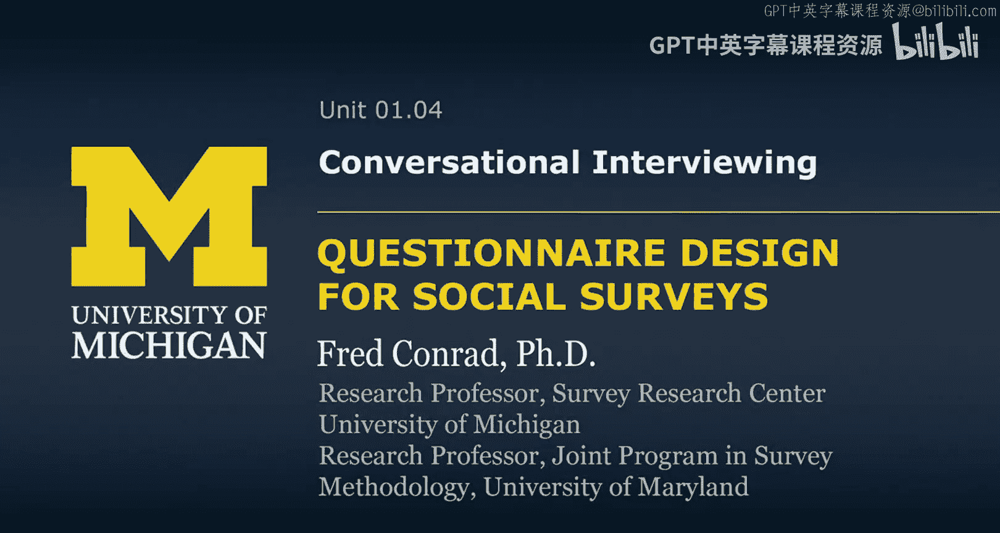

Yeah。We'll continue with our discussion of standardized interviewing。

 but from a slightly different perspective， this segment concerns the standardization of meaning instead of standardization of wording。

Let me just review some of the points that were made in the previous segment about standardized interviewing。

It's like standardized testing in that the goal is for responses to be comparable across respondents。

And this is achieved in principle by holding constant as many attributes of the interview administration as possible。

 especially the wording of items。 This is intended to reduce interviewer related error or interviewer variance。

 by reducing variation and behavior across interviewers。

 So if interviewers are limited in what they can say。

 then the differences between interviewers will be minimal。

And this is motivated by the likelihood that it will reduce cost by focusing the interaction。So。

 again， the technique that's used in standardized interviewing is initially to read the question exactly as worded。

 the idea being that even small changes in wording can affect answers。

 And then if the respondent provides an answer that's not one of the answers that has been offered to them。

 The interviewer provides a neutral or non directive probe。 For example， Let me repeat the question。

 We need a number。 Is that a yes or a no， whatever it means to you。Can you be more specific？

Here's an example of what we're talking about。 This comes from an example by Schffer and Maynard F I Stanford。

 interviewer F R respondent during the past four weeks。

 have you been able to see well enough to read ordinary newsprint without glasses or contact lenses。

Just reading glasses。That's called a report by people who study conversation， it's not an answer。

 this is a yes or no question， this is instead a description of the respondent's circumstances she reads with she needs reading glasses。

 but she didn't say yes or no。

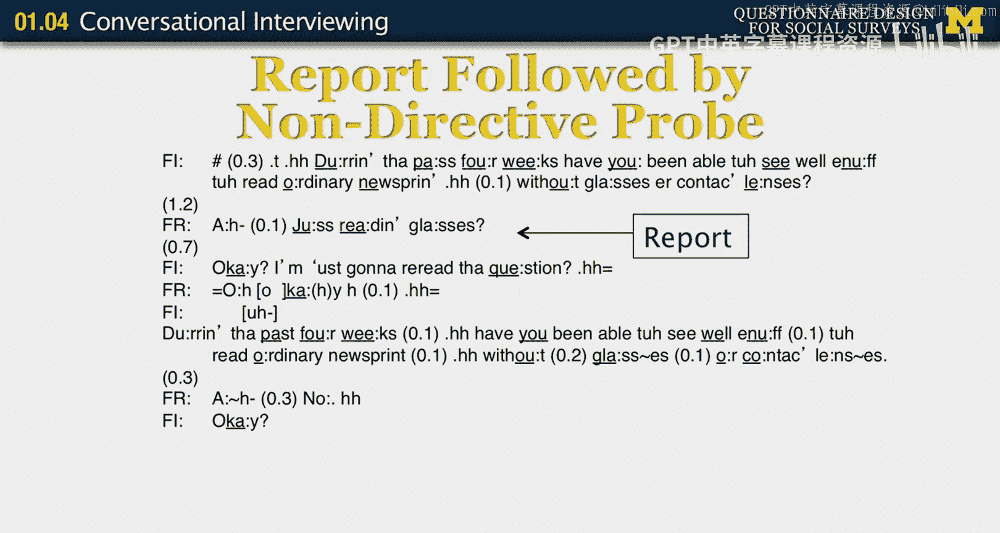

And then the interviewer continues， okay， I'm just going to reread the question。

Okay。During the past four weeks， Have you been able to see well enough to read ordinary newsprint without glasses or contact lenses。

 So that's a neutral probe。 The interviewer has reread the question。 The respondent then answers， no。

 which is an acceptable answer。 The interviewer says， O， and goes on。

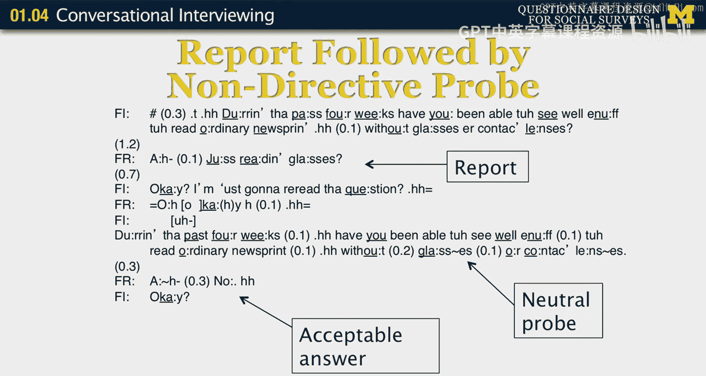

So this is how it's supposed to work， it doesn't always work this way in practice。

 but this is the idea that by providing a neutral probe。

 the respondent then provides an acceptable answer。

What's good about standardized interviewing， Well， it should lead to fast interviews and reduced interviewer costs。

 It should， in principle， reduced interviewer effects。

 and it allows us to be sure that all respondents receive the same materials as interviewers are reading the questions exactly as worded。

 What's bad about the approach is that it prevents grounding。

 which is the back and forth process that helps interlocutors。

 people talking to one another to understand each other。 And this may lead to misunderstanding。

 which may then lead to inaccurate answers。So recognizing these limitations LED such men in Jordan to propose that strict standardization of wording can undermine response validity。

 That is the accuracy of answers， because respondents may not understand the questions as intended。

This doesn't mean that reliability will be affected that his respondents can answer consistently can give the same answer to the same question if it's asked on multiple occasions。

 but misunderstand the question in the same way， their study was a conversation analytic study in which they carefully examined the interactions in a small set of interviews conducted as part of the general social survey。

 So it was not a large scale quantitative study based on their observations。

 they argued that interviewers should be empowered to use conversational resources like grounding that we just mentioned to promote the validity of answers。

The idea behind this alternative that they advocated was to allow interviewers to say whatever is required to be sure respondents understand the question as intended to ground understanding。

The way this approach this idea has been implemented is that interviewers must read the question as worded initially。

 but then can paraphrase the question or a relevant definition。

 either when the respondent specifically asks for clarification or when the interviewer deems that it might help。

What's good about this approach is that it should promote the intended understanding of questions and therefore。

 higher response accuracy。 What's bad about the approach is that clarification may take extra time。

 These different approaches to interviewing rest on different views of meaning。

So the rationale for standardized wording is that meaning resides in words。

 if two respondents get the same words， they'll get the same meaning。

This has been called the message model and the idea is that if I'm a speaker and I have an idea。

 I convert that idea into words， I utter those words。 you as the listener。

 hear those words and they activate in your head。 The meaning that I had originally it doesn't always work like that。

 but that's the idea behind standardized wording hand in hand with this idea is the idea that pretesting can remove most of the major comprehension errors that most people would have The alternative advocated by such men in Jordan is that meaning rests on collaboration that participants。

 the speaker and listener need to talk about what's being said to make sure they both understand each other that they're on the same page。

 This is what's meant by the utterance must be grounded。

It comes from collaborative theory， which is due to Herbert Clark and his colleagues。

Hand in hand with this idea is that pretesting cannot anticipate all of the ambiguities across a diverse sample of respondents。

 So if you have several thousand respondents in a sample。

 many of them will have different situations that will make the question ambiguous。

 it's hard to anticipate all of those with a small pretest and write a single question develop a single question wording that will be clear to all respondents。

 So while pretesting helps the idea here is that clarification is also needed in the interview so that interviewers can help respondents make sense of the question in light of their particular circumstance。

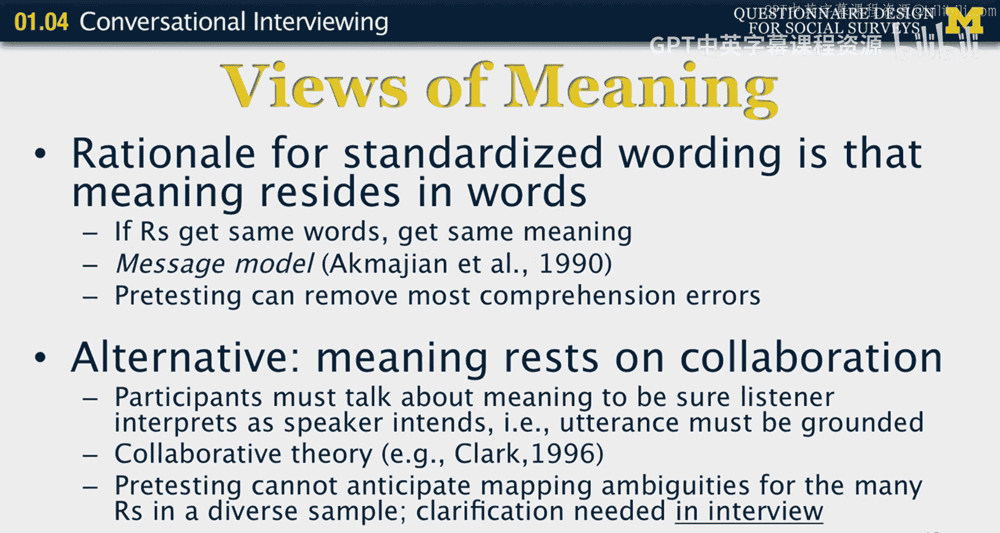

So in conversational interviewing， as it has been implemented。

 interviewers and respondent work together to assure the respondent understands the question the way it was intended。

 The interviewer reads the question as worded， then says whatever is necessary to assure the respondent understands the question the way it was meant to ground the meaning。

 What that usually consists of is clarifying concepts in the question。

So the goal is to standardize meaning， even if the wording varies。

 it may take different wording by the interviewer to establish the same interpretation across a range of respondents。

There have been a number of empirical comparisons of these two techniques。

 The first by Schchoer and Conrad trained two groups of interviewers on the same survey concepts。

 and then one group was trained in strictly standardized techniques where they read the questions as worded。

 use neutral probes， et cetera， and the other group was trained to use conversational or flexible techniques。

There were 12 questions borrowed from ongoing federal surveys。

 The truth of respondents' answers could be evaluated。

 the accuracy respondents' answers could be evaluated because they were based on fictional scenarios for which the experimenters knew the correct answer。

Here's an example， has Kelly purchased or had expenses for household furniture。

Half of the respondents answered on the basis of a scenario like this。

 a receipt from a fictional purchase， a Brooks end table for $149。 Now this is fairly unambiguous。

 and a table is a piece of household furniture by most interpretations。

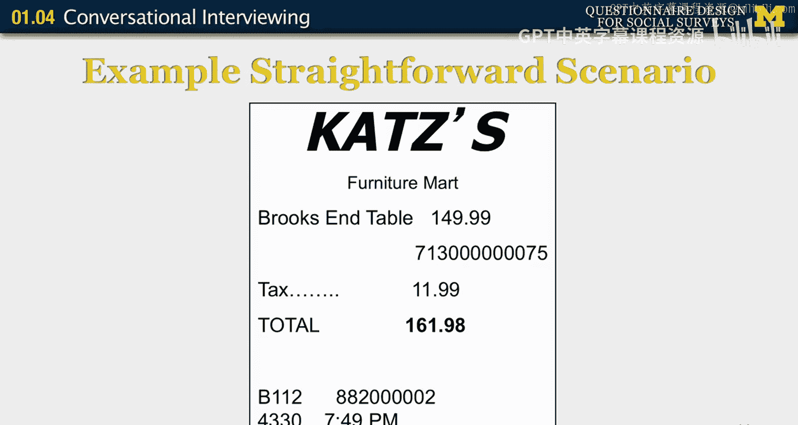

We call this a straightforward scenario because it really doesn't require additional clarification。

The other half of the respondents answered that question on the basis of this scenario。

 which we called complicated because it's a receipt for the purchase of a floor lamp and it's less clear if a floor lamp counts as furniture or not。

 it really depends on the definition。 So the impact on data quality or response accuracy could well be different depending on whether interviewers can provide clarification or not。

 Here are the results。 This is the percent of accurate responses for standardized and conversational interviews for straightforward and complicated scenarios。

 So as you can see， the response accuracy is quite high for straightforward scenarios。

 whether interviewers can provide clarification in conversational interviews or cannot provide clarification in standardized interviews。

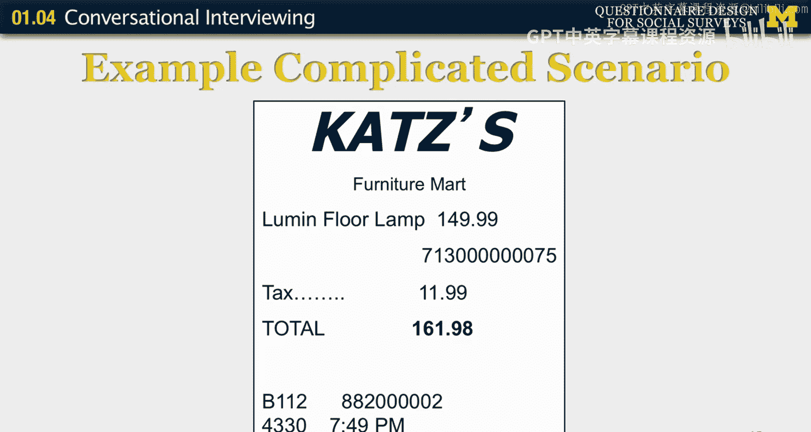

But for the complicated situations， accuracy is quite different In standardized interviewing。

 the accuracy is really quite low。 It's about 27% cent because interviewers cannot provide clarification for situations like。

 does a floor lamp count as a piece of furniture in conversational interviewing where interviewers can clarify that concept。

 Ac is much higher。 It's nearly as high as it is for the straightforward situations。

One concern about conversational interviewing is that interviewers might mislead respondents。

 They might inaccurately explain what the questions mean， but as you can see here。

 the vast majority of the information they provided to respondents was accurate。

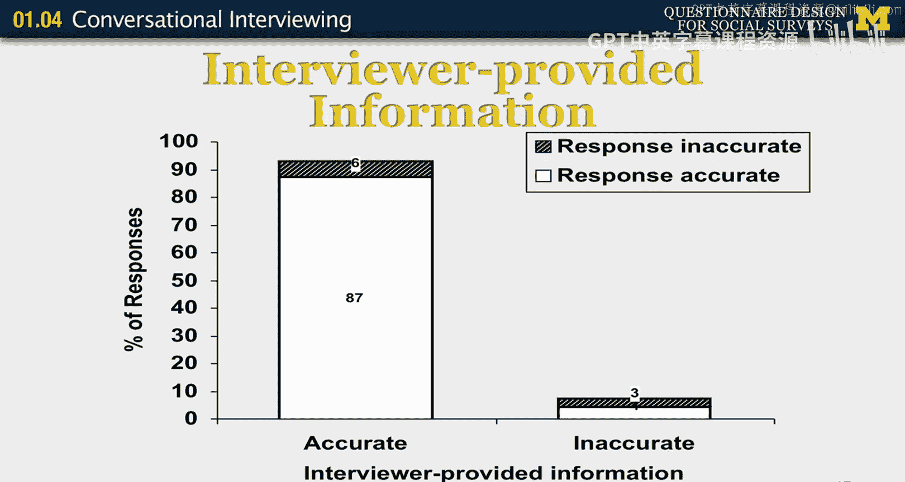

The downside to this approach is that or the cost to this approach is that it takes more time to clarify concepts。

 more words have to be produced by the interviewer and this takes time。

 so this plot here indicates that on the far left， the lower left。

 standardized interviewing for complicated situations produces relatively low accuracy about 27%。

 but it also produces fast interviews about under four minutes on average。

Conversational interviews， this point in the upper right， produce。

Far higher accuracy for complicated situations， but at the cost of much longer interviews。

So these are laboratory studies in which the frequency of the complicated situations was experimentally manipulated to be 50%。

 so half the time respondents were answering on the basis of straightforward situations half the time complicated situations。

 if those complicated situations are less frequent in practice outside of the laboratory。

 then the advantages for providing clarification are probably reduced。

 so one question is how frequent are these complicated situations。

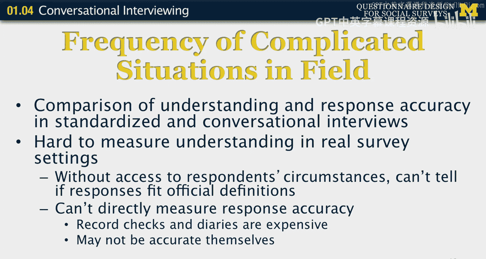

So in real- worldord situations it's hard to measure understanding without access to respondent circumstances。

 we can't tell if the responses fit the official definitions that is if they're accurate。

 and we can't directly measure response accuracy in some studies there are record checks and diaries that allow you to evaluate accuracy of answers。

 but both of these are expensive and may not be accurate themselves。

So we can't directly measure interpretation and accuracy。

 but we can determine if conversational interviewing changes respondents understanding。

 The idea is that if conversational interviewing improves comprehension。

 then respondents in standardized interviews should change their answers in a subsequent conversational interview。

 more than they would in a subsequent standardized interview。 In other words。

 if in an initial standardized interview， they have misunderstood a question because they are unable to get clarification from the interviewer。

 but then in a subsequent conversational interview， they can get clarification。

 that should lead them to change their answer more than they would change their answer if they couldn't get clarification in a subsequent standardized interview。

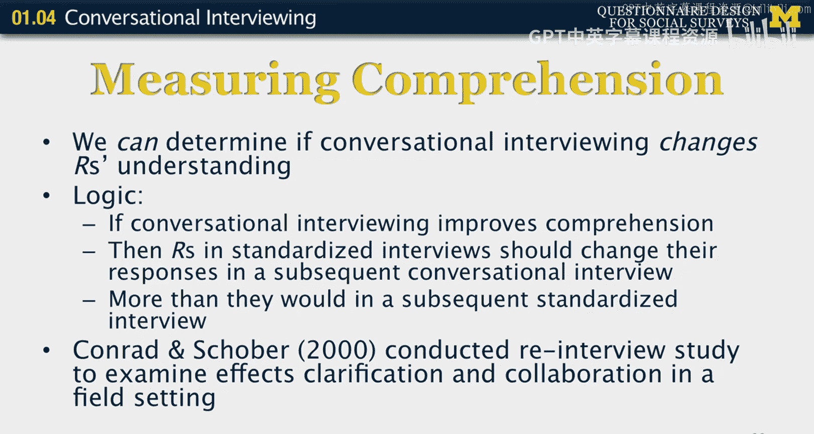

So Conrad and Schchoer conducted a re interviewter study based on this logic。

So as you can see in this figure， all of the respondents were initially interviewed with standardized techniques。

 then in the second interview half were recruited into standardized interviews and half into conversational interviews so how does this difference in the second interview affect response change？

As you can see more people change their answers between an initial standardized and a subsequent conversational interview than between two standardized interviews。

 in fact the difference is 11%， which we've interpreted as the frequency of complicated situations that is the kind of ambiguities that benefit from clarification in this sample for these items and it raises the question or the decision for a practitioner about whether that amount of misunderstanding is or reducing misunderstanding by that amount is worth the additional costs。

 and there are additional costs in these conversational interviews。

 they took about four minutes longer than a subsequent standardized interview。

 so nine minutes versus five minutes。

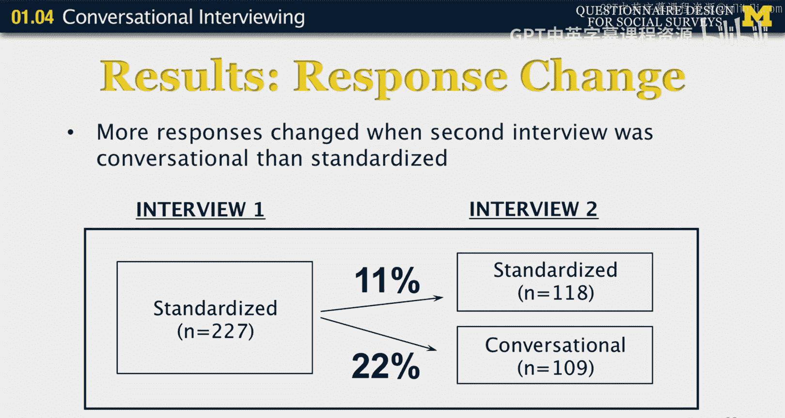

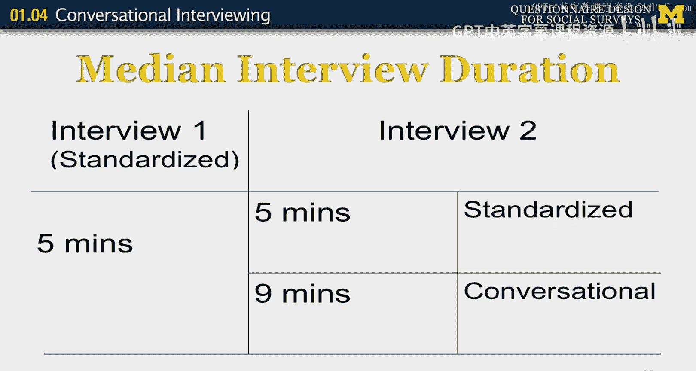

The final。Point about conversational versus standardized interviewing is whether conversational interviewing is as effective for。

Questions about opinions as it is for questions about behaviors or facts。

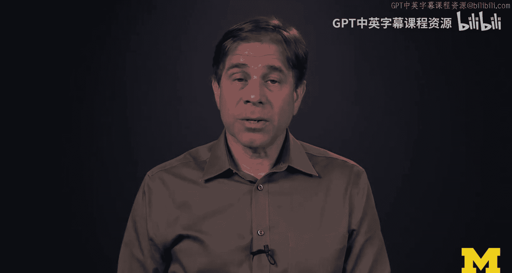

Hubard and colleagues examined this question by also using response change to assess the accuracy of answers for three factual and seven opinion questions about the economy and drowsy driving。

They embedded a study in production interviews from the survey of consumers in which they re aministered these 10 questions。

 So the first administration was standardized for all respondents。 It was the production interview。

And then the readadministration was conversational for half of the respondents in which interviewers could provide definitions and standardized for the other half。

Some of the response change in the conversational re interview reflects improved understanding that his responses were now more aligned with the definition。

 so more change in conversational and standardized re interviews reflect more accurate interpretation。

For opinion questions， the definitions were of both question concepts and response scale labels。

So here's an example of an opinion question with a definition of a concept in the question。

 we are interested in how people are getting along financially these days。

 would you say that you and your family living there are better off or worse off financially than you were a year ago。

By better off financially， we mean the following， by worse off financially， we mean the following。

And here's an example of a definition of a response scale label。In your opinion。

 how risky is drowsy driving， would you say that it is extremely risky， very risky， somewhat risky。

 not too risky or not at all risky。By extremely risky。

 we mean it causes an accident every time you do it。 by not at all risky。

 we mean it never causes an accident。 So this graph presents response change for factual questions and opinion questions when administered with either type of interview。

 and theres more response change in conversational and standardized interview and factual questions on the left。

Very consistent with the other studies we've talked about。

There's also more response change with conversational interviewing than standardized interviewing for opinion questions on the right。

 In fact， it may look like there's even more response change for opinion than factual questions。

 but that's not reliably different statistically so the take home message here is that is that conversational interviewing works very much for opinion questions as it does for factual questions。

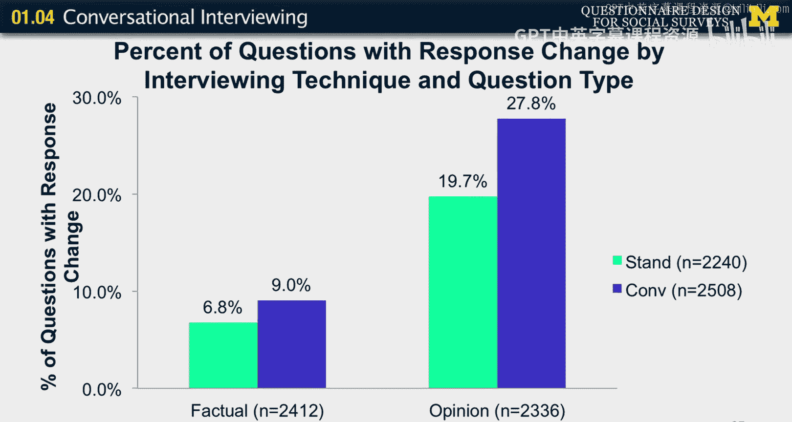

So to summarize。Standardized interviewing in principle reduces the impact of interviewers on answers。

 This is achieved by presenting the same wording to all respondents。

 and then using only neutral probes。 in other words， the only non-standard wording is neutral probes。

 The only thing that's not scripted。 interviewviewers cannot engage in grounding as is possible in everyday conversation。

 So despite adequate answers， respondents may be inaccurate。

Conversational interviewing improves accuracy across a range of studies using a range of measures。

 but it increases interview duration because clarification takes time。

The approach seems to improve interpretation， but also increase duration to the same extent whether questions concern behaviors or opinions。

So practitioners need to weigh the trade off between longer and maybe more costly interviews against higher certainty that respondents understand questions as intended。

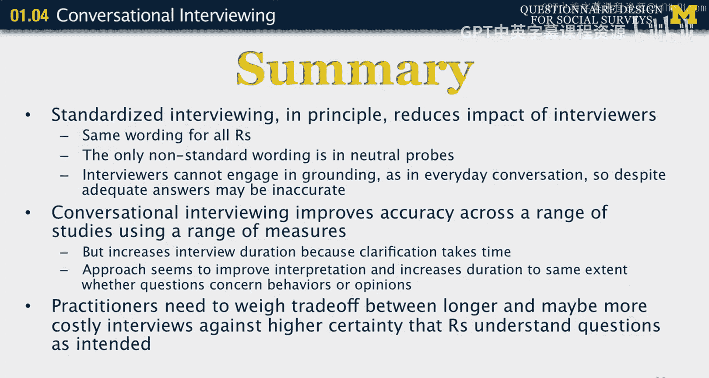

In our next segment， we'll go deeper into the idea of interviewer variant to which we've alluded several times during the current segment。

