# 调查数据收集和分析：4：对话式访谈 🗣️

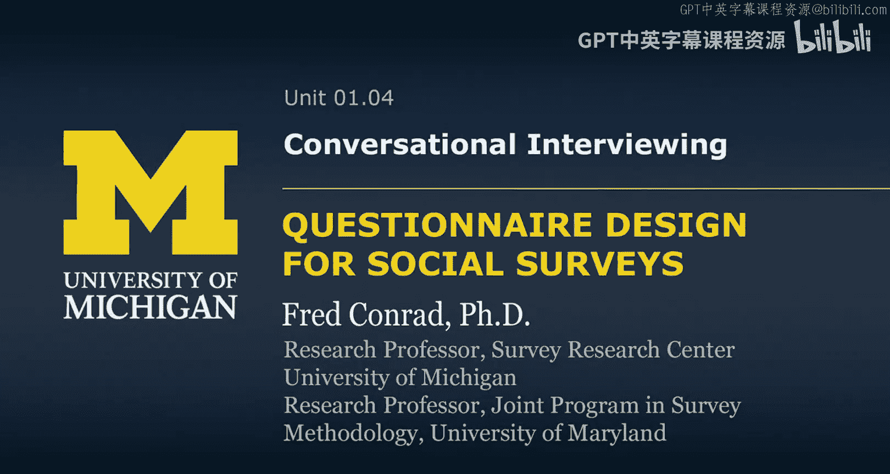

在本节课中，我们将从“意义标准化”而非“措辞标准化”的角度，继续探讨标准化访谈。我们将对比传统的标准化访谈与新兴的对话式访谈，分析各自的优缺点，并通过实证研究数据来理解它们如何影响调查数据的质量和成本。

上一节我们介绍了标准化访谈的基本原则，本节中我们来看看另一种视角：对话式访谈。

## 标准化访谈回顾

标准化访谈的目标是确保不同受访者的回答具有可比性。其核心原则是尽可能保持访谈实施过程的所有属性恒定，尤其是问题的措辞。这旨在通过减少不同访员之间的行为差异，来降低访员相关的误差或访员方差。

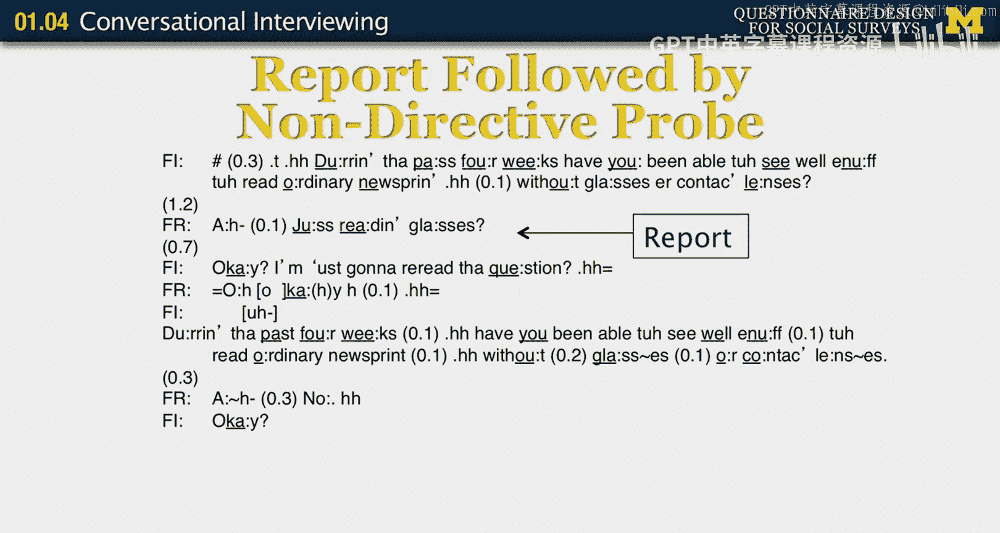

以下是标准化访谈的标准操作流程：
1.  **初始提问**：访员严格按照既定措辞读出问题。
2.  **中立追问**：如果受访者的回答不在预设选项内，访员使用中立、非引导性的方式进行追问。例如：“我再重复一遍问题”、“我们需要一个数字”、“您能说得更具体一些吗？”。

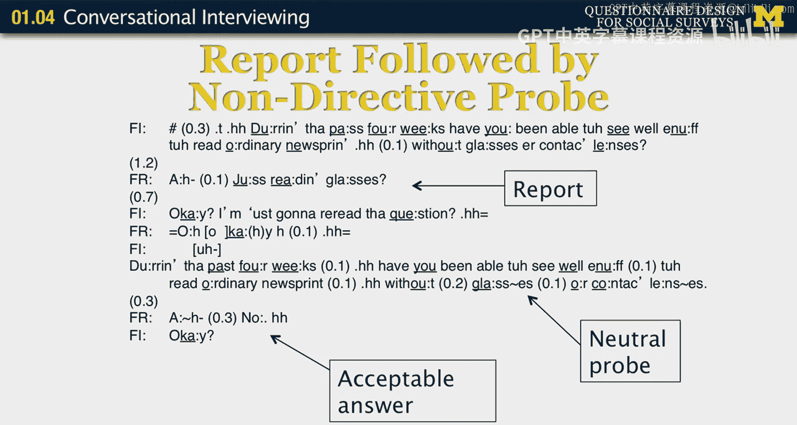

**示例**：
*   **访员**：“在过去四周里，您在不戴眼镜或隐形眼镜的情况下，视力是否足以阅读普通新闻报纸？”
*   **受访者**：“我戴老花镜。” （这描述了个人的具体情况，但未回答“是”或“否”）
*   **访员**：“好的，我再读一遍问题……” （中立追问）
*   **受访者**：“不能。” （可接受的答案）

理论上，通过提供中立追问，受访者会给出可接受的答案。

## 标准化访谈的优缺点

**优点**：
*   访谈速度快，有助于降低访员成本。
*   理论上能减少访员效应。
*   确保所有受访者接收到完全相同的提问材料。

**缺点**：
*   阻碍了“意义共建”——即对话双方通过来回交流以确保相互理解的过程。
*   可能导致误解，进而产生不准确的答案。

认识到这些局限后，Suchman 和 Jordan 提出，严格的措辞标准化可能会损害**回答效度**（即答案的准确性），因为受访者可能无法按设计意图理解问题。这不一定影响**信度**（即回答的一致性），但可能导致受访者始终以错误的方式理解问题。

他们主张，访员应被授权使用“意义共建”等对话资源来提升答案的效度。这种替代方法的核心理念是：允许访员说任何必要的话，以确保受访者按设计意图理解问题。

## 两种访谈方式背后的意义理论

这两种不同的访谈方法基于对“意义”的不同看法。

*   **标准化措辞的理据（信息传递模型）**：意义存在于词语之中。如果两位受访者听到相同的词语，他们就会获得相同的意义。其理念是：说话者将想法转化为词语，听者听到词语后激活相同的意义。与此配套的观点是，**预测试**可以消除大多数受访者可能遇到的主要理解错误。
*   **对话式访谈的理据（协作理论）**：意义基于协作。对话参与者需要通过交谈来确保双方相互理解、达成共识。这就是“话语必须被共建”的含义。与此配套的观点是，预测试无法预见多样化的受访者样本中所有可能的歧义。因此，在访谈中需要澄清，访员可以帮助受访者根据其特定情况理解问题。

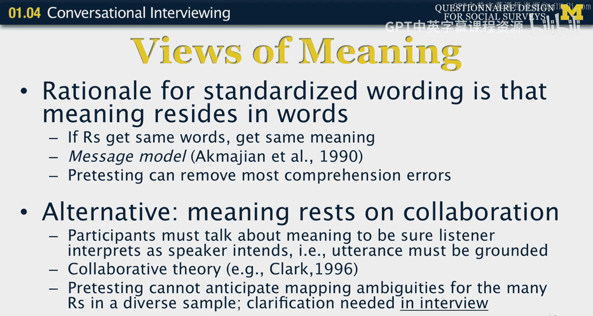

## 对话式访谈的实施与实证比较

在对话式访谈中，访员和受访者共同努力，确保受访者按设计意图理解问题。访员先按既定措辞读出问题，然后说任何必要的话来确保理解、共建意义。这通常包括澄清问题中的概念。**目标是标准化“意义”，即使措辞可能因受访者而异**。

已有若干研究对这两种技术进行了实证比较。Schober 和 Conrad 的一项研究训练了两组访员，一组使用严格标准化技术，另一组使用对话式（灵活）技术。受访者基于虚构场景（研究者已知正确答案）回答问题。

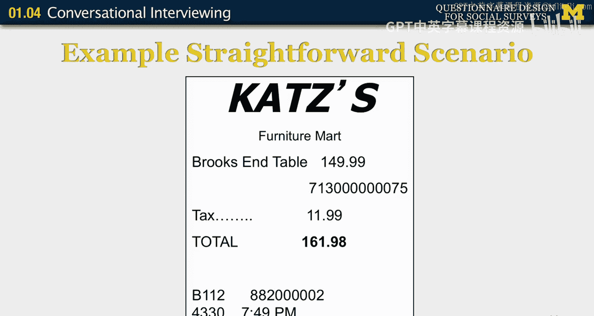

**示例问题**：“Kelly 是否购买或支付了家庭家具的费用？”
*   **简单场景**：购买了一张价值149美元的边桌（桌子明确属于家具）。
*   **复杂场景**：购买了一盏落地灯（落地灯是否算家具取决于定义）。

以下是研究结果：

**回答准确率对比**：
*   对于**简单场景**，无论是标准化访谈还是对话式访谈，回答准确率都很高（约97%）。
*   对于**复杂场景**，标准化访谈的准确率很低（约27%），而对话式访谈的准确率则高得多（约91%），因为访员可以澄清概念。

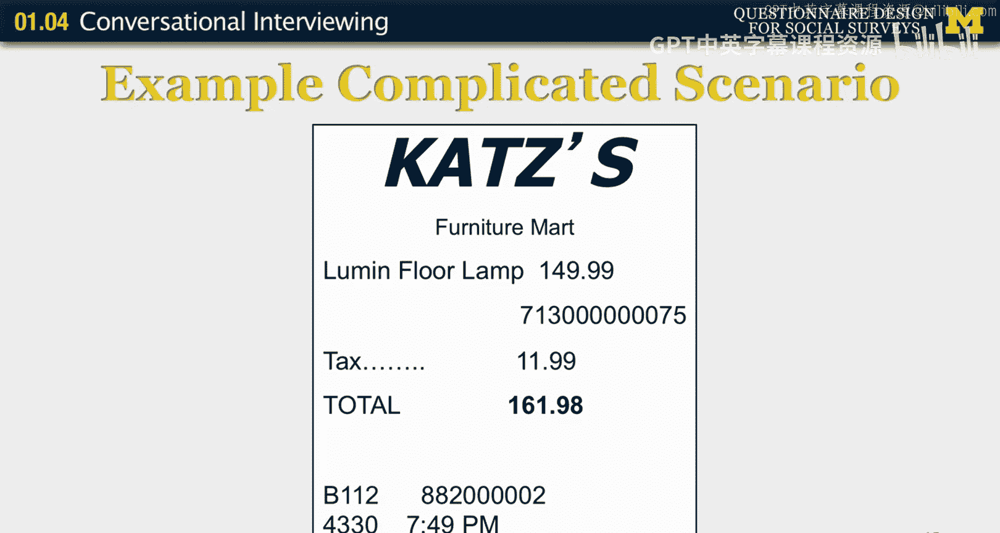

**关于访员误导的担忧**：数据显示，访员向受访者提供的信息绝大多数是准确的。

**成本权衡**：对话式访谈的缺点是澄清概念需要更多时间。下图展示了这种权衡：标准化访谈（左下点）对于复杂场景准确率低（~27%），但访谈速度快（平均约4分钟）；对话式访谈（右上点）准确率高得多，但代价是访谈时间显著延长。

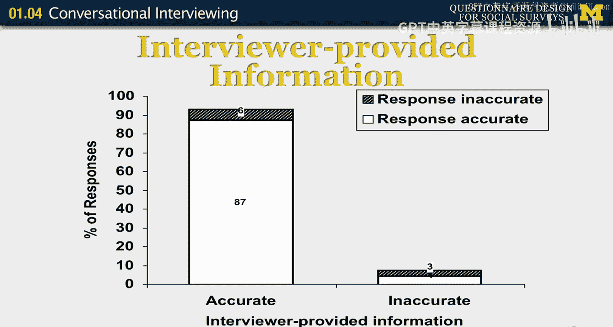

（注：此处为文字描述，原讲义中应有展示准确率与时长关系的散点图。）

## 现实世界中的复杂情境频率

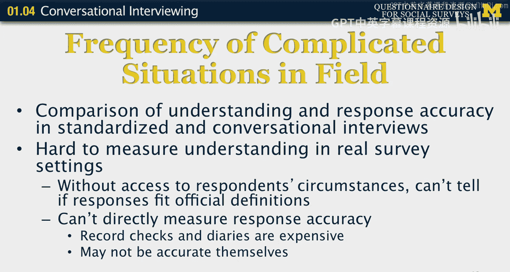

上述实验室研究中，复杂情境的频率被实验操控为50%。在现实世界中，复杂情境可能没那么频繁，因此提供澄清的收益可能会降低。那么，复杂情境在实际中有多频繁呢？

在现实情境中，我们很难直接测量受访者的理解程度或答案的准确性。但我们可以通过考察**回答一致性**的变化来推断。Conrad 和 Schober 进行了一项重访研究：

1.  所有受访者首次接受标准化访谈。
2.  第二次访谈时，一半受访者接受标准化访谈，另一半接受对话式访谈。

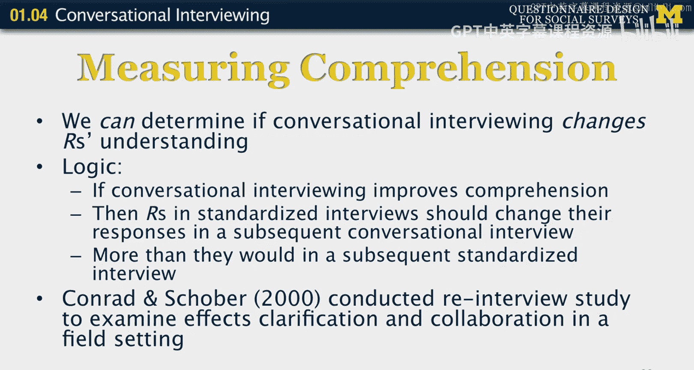

**逻辑**：如果对话式访谈改善了理解，那么那些首次标准化访谈中可能因无法获得澄清而误解问题的受访者，在后续的对话式访谈中获得澄清后，更有可能改变他们的答案。

**结果**：与两次标准化访谈相比，从首次标准化访谈转为后续对话式访谈的受访者中，改变答案的人数多出11%。这11%可被解释为此样本中这些问题上**受益于澄清的歧义情境（即复杂情境）的频率**。同时，这些对话式访谈比后续的标准化访谈平均长约4分钟（9分钟 vs 5分钟）。

## 对话式访谈对观点类问题的效果

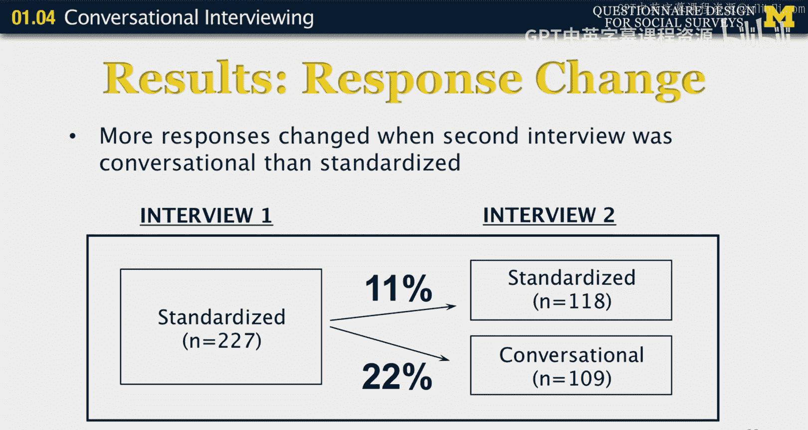

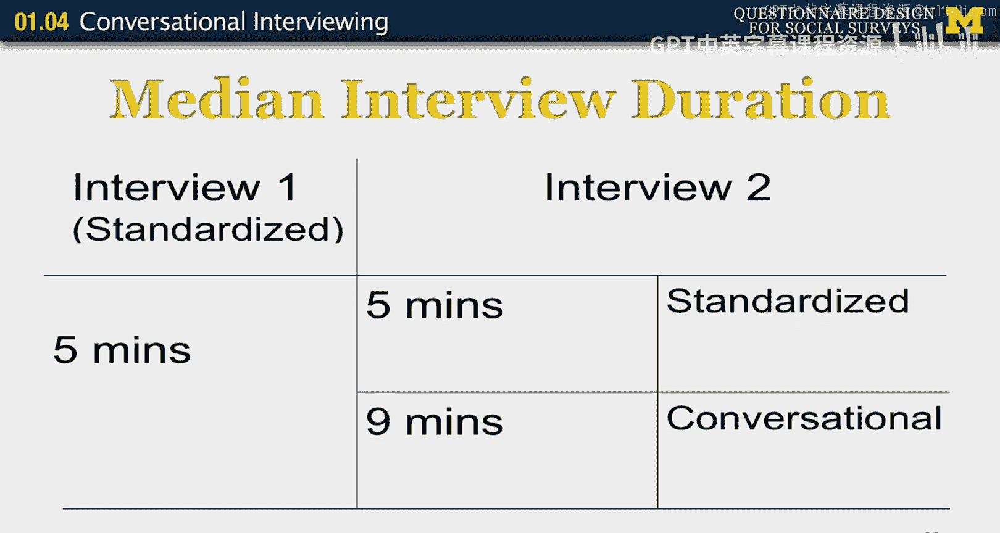

对话式访谈对事实/行为类问题有效，那么对观点类问题是否同样有效？Hubard 等人的研究也使用回答变化来评估准确性，他们比较了3个事实性问题和7个关于经济和疲劳驾驶的观点性问题。

**操作方法**：首次访谈（生产性访谈）对所有受访者都是标准化的。重访时，一半受访者接受对话式访谈（访员可提供定义），另一半接受标准化访谈。

*   对于观点性问题，定义既包括问题中的概念，也包括**回答选项的标签**（例如，“极其危险”定义为“每次这样做都会导致事故”；“一点也不危险”定义为“永远不会导致事故”）。

**结果**：无论是事实性问题（左图）还是观点性问题（右图），对话式访谈都比标准化访谈引发了更多的回答变化。这表明，**对话式访谈对于观点性问题的效果与对事实性问题一样好**。

（注：此处为文字描述，原讲义中应有展示事实与观点问题回答变化率的柱状图。）

## 总结 📝

本节课中我们一起学习了标准化访谈与对话式访谈的核心区别与权衡。

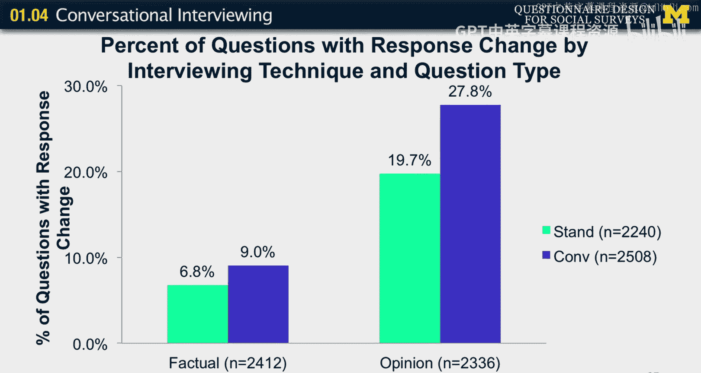

*   **标准化访谈**：原则上通过向所有受访者呈现相同措辞并仅使用中立追问，来减少访员对答案的影响。访员不能像日常对话那样进行“意义共建”。尽管可能得到看似合格的答案，但准确性可能受损。
*   **对话式访谈**：多项使用不同测量方式的研究表明，它能提高答案的准确性。但代价是增加了访谈时长，因为澄清概念需要时间。
*   **适用范围**：这种方法在改善问题理解的同时增加访谈时长的效果，对于行为类问题和观点类问题是相似的。

因此，实践者需要在**更长、可能成本更高的访谈**与**更高的受访者按设计意图理解问题的确定性**之间进行权衡。

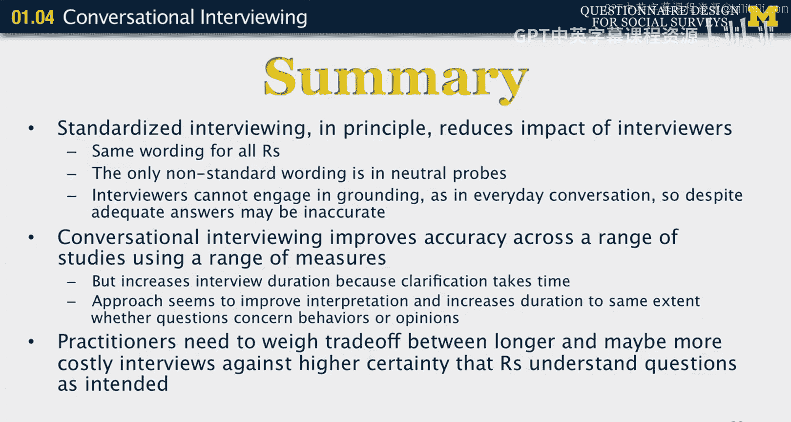

在下一节中，我们将更深入地探讨在本节中多次提及的“访员方差”这一概念。