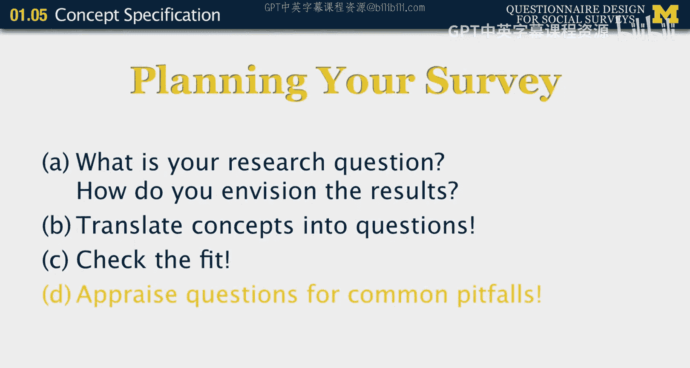

# 密歇根大学《调查数据收集和分析（2-6：方法、社调问卷设计、抽样、缺失数据、分析）｜Survey Data Collection and Analytics》 p48 5_概念界定.zh_en -BV1fw4m1e7Zh_p48-

So this segment is about concept specification。Remember， we already had two segments on interviewers。

 standardized interviewing and conversational interviewing。

 pointing out how interviewers can contribute to variants and bias and for the rest of the course。

 we pretty much will talk about items and how they can affect these two elements， but the first step。

On the item side is of quote， finding the right item。And to launch us into this。

 I want to cite Noah Schwartz， a former faculty member here at the University of Michigan。

Who stated a common problem？And I'll let you read out this quote here for a moment。

Now the point that NoA makes here is very common， I've consulted in a number of research settings and people who have some big idea what they try to measure。

 but getting that in the form of a question can be very。

 very difficult and so that's what we're talking about here in the segment。

So when you plan your survey， the first thing that you do is you have to think about what is your research question and how do you envision the results？

This is key， you need both of these things in your head and discuss them with the substantive researcher。

Because otherwise， you might be missing crucial items that belong to you or should belong into your survey。

The second step， once you have that mapped out is to translate larger concept that should be measured into questions。

 which you won't do in a second。Then you need to check the fit and appraise the question for common pitfalls。

 so let's start with the first。Here's an example， this is a study that Nielsen Media Research was doing。

 or better yet the Council of Research Excellence that oversees some of what Nielsen Media Research does。

 they wanted to know if the households that Nielsen samples when they do their television measures。

 but from which they don't get any tuning or viewing data。

 whether they have patterns that are similar or meaningfully different from households that cooperated with the Nielsen panel。

 that's important because if they're missing， they will be biases in their viewing measures。And so。

You can envision in the background here a survey going out both to the Nis and participants and those that declined to join that panel in finding out their viewing patterns。

You can translate this concept of this research question into an analysis graph or result graph you see a chart that compares inTab。

 those are the ones that needs were able to do measures on to non-inTs in surveys often called non-respondents and the total measure the numbers are entirely made up the study is not we were here at the University of Michigan jointly with the University of Maryland involved in helping with this research project but what was measured here is every hours of TB viewing through the survey so that's one measure of TV viewing and the inTs and non-inTs should later on be compared on that measure now this is a very simple analysis if you have more complex analysis so even multimarried models many more variables will be involved。

But picturing how this result should look like will help you in the design。

The next piece that will help you in the design is translating complex concepts into questions。

So here's an example from the war service and social research。That shows how a very abstract concept。

 social capital。Can be divided up in measurable components。

 So the suggestion here is to break social capital up in the dimensions。That form social capital。

 And for anyone listening here who's not a social scientist。

 a sociologist and not familiar with the term social capital， what is meant here is。I'm like。

Real capital money or human capital， which is usually called the knowledge that a person inherits。

 Social capital has to do with the people around you that you can draw on。For various things。

 So it's the way， a question of， you know， the quantity and quality of the relationships around you。

 So there you have already the first dimensions that form this abstract concept of social capital。

Now， in this example here， the quality of the relations are divided up into subdimens。

 trust and reciprocity。And the structure of the relations。

 they're divided into sub dimensionmens like spatial location size， the type， the structure。

The type itself can then further be subdivided into former and informer。

 and you can see how this breaks out even further eventually will' reach to family and friends and so on。

If you want to see the full picture， I refer you to the book that's referenced here。

But you can see how dividing this up will help you to eventually reach a level where you will be able to formulate a particular question and get meaningful answers。

It won't be very helpful to ask respondents how much social capital do you have， you know。

 they might not know what it is， let alone how to quantify that。So that's your job as a researcher。

Yeah， a couple of bigger concepts that are hard to specify and you。

 I want to challenge you or that you know， common survey problems， you know。

 satisfaction with the employer satisfaction with the current government。

Class evaluations are in a similar vein， know， satisfaction with the particular course。

A concept like eating healthy， household consumption， energy consumption。

 or whatever your topic might be。Think about the dimension and subsimmen for a second that we would need。

To。Evaluate satisfaction with the course that you take on Coira。

Such concept specification could look like this。 You have satisfaction with the course as overall abstract concept。

There are two aspects that dominate in a course， it's the professor。

And it's the content of the course。 you know， you might like the professor。

 you might hate the content。 you might love the content。

 you might know be less thrilled about the professor。On the content。

 you can evaluate and ask responds or yourself for that matter if was the right amount。

If the topic was the right topic and included all the elements that you had hoped for。

If you look at the professor， you can think about how personal the professor is obviously inquira courses maybe a little less noticeable than in onsite classes。

 but certainly your assessment of knowledge that was conveyed teaching clarity and many other aspects。

Don't get fooled here by the absence of labels and the different subdimens。

This is only due to the space of the slide here， you yourself can fill in the relevant aspects。

Once you've done that， you have to， of course， check the fit。

 Do you really have everything that you need。Ask yourself。

 which variables do you want to combine to measure satisfaction。

 What are the statistical requirements on those variables。

 What kind of scale points would you might need， Do you need to group them。

 Do you need to spread that more out， You know， those kind of things。

 What do you want to do with it afterwards。But then also importantly。

 for whats up groups would you want to report。I have actually been involved in surveys that were very much interested in reporting content by gender。

 but failed to ask theent what respondent's gender is。

 so only last minute was that era noticed and be added back into the questionnaire seems such an easy question very easy to forget。

You also want to ask yourself if you want to explain differences between different demographic groups or other groups。

And what variables you will use to do so？If you do want to do that。

 you have to ask them in your questionnaire。So this will add up a lot of background questions presumably to the topic of interest that you actually have。

 but be careful that it doesn't get too much， you want to remove everything that you don't need because you do want to minimize respondent Put。

And that's why we can't emphasize enough that you have to have an analysis plan before you start planning UV。

If you have that， that will really decrease the likelihood that critical items are left out of the final questionnaire。

It will decrease the likelihood that the questionnaire includes everything in the kitchen sink and creates excessive response。

It will help identify which topics are most important and neat space in the instrument。

All these things are really key to making a good questionnaire。Finally。

 you want to appraise your questions for common pitfalls。

 you want to make sure that you don't trap into those and we will have a special segment just with those。

 but before that it's important that you do know about the general response process and the issues。

Related to response behavior in general。Thank you。