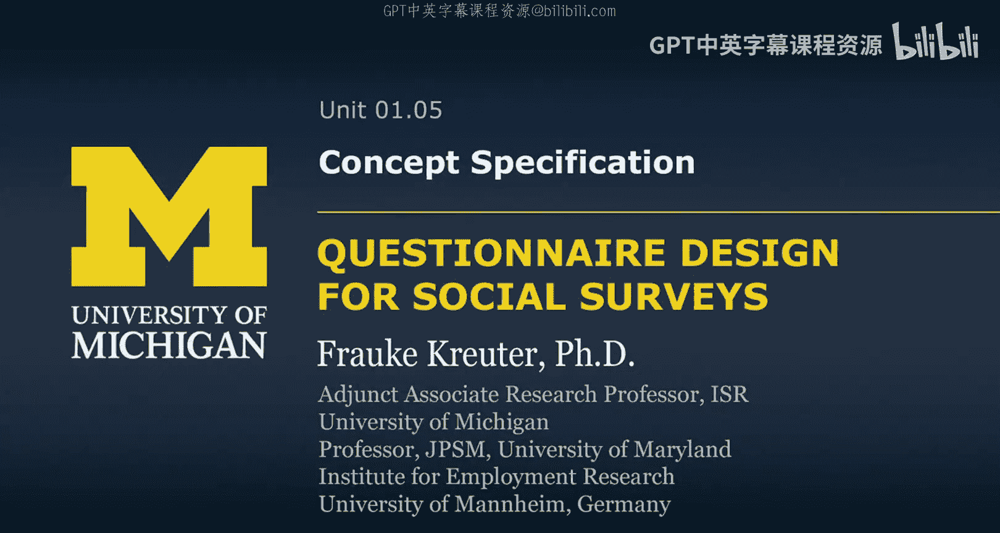
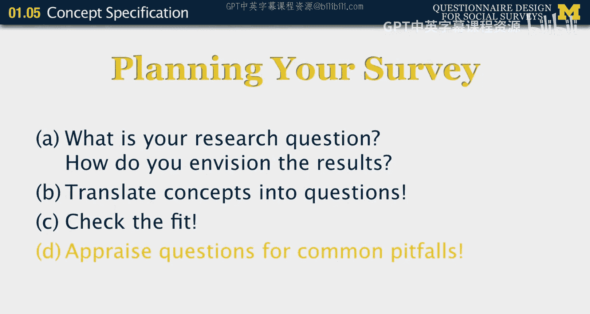

# 密歇根大学《调查数据收集和分析》：5：概念界定 📝

在本节课中，我们将要学习如何将研究中的抽象概念转化为具体的调查问题。这是设计有效问卷的第一步，确保我们能够准确测量想要了解的内容。

上一节我们讨论了访员的影响，本节中我们来看看如何从“项目”（即调查问题）的层面入手，减少测量误差和偏差。第一步就是“找到正确的问题”。

## 从研究问题到结果构想

当你计划一项调查时，首先要思考你的研究问题是什么，以及你期望看到什么样的结果。这两点至关重要，需要与领域研究者充分讨论。否则，你可能会遗漏调查中本应包含的关键项目。

以下是开始设计前需要明确的两个步骤：
1.  **明确研究问题与预期结果**：清晰地定义你想知道什么，并设想最终的数据分析图表会是什么样子。
2.  **将抽象概念转化为问题**：将宽泛的研究概念分解成可以提问的具体组成部分。

## 分解抽象概念

将复杂概念转化为可测量的问题，关键在于将其分解为多个维度。这有助于我们最终提出具体、可回答的问题。

以“社会资本”这一抽象概念为例。社会资本指的是个人可以从其社会关系网络中获取的资源。直接询问受访者“你有多少社会资本？”是无效的。我们需要将其分解。

以下是“社会资本”概念的一种分解方式示例：
*   **关系质量**
    *   信任
    *   互惠
*   **关系结构**
    *   空间位置
    *   规模
    *   类型
        *   正式关系
        *   非正式关系
            *   家人
            *   朋友

通过这样的层层分解，我们最终可以针对“你信任你的邻居吗？”或“你与家人联系的频率是？”这类具体维度设计问题。

## 应用练习：课程满意度

让我们以评估一门Coursera课程的满意度为例，练习概念分解。满意度是一个整体抽象概念，通常由几个主要方面构成。

以下是“课程满意度”可能包含的维度：
*   **课程内容**
    *   内容量是否合适
    *   主题是否相关
    *   是否涵盖了期望的所有元素
*   **授课教授**
    *   教授的个人魅力（在线课程可能不明显）
    *   教授传达的知识深度
    *   教学清晰度

你可以根据实际情况填充更多相关子维度。完成分解后，你就有了设计具体问题的基础。

## 检查匹配度与设计考量

将概念分解并初步转化为问题后，必须检查其匹配度。你需要自问一系列问题，以确保设计出的问卷既能收集到所需数据，又不会给受访者造成不必要的负担。

以下是设计时需要检查的关键事项列表：
*   **测量需求**：你计划如何组合变量来测量核心概念（如满意度）？对这些变量有何统计要求？
*   **量表设计**：你需要哪种类型的量表（如李克特量表）？选项需要分组还是更分散？
*   **后续分析**：你打算用这些数据做什么分析？
*   **分组报告**：你希望按哪些群体（如性别、年龄）来报告结果？**务必在问卷中包含用于分组的背景问题**。
*   **解释差异**：你是否想解释不同群体间的差异？需要哪些变量来解释？

**制定详细的分析计划**是避免上述问题的关键。它能显著降低遗漏关键项目或问卷冗长的概率，并帮助确定问题的优先级，合理利用问卷空间。

## 评估问题的常见缺陷

最后，你需要评估初步设计的问题是否存在常见缺陷。确保自己了解一般的回答过程及与之相关的问题行为，这能帮助你避开许多陷阱。我们将在后续章节专门讨论这些常见问题。

本节课中我们一起学习了概念界定的完整流程：从明确研究构想，到将抽象概念分解为可测量的维度，再到根据分析需求检查问题设计。这是构建一份科学、有效问卷的基石。