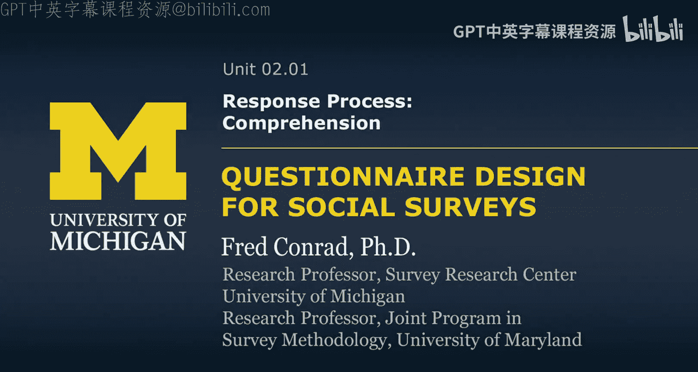
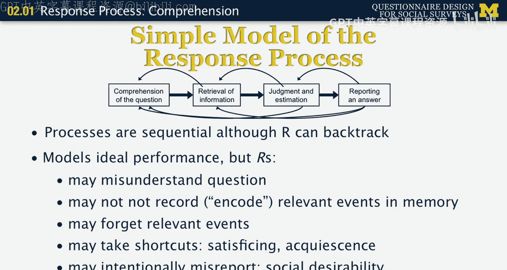
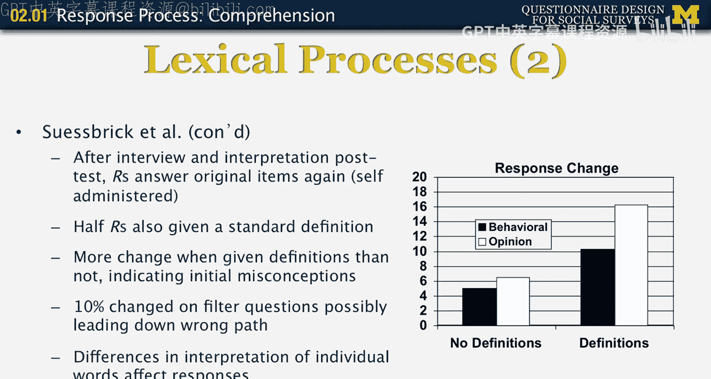
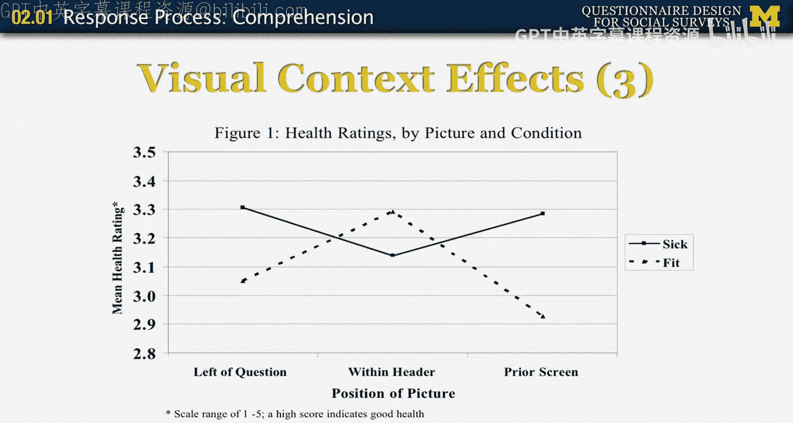
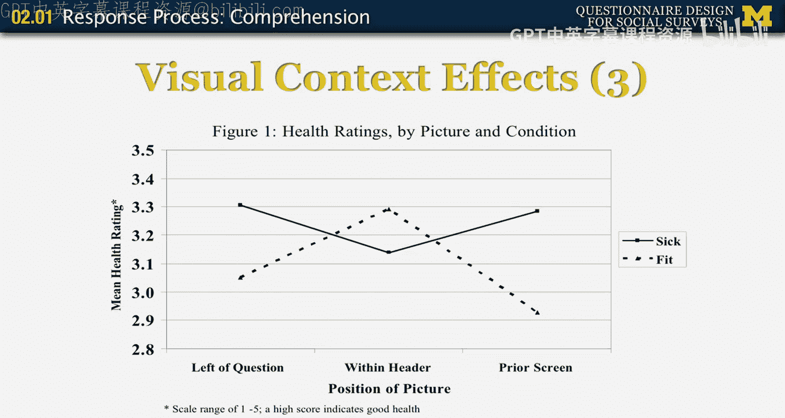
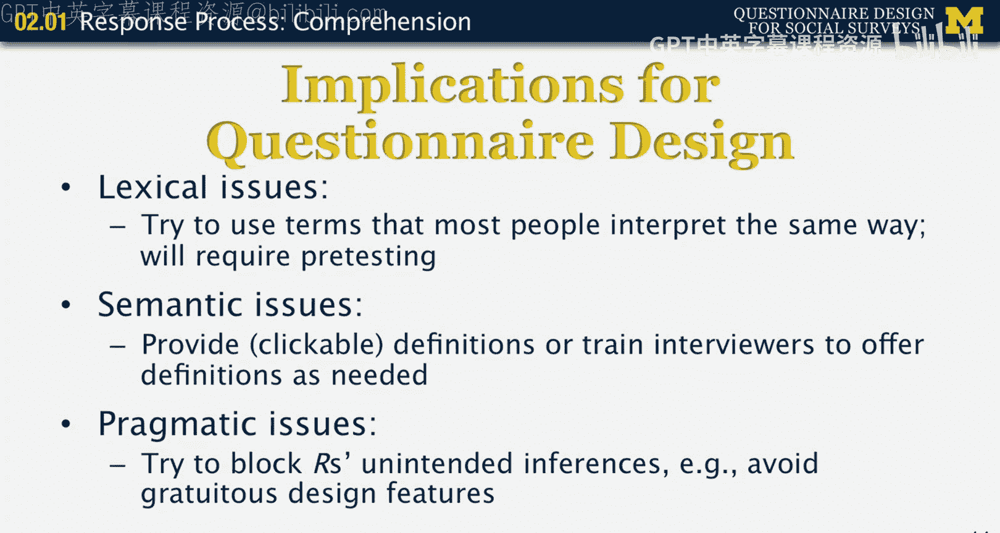

# 密歇根大学《调查数据收集和分析（2-6：方法、社调问卷设计、抽样、缺失数据、分析）｜Survey Data Collection and Analytics》 p49 6_应答过程：理解阶段.zh_en -BV1fw4m1e7Zh_p49-

This is the first of four segments on the survey response process today our focus is on comprehension。

If you think about it， a respondent needs to go through at least these stages in order to answer a question。

 the respondent needs to understand what it is they're being asked to do。

 so there's a comprehension stage。They need to retrieve relevant information。

 whether the question is about behaviors or opinions。

They need to supplement what they can recall with a series of judgment and estimation processes。

And when the result of those first three stages or sets of processes don't correspond to response options that are offered。

 they need to select a response option by mapping what's in their heads to the options that have been offered in a model like this。

The stages are presented sequentially， but respondents can backtrack so for example。

 if a respondent is in the process of retrieving let's say doctor visits and it's becoming increasingly difficult as the doctor visits are going back further in time a respondent might think there's no way they intended for me to actually recall and count up all my doctor visits over this long time period。

 let me go back and reconsider the question， reconsider what I'm being asked to do so there's the potential to backtrack through these stages。

Ideally， a respondent will perform each of these stages without problems。

 but much of what we're focused on is the kinds of problems they encounter so they might misunderstand the question in the comprehension stage and actually try to answer a question other than the one that the authors of the questionnaire intended them to answer when it comes to retrieval there might be nothing to retrieve they might not have actually encoded or recorded the relevant events in their memories and then there's probably nothing that can be done to bring them to mind it might have recorded the events in their memories but have forgotten them so forgetting is a problem when it comes to retrieval。

They might take shortcuts so one class of shortcuts is called satisfying which is the tendency to give acceptable but not optimal answers。

 for example if there's a long series of response options。

 respondents might not give a full attention to all of them they might instead give more attention to the earlier response options or they might engage in what's called acquiescence which is the tendency to give positive answers。

 so to say I agree。Inag， disagree questions when they might not fully agree。

And they might intentionally misreport answers， giving answers that are more socially desirable to questions on topics that are considered to be sensitive。

Our focus today is on the comprehension process， so the first of those stages in the model we just looked at。

There are problems in understanding survey questions of at least three sorts。

 some have to do with the words and what they mean， and these are called lexical problems。

Others arise when the individual words are combined into an overall sentence or in our case question。

 and this is what's known as the literal meaning of the question。

 which is often contrasted with the meaning that respondents come up with doing pragmatic processes。

 so pragmatics have to do with going beyond the literal meaning and inferring what the speaker really intended the listener to understand。

 so a set of inferences about what was really intended is what we mean when we refer to pragmatic processes。

Here's an example of what we mean by lexical processes and the kinds of problems that arise when doing lexical processing。

 so the idea is that words may have many meanings even to the same person in a study by Suusbririck and her colleagues they asked respondents about their tobacco use。

 administering a set of questions from the current population surveys tobacco use supplement and they followed the interview with a post test to get at how respondents had interpreted the questions this was a multiple choice postt which they presented possible interpretations of the questions so the graphic here presents the proportion of respondents who endorsed each of three possible interpretations they've been offered for the phrase smoke a cigarette in the question。

 have you smoked at least 100 cigarettes in your entire life。

So as you can see while more than half the respondents endorse one interpretation。

 even just one puff， the rest of the respondents， the other path roughly are evenly divided between the other two interpretations。

 so the point is the same phrase can be interpreted by respondents and people in general in quite different ways。

This has implications for the quality of the answers that respondents provide。

 so Suus Bririck and her colleagues， after conducting the interview and administering the post test on interpretation。

 they readministered the original questions and gave half of the respondents a definition。

What they're interested in was whether giving them a definition led to more change between the first time they answered the question and the second time than when no definition was given and as you can see in the figure。

 this was the case， giving respondents definitions the two bars on the right led to more change than not giving them a definition and the implication is that。

Respondents initially interpreted the questions in a way other than what was intended so that they changed their answers when they were given a definition。

In fact， this can lead to problems beyond the particular question where a misinterpretation occurs。

 they found that 10% of respondents change their answers on filter questions。

 filter questions determine what the following sequence of questions is for respondents。

 and the overall point is that variation in how respondents interpret individual words can affect the answers they give。

 can affect the accuracy of the answers they give。

When interpreting words in a question， respondents are affected by the context in which those words occur。

So one type of context is question context or questionnaire context。

 more specifically the information that respondents use to answer prior questions in the same questionnaire can affect the way they interpret the question they're currently being asked。

 here's an example from a study by Schwartz and his colleagues。

 they found that if they asked respondents about their overall life satisfaction after they asked them a more specific question about their marital satisfaction。

That the answers to the two questions were highly correlated as if the respondents continued to think about marital satisfaction when answering the more general question about life satisfaction。

If they reverse the order of the questions and ask the more general question first。

 this correlation dropped substantially to 03 to， the idea being that when you're asked a question about overall life satisfaction。

 you can be thinking about any number of dimensions of life satisfaction。

 and so you're less likely to be thinking specifically about marital satisfaction when that question follows。

Another type of context is visual， so for example， this is particularly an issue in web surveys where it's common to use images。

Cooper and his colleagues showed that visual context can affect respondents answers in particular the way they evaluated their own health so they presented along with a question asking respondents to rate their health images of either a person who was clearly healthy and fit or a person who was sick and not very healthy so here's an example of the question how would you rate your health accompanied by an image of a healthy fit jogger it also appears to the left side of the question here's the same question but presented with an image of a person in a hospital bed she's clearly not healthy what they found was that if the image of the healthy person accompanied the question respondents rated their health lower than if the image of the sick person accompanied the question and the idea is that respondents were comparing their health to the health depicted in the image so that if the image depicted a very healthy person they might say well I'm not quite that。

healthy， so they'd rate their health lower than if the image depicted somebody was clearly not healthy and they'd say I'm doing better than that I'll rate my health higher so we see this pattern of results when the image appeared to the left of the question and when it appeared on the prior screen。

Actually， this pattern appears to reverse， but it really goes away when the image is presented in the banner in the middle and the top of the page。

 and this is referred to as banner blindness and the idea is that respondents and web users in general really don't fully process the information when it's presented in the center and at the top。

 but when the images on the prior page or immediately to the left of the question。

 respondents take this into account in interpreting in this case what's meant by health。

Semantic processes involve assembling the meanings of individual words into an overall question or sentence meaning。

 here's an example of the kind of problem that can come up in semantic processes in which respondents don't quite know how to map their circumstances or how their circumstances correspond to the concepts being asked about on the question。

Have you purchased or had expenses for household furniture or respondent answers I purchased a floor lamp does that count as household furniture so the idea is that respondents are doing a fine job interpreting the individual words what they don't know is whether the concept should include this particular idea of purchasing a floor lamp in a standardized interview。

 the interviewer would not be able to clarify this for respondents in a conversational interview the interviewer could communicate to respondents that in this survey the following definition applies here are data that we've seen previously concerning response accuracy for this type of question and set of circumstances which are called complicated mappings when interviewers either can provide clarification。

 conversational interviews or cannot standardized interviews and as you can see accuracy increases substantially when interviewers are able to clarify what's meant by in this case。

Household furniture， whether a foreign lamp shooter should not be included。

 the versus when they can't。The third set of processes we'll discuss are called pragmatic processes or pragmatic inferences。

 and they come mostly from or our understanding of them is mostly due to what Grce called the cooperative principle。

 which is a way that listeners can make sense of what speakers are saying by inferring what they really meant。

Gryce talked about the cooperative principle in terms of four sub principlesncles or what he called maxims。

The maximum of quantity say as much but no more than necessary。

 the maximum of quality did not say what you believe to be false。The maximum relation be relevant。

And the maximum of manner， avoid obscurity and ambiguity。

So the idea is that by keeping this principle in mind one can make sense of what a speaker says when it might not make sense literally。

 so if a speaker were to ask me can you pass the salt。

 I would probably not think of that as a question about my ability to pass the salt even though that's literally what it is instead I would probably make the almost automatic inference that she's asking me to pass the salt it's a request to pass the salt and I would presumably comply related to this is the idea that the speaker would not say something if she didn't intend to inform me and so I will take that into account in interpreting the rest of what she says。

So how might pragmatic inferences play a role in answering survey questions this study by Schwartz and colleagues is a good example they asked respondents how successful would you say you have been in life and asked them to answer on a scale。

 not at all successful to extremely successful for half the respondents the verbal label not at all successful was accompanied by a minus5 and extremely successful by a plus5 for the other half of the respondents。

 the label not at all successful was accompanied by a zero and extremely successful by a 10。

 how do you think this might have affected the way respondents answered？Well。

 34% of the zero to 10 group responded in the lower half， that is zero to5 part of the scale。

 the less successful part of the scale， but only 13% of respondents in the minus5 to plus5 group responded in the lower half of the scale。

 so respondents were less willing to position themselves in the unsuccessful part of the scale。

 when there was a negative number attached to the verbal label not at all successful。

 the authors suggest that when there's a zero associated with the label respondents interpret that as the absence of success。

 zero success。But when there's a negative number associated with not at all successful。

 they interpret that as the presence of failure。So this is the case where respondents are going beyond the literal meaning to make sense of what's presented in the question。

 so they're using these numbers to interpret the verbal labels when this was probably not the intention of the questionnaire designer。

Okay， so what are some of the implications of the kinds of processes and problems we've been discussing for questionnaire design here are some possibilities with respect to lexical issues。

 try to use terms that most people interpret the same way。

This may be very difficult and will require pretesting to confirm your intuition that the terms you've chosen are interpreted in a uniform way。

 but trying to find terms like this is certainly a worthy design goal。

With respect to semantic issues， providing definitions or either that respondents can click to view in a web questionnaire or by training interviewers to provide those definitions as needed should help address the kinds of ambiguities we talked about before when attempting to map one's own circumstances to the concepts in the surveys。

And with respect to pragmatic issues， a good goal would be to try to block respondents unintended inferences。

 for example， by avoiding gratuitous design features。

That's a brief overview of comprehension issues in the response process when we resume we'll talk about memory and recall issues and how they can relate to error in answering survey questions。

