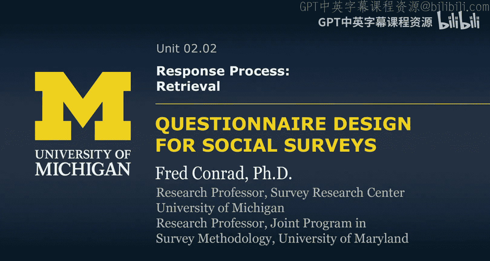
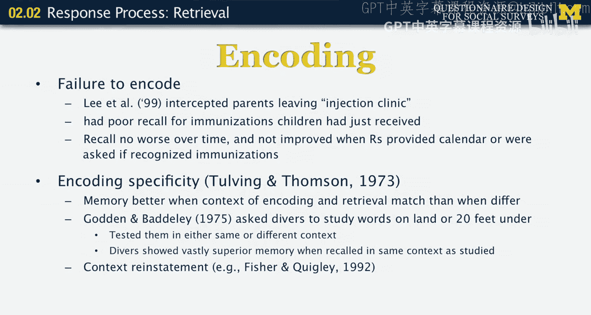

# 密歇根大学《调查数据收集和分析（2-6：方法、社调问卷设计、抽样、缺失数据、分析）｜Survey Data Collection and Analytics》 p50 7_应答过程：信息提取.zh_en -BV1fw4m1e7Zh_p50-

Yeah。Continuing with our discussion of the response process we'll focus now on retrieval processes。

After the respondent has gone through a comprehension stage in which presumably he or she understands the question they're being asked and the task they're being asked to perform。

 they'll need to retrieve relevant information， this is true whether the question is factual or subjective。

 if it's factual they generally need to recall one or more events。

 if it's subjective that is an opinion question they might recall an already formed opinion if they have one or if not then they're likely to recall opinions about related topics or other relevant considerations in formulating an opinion on the fly the point is that respondents need to retrieve something from memory in order to answer almost any kind of survey question。

Cognitive psychologists and neuroscientists have distinguished between a number of different memory systems。

 one fundamental distinction is between working or short term memory and long term memory。

Working memory is a temporary storage mechanism that allows in our case。

 survey respondents to remember the words of a question as they arrive to maintain partial results and update a running tally。

 for example， when keeping track of the number of visits to a doctor's office they've had in the last year。

Or to maintain the response processes that an interviewer reads out loud to them。In contrast。

 long term memory is a more permanent storage mechanism， although certainly forgetting occurs。

And actually， long term memory entails at least three distinct memory systems。Episodic memory。

 which consists of events for one's life， also called autobiographical memory， for example。

 I ate Ethiopian food on Saturday。Semantic memory， which is really knowledge about the world and about oneself。

 so for example， trees have leaves and I meet with my reading club every Tuesday。

And procedural memory， which is really memory for doing things like riding a bike。

 The first two episodic memory and semantic memory are most directly relevant to survey response。

 And so we'll focus now on the circumstances under which one of these is more or less likely to be used by respondents than the other。

Gita Menin in a 1993 study asked respondents to judge the frequency of mundane activities like snacking。

 washing one's hair， and so on。She picked these activities so that they generally occurred on either aregular or irregular schedule and each time they occurred。

 they were either similar to every other time the episode occurred or dissimilar and distinctive and the idea behind the variation in regularity is that if events occur on irregular schedule and respondents know the rate of occurrence and this is kind of a semantic memory it's a fact about the world it happens to be a fact about their lives。

 the reason for distinguishing between similar and dissimilar events is because when events are similar。

 it's hard to differentiate one from another and therefore it's hard to recall individual episodes。

 So she predicted that respondents would most likely use episodic recall and would be least likely to use rates of occurrence when events were distinctive or dissimilar and irregular and the idea again is that when they're distinctive it's easier to differentiate one event from another and recall individual events。

And if they occur on an irregular schedule， respondents won't have rate information available to use In contrast。

 she predicted that respondents would be least likely to answer on the basis of episodic recall and most likely to answer on the basis of rates when events were similar and regular and the idea is that if they're similar to one another。

 it's hard to use episodic recall and if they occur on a regular schedule。

 then respondents have rate information available to use we can see in the table here that this is very much what she found the numbers in the table are the percent of responds based on rates and by her thinking。

 when respondents answer based on rates。They're not answering based on episodic recall。

 so for example， in the lower right where the events were dissimilar and irregular。

 they're answering on the basis of rates only 24% of the time。

 which means that they are mostly answering on the basis of episodic recall and this is exactly what you predicted events are dissimilar and therefore distinctive and because they occur on an irreg schedule。

 no rate information available to respondents in contrast in the upper left cell where events occur on a regular schedule and are similar each time they occur respondsponents are answering predominantly about 90% of the time on the basis of rates and this presumably is because they can't really recall these events because they're similar to each other。

 but they do have rate information available because the events occur on a regular schedule。

So while episodic memory is a relatively permanent memory system， respondents of course。

 forget events from their lives。Generally， there are two mechanisms for forgetting interference and decay and both get worse with the passage of time。

 So in the case of interference， the longer the time period in question。

 the more likely other similar events will have occurred。

 and it's hard to distinguish the details of similar events from each other。

 and they tend to blend into a single generic memory。In contrast is the decay idea。

 which is really about strength and the idea is that as more time passes。

 the strength of the event becomes diminished， the event becomes weaker in people's memory。

 most forgetting due to decay occurs rapidly in the period immediately after the event was experienced。

And continues for long periods of time。So in this， I think compelling figure from Taranzo Ripsson Rozinski forgetting is plotted that is percent correct recall on the Y axis and e lapsed time in months on the X axis for a number of different domains let's focus for a moment on the retention curve for classmate names。

 you can see like all the other curves， percent correct recall drops as time passes starting close to 90% correct recall right after presumably high school graduation dropping to about 50% recall after 600 months。

 600 months happens to be 50 years， so it's actually quite amazing to me that after 50 years respondents remember anything but the point is they do。

 and if there is some memory retained after long periods of time there is some hope that we can stimulate that the recall of that information by providing retrieval cues to respondents。

So by retrieval cues， we're talking about basically reminders of list of。

 in the case of the National Crime victimtization Surveys item on shopping。

 a list of the kinds of outlets or stores respondents might shop in。

 so if they hadn't considered trying to recall their shopping episodes from these stores。

 they should if they're included in the list of retrieval cues。

It's an open question whether respondents search only for the terms that are included in a list like this or whether they use the list of terms to define a broader conceptual space and search more broadly。

 the latter would be more desirable， we just don't know how often this occurs for better or worse。

 retrieval cues can affect what comes to respondent' mind。

 this is nicely illustrated in a study by Cooper and his colleagues。

In which they asked respondents questions like how many sporting events have you attended in the past year and presented images along with the questions？

The images were what they called either low frequency or high frequency images。

 so for the question about sporting events， the low frequency image they used was a major league baseballball stadium。

 the high frequency image was an image of a little league game， an amateur sporting arena。

And the idea simply is that people will if the image leads them to think about major League ballparks。

 they are less likely to have attended sporting events in major League ballparks than they are in amateur ballparks。

 and in fact the low frequency images led to lower reports than the higher frequency images。

The final topic I'd like to cover in this introduction to retrieval is encoding。You know。

 if the information is not recorded in memory in the first place。

 there's probably little we can do to stimulate its later recall。

The failure to encode has been nicely demonstrated in the study by Lee and her colleagues。

 which you'll hear about in more detail in the later segment。

But the main points in this study are that Lee and her colleagues intercepted parents as they were leaving what they called an injection clinic where they had taken their kids for immunizations。

 and they were asked about the immunizations and whether their children were up to date and they really had very poor recall for the immunizations that their children had received minutes before。

 suggesting that they just hadn't recorded these these events in their memories。

 more evidence that the events were not encoded came from the fact that recall while bad immediately after the parents left the clinic was no worse 10 weeks later。

 and this is not at all characteristic of the kind of forgetting that we saw moments ago in the retention curves。

And the recall was not improved when the respondents were provided a calendar。

 the kind of tool that is used to stimulate a recall and provides retrieval cues。

And further evidence that they hadn't encoded the information in the first place came from the fact that when the task was turned into a recognition task and they were showing a list of immunizations and asked which of those the child had had。

 they were no better than if they were asked to recall the immunizations and recall is almost always worse than recognition。

 so the fact that there was no advantage to recognition suggests that they just didn't have this information recorded in their memories。

So if respondents do encode information， it's known that their recall can be improved by matching the context of their recall to the context in which they encoded the information originally。

 This is known as the encoding specificity principle it's due to Tlling and Thompson a good example of this comes from a study by God andbaly。

 in which they asked deep sea divers to study a list of words either on land or 20 feet under the water。

And then they tested them in either the same or different context。

The diver showed vastly superior memory when they were calleded in the same context in which they studied。

 so if they studied the words 20 feet underwater and they were tested 20 feet underwater。

 they were better than if they were tested on the land。

This idea has been extended to the notion of context reinstatement。

 which essentially maintains that it's not necessary to physically recreate the encoding context at the time of recall。

 but instead people， survey respondents can imagine that encoding context at the time of recall。

 they can attempt to put themselves back in the state they were in when they encoded the information they are currently being asked to recall。

This is demonstrated nicely in a study by Fisher and quicklyly in which they asked respondents in a study on dietary recall to imagine the situation。

 the physical situation they were in right before consuming the food they were later asked about and when the authors asked respondents to do this。

 it improved recall relative to the cases in which they didn't ask respondents to reinstate the context。

In our next segment we'll discuss the set of processes that respondents can use to supplement what's in their memory in the event that they're not able to completely answer the question on the basis of what they can recall。

 these processes are known as judgment and estimation。

