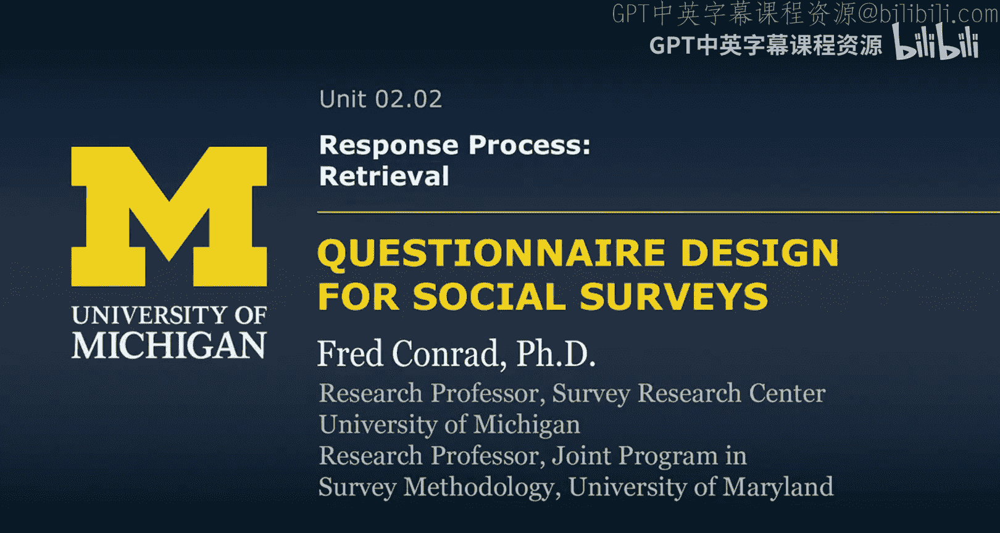
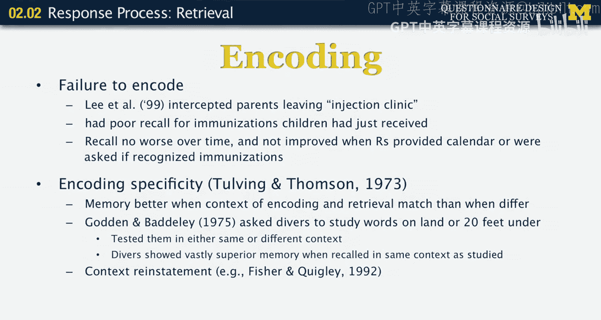

# 调查数据收集与分析：2-6：应答过程：信息提取 📝

在本节课中，我们将聚焦于调查应答过程中的“信息提取”阶段。这是继“理解问题”之后的关键步骤，受访者需要从记忆中检索相关信息来回答问题。我们将探讨记忆系统的类型、影响信息提取的因素，以及如何通过设计问题来优化提取过程。

上一节我们介绍了应答过程中的理解阶段，本节中我们来看看信息提取。

受访者在理解了问题及其任务后，需要检索相关信息。无论是事实性问题还是主观意见问题，这个过程都不可或缺。对于事实性问题，受访者通常需要回忆一个或多个事件。对于主观意见问题，受访者可能回忆一个已形成的观点；如果没有，他们则可能回忆相关话题的看法或其他考量因素，以便现场形成观点。核心在于，受访者需要从记忆中提取某些信息来回答几乎所有类型的调查问题。

## 记忆系统 🧠

认知心理学家和神经科学家区分了多种不同的记忆系统。一个根本的区分是**工作记忆**（或短期记忆）与**长期记忆**。

*   **工作记忆**是一种临时存储机制。在我们的语境中，它允许受访者记住听到的问题、维持部分结果并更新一个动态的计数。例如，当需要统计过去一年去诊所的次数时，或当需要记住访问员大声读出的回答选项时。
*   **长期记忆**是一种更持久的存储机制，尽管遗忘确实会发生。长期记忆至少包含三个不同的系统：
    *   **情景记忆**：由个人生活中的事件组成，也称为自传体记忆。例如，“我周六吃了埃塞俄比亚菜”。
    *   **语义记忆**：关于世界和自身的知识。例如，“树有叶子”或“我每周二参加读书会”。
    *   **程序记忆**：关于如何做事的记忆，例如骑自行车。

前两者——情景记忆和语义记忆——与调查应答最直接相关。接下来，我们将重点讨论受访者在何种情况下更可能使用其中一种而非另一种。

## 提取策略：情景回忆 vs. 频率估计 📊

Gita Menon在1993年的一项研究中，要求受访者判断日常活动（如吃零食、洗头等）的频率。她选择这些活动是因为它们通常以**规律**或**不规律**的日程发生，并且每次发生时，要么与其他次**相似**，要么**不同且有独特性**。

以下是她的预测逻辑：
*   **规律性**：如果事件发生不规律，受访者无法获得稳定的“发生率”信息（一种语义记忆），因此更可能依赖情景回忆。
*   **相似性**：如果事件彼此相似，则难以区分和回忆单个事件，因此更可能依赖已知的发生率（如果存在的话）。

她预测，当事件**不同且不规律**时，受访者最可能使用情景回忆，最不可能使用发生率。相反，当事件**相似且规律**时，受访者最不可能使用情景回忆，最可能使用发生率。

研究结果在下表中得到了充分验证。表中的数字表示基于“发生率”回答的受访者百分比。根据她的思路，当受访者基于发生率回答时，就不是基于情景回忆。

| 事件相似性 | 事件规律性 | 基于发生率回答的百分比 |
| :--- | :--- | :--- |
| 相似 | 规律 | ~90% |
| 相似 | 不规律 | ~70% |
| 不同 | 规律 | ~40% |
| 不同 | 不规律 | ~24% |

例如，在右下角（事件不同且不规律），受访者只有24%的时间基于发生率回答，这意味着他们主要基于情景回忆回答，这与预测一致。相反，在左上角（事件相似且规律），受访者约90%的时间基于发生率回答，这很可能是因为事件相似难以回忆，但规律的发生率信息是可用的。

## 遗忘与提取线索 🔍

虽然情景记忆是一个相对永久的系统，但受访者当然会忘记生活中的事件。遗忘主要有两种机制：**干扰**和**衰退**，两者都随时间推移而加剧。

*   **干扰**：时间跨度越长，发生其他类似事件的可能性越大。类似事件的细节难以区分，容易融合成一个单一的、泛化的记忆。
*   **衰退**：随着时间流逝，事件在记忆中的“强度”减弱。大部分由衰退引起的遗忘发生在事件经历后不久，并持续很长时间。

下图（来自Tulving, Rips & Rosskopf）展示了不同领域的遗忘曲线（Y轴为正确回忆百分比，X轴为经过的月数）。以“同学姓名”的保持曲线为例，正确回忆率随时间下降，从高中毕业后的接近90%，到600个月（50年）后降至约50%。这表明即使经过很长时间，仍有一些记忆被保留，这给了我们希望通过提供**提取线索**来刺激信息回忆。

**提取线索**本质上是提醒物。例如，在“全国犯罪受害调查”关于购物的项目中，提供一份受访者可能购物的商店类型清单。如果受访者之前没有考虑从这些商店回忆购物经历，这个清单应该能帮助他们回忆。

一个悬而未决的问题是，受访者是只搜索清单中包含的条目，还是利用清单来定义一个更广泛的概念空间并进行更广泛的搜索。后者更理想，但我们尚不清楚这种情况发生的频率。

提取线索会影响受访者想到的内容。Cooper及其同事的研究很好地说明了这一点。他们问受访者“过去一年你参加了多少场体育赛事？”，并随问题呈现图片。图片分为“低频”图像（如职业棒球场）和“高频”图像（如业余少年棒球赛）。想法是，如果图片引导人们想到职业球场，他们参加职业球场赛事的可能性低于参加业余球场的赛事。事实上，“低频”图像导致了比“高频”图像更低的报告次数。

## 编码：记忆的起点 📥

最后，我想在本次关于提取的介绍中涵盖**编码**。如果信息最初就没有被记录在记忆中，我们可能很难刺激其后的回忆。

Lee及其同事的研究很好地证明了编码失败。该研究的主要发现是：
1.  父母在带孩子接种疫苗后离开诊所时被拦截询问，他们对孩子几分钟前刚接受的疫苗回忆非常差，这表明他们根本没有将这些事件记录在记忆中。
2.  更多证据表明事件未被编码：父母离开诊所后立即的回忆很差，但10周后的回忆并没有更差。这完全不符合我们之前在保持曲线中看到的那种典型的遗忘模式。
3.  当向受访者提供日历（一种用于刺激回忆和提供提取线索的工具）时，回忆并未改善。
4.  进一步证据：当任务变为识别任务（向他们展示疫苗列表并询问孩子接种了哪些）时，他们的表现并不比自由回忆时更好。而识别几乎总是优于回忆。识别没有优势这一事实表明，他们根本没有在记忆中记录这些信息。

## 编码特异性与情境复现 🎭

如果受访者确实编码了信息，已知可以通过使回忆时的情境与最初编码信息时的情境相匹配来改善回忆。这被称为**编码特异性原则**。

一个很好的例子来自Godden和Baddeley的研究。他们让深海潜水员在陆地或水下20英尺处学习单词列表，然后在相同或不同的环境中测试他们。潜水员在**学习与测试环境相同**时表现出远优于不同环境时的记忆力。

这一思想被扩展到**情境复现**的概念。它本质上认为，不必在回忆时物理上重现编码情境，而是可以让人们（调查受访者）在回忆时**想象**那个编码情境。他们可以尝试将自己放回到编码被要求回忆的信息时所处的状态。

Fisher和Quigley的一项研究很好地证明了这一点。在一项关于饮食回忆的研究中，他们要求受访者想象在食用后来被问及的食物之前所处的物理情境。当作者要求受访者这样做时，相对于未要求复现情境的情况，回忆得到了改善。

## 总结 📝

本节课中我们一起学习了调查应答过程中的信息提取阶段。我们了解到：
1.  受访者依赖**工作记忆**处理即时信息，依赖**长期记忆**（特别是**情景记忆**和**语义记忆**）来回答问题。
2.  受访者根据事件的**规律性**和**相似性**，在**情景回忆**和**频率估计**两种提取策略间进行选择。
3.  **遗忘**主要由干扰和衰退引起，但长期记忆可能保留部分信息。
4.  提供**提取线索**可以帮助刺激回忆，但其作用机制和效果可能因情况而异。
5.  **编码**是记忆的起点，如果信息未被编码，后续提取将极为困难。
6.  **编码特异性原则**和**情境复现**技术表明，匹配或想象原始编码情境可以显著改善回忆效果。

在下一节中，我们将讨论当受访者无法完全依靠回忆来回答问题时所使用的一系列补充过程，这些过程被称为**判断与估计**。