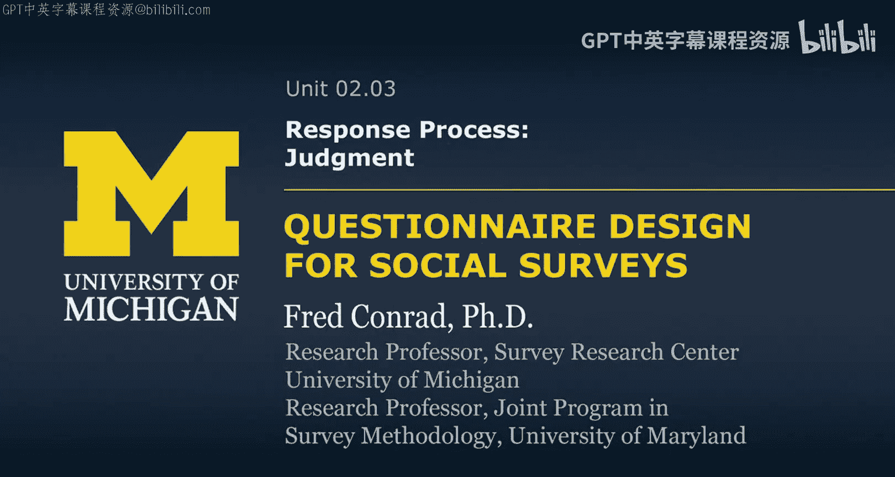
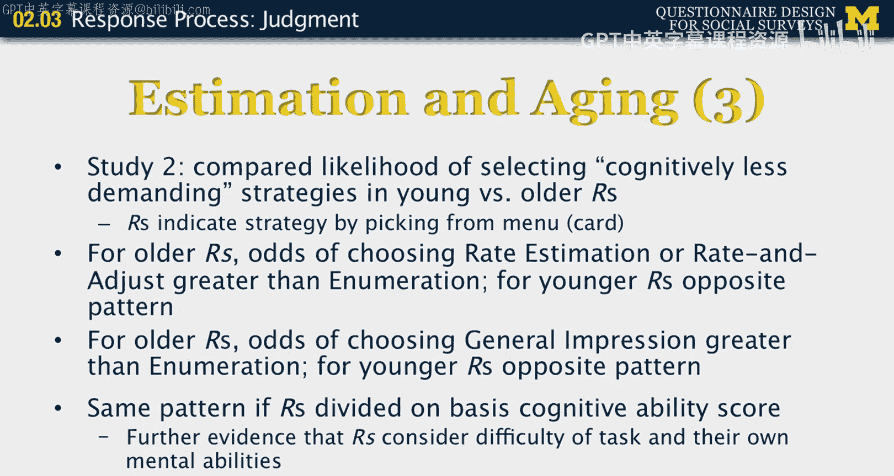

# 密歇根大学《调查数据收集和分析（2-6：方法、社调问卷设计、抽样、缺失数据、分析）｜Survey Data Collection and Analytics》 p51 8_应答过程：判断形成.zh_en -BV1fw4m1e7Zh_p51-

。So continuing with our discussion of the response process。

 we've already talked about some of the key concepts involved in comprehending the question。

 the first stage in the process and some of the key processes involved in retrieving information to answer the question。

What we're up to now is the judgment and estimation stage。

 This is the collection of mental processes that are used to compensate for what respondents don't have available in their memories。

 really to compensate for imprecise or incomplete memory I'll illustrate this with two phenomena one is the availability heuristic which is the very influential idea of diversity in knemen that people can infer the frequency or probability of events on the basis of how easy or difficult it is to recall instances of those events So for example。

 someone might reason I can't recall many instances of this event so it must be rare。

The other phenomenon I'll use to illustrate estimation and judgment is frequency estimation when recall is not possible or involves more effort than respondents are willing to invest。

So turning first to the availability heuristic， diversity Kanemen observed that people will use the ease with which examples come to mind as an indication of their frequency or probability of occurrence。

 and they illustrated this with a number of demonstration so in one case they asked respondents which is more frequent words whose first letter is are or words whose third letter is are and the idea is that it's much easier to bring to mind words whose first letter is are than words whose third letter is R and in fact the participants in the study judged the first of those words whose first letter is are to be more frequent when in fact it turns out that the opposite is true。

Another example of the availability heuristic comes from a demonstration in which diverse econmen asked respondents whether male names on the list or female names on the list were more frequent and they varied how famous the male celebrities were versus the female celebrities and when the female celebrities were more famous than the male celebrities the participants judged that there were more female names on the list when in fact there were equal numbers of male and female names on the list so the idea is it's not about actual frequency it's not actual recall than that's involved it's the。

Difficulty of recall that's involved and because of it's easier to bring to mind famous names than less famous names。

 the participants judged the famous names females in this case to be more frequent。

An example of the availability heuristic in a survey setting comes from a study by Schwartz and colleagues in which they asked respondents to list either six or 12 situations in which they were assertive。

And then they ask them to rate their own assertiveness。

The respondents who listed six occasions on which they were assertive rated themselves more assertive than respondents who listed 12 instances in which they were assertive now you might think well people who could list 12 instances in which they were assertive would rate themselves to be more assertive after all they were able to retrieve 12 occasions of being assertive。

 but the explanation that Schwartz and his colleagues provide is that。

Listing 12 instances of being assertive is difficult， it's more difficult than listing only six。

 and so the difficulty of bringing to mind 12 cases of instances of being assertive led respondents to rate themselves as being less assertive overall because after all。

 it was that difficult to bring those instances to mind， they can't be very common。

Turning to a frequency estimation， consider the following question。In the past two years。

 how many times did you donate blood。For someone who donates every eight weeks in the same workplace location。

 there's little to distinguish one donation from the next。

 so it's hard to recall and count up each one as we've discussed。

To supplement memory respondents may estimate on the basis of a rate， for example。

 I donate every time there's a blood drive， which seems to be about every eight weeks。

 which is two months， so I will say 12 times in the last two years。

Or they might estimate on the basis of a qualitative impression。And convert it to a number。

 I do this a lot， so I'll say 10 times in the last year。If one can recall and count the events。

 then there's no need to estimate。So there are at least three broad strategies。

 and each of these leads to a different type of error。

There's recall and episodic enumeration and this tends to lead to underestimates。

 the reason being that people are more likely to forget than to invent an event and because of forgetting they will report fewer events than actually occurred。

Alternatively， respondents might use rates to estimate frequency and this tends to lead to overestimation。

The reason is that while rates can be quite accurate。

 if respondents fail to take into account an exception like not doing the behavior。

 then what they report based on rates will be an overestimate。

The final major strategy that respondents use is impression based estimation。

 and this leads to overestimation， but for different reasons than rate based estimation。

And the reason for this is that to convert a vague or qualitative impression into a number requires essentially mapping it to the number line。

 which runs from zero to infinity， this means that their estimates are bounded on the low end by zero。

 they can't go any lower than zero， you can't do something a negative number of times。

But you can overestimate indefinitely， the number line is unbounded on the high end。

 and this leads to overestimation on balance because estimates are bounded on the low end。

 not bounded on the high end。Let's look at a study by Conrad Brown and Cashman in which they ask telephone respondents to answer frequency questions。

For each question， respondents also reported how they arrived at their answers and these were later coded as evidence of the strategy they used。

 they rated the regularity of the events's occurrence and rated the similarity of occurrence。

So we can see this in the table in the top row labeled enumeration。

 which is another name for episodic recall or episodic enumeration。

Regularity and similarity are lower than they are anywhere else in the table。

 which as we saw in the previous segment in the study by menin are the conditions that promote episodic recall or enumeration and lead to the least use of rates。

Note also that the frequency in the third column under mean reported frequency is quite low。

 and this suggests that respondents make a judgment that the frequency is low enough they are willing to enumerate that they'll be able to recall the various events that they've been asked about。

If we look at rate retrieval in row2， where regularity and similarity are much higher， again。

 as in the study by menin， mean reported frequency is higher。

 which could reflect the same judgment that the actual frequency is too high to recall and count and so it's more attractive to use a rate based strategy。

If we look at row5 general impression or qualitative impression。

 regularity and similarity are kind of intermediate level。

 which makes neither attractive for enumeration or rate retrieval。

 and the mean reported frequency is quite high， 12。3。

 this really seems to be a case in which respondents make the judgment that theres just too many events here to recall and count them all and that the best solution would be to make use of an impression since a rate is not available。

Another example of the idea that respondents make a judgment about their memory ability and then either。

Based their answer on recall or on some kind of estimation comes from a study by Sonya Zal in which she examined how reduced memory ability in aging affects the selection of the estimation strategy so she did two things she first analyzed the study we just talked about Conrad Brown and Kashmen based on respondents age。

 and she observed less enumeration among older respondents。

 presumably because their memory abilities were degraded relative to younger respondents。

And she conducted a laboratory study with young and older respondents where she had more control over more measures of their cognitive abilities。

So in her re-analysis of the data we looked at earlier by respondent age。

 you can see that for episodic enumeration， a smaller percentage of older respondents are selecting that strategy instead a higher percent of them are relying on rate retrieval and general impression at the bottom row in the table。

 and again this probably suggests a kind of judgment that they're not going to be able to perform the task as well if they base their answers on recall。

 they recognize their own memory limitations。In her second study。

 she compared the likelihood of selecting cognitively less demanding strategies in young and older respondents。

 respondents indicated the strategy that they had chosen by picking from a menu that Zil presented them。

For older respondents， the odds of choosing rate estimation and rate and adjust strategies was greater than enumeration for younger respondents。

 she observed the opposite pattern。And for older respondents。

 the odds of choosing general impression， which is a memory free strategy， if you like。

 were greater than they were for choosing enumeration and again for younger respondents。

 she observed the opposite pattern。And finally， she observed the same pattern if respondents were divided。

 not on the basis of age， but on the basis of a cognitive ability score。

 which is further evidence that respondents consider the difficulty of the task and their own mental abilities when choosing an estimation strategy。

In our next segment we'll talk about the fourth and final stage in the response process known as response mapping or response formatting。

 this is the stage in which respondents select an option that's been provided in a closed form question and we'll talk about some of the considerations in choosing a response option and some sources of error that are introduced in choosing a response option。

