# 密歇根大学《调查数据收集和分析（2-6：方法、社调问卷设计、抽样、缺失数据、分析）｜Survey Data Collection and Analytics》 p52 9_应答过程：最终响应.zh_en -BV1fw4m1e7Zh_p52-

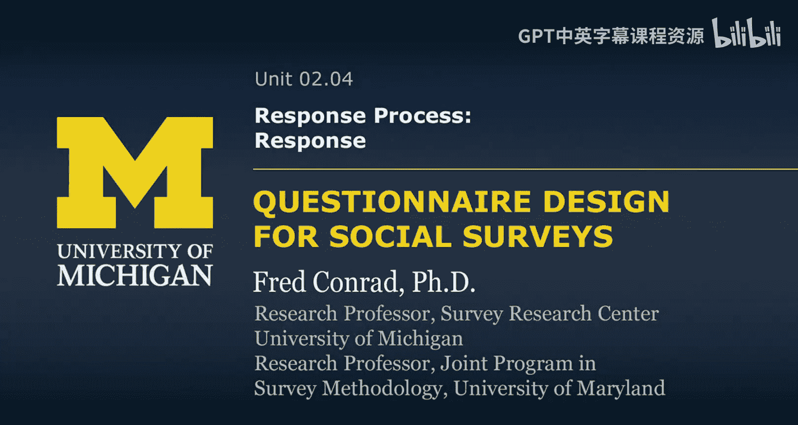

。So far we've talked about three of four stages in the survey response process we've talked about comprehension of the question。

Retrieval of information， judgment and estimation and in this segment we will talk about reporting an answer that is selecting an option from among the set provided to respondents sometimes this is called the mapping and reporting stage because what essentially happens is respondents map a judgment the results of the estimation process and all that has preceded it to one of the answer categories that have been provided the results of the estimation stage may not be expressed precisely and if they are they may not match one of the options that's provided so this requires some sort of transformation from the information that results from the estimation process to one of the options that are provided with the question and this transformation can introduce error and the current segment will present a series of examples of the types of measurement error that can occur at this stage in the process。

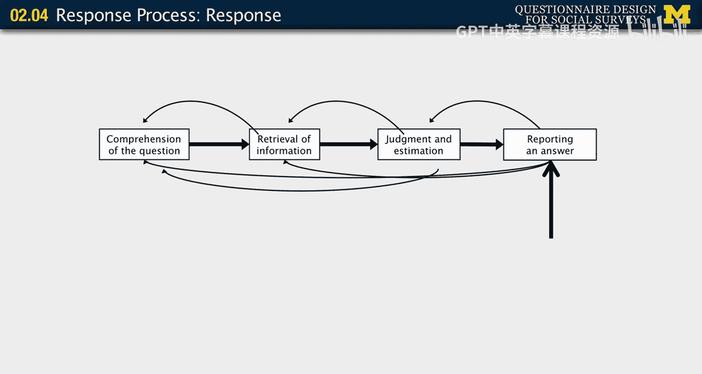

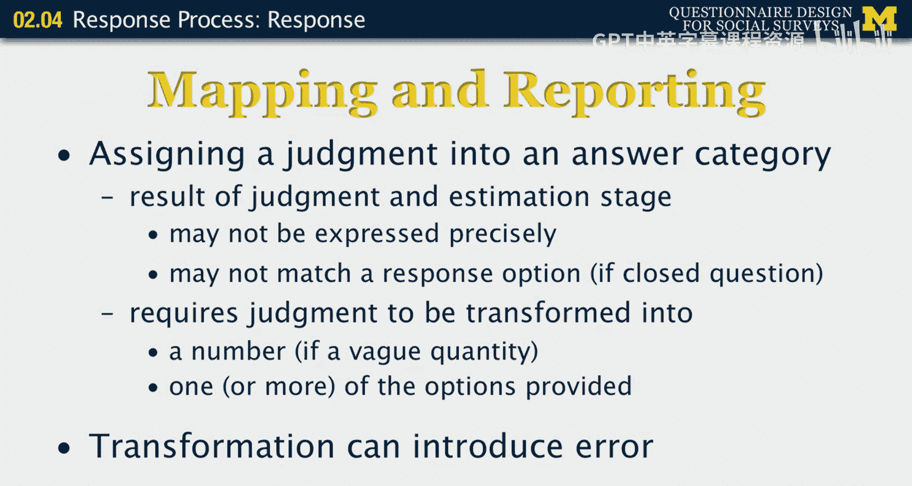

The first example has to do with the spacing of response options in a scale。

 a response and ordered response scale。If you think about it。

 there's a distinction between the midpoint conceptually in the scale and the midpoint visually。

 assuming that the scale is presented on a web page or on a paper questionnaire。

And the respondent's mental representation of the scale will probably involve both。

Tranjo and his colleagues compared the endorsement of the middle option when the scale was spaced evenly versus unevenly。

 as can be the case in a web survey with different web browsers presenting the question and the options differently。

The uneven spacing made the scale points on the right conceptually look more central。

Here's what the two scales look like the question is during the next year what is the chance that you will get so sick that you will have to stay in bed for the entire day or longer the scale on the top is evenly spaced with the option even chance right in the middle visually so the visual and conceptual midpoints are aligned in the top version of the scale。

In the lower version where the spacing is uneven， even chance is now to the left of center visually。

 so the three options that are conceptually to its right are now more central。

So let's see what happens to the number of respondents endorsing an option from the right side of the scale。

When the scale was evenly spaced， 58% of respondents selected an option from the right。

But when it was unevenly spaced， 64% of respondents selected an option from the right。

 reflecting the visual appearance of the scale。

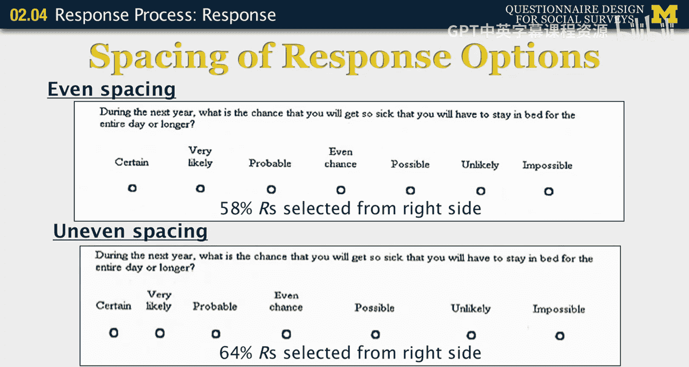

So let's turn to an example now that shows how measurement error can be introduced in the mapping process。

 the reporting and mapping process for items that have unordered scale options。

Krosnik and Alwin embedded an experiment in the general Social Sur in which respondents were asked to select qualities of children that were most desirable for their children。

These were presented visually on show cards in a face to face interview。

 so the interviewer handed the respondents a card with the actually 13 attributes or qualities that a child might have。

For a third of the respondents， the order was reversed。

 so there was a standard order and a reversed order。

Here the 13 qualities that they start with has good manners， tries hard to succeed。

 the final one is is a good student。

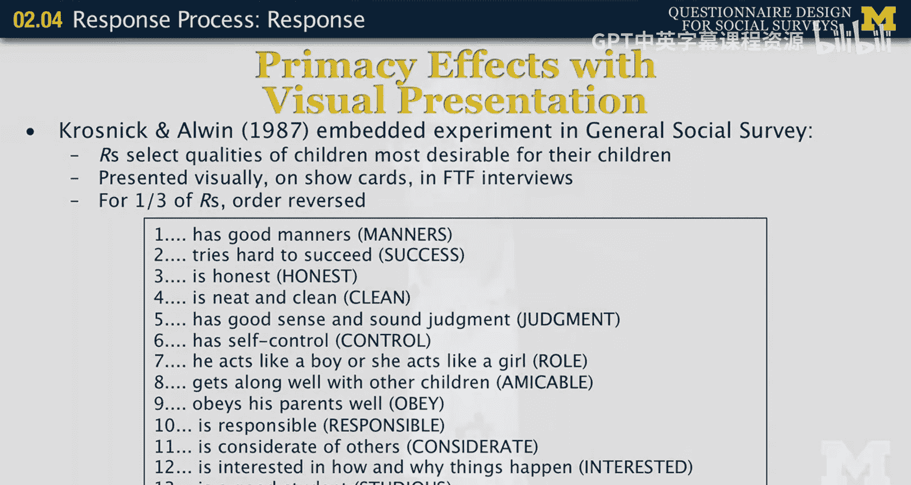

So the question is whether the early options are endorsed more frequently than the later options。

 and if so， that's what is known as a primacy effect。

Here's the data when the options are presented in the standard order。

 the first three manners success， honesty are endorsed substantially more often than when they're presented in the reversed order and appear respectively in the 13th。

 12th and 11th positions。And for the item that is presented last in the standard order Studious。

 it is endorsed 10 percentage points less often in that order than when it appears first in the reversed order。

 so this is a clear primacy effect and it doesn't depend on the particular options。

 it really depends on just their order。

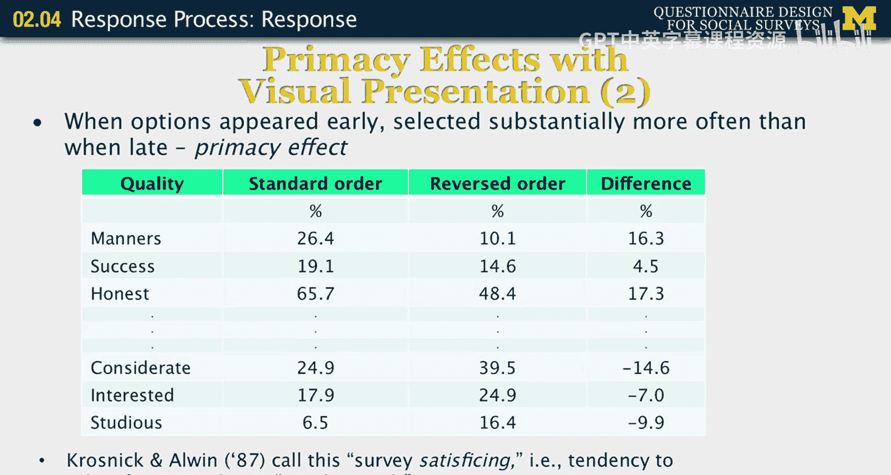

Krosniick andaln called this or called the mechanism responsible for Priacy survey Saing。

 which is the tendency to select the first item that's good enough。

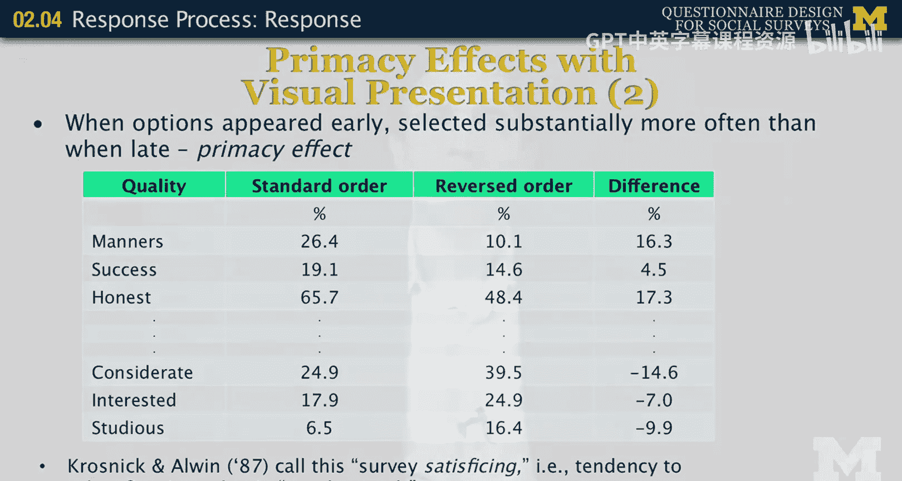

There's a parallel or complementary response order effect when the questions are presented auditorily or when they're spoken。

 and this can occur with very short lists of options this is demonstrated in a study by Schwartzzen colleagues。

Who report a preference for the final item， this is the final item or option spoken by an interviewer when the list has only two such options。

So the question was what form of government do you prefer。

 and the question is whether the options presented second are endorsed more frequently than when they're presented first。

And as you can see when the option is authoritarian government。

 it's endorsed 11 percentage points more often when it's presented second than when it's presented first。

The same is true for democratic， it's endorsed nine percentage points more often when presented in the second or final position than first。

 but the point here is that authoritarian appears to be a relatively popular option when it's presented in the second position。

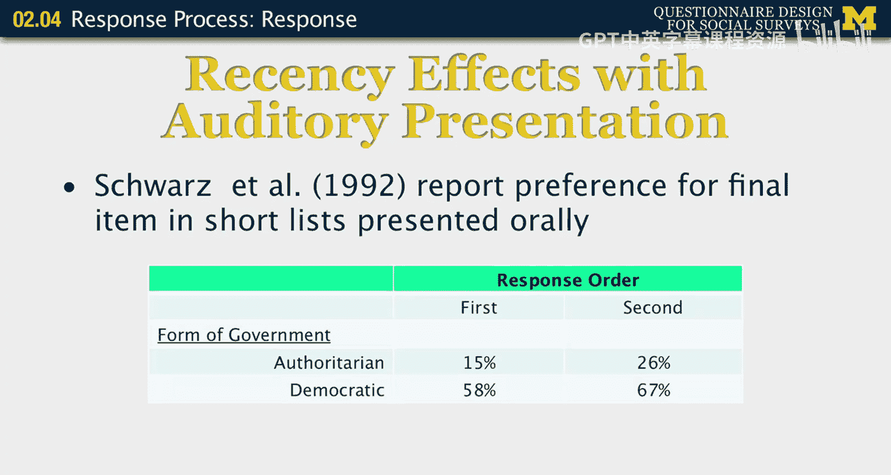

The explanation for recency effects has been attributed to working memory capacity。

 in particular people are forgetting the earlier options and better remembering the more recently presented options。

 hence the name recency effect。

This idea has been explored by Knoyper， who controlled for working memory capacity using respondent age as a proxy。

 taking advantage of the well known and unfortunate fact that people's working memory capacity deteriorates as they age。

She reanalyzed results from Schumman impresspressor。

 who had done a study to look at response order effects in questions about housing。

And she found that older respondents showed a larger recency effect than younger respondents who barely showed any recency effect。

 suggesting that working memory capacity and forgetting earlier options is probably at least part of the explanation for recency effects。

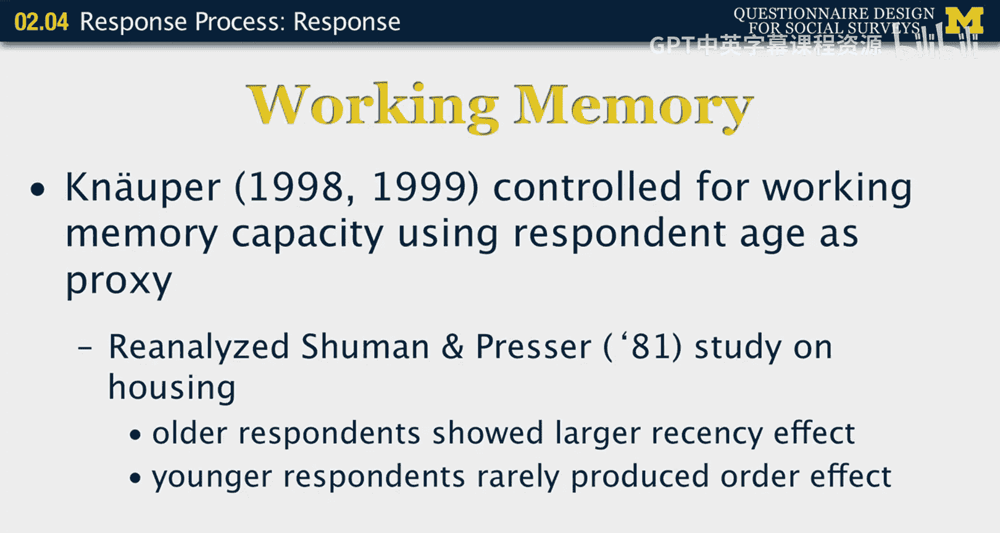

Another type of question that can demonstrate error in the mapping stage are questions requiring open numerical responses。

In particular， when respondents provide prototypical or rounded reports。

This may indicate imprecision in their underlying representation。

May simplify the mapping task for them by creating kind of categories。

It may signal uncertainty and it may signal embarrassment。

Here's an example from data from the American National Ection Survey analyzed by Taranjo Ripsson Rainnski。

The question concerned preference for presidential candidates on the 100 point feeling thermometer and the analysis classifies the numerical responses selected on the feeling thermometer into multiples of 10。

 15 or 85 and other values where other values are essentially the unrounded values。As you can see。

 the vast majority of respondents， whether answering about Clinton or Bush。

 selects numbers that are multiples of 1。A large number of respondents also selects numbers that are either 15 or 85。

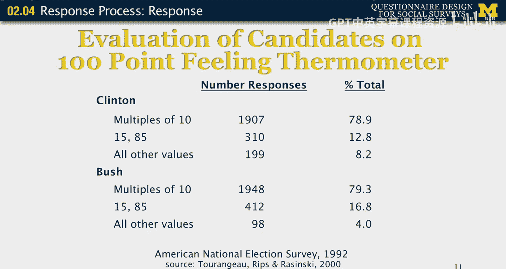

So respondents are rounding extremely often here， presumably indicating to the researchers that they are taking a 100 point scale and breaking it into a more manageable scale with the discriminations that are meaningful to them。

The final example of error in the mapping and reporting stage concerns respondents' answers to sensitive questions。

It's well known that when respondents self administer questions。

 they're more likely to answer truthfully to disclose more and to report fewer socially desirable answers。

This is well documented in a study by Taranjo and Smith in which they presented sensitive questions on topics like drug use under either interviewer or self administered conditions。

These data are ratios of estimated prevalence of cocaine use and marijuana use under self administration and under interviewer administration。

Numbers bigger than one indicate more prevalence。Numbers bigger than one indicate greater prevalence。

Under self administration than interviewer administration， all of these numbers are greater than one。

 suggesting that people are more likely to report an undesirable， in this case。

 illegal behavior under conditions of self administration。Why is this happening。

 one possibility is that respondents are editing their answer before they report it。

This has been called motivatedt misreporting， and evidence comes from at least two findings。

The misreporting is in one direction， the socially desirable direction。

And self administration affects answers to sensitive， but not non sensitiveens questions。

It's most likely therefore that respondents are editing a formulated response。

 the result of the earlier three stages， rather than selectively retrieving positive attributes about themselves。

One piece of evidence supporting this view is that response times are longer for sensitive than equally demanding non sensitive questions。

For example， Holtgraves observed longer response times when the introduction emphasized the social desirability of questions。

 so this suggests that respondents go through an edit step where they consider do I want to edit this answer or not before reporting it。

 so even if they don't change their answer they've gone through this edit step。

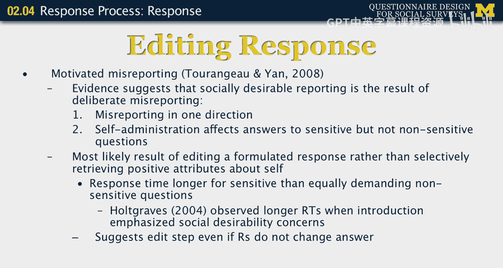

This concludes our discussion of the four stages that a respondent would need to go through to provide a thoughtful answer。

So the next segment concerns types of survey questions。

