# 调查数据收集与分析：2-6：应答过程：最终响应 📝

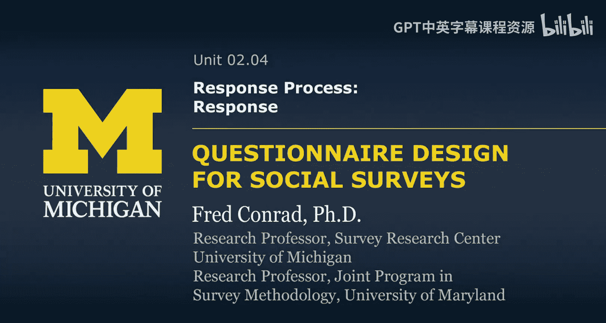

在本节课中，我们将学习调查应答过程的第四个，也是最后一个阶段：**报告答案**。这个阶段有时也被称为“映射与报告”阶段，受访者需要将之前理解、信息检索和判断估计阶段得出的结果，映射到问卷提供的具体答案选项中。这个过程本身也可能引入测量误差。

---

在上一节中，我们讨论了应答过程的前三个阶段。本节中，我们来看看最后一个阶段：**报告答案**。在这个阶段，受访者需要从提供的选项集中选择一个答案。本质上，这是一个**映射**过程：受访者需要将判断和估计的结果，转化为问卷上某个具体的答案类别。由于估计结果可能不精确，或者与现有选项不完全匹配，这种转化就可能带来误差。接下来，我们将通过一系列例子，展示在这个阶段可能出现的测量误差类型。

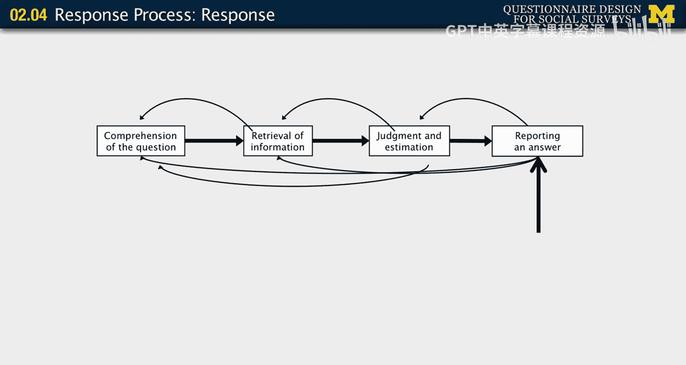

## 示例一：有序量表的选项间距 📏

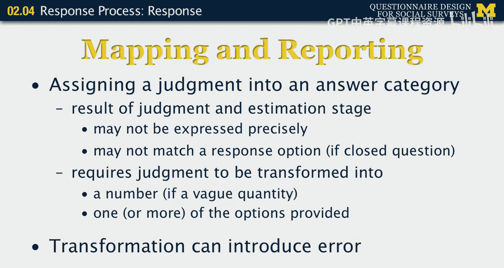

第一个例子与有序量表中**答案选项的视觉间距**有关。这里存在一个概念上的中点与视觉上的中点的区别。受访者对量表的心理表征会同时受到这两者的影响。

Tranjo及其同事比较了量表选项**均匀间距**与**不均匀间距**时，中间选项被选择的情况。在不均匀间距的情况下，量表右侧的选项在概念上看起来更接近中心。

以下是两种量表的呈现方式。问题是：“在接下来的一年里，您生病到需要卧床一整天的可能性有多大？”

*   **均匀间距量表**：选项视觉上均匀分布，“一半可能”正好在视觉中心。视觉中点与概念中点对齐。
*   **不均匀间距量表**：“一半可能”在视觉上偏左，因此概念上位于其右侧的三个选项在视觉上显得更居中。

以下是实验结果：
*   当量表均匀分布时，**58%** 的受访者选择了右侧的选项。
*   当量表不均匀分布时，**64%** 的受访者选择了右侧的选项。

这反映了量表**视觉外观**对受访者选择的影响。

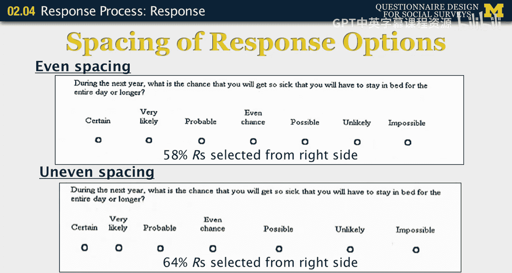

## 示例二：无序选项的顺序效应（首因效应）🔝

现在让我们看一个例子，展示在映射和报告**无序选项**时如何引入测量误差。

Krosnik和Alwin在《综合社会调查》中嵌入了一个实验。受访者被要求选择他们认为孩子最应具备的品质。这些品质通过“展示卡”在面对面访谈中呈现。

*   对于三分之一的受访者，选项顺序是**标准顺序**。
*   对于另外三分之一的受访者，选项顺序是**反转顺序**。

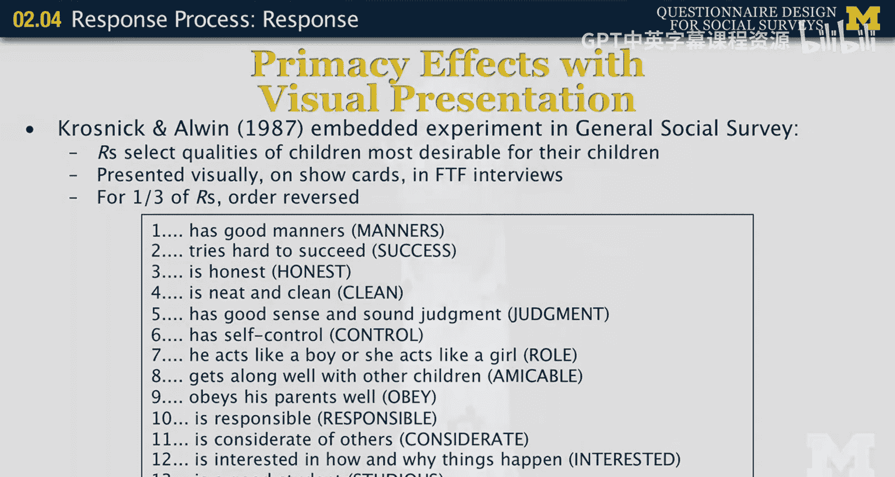

问题是：**靠前的选项是否比靠后的选项被选择的频率更高？** 如果是，这就是所谓的**首因效应**。

以下是数据结果：
*   当选项以标准顺序呈现时，前三个品质（有礼貌、努力成功、诚实）被选择的频率，远高于当它们以反转顺序出现在第13、12、11位时。
*   对于在标准顺序中排在最后的品质（好学），其被选择的比例比它在反转顺序中排在第一位时低了**10个百分点**。

这清楚地表明了**首因效应**，且这种效应不依赖于具体选项内容，而主要取决于它们的**呈现顺序**。

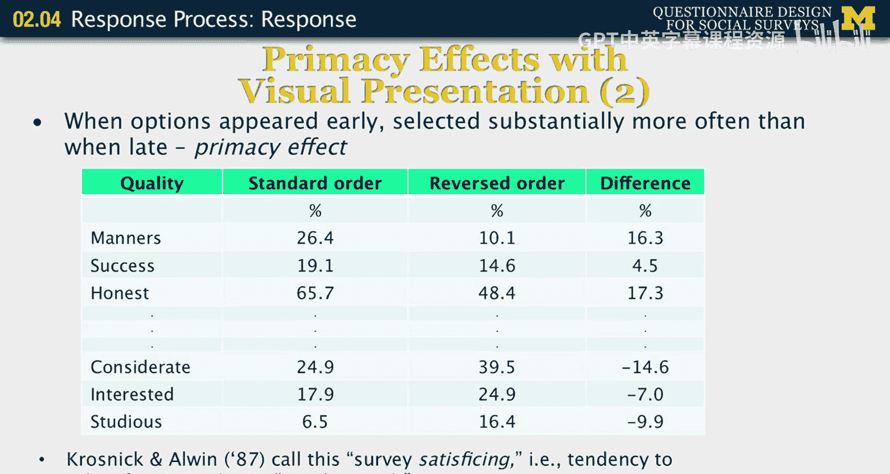

Krosnik和Alwin将导致首因效应的机制称为**“满意即停”**，即受访者倾向于选择第一个“足够好”的选项。

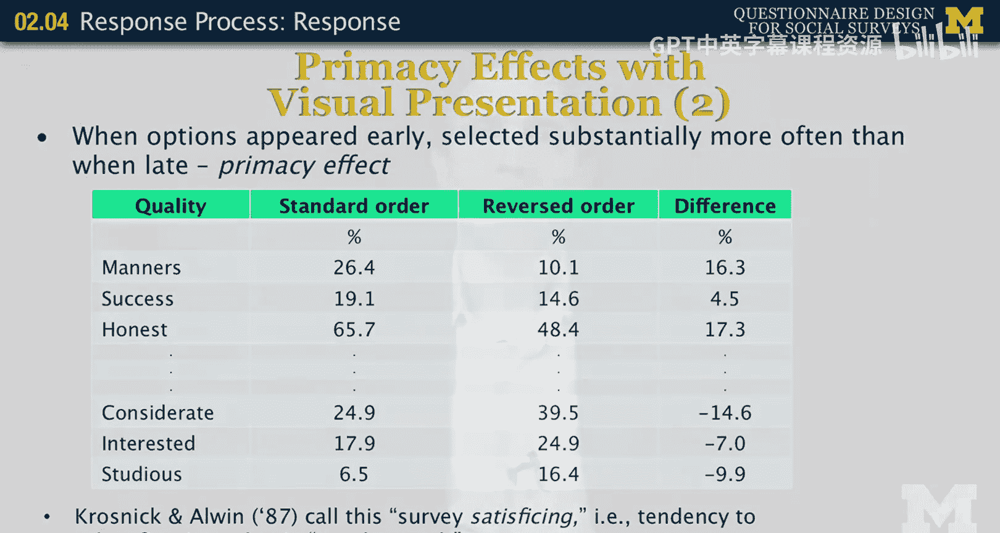

## 示例三：听觉呈现的顺序效应（近因效应）🔚

当问题以**听觉方式**呈现（如访员读出）时，存在一种并行或互补的应答顺序效应，即**近因效应**。这在选项列表很短时尤为明显。

Schwartz及其同事的研究证明了这一点。他们的问题是：“您更喜欢哪种政府形式？” 选项只有两个。研究目标是：**第二个被读出的选项是否比第一个被读出的选项更常被选择？**

结果如下：
*   当“威权政府”作为第二个选项被读出时，其被选择的比例比作为第一个选项时高出**11个百分点**。
*   “民主政府”作为第二个选项时，也比作为第一个选项时高出**9个百分点**。

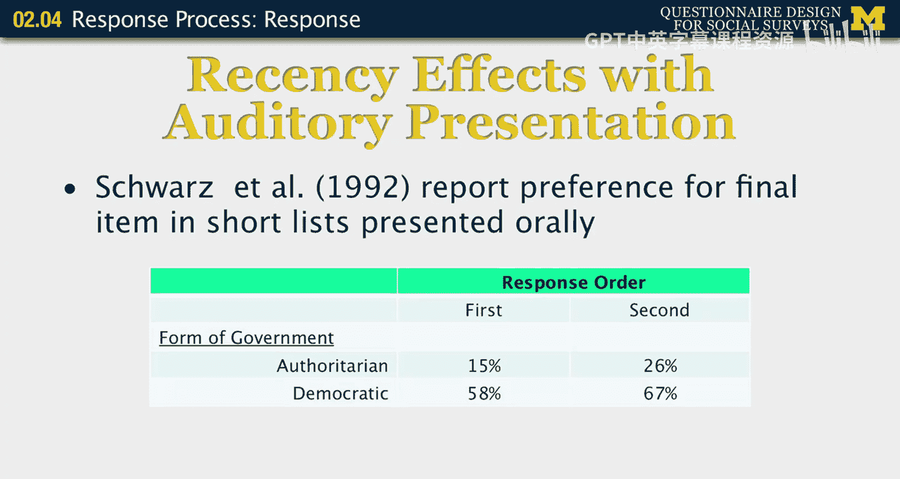

这表明，在听觉呈现的短列表中，存在对**最后听到的选项**的偏好，即**近因效应**。

对近因效应的解释通常归因于**工作记忆容量**。人们更容易忘记较早听到的选项，而更好地记住最近听到的选项，因此得名“近因效应”。

Knäuper通过以受访者年龄作为工作记忆容量的代理变量，探索了这一观点。她重新分析了Schuman和Presser关于住房问题的应答顺序效应研究数据，发现**年长的受访者**表现出比年轻受访者**更明显的近因效应**，而年轻受访者几乎没有表现出近因效应。这支持了工作记忆容量限制和遗忘早期选项是近因效应至少部分原因的观点。

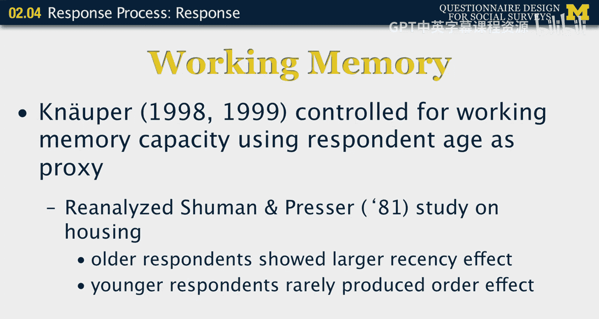

## 示例四：开放式数值回答的取整现象 🔢

另一类能在映射阶段展示误差的问题是要求**开放式数值回答**的问题。具体来说，当受访者提供**典型化或取整**的报告时，这可能表明：
1.  他们内在表征的不精确性。
2.  他们通过创建类别来简化映射任务。
3.  他们表达了不确定性或尴尬。

一个例子来自Tourangeau、Rips和Rasinski分析的《美国国家选举研究》数据。问题涉及在100分的“感觉温度计”上对总统候选人的偏好。分析将选择的数值分类为10的倍数、15或85、以及其他（未取整的）值。

结果显示，绝大多数受访者，无论是评价克林顿还是布什，都选择了**10的倍数**。也有大量受访者选择了**15或85**。

这表明受访者在此处**极其频繁地进行取整**。研究人员认为，这可能是受访者将100分量表转化为对他们而言更易管理、区分更有意义的量表。

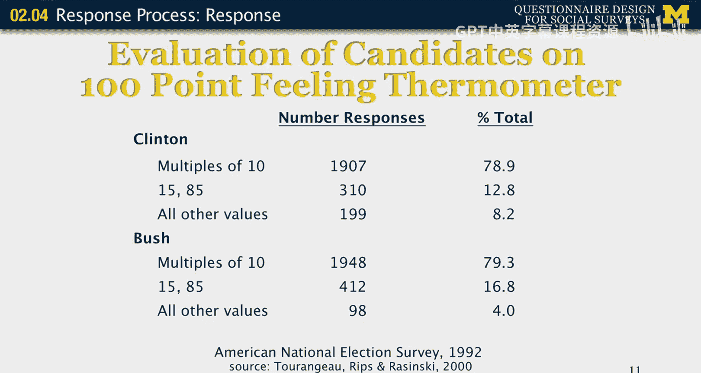

## 示例五：敏感问题的应答编辑（动机性误报）🤫

映射和报告阶段误差的最后一个例子涉及受访者对**敏感问题**的回答。众所周知，当受访者**自填问卷**时，他们更可能如实回答、披露更多信息，并减少社会赞许性回答。

Tourangeau和Smith的研究清楚地记录了这一点。他们比较了在访员提问和自填条件下，关于吸毒等敏感话题的问题回答情况。数据是自填条件下与访员条件下，可卡因和大麻使用估计流行率的**比率**。

*   **比率 > 1** 表示自填条件下的报告流行率更高。
*   所有比率都**大于1**，表明人们在自填条件下更可能报告这种不良的（此处为非法的）行为。

**为什么会这样？** 一种可能是受访者在报告答案前对其进行了**编辑**。这被称为**动机性误报**。支持这一观点的证据至少来自两方面：
1.  误报是**单向的**，即朝向**社会赞许**的方向。
2.  自填方式主要影响**敏感问题**的答案，而不影响非敏感问题。

因此，最可能的情况是，受访者是在编辑一个已经形成的回答（前三个阶段的结果），而不是有选择地检索关于自己的正面属性。

支持这一观点的一个证据是，回答**敏感问题**所需的**时间**比回答同等难度的非敏感问题**更长**。例如，Holtgraves观察到，当问题引言强调问题的社会赞许性时，应答时间会延长。这表明受访者在报告前会经历一个“编辑”步骤，考虑“我是否要修改这个答案？”，即使他们最终没有改变答案，也经历了这个编辑步骤。

---

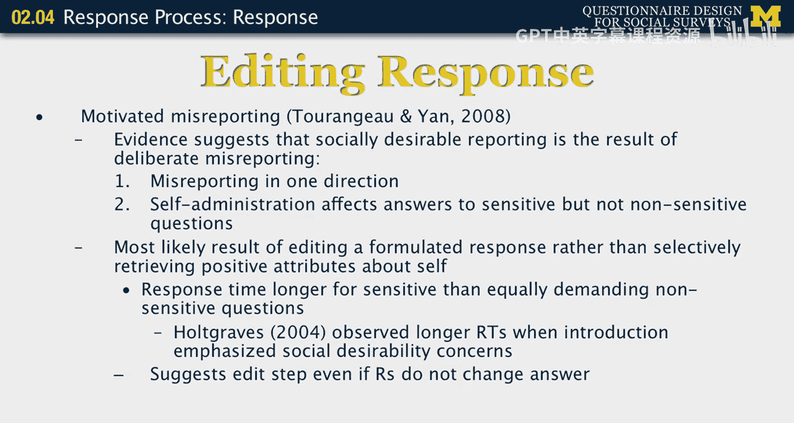

本节课中，我们一起学习了调查应答过程的第四个阶段——**报告答案**。我们探讨了在这一“映射”阶段可能出现的多种测量误差，包括：
*   量表**视觉间距**对选择的影响。
*   视觉或听觉呈现中选项**顺序**导致的**首因效应**与**近因效应**。
*   开放式数值回答中的**取整**现象。
*   面对敏感问题时，受访者可能进行的**动机性误报**和答案编辑。

理解这些误差来源，对于设计能获取更准确数据的调查问卷至关重要。下一节，我们将探讨**调查问题的不同类型**。