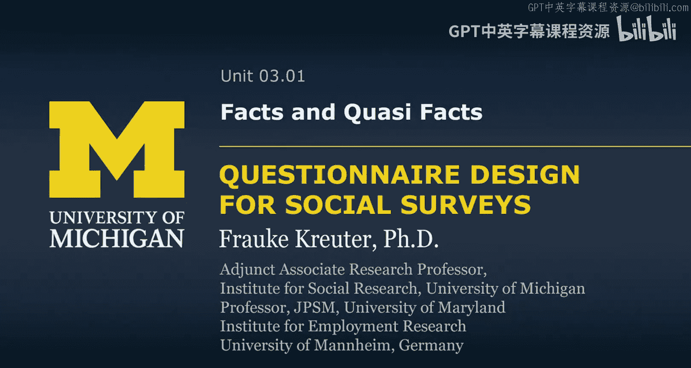
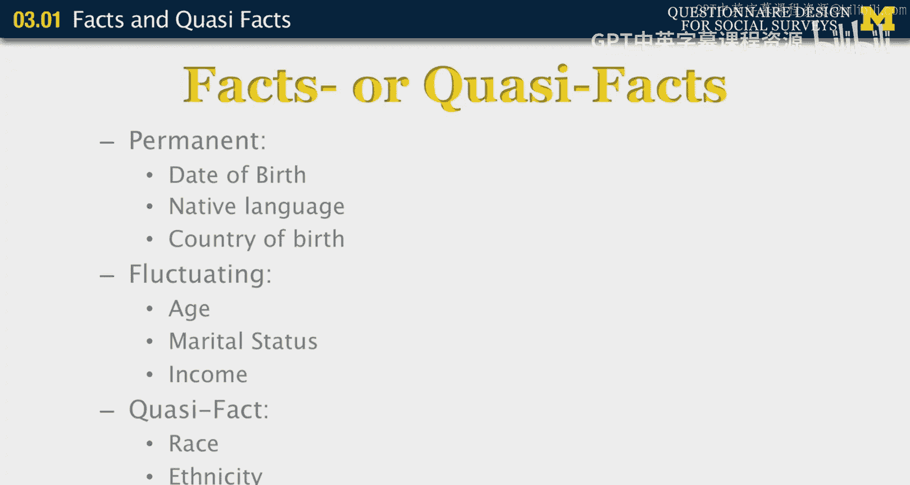
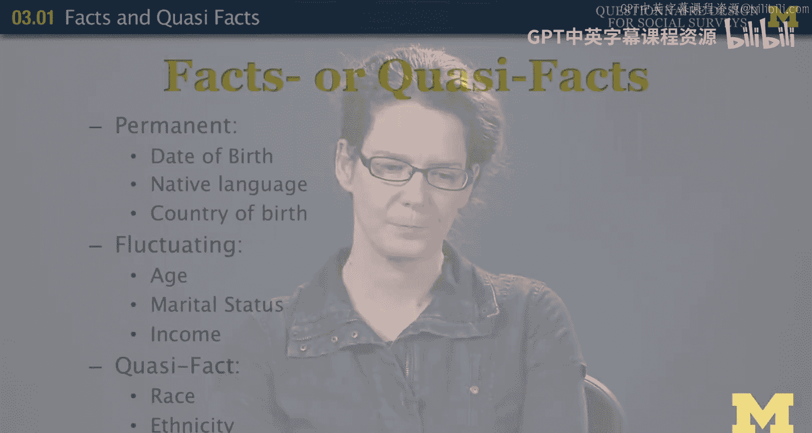
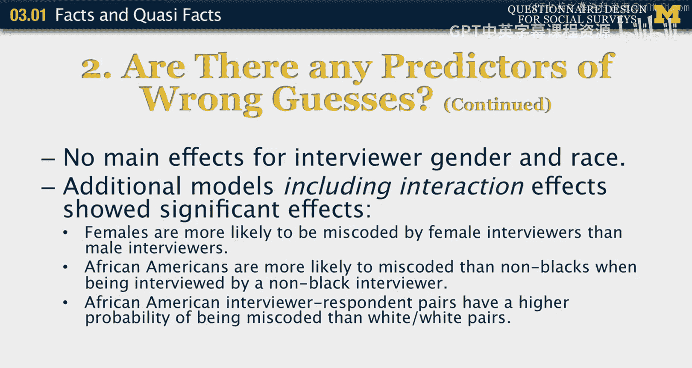

# 密歇根大学《调查数据收集和分析（2-6：方法、社调问卷设计、抽样、缺失数据、分析）｜Survey Data Collection and Analytics》 p53 10_事实与准事实.zh_en -BV1fw4m1e7Zh_p53-

This whole unit is about asking factual questions or quasi effects。

 some of them at least will be such and well introduce you to that concept and start with a couple of examples。

So。You， factactual question can be questions about behaviors， use of online shopping。

 cigarette smoking， doctor visit， exercises， food intake， any of those activities。

Some of them are sensitive， we talk about how to ask sensitive questions。

 Some of them are hard to remember， will talk about recall problems and errors of that nature。

And some of them are just facts。 and you would think they should be easy to ask and even more easy to answer。

But some of these facts are actually quasi facts that are defined as something that is。

Commonly seen as concrete and objective， but has a large subjective component。

 So it shares features of effect factual question and an etitudinal question。

This is our question to you。Would you say this is a fact or a quasi effect。Just click for each of。

The items listed here， what you think this is。Now， the first three are permanent。

 unchangeable effects， your date of birth， you might not know it， but it is a fact。

So is your native language or your country of birth？

Other facts are much more fluctuating H， for example。You know， if youre a certain age。

 gets really hard to remember how old you actually are， right。

 It's easy to remember your date of birth， but how old you are changing all the time。 I mean。

 time goes very quickly， very hard to answer。For certain respondents。

Marriill the status obviously fluctuating。Depending on the country at least。

 many allow divorces and such， so this is a fact， but it might change。Income is fluctuating。

 and for that nature， already harder to answer。 but it also。Might be a sensitive question。

 And as I said， we'll have a segment on those。 actually， segments。And then there are two quasi facts。

True， I mean， what we call the quasi effects and those would be questions on race and ethnicity。

Why is that？ Well， just think about this for a moment。 What attributes define race。

Let me give you a little bit of history on the race question。

One goal was or is still to monitor and expose oppression and its result。The question， of course， is。

 is the survey question the right tool to measure that and how this is measured and whether it's measured at all it varies across countries and across time？

The US census has actually not used the same definition in more than two censuses。Nowadays。

 race and ethnicity questions are collected through self reports and self identification。

 but prior to 1960， it was collected based on enumerator observation。

You might be taking itback by this since I was like， well， wait a second。 How can they know that。

 but。You could argue that if you want to measure。What people experience。

 it might not be a bad idea to actually measure。What other people see there。

 so there's some argument to make be made for that。

Great Britain did not collect data on ethnic groups until 1991。

A lot of other countries that don't do that either in the US， given its history。

There has always been a big debate on how to best measure this an authority in this debate is the Office of Management and Budget。

That oversees all of the federal statistical agency data collection。

And they have a policy directive when they had a policy directive in 1978 that stipulated federal agencies。

They were to collect and present data on at least four racial groups。

 American Indian or Alaska natives。Asian or Pacific Islander， black and white。Back then。

 no reporting of multiple races was possible。It was preferred that people self identify。

And nobody should tell them how they classify themselves。This is a little unreadable。

 and you'll see a link on the website to these old census forms。 But basically， what you see here。

 it says if Indian print the name of the。Now， I can't even read it enrolled or principal tribe。

And that can be listed here。And then if Asian or Pacific Islander， you know。

 specifications can be made here and here。 and then the respondent was asked to。

Check off which of these categories applied to them。For some of them to give additional information。

Now， a little bit confusing of a form， you know， here the actual question。

 here's some explanation of what should be done。But you see the categories here and interesting labels。

 you know， that might not be any longer in the common language use。

There was no possibility to mention multiple arrays on this form。

That was changed in the OMB directive from 1997。More in the spirit that the social definition of race should be recognized and that doesn't conform to any biological。

 anthropological or genetic criteria。 So here， you know。

 the directive suggests to include the following race groups as listed here。

 but it also allowed for multiple reporting of race。In that 2000 and 2010 census form。

You see the race question as follows。 Now we have category white black。African American or Negro。

 the old term was kept because they are still older African Americans for whom this term is actually not offensive but the way they would self describe。

It's a big debate every census on how this should be done， interesting to follow up on this。

 on the web entries that we have to this form。Again。

Print name of enrolled or principal tribe as a further specification。

 the different categories and so on， but。While in spirit。

 this still looks like this very old census form with the better layout， you see a big change。

1 x1 or more races。Here now people can self identify themselves as having multiple races。

 which with you know mixed parents and the like makes a lot of sense。

This is the ethnic question used in the census form。

Here there's a separate note that both question  seven and question8 should be answered if the person Hispanic or Hispanic or Latino。

And what's the person's first race。 So this is a further specification that is asked here。Now。

 there are some challenges to measuring race and ethnicity。

One has to do with the validity of the concept。With the reliability of the concept。

 we can have changes in self perception over time。We have challenges with the response selection。

 you know， are these categories really mutually exclusive， are they meaningful for all respondents？

And how can you compare this over time？Keep in mind， these questions might be asked in context。

 So early on， we talked about Gr mixims。 So the context creates a conversation in norm。

 And this is true also for the race and ethnicity question。 that would determine， for example。

 the flow。Of the。Hispanic versus non Hisspanic question and additional race questions。

 because in the order that is issued now， context effects can be mitigated。Context in general。

 provides an interpretive framework。And we have seen in many other examples that this can resolve anities。

The work from Fred Conrad and Michael Scher is a good example here。And it can， of course。

 prime the respondent to relevant items。 And while， you know。

 you might first think of only additudinal questions being affected by context。

 this is true also for factual question。Now， sometimes just like with the old way of measuring race。

 you would say， well， can't we just guess， for example， what the respondent's gender is。

 Why do we need to ask respondents gender another factual question。In county surveys， computer edit。

 telephone survey interviews， genders often。Gest。Interviewers are asked you to listen and only ask if Im。

Or not even encouraged to ask。These interviewer guesses are then used for a variety of purposes。

 sometimes to screen for eligibility， sometimes to filter for know gender related items。

And in rare cases， also for a nonres adjustment or post certification。

 actually not that rare if there isn't an additional demographic section in the survey with the respondents of reports。

So here's an example from them。Hes Information National Fri Sty hints。If not obvious。

 interviewers guess respondents gender and then the instruction to the interviewer ask。

 if not obvious， are you male or female？Now。We did a little research study with two research questions。

 A， we wanted to know how good our interviews at guessing respondentence gender。And B。

 we wanted to know if there are any predictors of wrong guesses if they might occur。

Why would we think they might of， Because linguists find that pitch tones allow listeners to discriminate between men and women voices。

 but。There's overlap in these pitch tones。 And so the question is。

 how good are we really in teasing apart males and females。

And do these males and female classification through the voice really match what the respondents of reports here。

 too， you could argue that maybe gender is more a quasi effect than a factual question。

In order to conduct the study， we used 28 public opinion phone surveys conducted between the years 2008 and 2010。

 when I say we， I mean Susan Kenny McCak and myself。

She was a student in the joint program in Silver methodology and had worked at Merist。

And was able to。Analyze or reanalyze these data that Mariistt had collected。In total。

 there were over 20。5000 respondent data that we could use for this study。

All collected in a centralized facility in Poughkeepsie， New York。

And these surveys have been national surveys， some just in the state of New York。

 and many of them are landlight samples here in this database， there are no cell phone data。

Here you see a description of the respondent demographics。So， you know， reasonably。

 as you would expect， and a description of the interview demographics that conducted the interviews in the phone survey。

 a total of 475。 All these interviewers were trained in Merris College student between the ages of 18 and 23。

So now you know how many interviewers there are and how many respondents。

The distribution and the like。Each of these various interviews was asked to guess the respondent's gender。

 and then later on， the respondent were asked。My question， do you know， is how。Big。

 do you think or how small。Is a misclassification era。 How many of these guesses might be wrong。Wang。

8% overall。8% of the gender was guessed incorrectly。

 We have different ran measurement error across the gender groups。

 which is interesting We have among the female respondents，12。

6% that were guessed to be male and among the male respondents 2。6% that were guessed to be female。

That is because the vocal codes of the females have a wider range。

 and so it's much easier to misclassify the females than the males。Interestingly。

This misclassification happens much more so among blacks than among other racial groups。

 So you can imagine， in particular among black females， they will be misclassified the most。

We also look at predictors of wrong guesses in some multivariate models。

 hierarchical linear probability models， the paper that related to this research is on the course website here you see a list of the dependent variable our era。

 the guess between interviewer and the respondent report。

And then a bunch of interviewer variables predicting the error probability。

This is for you to look at and for you know us to discuss only one single thing。

 which is that interestingly enough interview experience。

 so experience level3 and4 higher levels of experience seem to increase the error in the interviewer guesses and we have since then confirmed this with other survey houses here can be an adverse effect of interview experience。

 maybe paying less attention or having heard too many of these voices， we don't know for sure。

But in this interesting line of research and we put a couple of manuscripts out there on the course website if you want to see for yourself what these effects are in other studies。

To sum this up， we didn't see any main effects for interview agenda and race as predictors for what is wrong guess。

But if we include interactiona effects， we saw significant effects that females are more likely to be miscodeded by female interviews than male interviews。

African Americans were more likely to be miscodeded than non blacks when being interviewed by a non black interviewer。

And African American interviewer respondent pairs have a higher probability of being miscodeded than white pairs。

