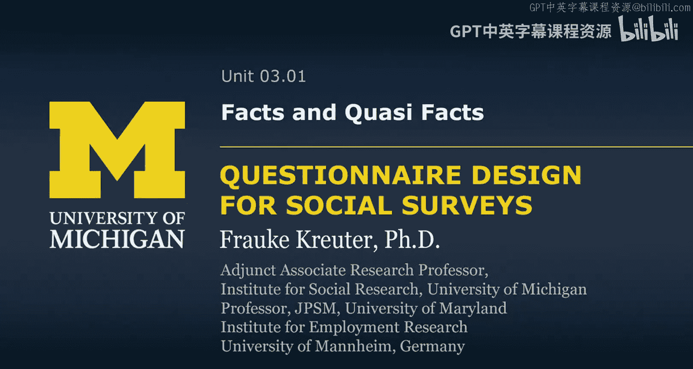
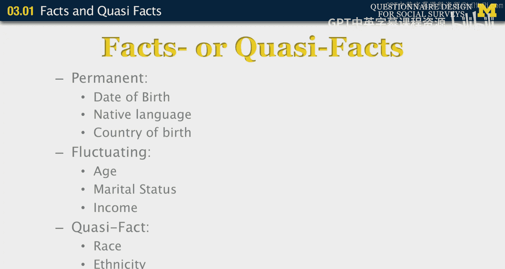
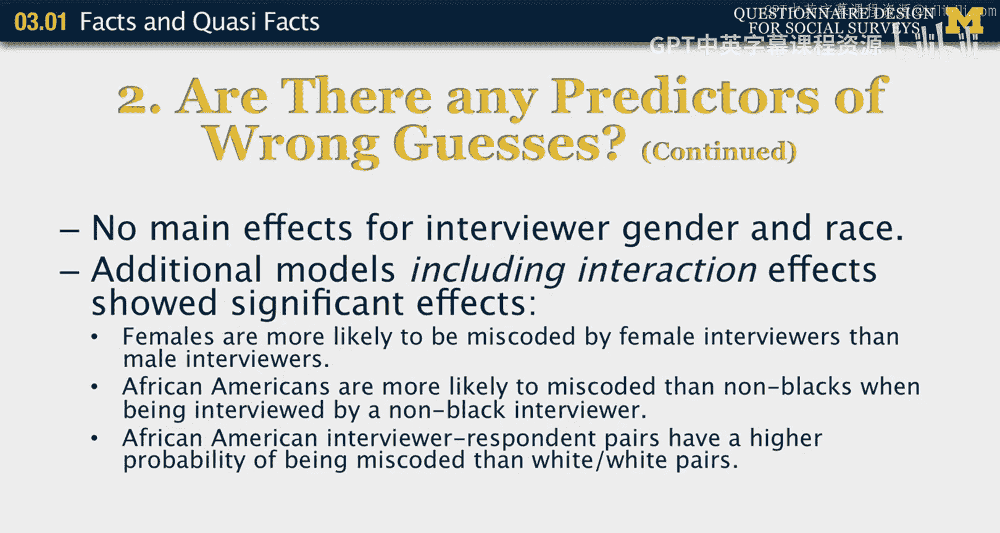

# 密歇根大学《调查数据收集和分析》：2-6：事实与准事实问题

在本节课中，我们将学习如何设计关于事实与准事实的调查问题。我们将探讨什么是事实问题，什么是准事实问题，并通过具体例子理解它们之间的区别与设计挑战。

## 什么是事实与准事实问题？

本单元的主题是询问事实性问题或准事实性问题。我们将介绍这个概念，并从几个例子开始。

事实性问题可以是关于行为的问题，例如：在线购物、吸烟、看医生、锻炼、食物摄入量等任何活动。其中一些问题可能比较敏感，我们将讨论如何询问敏感问题。有些问题可能难以回忆，我们将讨论回忆问题及其相关的误差。而有些问题则纯粹是事实，你可能认为它们应该很容易提问，甚至更容易回答。

但有些所谓的“事实”实际上是准事实。准事实被定义为通常被视为具体和客观，但包含大量主观成分的事物。因此，它兼具事实性问题和态度性问题的特征。

## 区分事实与准事实

以下是我们的问题：你认为下列各项是事实还是准事实？请为列出的每一项做出选择。

前三个是永久不变的事实：你的出生日期、你的母语或你的出生国家。你可能不知道某些信息，但它们本身是事实。

## 波动性事实与敏感事实

其他事实则波动性大得多。例如，达到一定年龄后，记住自己的实际年龄会变得非常困难。记住出生日期很容易，但你的年龄一直在变化。时间过得很快，因此很难回答。

婚姻状况显然是波动的。至少在允许离婚的国家，这是一个事实，但它可能会改变。收入是波动的，因此本身就较难回答，而且它也可能是一个敏感问题。正如之前提到的，我们会有专门章节讨论这些问题。

## 准事实：以种族和族裔问题为例

接着是两个准事实，也就是我们所说的准事实问题，即关于种族和族裔的问题。

为什么它们是准事实？让我们思考一下：定义种族的属性是什么？让我简单介绍一下种族问题的历史。

一个目标曾经是（现在仍然是）监测和揭露压迫及其后果。当然，问题是：调查问题是衡量这一点的正确工具吗？如何衡量？是否进行衡量？这在不同国家和不同时期都有所不同。

美国人口普查实际上没有在超过两次普查中使用相同的定义。如今，种族和族裔问题通过自我报告和自我认同来收集，但在1960年之前，它是基于普查员观察来收集的。你可能会对此感到惊讶，但可以这样理解：如果你想衡量人们的经历，衡量他人如何看待他们可能不是一个坏主意，因此这有一定道理。

英国直到1991年才开始收集关于族裔群体的数据。许多其他国家也不这样做。在美国，鉴于其历史，如何最好地衡量这一问题一直存在很大争议。这场辩论中的一个权威机构是管理和预算办公室，它监督所有联邦统计机构的数据收集。

## 种族问题定义的演变

他们在1978年发布了一项政策指令，规定联邦机构应至少收集和呈现四个种族群体的数据：美洲印第安人或阿拉斯加原住民、亚洲人或太平洋岛民、黑人和白人。当时，不允许报告多种族。他们倾向于让人们自我认同，没有人应该告诉他们如何分类自己。

以下是一份旧的人口普查表格，虽然有些难以辨认，但你可以看到类别和有趣的标签，这些可能已不再常用。这份表格上没有提及多种族的可能性。

这在1997年的OMB指令中得到了改变。更倾向于承认种族的社会定义，并且它不符合任何生物、人类学或遗传标准。该指令建议包括以下列出的种族群体，但也允许报告多种族。

在2000年和2010年的人口普查表格中，种族问题如下所示。现在我们有了白人、黑人、非裔美国人或黑人的类别。保留了旧术语，因为对于一些年长的非裔美国人来说，这个词实际上并不冒犯，而是他们自我描述的方式。每次人口普查都会对此进行大辩论，值得关注。

表格上还有进一步的说明：如果一个人是西班牙裔或拉丁裔，应同时回答问题7和问题8。这是此处询问的进一步说明。

## 衡量种族和族裔的挑战

衡量种族和族裔存在一些挑战。一个挑战与概念的有效性有关，另一个与概念的可靠性有关，自我认知可能随时间变化。还有回答选择的挑战：这些类别是否真的互斥？对所有受访者都有意义吗？如何随时间进行比较？

请记住，这些问题可能在特定背景下被提出。早期我们讨论过格赖斯准则，背景创造了对话规范，这对种族和族裔问题也是如此。例如，这会决定西班牙裔与非西班牙裔问题以及附加种族问题的流程，因为按照现在给出的顺序，可以减轻背景效应。

背景通常提供了一个解释框架。我们在许多其他例子中看到，这可以解决歧义。弗雷德·康拉德和迈克尔·舍尔的研究是一个很好的例子。当然，它也可以引导受访者联想到相关项目。虽然你可能首先想到只有态度性问题会受到背景影响，但这对事实性问题也是如此。

## 事实问题案例：性别猜测研究

有时，就像衡量种族的旧方法一样，你会想：我们不能直接猜测吗？例如，受访者的性别是什么？为什么我们需要询问受访者的性别——另一个事实问题？在县调查、计算机辅助电话调查访谈中，性别经常被猜测。访问员被要求倾听，只有在不确定时才询问，甚至不鼓励询问。这些访问员的猜测随后被用于各种目的，有时用于筛选资格，有时用于过滤与性别相关的项目，在少数情况下也用于无回答调整或事后分层。

以下是一个来自全国性调查的例子。如果受访者的性别不明显，访问员会猜测，然后指示访问员询问：“如果不明显，请问：您是男性还是女性？”

我们进行了一项小型研究，有两个研究问题：A. 我们想知道我们的访问员在猜测受访者性别方面有多好。B. 我们想知道如果发生错误猜测，是否有任何预测因素。

为什么我们认为可能会发生错误？因为语言学家发现音调允许听者区分男性和女性的声音，但这些音调有重叠。所以问题是：我们真的能很好地区分男性和女性吗？这些通过声音进行的男女性分类是否真的与受访者的自我报告相符？你也可以认为，也许性别更像是一个准事实问题，而非纯粹的事实问题。

## 研究设计与发现

为了进行这项研究，我们使用了2008年至2010年间进行的28项电话民意调查。总共有超过20,500名受访者的数据可用于本研究。所有数据均在纽约波基普西的集中设施中收集。这些调查包括全国性调查和一些仅在纽约州进行的调查，该数据库中只有固定电话样本数据。

以下是受访者人口统计的描述，以及进行电话调查的访问员人口统计描述。总共有475名访问员。所有这些访问员都是经过培训的玛丽斯特学院学生，年龄在18至23岁之间。

每项调查的访问员都被要求猜测受访者的性别，然后稍后询问受访者。我的问题是：你认为错误分类的误差有多大？有多少猜测可能是错误的？总体错误率为8%。我们在不同性别群体中观察到不同的错误率，这很有趣：在女性受访者中，12.6%被猜测为男性；在男性受访者中，2.6%被猜测为女性。这是因为女性的音域更广，因此女性比男性更容易被错误分类。

有趣的是，这种错误分类在黑人群中比其他种族群体更常见。因此，你可以想象，特别是在黑人女性中，她们被错误分类的可能性最大。

我们还通过一些多变量模型（分层线性概率模型）研究了错误猜测的预测因素。与此研究相关的论文在课程网站上。在这里，你可以看到因变量（我们的误差，即访问员猜测与受访者报告之间的差异）以及一系列预测误差概率的访问员变量。

这里只提一个有趣的点：访问员经验（经验水平3和4，即更高水平的经验）似乎增加了访问员猜测的错误。我们后来在其他调查机构也证实了这一点。访问员经验可能产生不利影响，也许是注意力不集中，或者听过太多声音，我们不确定具体原因。但这是一条有趣的研究路线，我们在课程网站上放置了几篇手稿，如果你想了解其他研究中的这些效应。

## 总结与启示

总结一下，我们没有发现访问员年龄和种族作为错误猜测的预测因素有主要效应。但如果我们纳入交互效应，我们发现显著效应：女性受访者更可能被女性访问员错误编码，而非男性访问员；当受访者由非黑人访问员访谈时，非裔美国人比非黑人更可能被错误编码；非裔美国人访问员-受访者对相比白人对有更高的错误编码概率。

本节课中，我们一起学习了事实与准事实问题的区别。我们了解到，事实性问题涉及客观、可验证的信息，而准事实问题虽然看似客观，却包含主观成分，如种族、族裔和性别认同。通过性别猜测的研究案例，我们看到了即使是看似简单的事实问题，也可能因测量方式（如访问员猜测）而产生显著误差。这提醒我们在设计调查问题时，需要仔细考虑问题的性质、受访者的认知以及社会背景的影响，以确保数据的准确性和有效性。