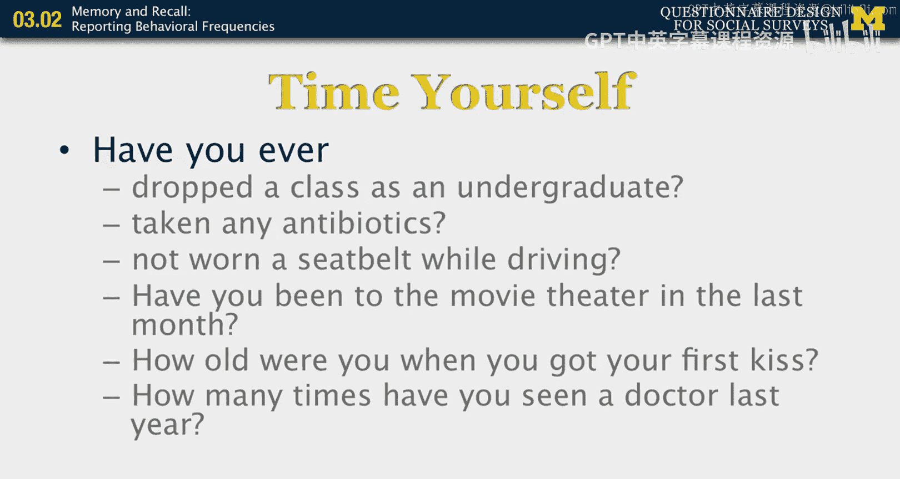

# 密歇根大学《调查数据收集和分析（2-6：方法、社调问卷设计、抽样、缺失数据、分析）｜Survey Data Collection and Analytics》 p54 11_记忆与回忆：行为频率报告.zh_en -BV1fw4m1e7Zh_p54-

Yeah。So now let's look at factship question from a different way in this segment we'll talk about memory and recall and this is all dancing around questions about specific events in the past and conduct of activities so behavioral frequencies and things of that nature so with specific events we might want to know whether they occurred or not。

 so for example since January 2013 have you looked for a job？

And here you ask about a specific event which requires the respondent to comprehend what you mean with looking。

And what you mean with looking for a job in particular。

 so definition oflooked and job is a comprehension task that the respondent has to master recall that from unit2 when we talked about the cognitive response process model。

But what is different here about past behavior when we ask those type of factual questions is that there's an additional recall task。

 so you have to remember everything you did since January 2013。 Now if you have been in a stable job。

 no problem there nothing has happened but if there。Timeframe would be different。

 or if you have done a lot of different things， this might be a more challenging question。

So then we can look about when did something occur for example。

 what age did you first try a cigarette here we asked the respondent about a specific event just taken the example before we ask about past behavior。

 but we also ask them to recall something else which is the specific date something occurred these kind of questions you find a lot in the public health surveys for example。

 they try to measure overall exposure or lengths of behavior of some form。

Another type is kinds of activities and this is also part of this set of autobiographical memory questions。

 very hard to do。So here we would， for example， ask since January 2013。

 how many times have you stayed in the hospital overnight？Again， a comprehension。

A recall task and in addition， an estimation or an exact count because you don't want to know the total number aggregated across all the events that happened at that point in time。

And then finally， an example for frequency， when you were growing up。

 how often did you attend religious services？This implicitly in the way it's wooded is encouraging the respondent to talk about frequency as a rate。

 so how often is usually the signal for this and we'll talk about the different challenges with these type of questions as we go forward now in these segments。

Now why is this difficult there are a couple of things that are related to error in recall of these past behavioral questions first one we'll talk about is encoding storage and retrieval。

Encoding of information is key to recalling information if it never entered your memory。

 can't come out again， right？So research has shown that information has to be considered salient or distinctive to enter long term memory。

And salience is individually defined what is salient for me might be not at all salient for you and vice versa。

 so if you designed your a questionnaire， think about your respondents that your population that you try to ask questions about。

And ask yourself how important is this to the respondent and does it stand out from other activities。

 Is this even reportable because if not， then you might have trouble recalling such events the deeper encoding affects accessibility so you know that if it's not stored very strongly in your memory it might be hard to retrieve it。

Also， if something is not encoded at all， as I said earlier， if it's not in memory。

 there's nothing to recall， which leads to under reportinging， not motivated under reporting。

 but just under reporting errors。This has big implications for questionnaire design if you do try to measure such past behavior where you think it was not salient。

And the respondent might not have encoded this enough to retrieve it。

 you might need to rely on alternative data sources for example。

 you know builts and receipts if you are in charge of the Bureau of Labor Statistics Consumer Expture Sur and you want to ask how many t-shirts someone bought in the year 2013 so over a year from today you would have troubles probably getting that number right。

 but if receipts are collected then you have a chance to look at this more closely。

Here's an example from a study that Roger Tenjo did it was published in edited volume under the title remembering What Happ。

Mem errors and survey reports， a good read and this table here sort of a core summary table of the results this was a study where the researchers ask parents that had just brought their kids into the doctor office when they returned out of it。

 they did ask about the type of immunization that these kids got and even so that just happened you can see that parents tend to over and underreport immunizations and that there is a big net era a lot of overall underreporting for hepatitis B and DTP where miselums rubella is reported much more often。

So lower rates of underreporting and also higher rates of overreing， a total net era of plus 17。1%。

This is interesting because you know you would think people。You know， only forget over time。

 but you see here that these parents probably never really knew what happened。

 but as I said before you always get an answer in the questionnaire and therefore should be cautioned relying on those。

Reports of past behavior。Now， there are different methods that help with the recall。

We differentiate between free recall， Q recalled， and recognition。

The free recall is the most difficult of all， this would be in the example before what type of immunizations did your child get。

 whereas you could give a Q recall， you give some examples of what this could be or you even have recognition where you tell the respondent all the sets of possible immunization and then just check it off。

Likewise， if you were to ask for social media use and which social media sites have you visited in the past year。

 it might be much harder to do that in a free recall task because there are so many。

 but if you see the list of them， you can just pick what fits there。

 or at least give some examples so that people do know what you mean and that helps them to remember。

Now the retrieval is also affected on what type of forgetting happens so people might know have stored this correctly and might be able to retrieve it with cu recall or recognition。

 but if they have forgotten in the meantime then it might be much harder to do so so the elements that affect forgetting time the older the event is。

 the more likely it will be forgotten， the less salient or mundane the event is the more likely it is to be forgotten。

 the more repetitive and routine， the more likely it is to forget an individual event。

 I mean so you do know that you drink coffee or that you eat bagels。

 but you might not recall every single time you did that。And here too。

 we have clear implications for questionnaire design， you need to， first of all。

 give time for a task that people can take the time to remember。

It is helpful to give some example cues， it's helpful to have shorter reference periods we'll talk about that in a second in more detail。

 and alternatively you might want to use an event history calendar so a visualization of a calendar where people can place events in time that can help mapping what happened in the past。

Now， to get a sense of how difficult or easy it is to get these questions answered。

 time yourself when you answer the following questions， have you ever？

Dr the cost as an undergraduate。Taking any antibiotics。Not one a seatbed by driving。

Have you been to the movie theater in the last month， how old were you when you got your first kiss？

And how many times have you seen a doctor last year？Now。

 usually people struggle you know with some of these questions， for example。

 the second to last question。Well， there's clearly a comprehension problem going in the way of answering this question because some people might interpret this as a first romantic kiss。

 whereas others might remember this as first kiss of someone pair and relative whatnot。

 and then you know well， I probably got that before times that I can even remember。Likewise。

 in the last question theres an issue here for remembering all the times you've seen a doctor。

 but also of course， what does last year mean is that from today until 12 months from today。

 or is it in 2013 so depending on when in the year the survey happens you might have different answers to this particular question。

So in the next segment， we will talk about exactly those things。

 reference period and trying to reconstruct what happened in the past。

