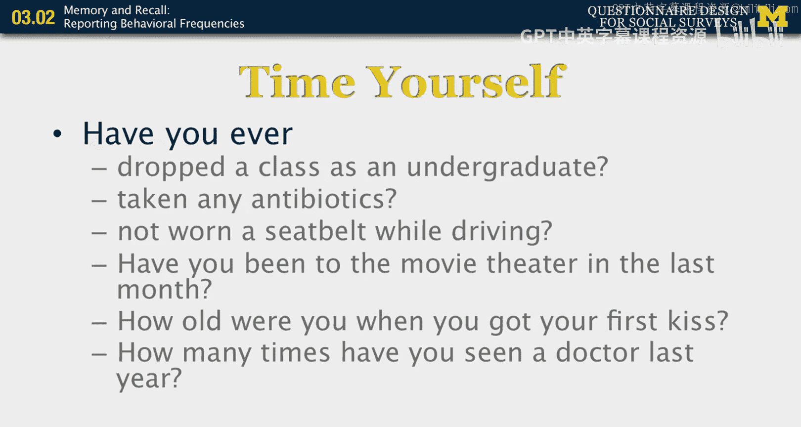

# 调查数据收集与分析：2-6：记忆与回忆：行为频率报告

## 概述

在本节课中，我们将学习如何设计关于过去行为和事件的调查问题。我们将探讨受访者在回忆和报告过去信息时面临的挑战，并介绍一些提高数据准确性的方法。

---

上一节我们讨论了事实性问题的基本概念，本节中我们来看看当问题涉及过去的行为和事件时，情况会变得更为复杂。这主要围绕对过去特定事件和活动频率的提问。

### 回忆过去行为的挑战

当询问过去的行为时，受访者除了需要理解问题本身，还面临一项额外的任务：**回忆**。例如，问题“自2013年1月以来，您是否找过工作？”要求受访者理解“找工作”的含义，并回忆在过去数年内是否发生过此事。对于工作稳定的人来说，这很简单；但对于经历丰富的人，这可能颇具挑战。

另一种类型是询问事件发生的具体时间，例如“您第一次尝试吸烟是在几岁？”。这类问题在公共卫生调查中很常见，旨在测量某种行为的总体暴露程度或持续时间。

此外，还有关于活动种类和频率的问题，这属于自传体记忆范畴，通常更难准确回答。例如：
*   “自2013年1月以来，您有多少次在医院过夜？”——这需要理解、回忆，并进行**估计或精确计数**。
*   “在您成长过程中，您多久参加一次宗教服务？”——这种措辞通常鼓励受访者以**频率或比率**的形式回答。

接下来，我们将探讨这类问题面临的具体困难。

### 记忆的编码、存储与提取

信息回忆的准确性首先取决于它是否以及如何被记忆。以下是影响记忆报告错误的几个关键因素：

1.  **编码**：信息必须进入长期记忆才能被回忆。研究表明，信息需要被认为是**显著的**或**独特的**才能被有效编码。然而，显著性因人而异。设计问卷时，需要考虑目标受访者群体，思考所问事件对他们是否重要、是否突出。

2.  **存储与提取**：编码的深度影响信息的可提取性。如果记忆存储不牢固，提取就会困难。如果事件根本未被编码（例如，过于平凡或重复），则会导致**漏报错误**，而非有意的隐瞒。

这对问卷设计有重大启示：如果你测量的过去行为对受访者而言不显著，他们可能无法有效回忆，此时可能需要依赖其他数据源（如账单、收据）进行补充。

以下是一个研究实例，展示了即使对于刚发生的事件，回忆也可能出错：

> **研究案例**：Roger Tourangeau 的一项研究显示，父母在带孩子看完医生后，被问及孩子接种了何种疫苗。尽管事件刚刚发生，父母对某些疫苗（如乙肝、百白破）存在大量漏报，而对其他疫苗（如麻疹、腮腺炎、风疹）则存在过度报告，净误差达到+17.1%。这表明，人们并非仅随时间推移而遗忘，有时可能从未准确知晓事件本身。

### 辅助回忆的方法

为了帮助受访者更准确地回忆，我们可以采用不同的提问方法：

以下是三种主要方法，按对受访者难度从高到低排列：

*   **自由回忆**：最难。例如，“您的孩子接种了哪些疫苗？”受访者需完全依靠自己回忆。
*   **线索回忆**：提供一些例子作为线索。例如，“您的孩子是否接种了诸如麻疹、百白破或乙肝等疫苗？”
*   **再认**：最容易。列出所有可能选项供受访者勾选。例如，提供一份完整的疫苗清单。

同理，询问“过去一年您使用过哪些社交媒体网站？”时，自由回忆非常困难，而提供列表进行再认则简单得多。

### 影响遗忘的因素与设计启示

信息的提取也受到遗忘类型的影响。以下因素会增加遗忘的可能性：

*   **时间**：事件发生越久远，越容易被遗忘。
*   **显著性**：事件越平凡、越不突出，越容易被遗忘。
*   **重复性**：事件越具重复性和常规性，回忆单个具体事件就越困难（例如，你记得自己喝咖啡，但不记得每一次）。

基于以上挑战，问卷设计可以采取以下策略以提高数据质量：

1.  **给予充足的回忆时间**：允许受访者有时间思考和回忆。
2.  **提供示例线索**：使用线索回忆法帮助激活记忆。
3.  **缩短参考期**：询问更近时间段内的事件，降低遗忘程度。
4.  **使用事件史日历**：提供可视化的日历工具，帮助受访者按时间顺序定位和回忆过去事件。

### 实践思考：这些问题容易回答吗？

请尝试计时回答以下问题，亲自体验回忆的难度：

1.  您大学时期是否曾酒后驾车？
2.  您是否服用过任何抗生素？
3.  您开车时是否曾未系安全带？
4.  过去一个月您去过电影院吗？
5.  您的初吻发生在几岁？
6.  去年您看过几次医生？

您可能会发现其中一些问题很难准确回答。例如，“初吻”的定义可能因人而异（是浪漫初吻还是儿时亲昵？），这属于**理解问题**。而“去年看过几次医生”则涉及对“去年”**参考期**的界定（是从今天算起往前12个月，还是指上一个自然年？）以及对所有就诊次数的**回忆负担**。

---

## 总结

本节课我们一起学习了设计关于过去行为频率的调查问题时面临的挑战。核心在于，受访者需要完成**理解**和**回忆**双重任务，而记忆的**编码、存储和提取**过程会受到事件显著性、时间远近和重复性等因素影响，导致漏报或误报。为了提高数据质量，问卷设计可以采用**缩短参考期、提供回忆线索、使用事件史日历**等方法。

下一节，我们将深入探讨“参考期”的设定以及如何帮助受访者重建过去事件的时间线。