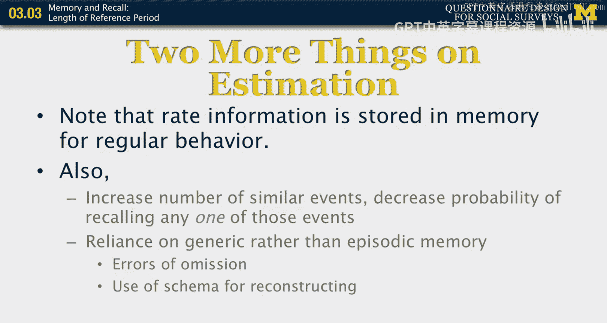

# 密歇根大学《调查数据收集和分析（2-6：方法、社调问卷设计、抽样、缺失数据、分析）｜Survey Data Collection and Analytics》 p55 12_记忆与回忆：回溯周期长度.zh_en -BV1fw4m1e7Zh_p55-

So as promised in this segment， we'll talk about length of the recall and reference periods。

 so estimation and reconstruction of the past in time。

The length of the reference period is also related to recall error and to understand this it's important to look at some terminology or stand some terminology so let me make you work here a little bit if you printed out the slides you can draw on this slide to help you remember this if not and just use your imagination so down here we have time。

And this is today's state， this is when the survey is done。And there's a long field period。

 let's say we have 20，000 people that we interview and take some time for you to be part of that survey。

And you will get asked， so this is you know about the middle of 2014 and you get asked about the whole 2013 year。

 which would be this between the end of the year and the beginning of the year。In this period。

 so when I ask you about what happened in 2013， you have to remember。You know。

 all the way back to when 2013 ended and all the way through 2013 in order to answer that question。

So that's the difference when we talk about recall period and reference period。

 so the reference period is the time period that's being used for the estimate later on that would be。

The year of 2013， if that matches your research question。

 whereas the recall period is really the length of the overall period that you have to remember。

 And these two can vary and。Some effect of measurement error actually do increase quite a bit if we have a longer recall period。

Some more findings on these recall effects of elase time in forgetting。

 this is a study done here very early on by Charlie Kenll。

 he was a researcher here at the University of Michigan and with his colleagues he was looking at reporting of hospital visits。

 they did a record check study so they had the actual true values from the hospital on hand and could compare the respondent reports to that。

What you see in the first column here is the weeks between discharge and the interview1 to 10 weeks。

 11 to 20 21 to 30 weeks and so on and then over here the percent not reported。

 so there's know an event in the records and then the proportion that is not reported from those records sorry not proportion but percent so 3%9% and so on and this is the end in records。

 the number in the records of these events。So you see that the percentage of not reported events of the events in the records is increasing drastically and by week 51 to 53。

 about 40% of all those events are not longer reported by the respondents in this study。

The National Crimeimate and Vtimization Survey has played around with different recall intervals and David Kenter from Westad and part of our faculty at JPSM here did a lot of studies to sort of find tune in the way victimization can be asked and these results here are part of this whole set of research studies on this topic。

And what you see in these two columns are the annual victimization rates estimated with different recall intervals。

 so what we see here is rates per 100 persons age 12 and above。And in the first column。

 the question asks with the recall interval of six months and the other one with the recall interval of three months。

 so in the past six months or in the past three months。

If there weret an issue with the recall intervals， then we should of course。

 see more events in six months than in three months。

 which is not the case here right we have pretty high rates for the three months recall interval so you know auto theft is reported with 2。

1 auto thefts per100 person age 12 years and above in this three months recall period。

 but in the six months recall period that's 1。8 now could B you know that something happened the world got more violent more recently but that is pretty unlikely so this has by and large to do with forgetting and this pretty striking result。

Now， in general， it is difficult to date events when they happen because people don't stack or store tags together with an event。

 you know， it is hard to remember if I were to ask you， so what did you do on。March 12。In 2013。

 you might have troubles remembering that， but you know there are of course a few landmark events for which we do know date。

 so if I were to ask you， where were you on September 11， 2001。

 you might in fact know it or at least if you at that time where in the United States。

 you might quite vividly remember where you have been at that point in time。

Often people have sort of relative landmarks or something that is important for themselves。

 so this was before I entered college or before I got divorced or before I got married。

 you know all these elements here can play into the effect and that helps a little bit in reconstructing this autobiographical sequence in general it is important to know that memory is not a continuous linear record and people are just able to sort of report them。

Depending on the type of event you might therefore want to see， okay。

 how might this information be stored in the respondent's head and what instrument should I use in my questionnaire to ask for it。

 so do I need a calendar to remind them of what seasons wars or whatnot。

 is this more socially defined period in to ask about these social events before can I ask in form of elase time or you might want to use idiosyncratic reference points pointing again at the technique of event history calendars to reconstruct the respondent's autobiography？

Now there's another aspect here related to a recall error in the reporting of past behavior。

 and that is has to do with how you try to。Report the past。

 So do you give estimation or can you actually reconstruct the actual event？

So here the question is when do respondents estimate？Behavioral frequencies。

 you know what estimation strategies are used and so。In general。

 it is true that the more frequent the behavior is the more likely estimation will be used again。

 if you're a smoker or if you're a frequent coffee drinker。

 it would be very difficult called for me to ask you how many cups of coffee did you drink in the last year。

Even so that is the estimate you would want to make from your substantive research question point of view。

And so instead you。You probably get an estimation， you know， oh。

 I drink about two cups a day and therefore this would be 365 times too。

Also the more regular the behavior is， the more likely estimation will be used and the more accessible relevant memory is the less likely estimation will be used right so if you actually can vividly remember every single time you drink a cup of coffee then you don't need that all that is less likely for this particular example。

😊，Two more things on estimation。Rate information is stored in memory for regular behavior。

 so as I said， twice a day would be a typical one， but it is also important to know that an increased number of similar eventss decreases the probability of recalling any single one and people then rely on something that is more generic memory than an episodic memory。

 which。You know， you think it was like， okay， three times a day I brush my teeth and it's just there are general routines that you remember。

 but you don't actually remember well， all these times that you went to bed without brushing your teeth so it easily can lead to an era of omission because you might diverge from the regressiongressing。

 Remember early in the task。 I ask you about the use of seatbelt and have there been times when you didn't and that would be another example for us use a schema for reconstructing the past and that can lead to errors of omission。

And in the next segment， we're going to talk a little bit more about comphension problems that can lead to retrieval issues when we talk about behavioral frequencies。

