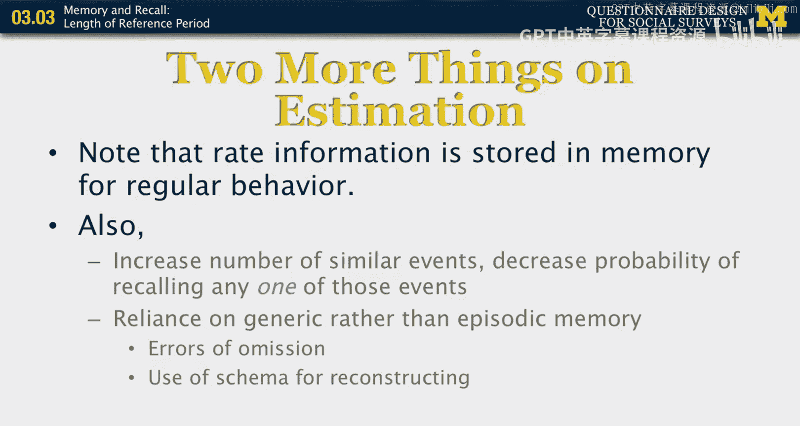

# 调查数据收集与分析：2-6：记忆与回忆：回溯周期长度

在本节中，我们将探讨回溯周期长度及其对调查数据质量的影响。我们将了解参考周期与回溯周期的区别，分析回溯周期长度如何导致回忆误差，并讨论受访者如何通过估计或重建来报告过去的行为。

## 参考周期与回溯周期

上一节我们介绍了记忆与回忆的基本概念，本节中我们来看看与时间相关的两个关键术语：参考周期和回溯周期。

参考周期是指研究问题所关注、并最终用于估计的时间段。回溯周期则是指受访者为了回答问题而需要回忆的整个时间长度。这两者可能不同。

例如，调查在2014年中旬进行，但问题涉及整个2013年。那么，参考周期是2013年，而回溯周期是从2014年调查时点回溯到2013年初的整个时间段。受访者需要回忆整个回溯周期内的事件来回答关于参考周期的问题。

## 回溯周期长度与回忆误差

研究表明，回溯周期的长度与回忆误差密切相关。回溯周期越长，遗忘的可能性越大，测量误差也倾向于增加。

以下是关于回溯效应的一些研究发现：

*   **查尔斯·坎内尔的研究**：一项关于医院就诊报告的记录核对研究发现，从出院到接受访谈的时间间隔越长，受访者未报告的事件比例就越高。
    *   出院后1-10周内访谈，3%的事件未被报告。
    *   出院后51-53周内访谈，约40%的事件未被报告。
*   **全国犯罪受害调查的发现**：该调查尝试了不同的回溯间隔。比较“过去6个月”和“过去3个月”两种问法得到的年度受害率估计值，发现较短的3个月回溯周期反而报告了更高的受害率。这表明在更长的回溯周期中，遗忘导致了更低的报告率。

## 事件的时间定位与重建

通常，人们很难精确记住事件发生的具体日期，因为我们不会为每个事件存储一个时间标签。例如，很少有人能准确说出2013年3月12日做了什么。

然而，人们会利用一些地标性事件或对个人重要的相对时间点来帮助重建记忆序列，例如“在我上大学之前”或“在我结婚之后”。记忆并非连续线性的记录，因此问卷设计需要考虑信息在受访者头脑中的存储方式。

以下是可能用到的工具或策略：

*   使用日历辅助工具，帮助受访者回忆季节或月份。
*   针对社会性事件，使用社会定义的时期（如“上学期”）进行询问。
*   使用模糊的时间表述（如“最近”）。
*   采用事件史日历技术，通过重建受访者的个人经历时间线来定位事件。

## 报告策略：估计与重建

回忆过去行为时的另一个重要方面是报告策略：受访者是在进行估计，还是在努力重建实际事件？

一般来说，行为越频繁、越规律，受访者越可能使用估计策略。例如，询问“去年你喝了多少杯咖啡”，常喝咖啡的人很可能会根据“每天大约两杯”这样的常规速率来估算，即 `年总量 = 365天 × 2杯/天`。

相反，如果相关记忆越容易提取，受访者越不可能使用估计。但需要注意的是：

*   对于规律行为，记忆中以速率信息（如“每天两次”）的形式存储。
*   相似事件的数量越多，回忆起任何单一事件的概率就越低。人们会依赖一种更概括性的“图式”记忆，而非具体的情景记忆。例如，你记得自己通常每天刷三次牙，但可能不记得某天晚上没刷牙。这可能导致遗漏错误。
*   使用图式重建过去也可能导致遗漏。例如，在询问安全带使用时，受访者基于“我通常都系安全带”的图式回答，可能遗漏掉那些没系安全带的例外情况。

## 总结

本节课中，我们一起学习了回溯周期长度对调查数据的影响。我们明确了参考周期与回溯周期的区别，了解到更长的回溯周期通常会导致更高的遗忘率和回忆误差。我们还探讨了人们如何通过地标事件来定位过去，并分析了受访者根据行为的频率和规律性，选择使用估计或重建策略来报告过去行为，以及这些策略可能带来的误差。理解这些原理，有助于我们设计更科学的问题，以获取更准确的数据。

在下一节中，我们将进一步讨论可能导致信息提取困难的理解性问题，特别是在询问行为频率时。