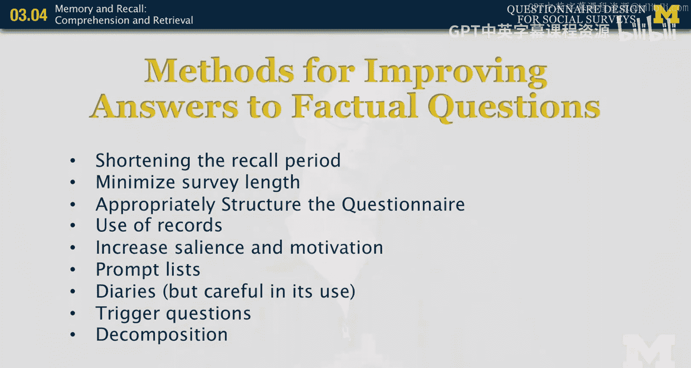

# 密歇根大学《调查数据收集和分析（2-6：方法、社调问卷设计、抽样、缺失数据、分析）｜Survey Data Collection and Analytics》 p56 13_记忆与回忆：理解与提取.zh_en -BV1fw4m1e7Zh_p56-

In the previous segments we alluded to the problem of comprehension in the early examples。

 and that is the last piece here that we want to fit to you as one that is related to we call error。

It is important to。No and think about how is an object defined in the respondent hand if you have to retrieve from memory。

 it is dependent on what the respondent understand what is searched。

 you know so what memory traces are in the respondent hand。

 does the object line up with any of these and do they feel that they know the answer to this。

You know it can help to think about what are relevant memory clusters so if you ask about a specific thing and you can ask about a set of things thats sort of similar to that specific thing。

 then it might be easier to recall these things and that you we summarize in terms of setting a context for retrieval you should think about where in the question you have the possibility to set such context so this would be the introduction to the item。

 the surrounding items themselves， the wording of the question and often also the answer categories if it is a closed in the question you can help with the introductory statement for example to facilitate the accuracy of recall questions。

So in the context of victimization surveys， you could do this similar to the introduction of the National Cri and victimtimization Survey that says。

 please tell me about any crime that may have occurred in the last six months。

That's a pretty short one， not too much in the introduction yet。

 and we'll show you a variation on that theme in a second。

The introduction to the National Violence Against Women Survey， on the other hand。

 has an introduction here that says we are particularly interested in learning about violence。

 woman experience either by strangers， friends， relatives or even husbands and partners。

 and so here you set a context， in the introduction。

 reminding them that you can be victim of crimes that come from a lot of other people。

 not just a particular stranger which might be the first thing that people think about so you change their focus and attention to what could be in memory。

This leads to what we pointed out earlier as a detailed queuing， it can help define object。

You knowWhen you design your questionnaire， you want to use cues to focus retrieval on those objects。

 but when you do that， be careful and mindful of two things。

The cues might interfere with retrieving other information so you can focus too much on the cues and block everything else。

And the cues also implicitly might exclude objects that are not mentioned。

 so if respondents saying that this is a finite set and not just some memory help。

 then you can be in trouble as well。So you know， this is a。Suggestive。

Improvement for your questionnaire， but how it works in practice has again be need to be tested in。

Before fielding the questionnaire， that's why we have a whole unit on question testing in this set。

So let me show you an example here for the summary was this detailedqueuing approach for the crime and victimization survey so here's a whole set of questions that you could have where the questions themselves provide context and cues so did you have your pocketed picked first question did anyone steal things that belong to you blah。

 blah， blah was anything stolen from you while you were away from your home and so on and then finally was anything at all stolen from you during the last six months you know would be a summary question of those individual ones the detailed queuing on the other hand what you see on the right is a long question was something belonging to you stolen such as and then all kinds of things I listed in fact so many that I couldn't even put them on the slide here。

David Kt， as I said， did a lot of studies on the National Cri and victimtimization surveys。

 and here again， we have rates of victimization per thousand0 people and you know ask with the two different approaches。

 the summary questions that we had up here was anything at all stolen from you and then。

This detailedqueuing question and you do see that we have a higher rate of reporting on these detailedqueuing questions。

 both for violence， property and household crimes。Now let me summarize the methods for improving answers to factual question。

 first of all， we learned short recall periods are good。

 rate of forgetting can be overcome a shorter length of the survey is always good。

 you overcome fatigue on the respondent side and help with the memory。

An appropriate structure of the questionnaire helps setting cu and context and helps the respondent remember the use of records in addition can help。

 there can be an attempt to increase salience and motivation of particular items and the motivation to even do that task of remembering。

 you can use lists to prompt the respondent or diaries， TV watching。

 for example will often be asked with the help of a diary because otherwise it gets too much to remember everything that happens even in two weeks。

You can have trigger question or decompose a question into various sub partss so that you can instead of having cues。

 as we saw with crime and victimization survey have a just。

Help the respondent by asking about all the different elements that belong to that particular question。

So in the next segment， we will be moving on to asking sensitive questions and looking forward to seeing you there。

😊。