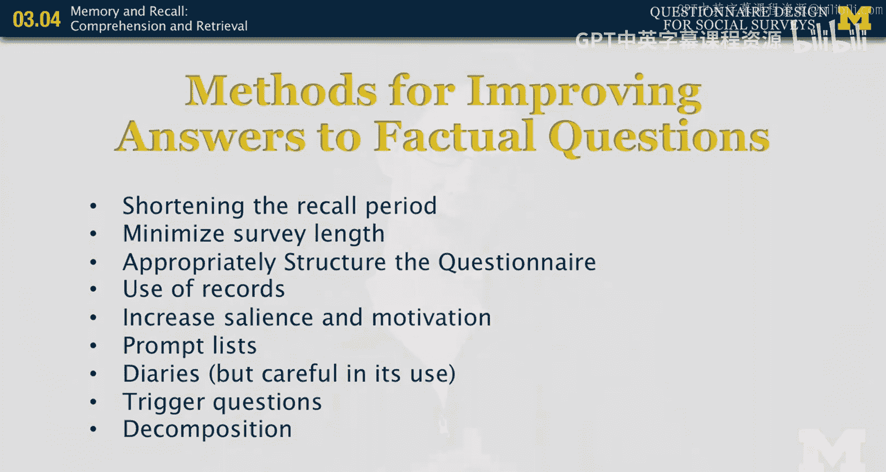

# 调查数据收集与分析：2-6：记忆与回忆：理解与提取

在本节课中，我们将要学习调查问卷设计中的一个核心环节：如何帮助受访者从记忆中准确提取信息。我们将探讨理解与回忆过程中的潜在误差，并介绍一系列提升事实性问题回答质量的具体方法。

在之前的章节中，我们通过早期示例提到了“理解”可能存在的问题。本节我们将深入探讨与误差相关的最后一个环节：记忆与回忆。

理解受访者如何定义问题中的“对象”至关重要，因为这直接影响到他们从记忆中检索信息的过程。这个过程取决于受访者对问题的理解、他们在记忆中搜索的内容、记忆中存在的相关痕迹、问题对象是否与这些记忆痕迹匹配，以及他们是否认为自己知道答案。

为了帮助回忆，可以考虑相关的“记忆簇”。如果询问一个特定事物，并围绕它询问一系列相似事物，受访者可能更容易回忆起这些信息。我们将此总结为“为检索设定情境”。在设计问题时，应考虑在何处设定这种情境，例如在问题的引言部分、周围的其他问题、问题的措辞，甚至封闭式问题的答案选项中。通过引言陈述，可以帮助提高回忆类问题的准确性。

例如，在犯罪受害调查的语境下，可以借鉴“全国犯罪受害调查”的引言：“请告诉我过去六个月内可能发生在您身上的任何犯罪行为。”这是一个相当简短的引言。我们稍后会展示一个变体。

另一方面，“全国针对妇女暴力行为调查”的引言则写道：“我们特别关注了解女性所经历的暴力，无论是来自陌生人、朋友、亲属，甚至是丈夫和伴侣。”这里，你在引言中设定了一个情境，提醒受访者犯罪可能来自多种人群，而不仅仅是他们首先可能想到的特定陌生人，从而改变了他们的关注焦点，指向记忆中可能存在的其他信息。

这引出了我们之前提到的“详细提示法”，它有助于定义回忆对象。在设计问卷时，我们希望使用提示来聚焦对特定对象的检索。但这样做时，需要谨慎注意两点：
1.  提示可能会干扰其他信息的检索，导致受访者过度聚焦于提示而忽略其他内容。
2.  提示也可能隐含地排除未被提及的对象。如果受访者认为提示列出的是一份完整清单，而不仅仅是记忆辅助，那么也可能出现问题。

因此，详细提示法是改进问卷的一个建议性方法，但其实际效果仍需在问卷实地测试前进行检验。这也是我们在本系列课程中设有专门单元讲解问题测试的原因。

让我展示一个在犯罪受害调查中应用详细提示法的例子。左边是一系列可能的问题，问题本身提供了情境和提示，例如：“您的口袋被扒窃过吗？”、“有人偷过属于您的东西吗？”、“当您不在家时，有东西被偷吗？”，最后是一个总结性问题：“过去六个月里，您是否有任何东西被偷？”。

另一方面，右边展示的详细提示法则是一个长问题：“是否有属于您的东西被偷，例如……”，然后列出了各种各样的物品（实际上种类繁多，幻灯片都无法完全展示）。正如之前提到的，David Cantor 在“全国犯罪受害调查”中进行了大量研究。

以下是使用两种不同方法（总结性问题 vs. 详细提示法）得到的每千人受害率数据。可以看到，使用详细提示法的问题，无论是在暴力犯罪、财产犯罪还是家庭犯罪方面，都获得了更高的报告率。

现在，让我总结一下改进事实性问题回答的方法：
1.  **缩短回忆期**：较短的回忆期更佳，可以克服遗忘率。
2.  **控制问卷长度**：较短的问卷总有益处，可以克服受访者的疲劳感，并有助于记忆。
3.  **设计合适的问卷结构**：设定提示和情境，帮助受访者回忆。
4.  **利用记录辅助**：除了记忆，还可以尝试使用记录来帮助回忆。
5.  **提高项目的显著性和动机**：尝试提高特定项目的显著性和受访者进行回忆任务的动机。
6.  **使用列表或日记提示**：例如，观看电视的情况常通过日记来询问，因为即使只是两周内发生的事情，要全部记住也太多了。
7.  **使用触发问题或将问题分解**：可以将一个问题分解为多个子部分，这样就不必依赖提示，而是通过询问属于该特定问题的所有不同要素来帮助受访者。

在本节课中，我们一起学习了记忆与回忆在调查中的重要性，理解了设定情境和提供详细提示如何帮助受访者更准确地提取信息，并总结了一系列提升事实性问题数据质量的具体策略。在下一节中，我们将继续探讨如何询问敏感问题。