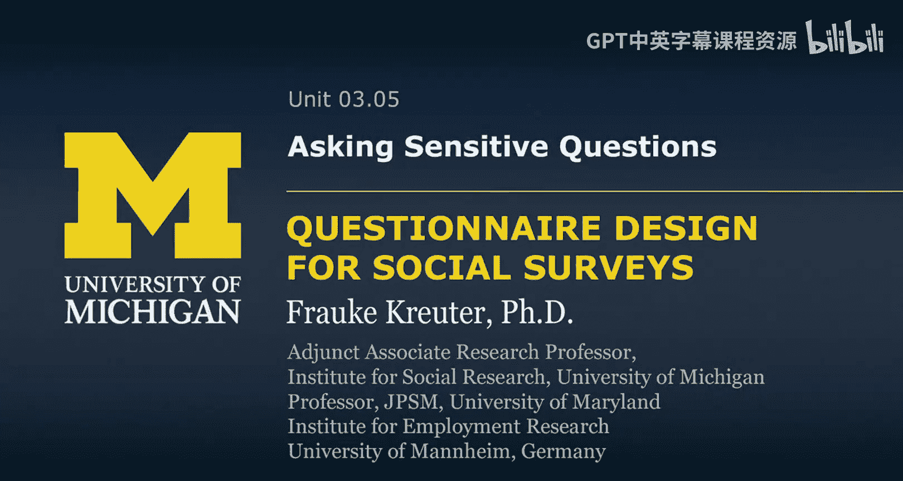
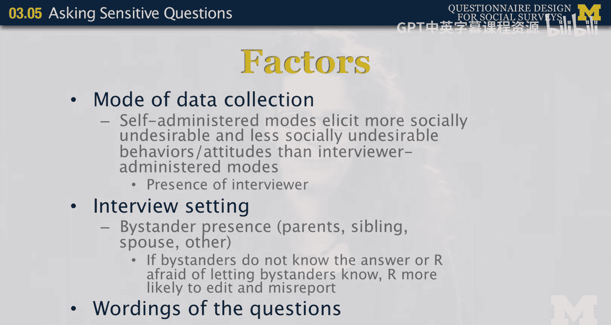

# 密歇根大学《调查数据收集和分析（2-6：方法、社调问卷设计、抽样、缺失数据、分析）｜Survey Data Collection and Analytics》 p57 14_敏感问题提问.zh_en -BV1fw4m1e7Zh_p57-

The next three segments are about asking sensitive questions。

There are very many techniques in the literature on asking sensitive questions。

 not all of them can be covered here。But the most important ones I will introduce to you and in doing so I want to acknowledge the work that Raja Tjo and Ting Yang did not only to assemble material here for the joint program and civil methodology when we teach this questionnaire。

 but also in the terrific overview piece that is part of the Cosera material that you have on your website。

Learning outcomes for these segments are the following。

We want to teach you what makes the question sensitive。

 what the consequences are of asking sensitive questions and surveys。

 and what we can do to minimize these consequences。And of course。

 what conclusions you can draw from them for your own questionnaire。

So let's start with a set of items here and think for yourself。

 which of these questions do you think are sensitive and think about why？

Now you will notice some of them are about behaviors you do that you would not want to reveal to me。

Some of them are things that you think one should do， but don't。

There's sort of a mixture here on these， and we will see in the course statistics that not everybody answered these questions in the same way。

Actually not answered， but evaluated them with respect to their sensitivity。In the last item on this。

 listst has the biggest variance because having a library card or not is not all that sensitive anymore depending on the context you are in。

 because in many settings， having a library card is obsolete because literature and things of that nature are nowadays available online。

So you already see personal perception。The only state you're in might drive what you think is sensitive。

Take a couple of other ways to structure sensitivity and we'll walk you through them。

There are three main types for sensitive questions。

The first one is you can consider a question as just being about private information。

 so income and other identifiers are part of that category。

 illegal behaviors and socially stigmatizing behavior。Let's go back to the income example。

People do not like to be asked about their income， regardless of what the income is。

With the legal behaviors， there might be a threat considered。In revealing。Their behavior。

And the social stigmatizing behavior， this is a set of things where respondent。😊。

Think that the interviewer or the researcher has a particular。Behavior in mind。 and they fail too。

Match。That behavior。So there's a mixture of isium， one is。

 can the information be used in a legal way， is the information personal and does the information relate to the image of the respondent？

In general， there are different levels of sensitivity。 You could think for you to ask yourself。

 is the question threatening to ask regardless of the respondent answer。

 as I mentioned for the income example。Or is this question threatening to answer because the respondent are afraid of the consequences this might have。

Now， what are the consequences of asking sensitive questions in your questionnaire？

There's three consequences that you might want to be aware of when constructing your survey。

The first one is if you include sensitive question and the respondents to know about it ahead of time。

 you might have a higher unit nonrespon rate than you would have otherwise people are less likely to participate in a survey with sensitive questions if they do participate and you hit that segment。

You will have item non response， people will， if ask。

 not tell you that information that they consider sensitive。And a good example， again。

 is the income question。Across many surveys， there is about a quarter of the respondents who do not reveal the answer to that particular question。

And finally， there's misreing， people do want to give an answer to a survey question。

 but they might just edit their answers。This can lead to overreporting of social desirable behavior and to underreporting of socially undesired behaviors and attitudes。

So why do people edit their answers， there's a norm out there for many questions on how that should be answered。

Did you vote at the last election， Well， good citizens to vote， so people。

Feel that social norm of being a voter and therefore might edit their answer。

 even so they know remember that they did not vote。

 People should not use drugs as another example of that nature。

People choose to give the norm answer because they want to avoid embarrassment or because of privacy and confidentiality concerns and finally。

 you should keep in mind people are more likely to edit in mis report if they have something to hide。

The topic is more sensitive than less sensitive。And if they are byenders。

 other people in the room that would listen and also hear the answer。

The last piece gives already an idea of other factors that can influence the reporting。

And the amount of editing people do when they answer a sensitive question。

The mode of data collection， the presence of an interview in the data collection。

Makes a big difference on the amount of misreporting to sensitive question and I will show you in a subsequent sequence。

A few examples of that。 If you remove the interview if it's administered and you have no bystanders in the survey。

 you get more reports on sensitive behavior。 But there are also techniques。

 the wording of the question themselves that you can use in order to improve。

Reporting to those items。 And that's what we're going to talk about in the next segment。

