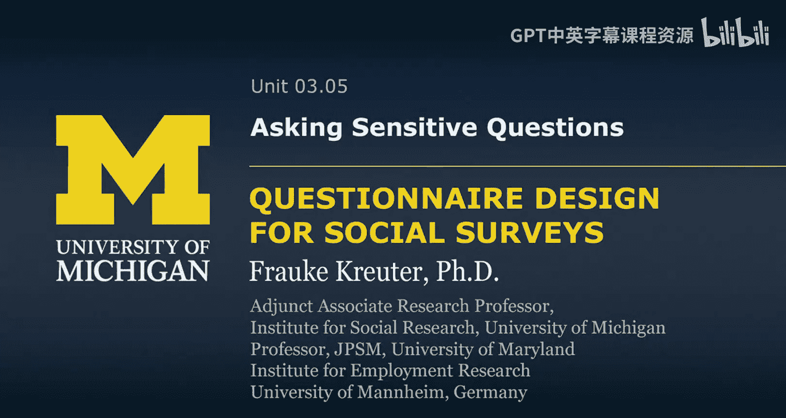
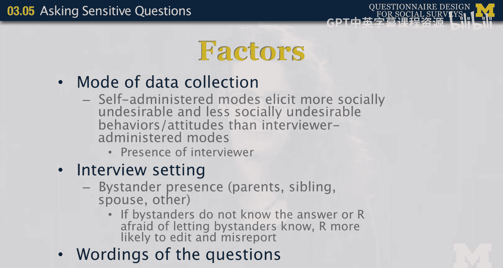

# 调查数据收集与分析：2-6：敏感问题提问方法

在本节课中，我们将学习如何在调查问卷中处理敏感问题。我们将探讨敏感问题的定义、其带来的后果，以及如何通过特定的提问技巧来最小化这些后果，从而获得更准确的数据。

## 敏感问题的定义与类型

上一节我们介绍了调查设计的基本概念，本节中我们来看看什么是敏感问题。敏感问题通常指受访者可能不愿如实回答的问题，原因包括隐私、法律风险或社会污名。

敏感问题主要分为三种类型：

*   **私人信息**：例如**收入**、家庭住址等身份标识信息。
*   **非法行为**：涉及违法或可能带来法律威胁的行为。
*   **社会污名化行为**：受访者认为不符合社会规范或研究者期望的行为。

敏感程度因人而异，取决于个人感知和所处环境。例如，拥有借书卡在今天可能已不再敏感，因为许多资料可在网上获取。

## 敏感问题带来的后果

了解了敏感问题的类型后，我们需要认识在问卷中包含这类问题可能导致的后果。主要有以下三点：

*   **单位无回答率升高**：如果受访者提前知道调查包含敏感问题，他们可能直接拒绝参与。
*   **项目无回答**：即使参与了调查，受访者也可能跳过具体的敏感问题不回答。例如，在许多调查中，约有**25%** 的受访者拒绝透露收入信息。
*   **误报**：受访者可能为了符合社会期望而修改答案，导致对社会期望行为**过度报告**，对不受欢迎的行为或态度**报告不足**。

## 导致答案编辑的原因

那么，为什么人们会编辑自己的答案呢？以下是几个主要原因：

*   **社会规范压力**：例如，“你在上次选举中投票了吗？”这个问题，人们可能因为感到“好公民应该投票”的社会压力，即使没投票也会回答“是”。
*   **避免尴尬或保护隐私**：受访者希望避免难堪或出于保密考虑。
*   **有需要隐瞒的事情**：话题越敏感，误报的可能性越高。
*   **有他人在场**：如果回答时房间里有旁听者，受访者更可能给出符合社会期望的答案。

## 影响报告准确性的因素

除了问题本身，其他因素也会影响受访者对敏感问题的报告准确性：

*   **数据收集模式**：是否有访问员在场影响巨大。例如，在**自填式问卷**（无访问员、无旁人在场）中，对敏感行为的报告率通常更高。
*   **问题措辞技巧**：通过特定的提问措辞方法，可以有效改善敏感信息的报告质量。这将是下一节重点讨论的内容。

本节课中我们一起学习了敏感问题的核心概念、其可能导致的三种主要后果（拒访、不回答、误报），以及影响答案准确性的关键因素（如社会规范和收集模式）。理解这些是设计出能获取真实数据问卷的第一步。下一节，我们将深入探讨改善敏感问题报告准确性的具体提问技巧。