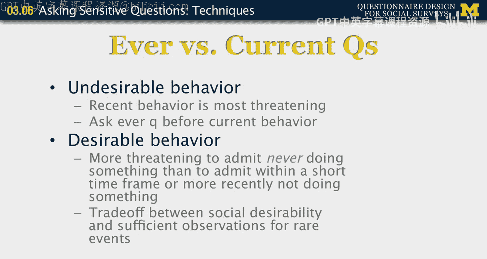

# 密歇根大学《调查数据收集和分析（2-6：方法、社调问卷设计、抽样、缺失数据、分析）｜Survey Data Collection and Analytics》 p58 15_敏感问题提问技巧.zh_en -BV1fw4m1e7Zh_p58-

。So as promised in this segment， a couple of techniques that help you ask sensitive questions and surveys。

First one is context。The response format， the answer categories is important， they provide context。

 and so is the set of questions in which that particular sensitive question is asked。

It's a good idea to ask sensitive questions in a related set of questions。And at best。

 you can put them in a setting in which you communicate that the behavior you ask about is acceptable。

 so you're removing any issue of social desirability if possible。

Here's an example for context with prior questions。

You can give a permissive context or a restrictive context。

 depending on whether you ask about undesirable behavior or desirable behavior。

One of the examples from the literature that we provided to you are those from Tentent's myth on the abortion question。

You have， a few from Suman and Bretburn。That are very good in illustrating setting the context。

 The first one would be a question about your friends in general。

 would you say that you drink more than your friends less than your friends or about the same mud as your friends。

Then you would ask about the friend who drinks most and how many drinks that person usually has。

 And only then do you ask explicitly。About the amount of alcohol consumption of the respondent themselves。

So this is a string of question you might only be interested in the answers to question number three。

 but because you ask question one and question two as well。

 the respondent already revealed a little bit about their behavior。

 puts it in the context of their friend' behavior and has therefore an easier time answering honestly to question number three。

This all helps the respondent to ease into the task。

Other ways of asking this question will also help the respondent ease into the task。

 one is using familiar words。So。That can， actually。Hyu。In standardized questionnaires。

 remember we said everyone gets the same stimulus in a standardized interview。

 and so you can't necessarily tailor the words for a particular topic if you think of sexual behavior。

 for example。To words and language used in a particular subgroup。So， try。In the survey itself。

 even if it's sanitized to emulate normal conversation。

Real variable wording will impact measurement in a different way。

 remember early on in this class we talked about interviewer variants and you might see that pop up here even more。

😊，Another way to ease the task is to refrain from asking too much detail about the different question。

 so income， maybe you don't need income continuously。

 maybe you can ask income in categories or use the response scale for income so that it is easier for the respondent to answer you might have heard about unfolding brackets so you could ask do you earn more or less than X amount of income。

Eassing the respondent into the type of answer or the question that you tried to get from that。

Another possibility are proxy reports。 So instead of the asking the respondent themselves。

You could ask other informants to report on that behavior。Now， of course， there are tradeoffs here。

 there can be a loss of quality because other people might not know enough about that respondent and also because depending on the relationship between the report and the individual from whom they want the proxy information。

You have varying amount of measurement error creeping into your data， so if possible。

 you would refrain from that， but it is something you should keep in mind because some surveys regularly use proxy respondents。

In lieu of asking the target person if they can't find them or get a hold of them。

Another technique is delivered loading。This can be used to reduce over and under reporting。

 depending on the context。You would。Start your question with。No， a precursor。

 like recent research has found that。阿co号。A glassss of red wine， for example， helps。X， Y， and z。

And with that， you know， we will to authority， put context into that particular question and make it easier to report on that sensitive topic。

Another way is to embed that topic into less sensitive topics， less threatening。

 to reduce the importance and to make the respondent feel more comfortable to talk about this。

So here's an example of deliberate loading everybody does it is a typical way to load a question deliberately。

An example can be seen below this first bullet point。

 even the calmist parents get angry at their children some of the time。

 did you children do anything in the past seven days to make you angry？

You make an assumption here up front that this behavior is normal， hoping that parents would reveal。

You can also ask a question in a way that assumes that a certain behavior is done with a certain frequency。

So instead of asking do you smoke at all and then continue with how many cigarettes do you smoke a day。

 some people make that pretoupposition。And just ask， how many cigarettes do you smoke a day。

 making it seem normal that people still smoke。And then the one example that I used on the previous slide。

 the use of authority for the deliberate loading。Two examples for deliberate loading of desired behavior。

 you can be very casual that you happen to get a parking ticket last month。

Or to upfront give reasons why a certain behavior might not have been executed。

Many people are busy and don't find the time to vote。

 did you vote in the last election would be a typical example。Now。

 note when you ask considered question that related to undesirable behavior。

 recent behavior is more threatening than past behavior。 You know this， many politicians。

 they have no problem revealing。Maybe the use of illicit drugs very early on in their college days。

That would be much more of a problem if that would be current behavior or would have happened last month。

Therefore， it's also easier to ask if a respondent has ever done anything and then ask about the current behavior because if you've revealed。

 okay， I've taken illicit drugs once。Then it is easier to ask or to reveal that you might still be doing this at least once anyway。

Likewise， for more desirable behavior。It's more threatening to admit that you've never done something than to admit that with a short time frame。

 you haven't done that。 Think of voting。 if you can say that you normally vote。

 but happen to have not voted in the last election。

 that is much easier than to reveal that you might have never been voting or only be asked about the last election and then have no chance to report that you would do that。

 In fact， you see when questioners do not include that question。

 respondents volunteer that answer just to mitigate the effect social desirable behavior that they are asked about。

In all of these things， you have a trade off between social deirability and sufficient observation for rare events。

😊。

And that is something to keep in mind when you ask about these things。

What I've been showing you so far is questioning techniques when you ask directly about that sensitive behavior in the next segment。

 we'll talk about other techniques such as randomized response that are much more indirect in how you ask about sensitive question。

And many of these techniques only give you population estimates。

 so they are used really for that reason。And also because some of these techniques are difficult to implement。

We'll also talk about different settings that you can use to provide more privacy and give the sense of confidentiality when people answer these sensitive questions。

