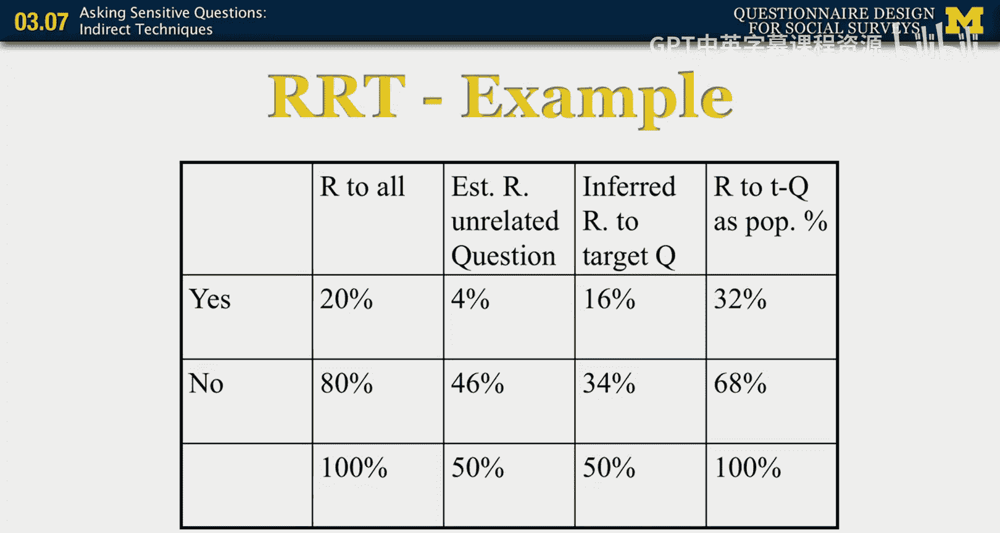
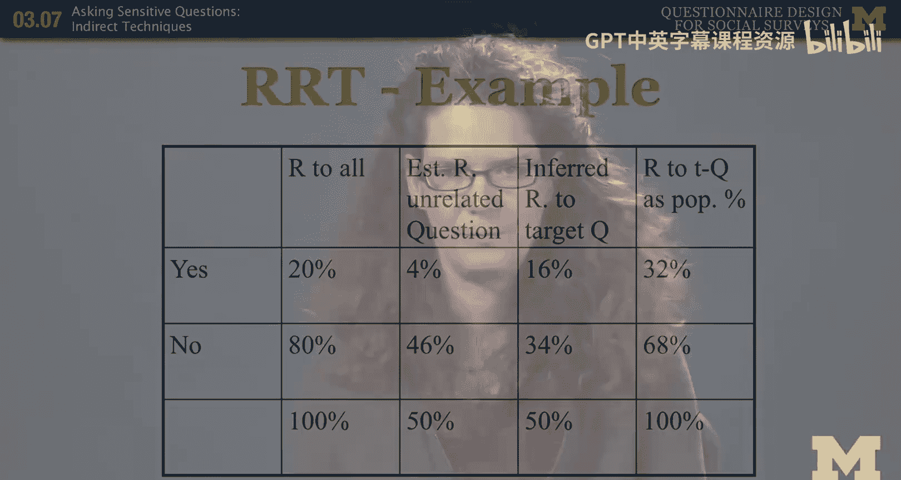

# 密歇根大学《调查数据收集和分析（2-6：方法、社调问卷设计、抽样、缺失数据、分析）｜Survey Data Collection and Analytics》 p59 16_敏感问题间接技术.zh_en -BV1fw4m1e7Zh_p59-

So as promised， we'll talk about indirect techniques today。

One of four techniques that we lump under this indirect technique topic， randomized response。

 In our case。 There a couple of others out there， It count technique， item sum technique。

 bogus pipeline。For the other three， we have additional material that's not part of the regular course sequence。

 but that you're of course welcome to look at， we have it for you on the course website。

The idea behind randomized response is that。The respondent will give you an answer without the interviewer you as a researcher knowing what their actual answer is to that question。

How can that work Well， you pair up a question that is sensitive， for example。

 did you get a parking ticket last month or any other sensitive behavior that you might want to ask about with the neutral question like is your mother's birthday in June？

The neutral question that you pay。Useful pairing has to be a question where you know the answer distribution。

 So let's say。You ask about birthdays in June。And you have a large enough sample。

 you can be pretty sure that about 112 of all respondents have a mother with the birthday in June。

That's the first element that you need for randomized response technique。

 The second element you need is a randomizing device。

 a randomizing device of which you also know the probabilities。

 You know that a fair coin about half the time will show tail。And about half the time will show hits。

So you'll ask the respondent to flip the coin or use whatever other randommizing device you want to use。

And then answer the question that is associated with either heads or tails。

So why don't you go ahead and take a coin？Flip it。And then enter your answer。All right。Now。

All we get is a total set of responses， let's say we have 20% yeses and 80% knows of everybody who responded to this survey。

Now， because we do know that 112 of everybody who got the question about mother's birthday in June has to say yes。

 we know that of 50% of our respondents， 4% answered yes to that question。

And 46% of these answered said no， because their mothers don't have birthday in June。

We then can infer the responses to the target question， we can divide up the 20%。

4% were those that answered to the question about mothers in June with the yes and 16% are yeses that were related to the target question that were actually answers to the target question。

So if we had asked everybody， we would know that we have 32% of our population having had a parking ticket in the last month。

That's it。It's pretty simple once you walk through it。

The key is for implementing this technique that the respondent buys into this。

 The respondent has to have。The trust that you do not know the answer。That there' is nothing。

You know， awkwardk what going on here that you're not tricking them into a response。

 but that this is actually an anonymous way for them to reveal the answer。Now， assuring anonymity。

Can also be done in other ways， and we'll talk about that in the next segment。

