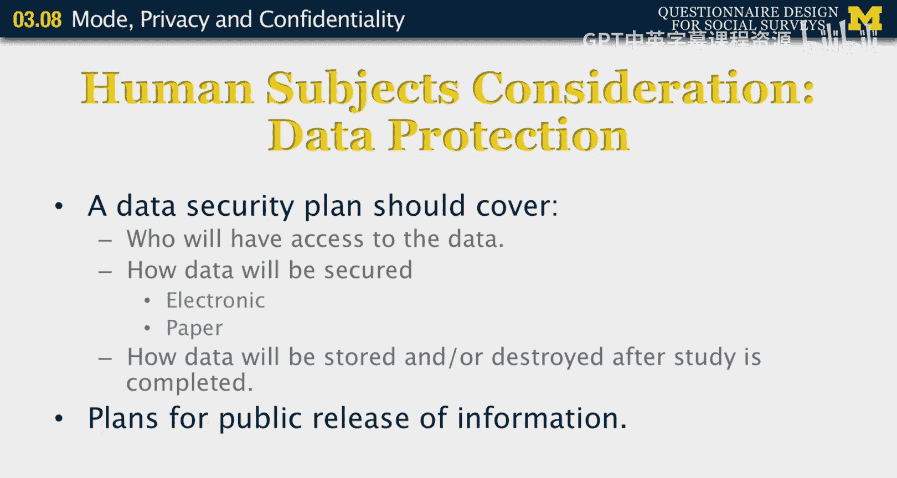

# 密歇根大学《调查数据收集和分析（2-6：方法、社调问卷设计、抽样、缺失数据、分析）｜Survey Data Collection and Analytics》 p60 17_调查模式与隐私保护.zh_en -BV1fw4m1e7Zh_p60-

So this last segment in our series of segments on asking sensitive question deals with mode。

And privacy and confidentiality。Moode， as we discussed very early on。

 is one of the most effective tools in removing social desability。

We have seen strong biases related to mode when an interview is present in a survey。

And for that reason， if you look at data collection techniques。

 people often try to combine modes if it's an interview administered mode。

 which has advantages because the interviewer can。Better recruit a respondent into the survey。

They combined it with a self administered mode by， for example。

 turning the laptop around and having the respondent answer。Questions privately。

Now there are different self administered modes around in the telephone。

 you can have the real interview be switcheditched over to an automatic voice recording IVR interviews is shorthand for this。

Or you can recruit someone and then move them over to a web survey and have them respond there。

We know so far very little about relative effects between self-administered modes and I'll show you results from one study in a moment There's also not that much knowledge out there on the relative effects of desirable and undesirable items。

 we do know that underreporting happens for under desirablesir behavior and overreporting for desirable behavior but most studies really have only looked at one of them。

 so you know if you plan your own studies always good to think of experiments that you could fold in to see these relative effects of these two types of items。

And the last thing that I want to demonstrate in the study that I'm about to present is the effect of being in a state where you would have to misreport in order to conceal undesirable behavior。

And how that affects perceived sensitivity of an item。So the study I'm referring to。

It was done in 2005 with the joint program in survey methodology， it was part of the JPSM practicum。

 so if you're enrolled as a student at JPSM， there's a two semester sequence where we collect data。

 usually having outside clients that issue that data collection project。In this particular case。

 the client was the University of Maryland Alumni administration。And with a sample of alumnini。

 a survey was conducted on all graduating classes between 1989 and 2002。

The sample was drawn from administrative records， which is great because then you can actually see the value that respondents should have reported on particular items。

And academic records were available as well。So we know behavior with respect to alumni administration and we know behavior with respect to the school performance。

So the question asks in the survey how part of these things that are also in the administrative records？

Question on failing grades， academic probation， and dropping a class。Positive behavior。

 like Hoable mention， were the grade point average a student achieved from the alumni administration venue with a respondent donated in the previous year prior to the data collection and how much they donated。

And then also， if they were a member of the Alumni Association。Now， as of mode of administration。

 what we compared here is responses via Web， Kati， so computer aided telephone interviewing and the interactive voice recording。

Just a few study basics， we had low response rates should admit there wasn't much of a non responses follow up in this study。

But we had about 300 and something complete， 320 in CAti and IVR and 363 on the web survey。

The way the web survey was done is people were recruited， let me back up here for a second。

 people were recruited into the web survey。We are the telephone and a web address was asked from them over the telephone。

 and they were then subsequently invited to。Participate in the survey。

So the first graph here shows you that the reporting errors on all these items that I just mentioned are condition on the mode the question was asked。

 So the first symbol here， the hellello diamonds， they show you the overall rate of misreporting in telephone。

 IVR and web， that's this line here and you see that the overall rate of misreporting goes down。

This effect is pronounced when we deal with undesirable behavior。

 there's a much bigger difference between telephone and the V response。On social desirable behavior。

 moving to a self aministered mode did not have that big of an effect， at least not in this study。

Now， this is in part you because the questions are also perceived with different sensitivity depending on which mode of data collection is used so here we ask at the end of the survey。

How sensitive the people believe these questions are。

 and you see the reporting modes for each of these answers。So in this study here。

 you can see that CAti interviews of these particular question always considered to be most sensitive weapon IVR。

 they switch positions sometimes on all of these questions in general。

 the positive items were seen as less sensitive than the negative items。Now。

 what I always like to show here is that it does depend on what it is that you would normally answer。

 So if you look at all respondents who， according to the administrative records。

Never drop the class compared to those that did drop the class。

 You'll see that they perceive these questions as less sensitive。In their respective mode。

 then the ones that have that behavior。 It's not true for the web survey。

 but it is true for IVR and the interview administered survey。

The effect is pronounced in the other behaviors overall， much lower for the positive behavior。

 as I mentioned before。Now the perception of the sensitivity is also what makes it important to assure privacy and confidentiality in a survey。

 so let me briefly introduce these two concepts。You have to assure that the respondent knows that the information will be kept private。

 and when you do that， you have to consider trades between anonymity and confidentiality。

 so you can ensure that the data will be protected and no one sees the identity of the respondent。

But there are two different ways to do that you can assure confidentiality。

 which means that the identity of the respondent is known or at least no a bone。

 but the information is restricted only to people that work on the project。

 whereas surveys that are anonymous， no one knows the identity of the respondent。

 and you can't connect that at any point in time to the survey responses。

Let's look at one example here。 Is this anonymous or confidential。That's right。 It's confidential。

 You， as the research still have the chance to know who the respondent is。

 The ID number provides a link between the respondent and the questionnaire that can be very helpful if you want to see everybody filled out the questionnaire。

 if you want to tailor your nonresponse follow up or if you want to use。

Information from the sampling frame for non response adjustment。

It is important that you know in which legal situations you are。

It varies by countries and you know certain states what the legal standing of a survey is。

Whether the data are subject to legal requests。And you should， in particular， when the。

Topic is very sensitive， make sure that you don't promise something that you can't hold you know in some countries。

You are legally obliged to report， for example， child abuse when it is mentioned as part of a survey。

Which can happen in crime and victimization surveys。Another element of ading。

Confidentiality and privacy to a respondent is。Knowing and having a good data security plan in place。

 so many funding agencies these days ask for such plans， but even if not。

 you should know and be able to tell the respondent who will have access to the data how it will be secured。

 their are electronic or also paper copies stored from the data when it will be destroyed and what is the plan for public release of the information。

