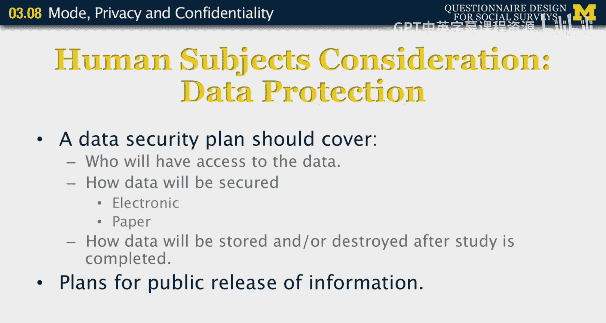

# 调查数据收集与分析：2-6：调查模式与隐私保护 🔒

在本节课中，我们将探讨调查敏感问题时的两个关键工具：**调查模式**与**隐私保护**。我们将了解不同调查模式如何影响受访者报告敏感行为的意愿，并学习如何通过确保隐私和保密性来获取更高质量的数据。

上一节我们讨论了询问敏感问题的挑战，本节中我们来看看如何通过选择调查模式和建立信任来应对这些挑战。

## 调查模式的影响

调查模式是减少社会期望偏差最有效的工具之一。当调查中存在访问员时，我们观察到强烈的模式相关偏差。因此，在数据收集中，人们常尝试结合不同模式。

以下是常见的模式组合策略：
*   **结合访问员主导模式与自填模式**：访问员主导模式（如面访）有助于招募受访者。随后，可以通过将笔记本电脑转向受访者，让其私下回答问题，切换到自填模式。
*   **电话调查中的自填模式**：在电话调查中，可以将实时访谈切换到自动语音应答系统。这种模式简称**IVR**。
*   **转向网络调查**：可以先通过电话招募受访者，然后引导其完成网络调查。

目前，关于不同自填模式之间的相对效果，我们知之甚少。同样，对于社会期望行为与非期望行为报告偏差的相对影响，知识也有限。我们确实知道，对于非期望行为会发生**低报**，对于期望行为会发生**高报**。但大多数研究只关注了其中一种。因此，在设计自己的研究时，最好考虑纳入实验，以观察这两类项目的相对影响。

接下来，我们将通过一项具体研究，展示处于需要隐瞒非期望行为的状态如何影响受访者对问题敏感度的感知。

## 案例研究：校友调查

这项研究于2005年与调查方法学联合项目合作完成。客户是马里兰大学的校友管理机构。调查对象是1989年至2002年所有毕业班的校友样本。

样本来自行政记录，这非常理想，因为我们可以核验受访者在特定项目上应报告的真实值。学术记录也可用。因此，我们既了解受访者与校友管理机构相关的行为，也了解其学业表现。

调查中的问题涉及行政记录中也存在的信息：
*   **非期望行为**：挂科、学业留校察看、退课。
*   **期望行为**：平均绩点、上一年度是否向校友会捐款及捐款金额、是否为校友会会员。

在调查模式上，本研究比较了：
*   **网络调查**
*   **计算机辅助电话访谈**
*   **交互式语音应答**

研究基础信息：本研究回复率较低，非应答跟进较少。共完成约300多份问卷，其中CATI和IVR模式320份，网络调查363份。网络调查的招募方式是：先通过电话联系，询问其网络地址，随后邀请其参与网络调查。

## 研究结果分析

第一张图表显示了所有项目的误报率，并按提问模式进行了区分。图表中的空心菱形代表电话、IVR和网络调查的总体误报率。可以看到，总体误报率在自填模式中下降。

这种效应在处理**非期望行为**时尤为明显，电话访谈与IVR应答之间的差异更大。对于**社会期望行为**，转向自填模式并没有产生如此大的影响，至少在本研究中如此。

这部分原因在于，根据所使用的数据收集模式不同，问题的敏感度感知也不同。在调查结束时，我们询问了受访者认为这些问题的敏感程度。图表显示了每种答案的报告模式。

在本研究中可以看到，对于这些特定问题，CATI访谈始终被认为是最敏感的，其次是网络和IVR。总体而言，积极项目被认为比消极项目的敏感度低。

这里我想强调的是，敏感度感知确实取决于受访者本应给出的答案。例如，比较行政记录显示**从未退课**的受访者与**曾退课**的受访者，会发现前者在其相应模式中认为该问题的敏感度低于后者。这种模式在网络调查中不明显，但在IVR和访问员主导的调查中确实存在。这种效应在其他非期望行为中也很明显，而对于积极行为则普遍较低。

## 确保隐私与保密性

对问题敏感度的感知，凸显了在调查中确保隐私和保密性的重要性。下面简要介绍这两个概念。

必须确保受访者知道其信息将被保密。在此过程中，需要在**匿名性**和**保密性**之间权衡。
*   **保密性**：意味着受访者的身份已知或至少可识别，但信息仅限于项目工作人员访问。
*   **匿名性**：意味着无人知晓受访者的身份，且在任何时间点都无法将身份与调查回答联系起来。

请看一个例子：“您的回答将被严格保密，并与一个ID号关联。”这是匿名还是保密？正确答案是**保密**。作为研究者，你仍有机会知道受访者是谁。ID号提供了受访者与问卷之间的链接，这在你想查看谁填写了问卷、定制非应答跟进或想使用抽样框信息进行非应答调整时非常有用。

了解所处的法律环境至关重要。这因国家、甚至地区而异，调查数据的法律地位不同，数据是否受法律索求约束也不同。特别是当调查主题非常敏感时，务必不要承诺你无法做到的事情。例如，在一些国家，法律要求报告在调查中提及的儿童虐待事件（这可能发生在犯罪与受害调查中）。

增强受访者对保密性和隐私信心的另一个要素，是制定并落实良好的**数据安全计划**。如今许多资助机构都要求此类计划。即使没有要求，你也应该了解并能告知受访者：谁将访问数据、数据将如何保护、数据的电子或纸质副本存储方式、数据何时销毁以及信息公开发布的计划。

## 总结

本节课中，我们一起学习了调查模式对敏感问题数据质量的影响。研究表明，自填模式能有效减少非期望行为的低报。同时，受访者对问题敏感度的感知受其自身行为和数据收集模式的影响。最后，我们明确了确保调查中隐私与保密性的重要性，包括理解匿名与保密的区别，以及制定健全的数据安全计划。这些措施对于建立受访者信任、获取真实可靠的数据至关重要。