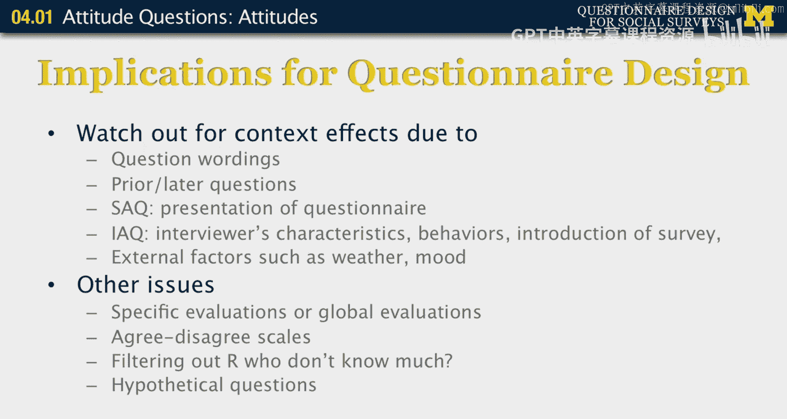

# 密歇根大学《调查数据收集和分析（2-6：方法、社调问卷设计、抽样、缺失数据、分析）｜Survey Data Collection and Analytics》 p61 18_态度问题：态度测量.zh_en -BV1fw4m1e7Zh_p61-

Welcome to our segment on attitude questionstion。Attitude questions are very popular in a lot of surveys。

 in particular consumer satisfaction surveys or the evaluative surveys work with attitude questions a lot。

In this first segment， we'll talk about attitudes more generally and then we'll talk about context effects and scales that you can use to measure attitudes in later segments。

Attitudal questions， are questions about things that are not verifiable by external observation or records。

 at least in theory they aren't， and you know it's important that you sort of distinguish attitude questions from other questions about subjective psychological states。

 so an attitude has this evaluative component。If you read this example below。

 you'll see we ask people here how strongly they agree or disagree with a particular statement in the statement being here。

 people in my neighborhood generally get along with each other。

That's a little different than asking them about something that's knowledge related。

 a cognitive component and more question about a belief like how healthy is pizza in the following dimensions Furthermore。

 it's different from behavioral intentions that have the strong behavioral component for example。

 in the next six months， how likely is it that you will buy a car。The last two。

 the cognitive components and the behavioral components。

 beliefs and behavioral intentions a little easier to ask and attitudes have a few more issues that we're going to talk about。

So the traditional view on attitude is that an attitude is an enduring positive or negative feeling about some person object or issue classicic reference here is the work by Pety and Kauppo from the 80s。

In other places described as a psychological tendency that's expressed by evaluating a particular entity with some degree of favor or disfavor。

Often， there would be an inclusion of a direction， positive versus's negative or a feeling that is implied and measured unitdially。

Now， implicit in these tradition of views is that attitudes are preexisting。

So you can you know pull out a drawer in your head and you can retrieve an attitude。

 f you call this automatic activation of attitudes。That requires that they are somewhat stable。

That they're independent of the context and independent of time in the way people answer。

And that they are predictive of behaviors and resistant to persuasion。

And that's the reason why they are popular for questionnaire is， you know。

 you can ask about these attitudes and you hope that you can make behavioral predictions from these attitudes。

However， there's a problem with this ta of few because in service， at least when we ask them。

So a methodorologist found big differences in numbers depending on how such attitude questions are asked。

 so here are two examples， 56% say that US should not allow public speeches in favor of communism if asked that way。

In a survey and 39% say that US should forbid public speeches in favor of communism concepte kind of the same。

 but big differences in the numbers likewise， 25% say that the federal government is spending too little on welfare was the 65% say that the federal government is spending too little on assistance to the poor again。

 big difference between the two and conception sort of the same thing。

That shouldn't be the case if attitudes are stable and not affected by question wording context or things of that nature。

So for that reason， alternative views have developed， there's a nice title by John Zeller in 1992。

 we have that on the reference list， it's called makingking it up as you go along。

 sort of captures the Spirit here， and in it he writes that individuals do not typically possess true attitudes。

 rather they construct opinion statements on the fly based on whatever consideration are momentarily salient。

Noble Schz has written a lot on attitudes and attitude measurements in 2007 piece。

 he wrote about attitudes being conceptual asvaluative judgments formed on the spot rather than a traitlike disposition。

 and that's important because it affects whether you want to measure those attitudes in the first place。

 and if so how you measure the attitudes。So let's recap in these alternative views。

 people don't have stable summary evaluation stored in memory。If you ask for one。

 people will construct them on the fly。So they give you a top of the head responses on whatever happens to cross their mind。

And it also means that tomorrow you will get a different answer。

And a small change in the wording or the question order can get you very different responses。

People also will report attitudes to things that don't even exist。

 And that's an interesting feature true in general， for questionnaires， we've sort of by the age of。

Two or three lost the ability to not answer questions。

 so usually you will get an answer no matter what the question is。

Trerener Razinski and in particular， Razinski have written a lot on these in their various pieces。

Here Rainski distinguishes between attitudes， seen as unobservable global elevation of objects and attitude expressions。

 which are specific responses to a specific question asked at a particular time in a particular way。

So any single attitude measure will be an imperfect reflection of the underlying attitude。

Can see this a little bit as a reconciliation about these different views。 So there's something。

 you know， inherent in a person that you might be able to measure。

 But how it is expressed is a very different thing。So in the Rainsky 2011 piece， he， as I said。

 tries to resolve the divergent views。😊，And says that some attitude expression are almost entirely constructed on the spot。

 just like Seller says， other attitude expression， they are retrieved almost internally intact from memory。

Most annex to the expression are some combination of the tool that means they're constructed by a ingredient in the construction is a fairly stable overall summary evaluation retrieve from memory。

 that is the actual attitude， but all these questionnaire design components that we talk about。

 they go into this formation of the response。No Schwartz in the 2007 paper that is part of the Co notes here resolves these divergent views in a slightly different way。

 he translates stable attitudes， strong attitudes， context effects and non-ats into something that matches this more modern view on attitudes。

 take a moment and retrieve from the reading or imagine how you would translate that in the context that if you conceptualize the construction and elevation and judgments on the spot drawing on what is available to the respondent。

So stable attitudes， that means a similar evaluation is arising from the respondent drawing on similar inputs or the same chronicle accessible information if you see strong attitudes。

 that means the respondent is drawing on highly accessible information。So you know。

 if answer comes out quickly， that might be highly accessible。

Context effects that you see means that respondents are drawing on contextual information when constructing evaluations。

 and non attitudeitude means that we have the same number of conflicting information accessible to respondent at the same time。

All of this has implications for question and design you have to watch out for context effects due to a question wording。

Prior and later questions， self administered questions。

Means the presentation of the entire questionnaire because you don't have that much control what comes first and what comes later。

In your administered questions， you have to include interview characteristics。

 behaviors and introductions to the survey in the set of context effects that you have to worry about。

And the same is true for external factors such as weather or mood。

 they have shown to influence respondents' answers as well。The other issues， for example。

 the specific evaluations or。We global evaluations agree with disagree scales。

 filtering of don't know and hypothetical questions。

 and well talk about these other issues in the next segments。

