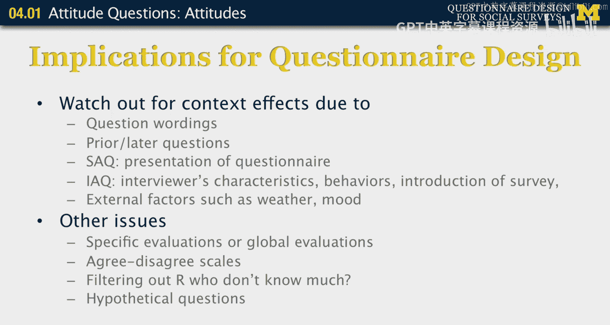

# 密歇根大学《调查数据收集和分析》：2-6：态度问题：态度测量

## 概述
在本节课程中，我们将学习调查问卷中的态度问题。态度问题在许多调查中非常流行，特别是在消费者满意度调查或评估性调查中。我们将首先讨论态度的基本概念，然后在后续章节中探讨语境效应以及用于测量态度的量表。

## 什么是态度问题？
态度问题是关于那些无法通过外部观察或记录来验证的事物的提问。至少在理论上如此。区分态度问题与其他关于主观心理状态的问题非常重要。

态度具有评价性成分。请看下面的例子，我们询问人们对于特定陈述的同意或不同意程度。这里的陈述是：“我社区的人们通常相处融洽。”

这与询问知识相关的问题（认知成分）不同，例如“披萨在以下维度上有多健康？”；它也不同于具有强烈行为成分的行为意图问题，例如“在未来六个月内，您购买一辆汽车的可能性有多大？”

后两者，即认知成分和行为成分（信念和行为意图），相对更容易提问。而态度问题则存在更多需要我们讨论的议题。

## 态度的传统观点
关于态度的传统观点认为，态度是对某个人、物体或议题的一种持久的积极或消极感受。经典的参考文献是佩蒂和卡乔波在80年代的工作。

在其他地方，态度被描述为一种心理倾向，表现为以某种程度的喜好或厌恶来评价特定实体。通常，这包含一个方向（积极 vs. 消极）或一种隐含的、可被单维度测量的感受。

这些传统观点隐含的假设是：态度是预先存在的。你可以从头脑中“取出”一个态度，这被称为态度的自动激活。这要求态度具有一定程度的稳定性，它们独立于语境和时间，能够预测行为，并且能够抵抗说服。

这也是态度问题在问卷中流行的原因：你可以询问这些态度，并希望从中做出行为预测。

## 传统观点面临的问题
然而，这种传统观点存在一个问题，至少在调查中询问态度时如此。方法论学者发现，根据态度问题的提问方式，得到的数字存在巨大差异。

这里有两个例子：
*   当被问及“美国是否应该允许支持共产主义的公开演讲”时，56%的人回答“不应该”。
*   当被问及“美国是否应该禁止支持共产主义的公开演讲”时，只有39%的人回答“应该”。概念基本相同，但数字差异巨大。

同样：
*   25%的人认为“联邦政府在福利上花费太少”。
*   65%的人认为“联邦政府在援助穷人上花费太少”。两者之间再次出现巨大差异，而概念上几乎是同一件事。

如果态度是稳定的，并且不受问题措辞、语境等因素影响，那么这种情况就不应该发生。

## 态度的替代性观点
因此，出现了替代性的观点。约翰·泽勒在1992年有一篇很好的文章，标题是“边做边编”，这抓住了其中的精髓。他在文中写道，个体通常并不拥有“真实的”态度，相反，他们会根据当下任何显著的因素，临时构建自己的观点陈述。

诺伯特·施瓦茨在态度和态度测量方面著述颇丰。在2007年的一篇文章中，他将态度概念化为当场形成的评价性判断，而非一种类似特质的倾向。这一点很重要，因为它影响了你是否想要测量这些态度，以及如何测量。

让我们总结一下这些替代性观点：
*   人们并没有稳定的、存储在记忆中的总体评价。
*   如果你要求一个态度，人们会当场构建它。他们会根据脑海中恰好想到的任何事情，给你一个“脱口而出”的回答。
*   这也意味着，明天你可能会得到一个不同的答案。
*   问题措辞或顺序的微小变化，都可能导致非常不同的回答。
*   人们甚至会报告对根本不存在的事物的态度。这是一个有趣的现象。总的来说，在问卷调查中，我们大约在两三岁后就失去了“不回答问题”的能力。因此，无论问题是什么，通常你都会得到一个答案。

特雷纳和拉辛斯基，特别是拉辛斯基，在他们的多篇文章中对此进行了大量论述。拉辛斯基区分了“态度”（被视为对客体的不可观察的总体评价）和“态度表达”（在特定时间、以特定方式对特定问题做出的具体回答）。

因此，任何单一的态度测量都只是潜在态度的不完美反映。这可以被视为对不同观点的一种调和。也就是说，一个人内在可能存在某种你可以测量的东西，但如何表达它则是另一回事。

在拉辛斯基2011年的文章中，他试图解决这些分歧的观点。他说，一些态度表达几乎完全是当场构建的（正如泽勒所言），而另一些态度表达则几乎是从记忆中完整检索出来的。大多数态度表达是两者的结合，这意味着它们的构建成分中包含了一个从记忆中检索出来的、相当稳定的总体评价，那就是实际的态度。但我们讨论的所有问卷设计要素，都会影响最终回答的形成。

施瓦茨在2007年的论文（也是课程笔记的一部分）以略有不同的方式解决了这些分歧。他将稳定的态度、强烈的态度、语境效应和非态度，转化为更符合现代态度观点的概念。

花点时间回想一下阅读内容，或者想象一下，在将态度概念化为受访者根据可及信息当场构建评价性判断的背景下，你会如何翻译这些概念：
*   **稳定的态度**：意味着受访者根据相似的信息输入或相同的长期可及信息，得出了相似的评价。
*   **强烈的态度**：意味着受访者利用了高度可及的信息。如果回答得很快，那可能就是高度可及的信息。
*   **语境效应**：意味着受访者在构建评价时利用了语境信息。
*   **非态度**：意味着受访者在同一时间可及的信息中存在相同数量的冲突信息。

## 对问卷设计的启示
所有这些都对问卷设计有重要启示。

你必须注意由以下因素引起的语境效应：
*   **问题措辞**
*   **前后问题**（在自填式问卷中，这意味着整个问卷的呈现，因为你无法严格控制先后顺序）
*   **访员特征、行为和调查介绍**（在访员面访中，这些也是你需要担心的语境效应）

外部因素，如天气或情绪，也已被证明会影响受访者的回答。

其他需要注意的问题还包括：
*   具体评价与总体评价
*   同意/不同意量表
*   “不知道”选项的过滤
*   假设性问题

我们将在接下来的章节中讨论这些问题。

## 总结
本节课中，我们一起学习了态度问题的核心概念。我们首先了解了态度的传统观点，即认为态度是稳定且预先存在的。然后，我们探讨了方法论研究揭示的问题，即态度回答极易受到问题措辞和语境的影响，从而引出了态度是“当场构建”的替代性观点。最后，我们讨论了这些不同观点对问卷设计的重要启示，特别是关注语境效应的必要性。理解态度的这些特性，是设计出能够有效测量真实倾向的调查问题的关键。