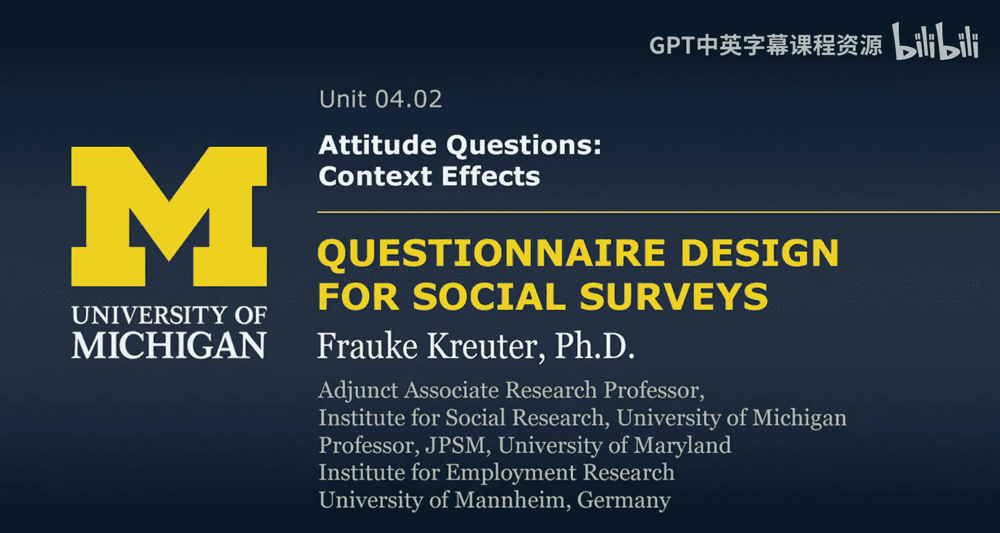
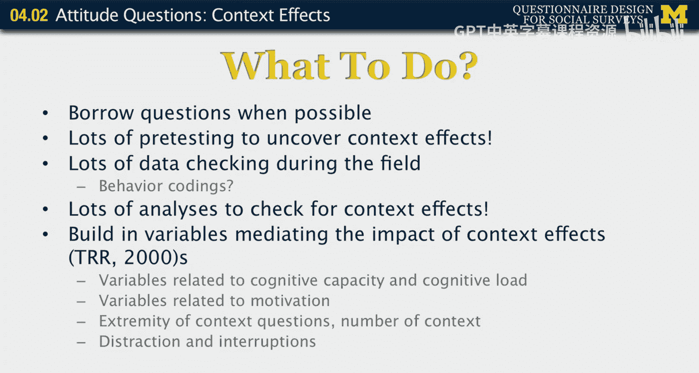

# 密歇根大学《调查数据收集和分析（2-6：方法、社调问卷设计、抽样、缺失数据、分析）｜Survey Data Collection and Analytics》 p62 19_态度问题：语境效应.zh_en -BV1fw4m1e7Zh_p62-

So let's look at how context affects。Alter answers to attitude questions。

Context in general will influence the response when it affects what enters into consideration when comprehending a question and forming judgment and evaluations。

 so again， think of the response process model that we talked about early in the class and context effect can enter at any of these stages and alter ultimately the response。

It's important that you think of context effects in a very wide way。

 so there are many aspects to the survey that can form a context。

It can be the subject of the questionnaire， the interviewer， the interview setting。

Instructions that you give in the questionnaire or through an interviewer。

 pictures that accommodate a question， wording of a question。

 response options or question order itself。We'll have a few those examples in here。

 but later on also when we talk about layout and modes， we will come back to these context effects。

Let's look at the first one， context effect comprehension。

There are assimilation effects that means the respondent includes prior questions into the interpretation and the understanding of a current item。

There's an example here from a paper from Trenja and Razinski from 1988。

Do you favor oppose passage of the Monteey control bill？27。

5% reported in Fa when this question was following a question on inflation。Whereas 12。

5% reported favor when following a neutral question。

The Monterey controlway is related to anti inflation。

 so this context has changed the amount of favorable answers to this particular question。

A second way in which context effect can enter comprehension is a contrast effect。

 so that means the respondent excludes prior question in interpreting and understanding the current item。

 we'll show you an example later where this context effect happened when we talk about something very specific versus is something that's very general and the content of that question is related to happiness and marriage I come back to that。

 but remember this contrast effect when we get to that example。

Both of these have implications for questionnaire designers。

 they do mean just like we said initially that you should avoid ambiguous and vague terms。

And you can't be specific enough about the attitude object that you want to talk about。

At the retrieval stage， the context prompts the accessibility or retrieval of certain consideration that can happen both in assimilation。

And contrast， where in contrast， it leads to excluding the retrieval of certain considerations。

On the judgment stage， again， this has to do with an inclusion exclusion model。

 Schwartz and Bless talk about this in the 1992 paper。

It depends a little bit on constructing targets and standards。

 so retrieval of information and the application of this information has to do with the accessibility in memory。

 some information is chronically accessible， others is temporarily accessible in context dependent。

So let me put some meat to the statement here， that representation of a target means that the information is activated by context。

 is included in representation of the target， that would mean an aation effect。

The information can mostly be activated by context and is excluded from representation of the target。

 which is subtracted and creates this context effect。

If the information is activated by context is included in representation of the standard。

 then comparing based contrast effects will appear。 So simulation。

 subtraction based contrast effect and comparing based contrast effect。

Let me give you an examples rather technical if the context is trustworthyiness of Richard Nixon。

 meaning a question ahead or some information given about Richard Nixon。

Which often has a low rating because of the scandal back then。

And the target of the question is trustworthiness of politician。

 then a low rating of politicians will appear due to the assimilation effect。

Because Nixon is incorporated into the representation of politicians。

Whereas the target is trustworthiness of a different politician that is seen favorly。

 you'll get a high rating of that politician that's Examput Gingrich due to the contrast effect because Nxness incorporated into the representation of the standard。

 which then lowers the bomb。So here is an example for this effect。

 a question about politicians in general and about a specific politician。

And on the Y axis a scale for trustworthiness that was used in this paper by B insurance in 2010。

If the scandal was brought to mind， those are the black bars。

 you see much higher ratings of specific politicians than if the scandal was not brought to mind。

 but the difference is particularly strong between asking about politicians in general and asking about a specific politician。

Context effect can also enter into reporting and mapping again。

 as simulation effect means that you get consistent responses to questions that are grouped together。

Whereas contrast effects will lead to the opposite。

 So if Nixon is mapped as the anchor for least trustworthy。

 then you have these anchoring effects that change the rating or the scale points that you will pick for later questions。

So let's summarize these context effects for attitude questions。

They can enter into the comprehension stage because the content of preceding questions may influence respondents interpretation of later questions at the retrieval stage。

 affecting accessibility at the judgment stage in affecting information that's used to answer the preceding questions is now more accessible in memory and used to construct either the representation of a target or the representation of a standard。

And then reporting issues as in consistent reporting of questions that are grouped together and anchoring of rating scales。

This has impact on questionnaire and designers， first of all。

 there's a threat to the interpretation of our data and to the generalizability of the findings。

 both substantive and methodological。Think for example， in trend analyses。

 so you feel the same question time after time after time in the general social survey or some other omnibus type survey where various questions are collected。

 often by different sponsors， you might have problems maintaining the context over time。

 but even if you can manage to have the same context， time after time after time。

 it could be that the meaning of the question changes over time。Also。

 there might be an interaction with demographic characteristics of the subgroups in your population。

And you know， although we have talked in these examples and mostly about context in the sense of prior or preceding questions。

Keep in mind， this can also be an interview， a setting or historic context that creates these effects。

 That's why it's important that you understand or go Anytime you construct your questionnaire that you go through the stages of answer formation。

 comprehension。Rerieval and judgment and response formation。 And think about。

 is there something in this setup， in the interview。

 in this context that might affect a particular stage in this。So what to do。

 you can borrow questions when possible， assuming those questions worked in other places and not too much time has passed and the like your control under the context and the like。

Regardless， there's lots of pretesting needs to uncover context effects。

 data checking during the field， maybe behavioral coding。

 lots of analyses to check for context effect afterwards quantitatively， if you can， I mean。

 ideally you want to build in some experiments that's often a good idea。

 some as they call it a B testing or split ballot experiments。

But then also you can build in variables that can mediate the impact of context effects， you know。

 those can be variables related to cognitive capacity or cognitive load。

 variables related to motivation。Any type of context， distractions， interruptions。

 Be cognizant of those as you design the questionnaire and the instrument as a whole。

In the next segment， I'll come back to this example of specific versus general evaluations that we touched on earlier when we talked about attitude effects。

