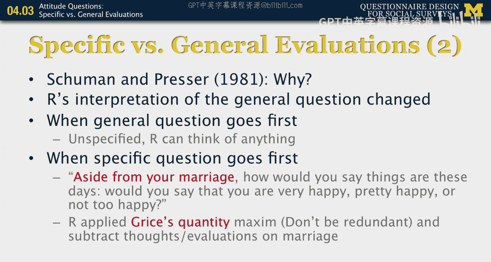

# 密歇根大学《调查数据收集和分析（2-6：方法、社调问卷设计、抽样、缺失数据、分析）｜Survey Data Collection and Analytics》 p63 20_态度问题：具体与总体评价.zh_en -BV1fw4m1e7Zh_p63-

。As promised， the quick segment on specific versus general evaluations。

The famous experiment by Howard Schumman and Stanley Pressser from 1981 that consists of these two questions that you see here。

 taking all things together， how would you describe your marriage。

 would you say that your marriage is very happy， pretty happy or not too happy。

And taking all together， how would you say things are these days。

 would you say that you're very happy， pretty happy or not too happy？

The researchers varied the order of these two questions and you might in your head want to answer them。

 maybe you can substitute marriage with relationship if you are not married。

And then let's look at the results here we have in this example from Hochman and Stanley Presssa。

 52% reporting to be generally very happy when the general question appeared first。😊，But only 38。

1 reported to be generally very happy when the marriage happiness question came first as it was presented in the previous slide。

So this is interesting because this context effect only appears on the general question。

 the specific question was not subject to this effect and if I flip back here on the slide you look at this you know what respondents happen here。

 you might already think of well could that be the subtraction context effect that we have talked about before and that is indeed the case。

 human impress do say that the respondent interpretation likely has changed in this experiment or in these two variation of the experiment when the general question goes first。

 it's pretty unspecified in the respondent can think of anything but when the specific question goes first then implicitly in the general question there's a starting that says aside from your marriage。

 how would you say things are these days would you say that you're very happy， pretty happy。

 not to happy？And in a way， respondents apply gra maxims of quantity。

 which means don't be redundant and therefore they subtract thoughts and evaluations on marriage。

As a conclusion for everybody here， ask specific questions only， or if you ask general questions。

 ask them first before you talk about specific questions。

