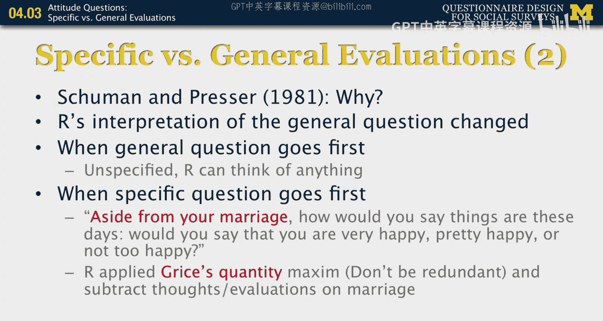

# 调查数据收集与分析：2-6：态度问题：具体与总体评价 📊

在本节课中，我们将探讨态度调查中的一个关键设计问题：具体评价与总体评价问题的顺序如何影响受访者的回答。我们将通过一个经典实验来理解其中的机制，并学习如何设计问卷以避免偏差。

---

## 概述

在问卷设计中，问题的顺序和措辞至关重要。本节将聚焦于一个由霍华德·舒曼和斯坦利·普雷斯在1981年进行的著名实验。该实验揭示了当先询问具体领域（如婚姻）的态度，再询问总体生活满意度时，会产生一种“减法语境效应”，从而显著影响总体评价的结果。

上一节我们介绍了问卷设计的基本原则，本节中我们来看看一个关于问题顺序的具体案例。

---

## 实验内容

实验包含以下两个问题，研究人员改变了它们的提问顺序：

1.  **总体幸福问题**：综合来看，你会如何描述你近来的生活？你会说自己非常幸福、比较幸福，还是不太幸福？
    *   `Taking all together, how would you say things are these days? Would you say that you're very happy, pretty happy or not too happy?`
2.  **婚姻幸福问题**：综合来看，你会如何描述你的婚姻？你会说你的婚姻非常幸福、比较幸福，还是不太幸福？
    *   `Taking all things together, how would you describe your marriage? Would you say that your marriage is very happy, pretty happy or not too happy?`

（注：如果你未婚，可以在心中用“恋爱关系”替代“婚姻”来思考这两个问题。）

---

## 实验结果

以下是霍克曼和斯坦利·普雷斯实验的结果：

当**总体幸福问题先出现**时，有 **52%** 的受访者报告自己“总体上非常幸福”。

然而，当**婚姻幸福问题先出现**（即如上页幻灯片所示顺序）时，只有 **38.1%** 的受访者报告自己“总体上非常幸福”。

这个结果非常有趣，因为这种**语境效应只出现在总体问题上**。具体问题（婚姻幸福）的结果并未受到提问顺序的影响。

---

## 效应机制分析

你可能会想，这是否与我们之前讨论过的“减法语境效应”有关？**答案确实是肯定的**。

研究人员指出，在这项实验的两种问题顺序变体中，受访者对问题的**解读很可能发生了变化**：

*   **当总体问题先出现时**，问题非常宽泛，受访者可以联想到生活中的任何方面。
*   **当具体问题（婚姻）先出现时**，受访者在回答随后的总体问题时，会**隐含地**理解为：“除了你的婚姻之外，你近来的生活如何？”。

在这种情况下，受访者应用了格赖斯的**数量准则**，即“避免冗余”。因此，他们会有意地从总体评价中**减去**已经专门评价过的婚姻部分的思考和感受。

---

## 核心设计原则

基于以上分析，我们得出一个重要的问卷设计结论：

**只询问具体问题**。或者，如果你必须询问总体性问题，**务必将其放在所有具体问题之前**进行询问。

这样可以防止具体问题的出现为后续的总体问题设定一个隐含的“减法”框架，从而获得更真实、不受干扰的总体态度测量。

---

## 总结

本节课中我们一起学习了具体评价与总体评价问题在问卷中的顺序效应。通过舒曼和普雷斯尔的实验，我们看到了“减法语境效应”如何导致总体幸福感的报告率发生显著变化。关键在于，问题顺序会改变受访者对总体问题的心理解读。因此，为了获得有效的测量结果，问卷设计应遵循“先总体，后具体”或“只问具体”的原则。