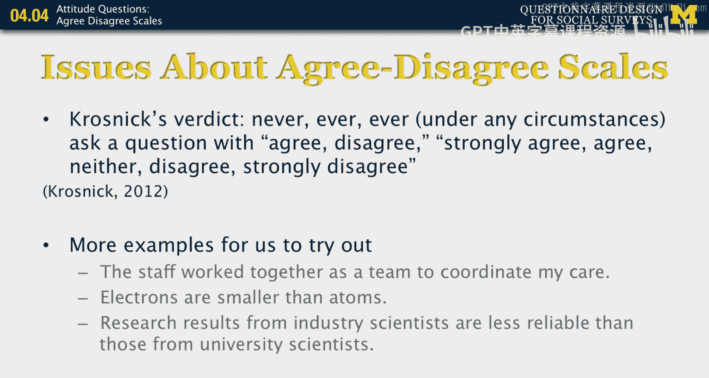

# 密歇根大学《调查数据收集和分析（2-6：方法、社调问卷设计、抽样、缺失数据、分析）｜Survey Data Collection and Analytics》 p64 21_态度问题：同意-反对量表.zh_en -BV1fw4m1e7Zh_p64-

没有。Welcome to this segment， this is a segment on the specific type of attitude questions。

Those then have an agree， disagree scale and they're quite popular。

 but they're also quite troublesome， so without it might be a good idea to introduce you to some issues。

Related to these agree disagree Scs。Here's an example。

To what extent do you agree or disagree with the following statements， abortion should be legal。

Would be the first statement， and then I am certain of my views on abortion would be the second statement。

Each of these statements can be answered with a 5 point scale。

 the endpoints are labeled strongly agree and strongly disagree， and in between fully labeled agree。

 neither disagree。Very common scale label， it's a very common type of question。

What is the problem here？The advantage for this format is that they are pretty easy to administer people are familiar with that format。

 they have seen it before in the paper by Krasnick from 2012。

He states that respondents are about two thirds the time faster to this format than other formats。

 that we have fewer don't know answers for this kind of format。

And that respondents actually like these kind of scales。However。

 there are a few disadvantages that we should mention here。

 and they have been pointed out in earlier literature。

 but again summarized in the crossic paper referenced here。

The first one is they are subject to acquiescence bias。

 a respondent want to answer polite and an agreeable way。In other contexts。

 acquiescence bias means respondents are more likely to answer yes to a question。Yeah。

 respondent is on the agreeable side， but also respondent might defer to higher status and adopt eding strategies。

 so it's all you know leading to more agreeableness or yes sure。

 there is a statement I probably should agree to that。

Another problem is that they often are doublebued in the way they administered so here's an example America is getting so far away from the true American way of life that force may necessary to restore it this is a statement that you can find in a survey and it's pretty easy to ask whether you agree or disagree with the statement but here you have to agree or disagree to do different things one is the America getting further away from the true America。

And the second piece of it， people might have a different opinion in terms of agreeing or disagreeing。

Often the disagree and can be ambiguous。 so consider this item here， I'm seldom depressed。

 So what does disagree mean really for this item。You are never depressed or you are depressed all the time。

 you know that。Can be two different skate points here， and it's not clear what is。

 what does it mean to disagree with any of these items？So instead。

When you know argues and in particular Crosnik argues。

 but literature you can think of other ways to ask the same question。

 so on the left hand side in this table you see agree， disagree formats for a particular issue。

which probably should be avoided and on the right hand side you see construct specific response choices that are recommended。

 so on the abortion item abortion should be legal， you can you see the five point scale again on the right hand side the same question is reformulated to say some people think that abortion should be legal。

 but other things that abortion should not be legal。Which one is closest to your opinion。

 legal or illegal， would be one way to ask this question to avoid some of these problems we just talked about。

I'm certain of my views on abortion is paired up here in a reformulation。

 how certain are you of your views on abortion， very certain， somewhat certain， not very certain。

 not certain at all， so that too would be an alternative formulation for the same issue。

If you read through John's Crossing's papers and in particular one we cite here。

 his verdictic is never， ever， ever under any circumstances， ask a question with agree， disagree。

 or strongly agree to a strongly disagree scale。Let's try it a few more examples listed below here。

The staff worked together as a team to coordinate my care。

That could be a question to some patients in the hospital。Electrons are smaller than atoms。

Research results from industry scientists are less reliable than those from university scientists。

To which of those would you be able to have an agree， disagree， scale in your opinion？

Which one would you prefer an alternative formulation。

 Weve provided a sheet here for you so that you can enter your alternative formulations for those questions where you would prefer that。

Okay， and on the next segment， we'll talk about doneno options。

