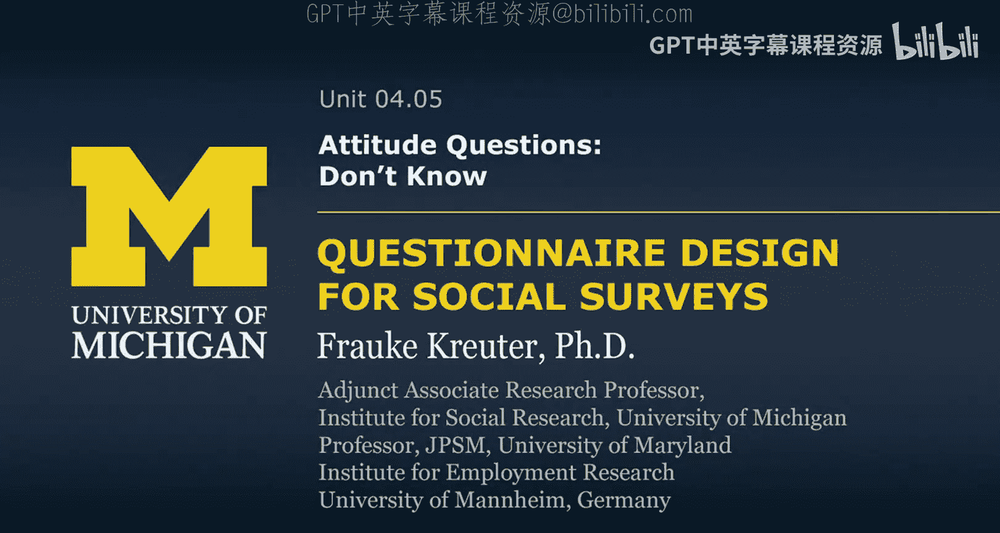
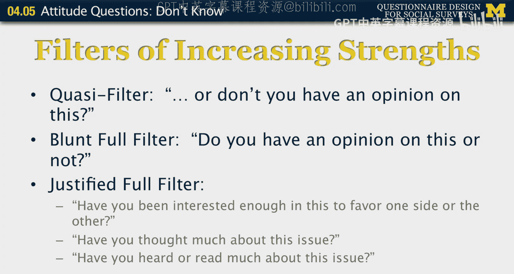
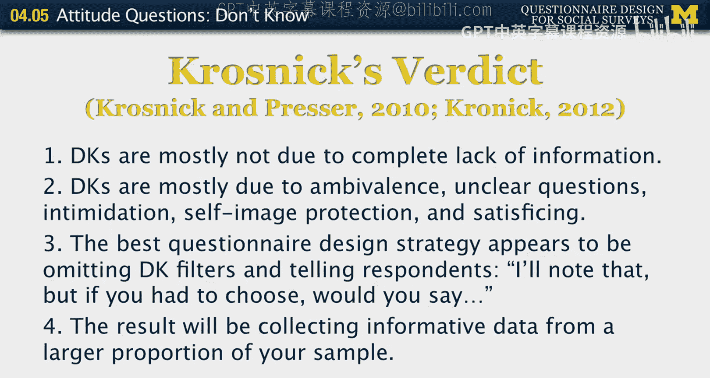

# 密歇根大学《调查数据收集和分析（2-6：方法、社调问卷设计、抽样、缺失数据、分析）｜Survey Data Collection and Analytics》 p65 22_态度问题：'不知道'选项.zh_en -BV1fw4m1e7Zh_p65-

The segment is under no options。Always a tricky question。

 should you offer respondents don't know the answer category in their questionnaire？

Or should you not。Our Trumin Stan Presser had in the 1981 bookQu Answers in attitude Service。

 a nice example here， the question that asks respondent on whether they are in favor or pose to the Agriculture Act of 1978。

The interesting thing about this question is that this agriculture actually didn't exist。

 so most people， as you can see in this graph here， they should say don't know because。

There is no favor or opposed to something that doesn't exist。However。

 in the first set of bars that you see here， this piece here。The question was asked just like this。

 are you in favor op opposed， and there was no filtering out of people that say they have never heard or don't know what the Agriculture Act of 1978 is。

In this condition， we had about 70% who volunteered the answer don't know。In this other segment here。

 where first people were asked whether they do know something about the Agriculture Act of 1978。

 almost 90% said they don't。And only the remaining set was asked whether they favor or oppose this particular act。

Now there are various methods for offering doneal options。You can have a full filter up front。

 do you have an opinion on that or do you know about that， or you can have a quasi filter。

 which is do you agree， disagree or do you not have an opinion on that or do you favor oppose or do you not have an opinion？

And that would be a formulation for a telephone server because。So if withmin mode。

 obviously you would have to write down the answer category， no opinion。

 even if it's not part of the question。Now the question should you do this or not。

 the issue here is will the respondent be provided with the option don't know or do they have to themselves say。

 no， I don't know anything about this or don't have an opinion。

The view of Converse and pressa is that you should offer to fill the respondent who don't know much and those can't have an attitude that was sort of in the 80s。

 the conclusion from these studies that they did。You can do this and execute this kind of recommendation with filters with increasing strength。

 so the quasi filter we talked about， you can have the blind filter。

 but you could also have justified full filters， for example。

 have you been interested enough in this to favor of one side or another or have you thought about this issue or have you heard and read about this issue to soften the filtering in case you worried about that？

Now。

All these methods aside， John Crosssick and actually together with Stanley Pressser worked on this later and so more recently the views on using don'tno option have changed a bit and they are sort of grounded in two cognitive models on the don'tno response option the first perception is the optimizer model in here with the notion that there are four situations in which a respondent might want to say don't know along the lines of the response process model the first one is。

So they interpret the question and realize they don't know。

 which means that the meaning of the question is not clear， right？

The search in the memory can be leading to don't know。

 which means that there's no information found at all in their head on this topic。

The thenno can arise the third step。If they integrate the information into a judgment。

 but in the formulation of their judgment， so there might be ambivalence and conflict among the information that they have in their head。

Or there's insufficient information to justify an opinion。

 And the last one would be in formulating the answer。

 So translating the judgment into a response category。

And here it would be that the meaning of the response alternatives is not clear so they can't really match their thinking to an answer category。

 and it was only the second step here， the search for memory and don't know that really would mean that if you force people into an answer。

Meaning you don't provide don't know option。 They would be giving you a non meaningfulaning answer。

 So for all of the reasons， except this one， pushing people to offer opinions might yield to meaningful responses。

If you take another cognitive model as a baseline here to evaluate these don no responses。

 that of a satisfying respondent。嗯。We'll mention this later again。

 but to point out this term sating is from Herbert Simon in the '50s。

 he described economic behavior with this term and it has been adopted by Ksnick and Din Alvin and Bas to match behavior in question and design。

So anyway， if we have the satfies in mind here， who does just enough to sort of get through the questionnaire？

Then some respondents sometimes look for cues in a question that allow them to skip all interpretation or retrieverier to justify the answer。

 so you know I say don't know because I dont want to go through these four steps and think do I understand。

 can I formulate an answer can I even retrieve what is in my head and the like so they just pick an easy answer category？

Most likely this behavior might be seen when the respondent's ability to answer that question is low。

Or the responding motivation is low， or there are too high of cognitive demands going on here。

So here in this situation， if pushed to offer opinions。

 these people would offer meaningful opinions and again。

 that would be an argument to actually do not offer don't know options。

There's some experimental evidence out there comparing offering versus omitting don't know options。

LikeCin and D Alvin in the 90s， as well as Croniick and Beren and Paul and others。

 and I'm sure there are many more studies of that type。Did a series of experiments。

 they found no more unreliability in responses to unfiltered question than to those filtered。

Another set of experiments listed here found that filtering doesn't strengthen and constraint correlations between attitudes and different issues。

MClenin also， in the latest actually earlier study in 1991。

 found that filtering did not reduce acquiescence or response order effects。

And Crosniig also did a series of studies that supported the notion that by and large one should probably omit don't know options rather than offering them。

 so the Cron wordic， as we call it here， summarized in those two papers is that don those are mostly not due to complete lack of information don nose are mostly due to ambivalence。

 unclear questions， intimidation， self-image protection and satisfying。

The best question of design strategy appears to be omitting don't know filters and telling respondents。

 I'll note that， but if you had to choose what you say so that can be a way for the interviewer to get substantive response after all nudging the respondent for an answer and as a result you will be collecting informative data from a larger portion of your sample。

Okay， and in the next segment we will talk about skills and response order effects in answer categories and the like。

