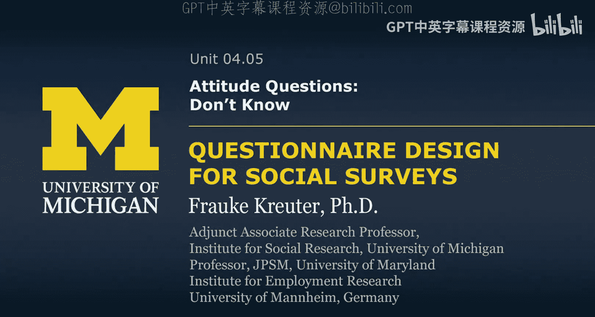
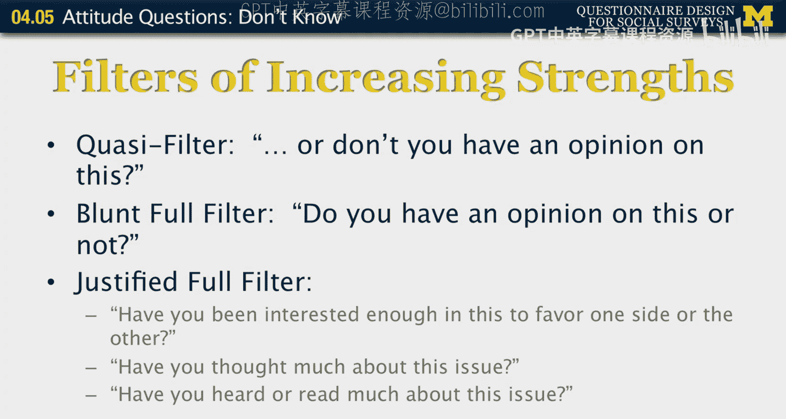
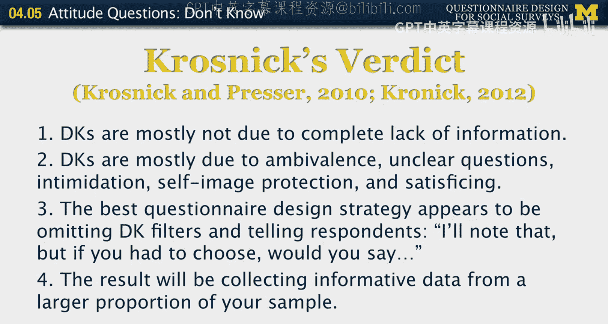

# 调查数据收集与分析：2-6：态度问题中的“不知道”选项设计 📊

在本节课中，我们将探讨问卷设计中一个常见且棘手的问题：是否应该为受访者提供“不知道”这个答案选项。我们将通过经典研究案例，分析提供与不提供该选项的利弊，并介绍相关的认知模型与实验证据，最终给出当前学界的设计建议。

---

## 是否应该提供“不知道”选项？🤔

这是一个始终具有挑战性的问题：在问卷中，是否应该为受访者提供“不知道”这个答案类别？还是不应该提供？

我们的特鲁明、斯坦和普雷瑟在1981年的著作《态度调查中的答案》中，给出了一个很好的例子。该研究询问受访者是否支持或反对《1978年农业法案》。有趣的是，这个法案实际上并不存在。因此，正如你在下图中看到的，大多数人本应回答“不知道”，因为他们无法对不存在的事物表示支持或反对。

然而，在第一组条形图（此处）中，问题直接以“你是支持还是反对”的形式提出，没有预先筛选掉那些表示从未听说过或不知道《1978年农业法案》的人。在这种条件下，大约有70%的人主动回答了“不知道”。而在另一组（此处）中，首先询问人们是否了解该法案，结果近90%的人表示不了解。只有剩下的那部分人才被问及是否支持或反对该法案。

---

## 提供“不知道”选项的不同方法 🔧

有多种方法可以提供“不知道”选项。以下是主要的几种设计策略：

*   **完全筛选法**：在询问态度问题之前，先问一个前置问题，例如“你对此有看法吗？”或“你了解这个吗？”。只有回答“是”的受访者才会进入后续的态度问题。
*   **准筛选法**：在态度问题的答案选项中直接包含“没有看法”或“不知道”的选项。例如：“你同意、不同意，还是没有看法？”这种形式常用于电话调查，因为在面对面或电话访问中，访问员需要记录下“无意见”这个答案，即使它并非问题文本的一部分。

那么，核心问题在于：是否应该提供这个选项？关键在于，是应该主动为受访者提供“不知道”的选项，还是让他们自己主动说出“不，我对此一无所知”或“没有看法”？

康弗斯和普雷瑟的观点是，应该筛选掉那些了解不多或无法形成态度的受访者。这是他们在80年代进行相关研究后得出的结论。你可以通过不同强度的筛选来执行这一建议：我们讨论过的准筛选法，或者完全筛选法。你甚至可以使用“合理化”的完全筛选，例如：“你是否对此有足够的兴趣来支持某一方？”或“你是否思考过或听说过这个议题？”，以软化筛选条件，以防你担心筛选过于严格。

---

## 认知模型视角下的“不知道”回应 🧠

抛开上述方法，约翰·克罗斯尼克（后来与斯坦利·普雷瑟合作）等人近期的研究使关于使用“不知道”选项的看法发生了一些变化。这些观点主要基于两种关于“不知道”回应的认知模型。

第一种是**优化者模型**。该模型基于回答过程理论，认为受访者可能在四种情境下想说“不知道”：

1.  **理解问题阶段**：他们解读问题后，意识到自己不理解问题的含义。
2.  **记忆检索阶段**：他们在记忆中搜索相关信息，但发现头脑中完全没有关于该主题的信息。
3.  **信息整合与判断阶段**：他们整合信息形成判断时，可能因信息之间存在矛盾、冲突或信息不足而无法形成明确意见。
4.  **答案表述阶段**：他们将判断转化为具体答案类别时，可能因为答案选项的含义不明确而无法匹配自己的思考。

其中，只有第二种情况（记忆检索无果）才意味着，如果强迫人们回答（即不提供“不知道”选项），他们给出的将是无意义的答案。因此，**除了记忆检索失败这个原因，在其他情况下，推动人们提供意见可能会得到有意义的回答**。

如果我们以另一种认知模型——**满足者模型**——作为评估“不知道”回应的基线，结论会有所不同。“满足者”一词源于赫伯特·西蒙在50年代的描述，后被克罗斯尼克、迪尔曼等人引入问卷设计领域来描述受访者行为。满足者型的受访者只愿付出刚好能完成问卷的最低努力。

在这种情况下，一些受访者有时会在问题中寻找线索，以便跳过所有理解、检索和思考的步骤来为自己的答案找理由。他们可能仅仅因为不想经历上述四个步骤（“我理解吗？”、“我能组织答案吗？”、“我脑子里有相关信息吗？”等等）而直接选择“不知道”这个简单的答案类别。当受访者回答问题的能力较低、作答动机不足，或认知负担过重时，最有可能出现这种行为。

因此，在这种情境下，如果推动他们提供意见，这些人反而可能提供有意义的观点。这又成为了**不提供“不知道”选项**的一个论据。

---

## 实验证据与当前建议 📈

有一些实验证据比较了提供与省略“不知道”选项的效果。

例如，克罗斯尼克、迪尔曼等人在90年代，以及克罗斯尼克、贝伦、保罗等人进行的一系列实验发现，未经过滤的问题（即不提供“不知道”选项）与经过过滤的问题相比，答案的可靠性并没有降低。

另一组实验表明，筛选（即提供“不知道”选项）并不会增强不同议题态度之间的约束性关联。

麦克伦南在1991年的一项早期研究中也发现，筛选并没有减少默许偏差或回答顺序效应。

克罗斯尼克的一系列研究也支持了这样一个观点：总体而言，可能应该省略而非提供“不知道”选项。

因此，总结在相关论文中的“克罗斯尼克建议”是：“不知道”回应大多并非由于完全缺乏信息，而主要是由于矛盾心理、问题表述不清、受访者感到压力、自我保护或满足者心态。

**最佳问卷设计策略似乎是：省略“不知道”筛选选项，并告诉受访者（或由访问员说明）：“我注意到这一点，但如果你必须选择一个，你会怎么说？”** 这可以成为访问员在推动受访者给出实质性回答时的一种方式。最终，你将能从样本中更大比例的受访者那里收集到有意义的数据。

---

## 总结 ✨

本节课中，我们一起学习了态度问题中“不知道”选项的设计考量。我们回顾了提供该选项的经典方法，并从优化者与满足者两种认知模型深入分析了受访者选择“不知道”背后的心理过程。基于近期的实验证据，当前的主流建议倾向于在大多数情况下省略明确的“不知道”选项，并通过适当的追问鼓励受访者给出实质性意见，从而提高数据的有效性和信息量。

在下一节中，我们将讨论答案类别中的默许偏差与回答顺序效应等问题。