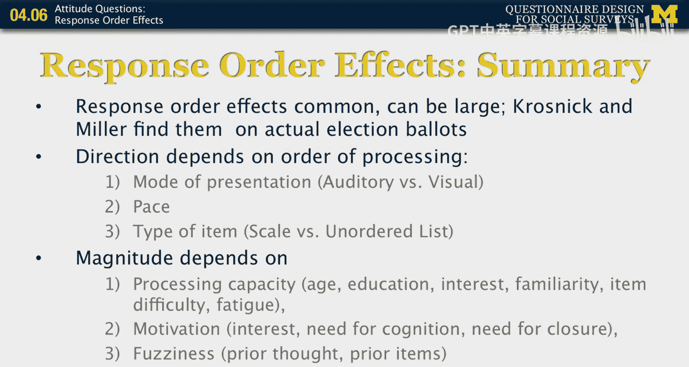

# 密歇根大学《调查数据收集和分析（2-6：方法、社调问卷设计、抽样、缺失数据、分析）｜Survey Data Collection and Analytics》 p66 23_态度问题：顺序效应.zh_en -BV1fw4m1e7Zh_p66-

Okay， so this segment here on response order effects fits nicely into the attitudeitude question unit。

 but it could also go somewhere else these response order effects might appear in factual questions。

 though maybe not as often because people might have a stronger representation of what their answer should be。

Let's take this question as one example。Which one of these qualities is the most desirable for a child to have and here comes a long list of qualities and some of them you might have thought about before others not。

 this is all formulated in the male version， but of course it should in this question relate to both males and females。

Good manners tries how to succeed， is honest， need and clean， good sense and sound judgment。

 self control， all those characteristics。Of a child。😊。

And what studies have shown is that if you have a long list like this。

 people at least in self admitted questionnaires where you look at this list tend to。

Anwer more often yes to items in the upper segment of this list。

Then the experience where the order of the list was changed。 So half of the respondent would get。

The list in the order printed here and the other half would get them in the opposite order version B all items flipped and in a studyback Knk。

 John Krasick and Du Alvin in 1987， they observed this primacy effect more items being picked on the top in both forward and backward orders so they concluded it's not due to the items。

They have these 13 choices about child characteristics that I just showed you。

And the task for the respondent was to choose three most important， and among those most important。

 they found that this primacy effect。Was actually only present for respondents with low sophistication as they called it。

 so lower level of education and lower level on scores on vocabulary test。

Has pronounced this kind of effect， so they argued that this group most likely answered in a satisfying way。

 which means they responded as soon as an acceptable option was encountered。

They also argue that response order effects of this kind are a function of mode。

Because under a visual presentation， respondents' mind might become clouttered after the first few options。

And the first few are likely to be endorsed showing this primacy effect。

But if you hear it in a telephone survey and it's an auditory presentation。

 then the earlier options are overwritten by later onces。

 and so the last few are more likely to be endorsed， which would lead to a recency effect。

And actually that has more to do with who administers the option rather than the actual mode。

 don't get confused here， the respondent could request， of course。

 from the interview of the computer that there is a visual presentation in addition。

 so it's not mode in the sense of what the survey mode in general is。

 but whether it's visual or auditory。In a meta analysis on response order effects that Hollbergok Cronik Moore interangd in 2007。

 they examined over 500 experiments in about 150 galllop poles that involved dichoama scales and looked at response order effects。

 and 19。2 showed a significant recency effect and only 1。8 showed a significant primacy effect。

minind you， these are telephone poles， so they had an error shift of 2。2% computed in this way。

 you know， the percentage of picking the option and second minus the percentage of option and it's picked first。

They saw as largest predictor of this effect， question difficulty， so the average length of words。

 number of words per sentence and the number of sentences。

The response option length was also a significant effect。

 and so was the position within a questionnaire。Now。

 just as a quick quiz question here in between what is primacy and what is recency？That's right。

Prirmacy would mean options that come first are more likely to be endorsed and a recency effect is options that come last are more likely to be endorsed。

Now continuing with that meta analysis question type is another thing that they looked at more closely and they grouped or categorized questions into three types。

 seemingly augmented questions， delayed processing questions and seemingly yes。

 no questions the seemingly opened questions would be something like this。

 how do you feel about President Bill Clinton as herustworthy or dangerous。

And you know you pause after Bill Clinton that of course， doesn't have an answer category there yet。

 and so you see trustworth you dangerous is a closed ended answer category。

 but to something that sounds more like a seemingly opened question。

The delayed processing question would be like this。

 which of the following describes your view about President Clinton so you know something is coming up and now you get it trustworthy or dangerous。

And the seemingly， yes， no question would be， do you think that President Bill Clinton is trustworthy or dangerous。

 but do you think implies that there will be yes no， but in this case。

 the yes no is converted into trustworthy or dangerous？

And they found an effective question type here， the seemingly augmented questions were at least prone to the recency effect。

And delayed processing questions were most prone to recency effects。

 So that's something to keep in mind when you consider formulating your questions。In general。

 education had the largest effect for low education groups compared to higher education groups。

Now let's look actually how respondents answer these questions I brought with me a few video clips to show to you and the first one is respondent who is considering all answer options and chooses the best answer。

 so this is like the perfect respond that we see here。

 this is an ITking study done at the University of Maryland by Mita Gallaicch and Roger Ter and colleagues。

Meanwhile published， but we were allowed to use those videos and you can see here while I'm talking that the respondent nicely read the question。

 thinks about the answer now here reread the question goes back up， goes back down， back and forth。

 reading the question， still thinking about the answer options then finally deciding on one and who off to the next screen。

Now not everybody has that same response pattern， so here's another example for a response pattern。

You have a respondent， she reads the question slowly， carefully uses the mouse as a pointer。

And then clicks on the first option that seems good， but then keeps reading。

And reconsidering it's like， you know， you have listen to phone options and you hover your finger over a particular number and then you might pick another one。

So here the first option was changed to the third and then the respondent still reads all the way down until she's done and realizes there is no better option than the one she already picked。

And then finally， we are seeing satisfying type behavior with this last respondent that we filmed T。

And again， the question is read nicely， you see the first two， three， four。

 five answer categories are read again when the bubble gets bigger that means there's time spent on this particular place reading and so far the last four options have not been read and now here one is picked and off we go to the next screen so you do see that this is a situation where the respondent did not read all the options and just picked something in the upper half。

So in summary， the response order effects are common。

 they can be large and Crossing and Miller actually found them on election ballots。

 which is of concern if you don't randomize the order。

 the direction depends on the order of processing， so the mode of presentation auditory versus visual we talked about that。

 the pace with which the items are read， the type of the item。

 whether it's a scale or an ordered list of things。

And its magnitude depends on the respondent' side on processing capacity， age， education。

 interest in the topic， familiarity with the topic， item difficulty， fatigue。

 motivation in general of the respondent and some psychological concepts that need for cognition need foreclo。

 those people who show these personality traits would be more likely to go through the entire list and fuzziness of the respondents thinking still about prior items and prior thoughts that might occur in the questionnaire。

What can you do to mitigate this effect as questionnaire designer Well ideally you would randomize the order of these items it's not always possible in particular with the if there's an inherent structure in this list。

 then it might be hard to randomize them， but then you can hope that this inherent structure will also mitigate some of these effects。

 but because people do expect a certain set of。Items to appear later on。For example。

 if you have an in factual question， a list of， let's say， study subjects， you know。

 and they're alphabetical and you are in computer science。

 you know you will find that in third place， but if you study you know war history then you will look in the very bottom of the list but in you know some things order historically you know it doesn't necessarily need to be alphabetical so that can help but you can always at least run this list forward and backward and randomize your responds to one of the two if you can't randomize the entire order of those questionnaires so that is one way how you can mitigate this effect when you design your questionnaire。

