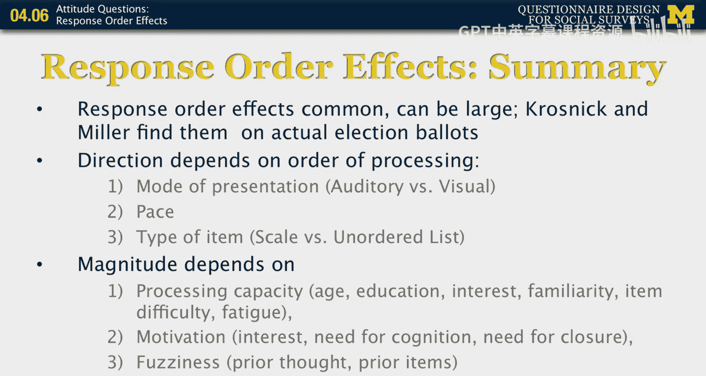

# 调查数据收集和分析：2-6：态度问题：顺序效应

## 📚 概述
在本节中，我们将探讨问卷设计中的一个重要现象：**回答顺序效应**。我们将了解什么是顺序效应，它如何影响调查结果，以及作为问卷设计者可以采取哪些措施来减轻其影响。

---

## 🔍 什么是顺序效应？
上一节我们介绍了态度问题的基本概念，本节中我们来看看回答选项的排列顺序如何影响受访者的选择。这种现象被称为**回答顺序效应**。

当受访者面对一个包含多个选项的列表时，选项在列表中出现的位置（靠前或靠后）可能会影响他们选择该选项的可能性。这并非只出现在态度问题中，也可能出现在事实性问题中，尽管在后者中可能不那么常见，因为人们对事实性问题的答案通常有更明确的认知。

---

## 📝 一个具体例子
以下是一个关于儿童品质的问题示例：
> “以下哪些品质是儿童最应该具备的？”（此问题适用于男孩和女孩）
> 1.  有礼貌
> 2.  努力尝试
> 3.  诚实
> 4.  整洁
> 5.  有良好的判断力
> 6.  有自控力
> （……以及其他一系列品质）

研究表明，当受访者在自填式问卷中面对这样一个长列表时，他们倾向于更频繁地选择列表**上半部分**的选项。

---

## 📊 顺序效应的类型与发现
为了验证这一效应，研究者进行了实验。他们将受访者随机分为两组：
*   **版本A**：获得如上所示的原始顺序列表。
*   **版本B**：获得顺序完全相反的列表。

在一项1987年的研究中，Krosnick、Alwin等人发现，无论列表是正序还是倒序，**位于列表顶部的选项被选中的概率都更高**。他们由此得出结论：这种效应并非源于选项内容本身，而是源于其位置。

更深入的发现是，这种**首因效应**（即优先选择靠前选项）主要出现在“低认知水平”的受访者群体中（例如，教育水平较低或在词汇测试中得分较低的人）。研究者认为，这部分群体更可能采用“**满意化**”策略进行回答，即一旦遇到一个可以接受的选项，就会停止搜索并选择它。

---

## 👁️🗨️ 呈现模式的影响
顺序效应的方向（是优先选前还是优先选后）很大程度上取决于选项的**呈现模式**：

*   **视觉呈现**（如纸质问卷、网页）：受访者的注意力可能在前几个选项后就变得分散，因此更可能选择**靠前**的选项，产生**首因效应**。
*   **听觉呈现**（如电话调查）：先听到的选项容易被后听到的选项覆盖，因此受访者更可能记住并选择**靠后**的选项，产生**近因效应**。

这里的关键区别在于信息是“看到”还是“听到”，而非广义的调查模式（如网络、电话）。

---

## 📈 元分析的关键发现
Holbrook等人于2007年进行了一项关于顺序效应的元分析，审查了超过500个实验。他们发现：
*   在电话调查中，**19.2%** 的实验显示出显著的**近因效应**。
*   仅有 **1.8%** 的实验显示出显著的**首因效应**。
*   平均效应大小为 **2.2%**（计算方式为：选择第二个选项的百分比减去选择第一个选项的百分比）。

以下是影响效应大小的主要因素：
*   **问题难度**：平均词长、每句词数、句子数量。
*   **回答选项的长度**。
*   **问题在问卷中的位置**。
*   **问题类型**：研究者将问题分为三类，发现：
    1.  **看似开放式问题**（如“你觉得克林顿总统是可信的还是危险的？”）：最不易受近因效应影响。
    2.  **延迟处理型问题**（如“以下哪项描述了你对克林顿总统的看法？[选项]”）：最容易受近因效应影响。
    3.  **看似是否问题**（如“你认为克林顿总统是可信的还是危险的？”）：效应介于两者之间。
*   **教育水平**：与高教育水平群体相比，**低教育水平群体**受顺序效应的影响更大。

---

## 🧠 受访者的回答行为
通过眼动追踪研究，我们可以观察到受访者处理选项列表的不同方式：

以下是几种典型的回答模式：
*   **最优决策者**：仔细阅读问题和所有选项，反复比较，最后做出选择。
*   **重新考虑者**：快速选择一个看似合适的选项（常是前几个），但继续阅读列表，可能会更改最初的选择。
*   **满意化者**：只阅读部分选项（通常是前半部分），遇到第一个可接受的选项后便停止阅读并做出选择。

---

## 🛡️ 如何减轻顺序效应？
作为问卷设计者，你可以采取以下策略来减轻顺序效应的影响：

**最理想的方法是随机化选项顺序。** 公式可以表示为：
`呈现给受访者i的选项顺序 = Randomize(选项列表)`

然而，并非所有情况都适合完全随机化（例如，选项本身有逻辑或时间顺序）。此时，可以考虑以下方法：
1.  **部分随机化**：如果无法完全随机化，至少可以创建两个版本（正序和倒序），并随机分配给受访者。
2.  **利用固有结构**：如果列表存在固有逻辑（如按字母顺序、时间顺序），这种预期中的顺序本身可能在一定程度上抵消随机顺序效应。
3.  **保持警惕**：在设计问卷时，始终意识到顺序效应可能存在的风险，特别是在设计长列表、难度较高的问题或针对特定人群时。

---

## 📖 总结
本节课中，我们一起学习了**回答顺序效应**这一关键概念。我们了解到：
1.  选项的排列顺序会系统性地影响受访者的选择，产生**首因效应**或**近因效应**。
2.  效应的方向和大小受多种因素影响，包括**呈现模式**（视觉/听觉）、**问题类型**、**问题难度**以及**受访者特征**（如教育水平）。
3.  通过观察受访者的回答行为，我们看到了“最优决策”、“重新考虑”和“满意化”等不同策略。
4.  作为设计者，**随机化选项顺序**是减轻该效应最有效的方法，同时需考虑问题的具体情境和约束。

理解并妥善处理顺序效应，对于收集高质量、无偏见的调查数据至关重要。